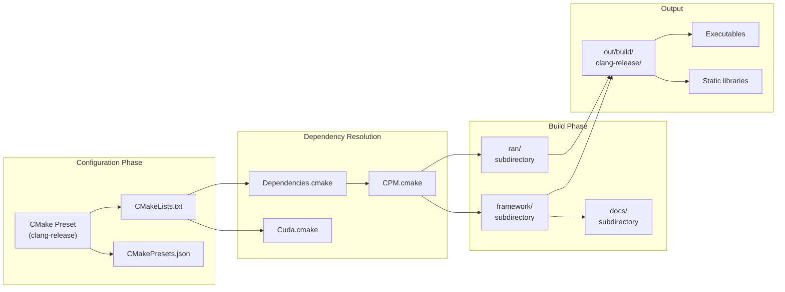

<!-- source: DeepWiki mcp.deepwiki.com · repo NVIDIA/aerial-framework · page 2 Getting Started · fetched 2026-10-26 -->

# Getting Started

<details>
<summary>Relevant source files</summary>

The following files were used as context for generating this wiki page:

- [CMakeLists.txt](CMakeLists.txt)
- [README.md](README.md)

</details>


## Purpose and Scope

This document provides an overview of prerequisites and the basic build workflow for the NVIDIA Aerial Framework. It covers hardware and software requirements, initial setup steps, and the commands needed to build the project for the first time.

For detailed instructions on setting up the containerized development environment and VSCode integration, see [Development Environment Setup](#2.1). For comprehensive information about build configurations, CMake presets, and compiler options, see [Building the Project](#2.2).

**Sources:** [README.md:1-178]()

---

## Prerequisites

### Hardware Requirements

The Aerial Framework has different hardware requirements depending on the target environment:

| Environment | GPU Requirement | Additional Hardware |
|-------------|----------------|---------------------|
| **Development** | NVIDIA GPU with [compute capability](https://developer.nvidia.com/cuda-gpus) ≥ 8.0 | None required |
| **Runtime** | NVIDIA GPU with compute capability ≥ 8.0 | NVIDIA NIC (ConnectX or BlueField), Real-time Linux kernel |

Development activities (prototyping, compilation, profiling) can be performed on any recent NVIDIA GPU. Runtime validation with network fronthaul requires additional hardware for DOCA GPUNetIO and deterministic scheduling.

**Sources:** [README.md:76-79]()

### Software Requirements

The framework requires the following software stack:

| Component | Version | Purpose |
|-----------|---------|---------|
| **CMake** | ≥ 3.23 | Build system generator |
| **C++ Compiler** | GCC or Clang with C++20 support | Core framework compilation |
| **CUDA Toolkit** | 12.9 | GPU kernel compilation |
| **Python** | ≥ 3.12 | Python packages and tooling |
| **uv** | Latest | Python package management |
| **Docker** | Latest | Containerized development environment |

The recommended approach is to use the provided Docker container, which includes all dependencies pre-configured. See [Development Environment Setup](#2.1) for container installation instructions.

**Sources:** [README.md:29](), [CMakeLists.txt:16-44]()

---

## Quick Start

The following commands demonstrate the basic workflow for building the Aerial Framework:

```bash
# 1. Configure the build using a CMake preset
cmake --preset clang-release

# 2. Build all targets
cmake --build out/build/clang-release

# 3. Install Python packages (example: RAN package)
cd ran/py && uv sync
```

### Build Configuration Flow



**Sources:** [README.md:130-139](), [CMakeLists.txt:1-112]()

---

## Build System Overview

The Aerial Framework uses CMake as its build system with a modular architecture that separates configuration, dependency management, and compilation.

### CMake Project Structure

```mermaid
graph TB
    subgraph "Root Configuration"
        Root["CMakeLists.txt<br/>[CMakeLists.txt:39-44]()"]
        Version["VERSION file<br/>(0.1.0)"]
        
        Root --> Version
    end
    
    subgraph "Configuration Modules"
        PreventInSource["PreventInSourceBuilds.cmake"]
        ProjectOptions["ProjectOptions.cmake<br/>setup_options()<br/>local_options()<br/>global_options()"]
        Dependencies["Dependencies.cmake<br/>setup_dependencies()"]
        
        Root --> PreventInSource
        Root --> ProjectOptions
        Root --> Dependencies
    end
    
    subgraph "CUDA Configuration"
        CudaCmake["Cuda.cmake<br/>check_cuda_architectures()"]
        
        Root --> CudaCmake
    end
    
    subgraph "Code Quality"
        Python["Python.cmake<br/>enable_static_analysis()"]
        Copyright["CopyrightTargets.cmake"]
        IncludeGuard["IncludeGuardTargets.cmake"]
        
        Root --> Python
        Root --> Copyright
        Root --> IncludeGuard
    end
    
    subgraph "Source Directories"
        ConfiguredFiles["cmake/configured_files/"]
        FrameworkDir["framework/<br/>[CMakeLists.txt:95]()"]
        RANDir["ran/<br/>[CMakeLists.txt:96]()"]
        DocsDir["docs/<br/>[CMakeLists.txt:102]()"]
        
        Root --> ConfiguredFiles
        Root --> FrameworkDir
        Root --> RANDir
        Root --> DocsDir
    end
    
    subgraph "Build Artifacts"
        Options["framework_options<br/>(interface library)"]
        Warnings["framework_warnings<br/>(interface library)"]
        
        ProjectOptions --> Options
        ProjectOptions --> Warnings
    end
```



The root [CMakeLists.txt:1-112]() orchestrates the build by:

1. **Setting global standards** - C++20 standard [CMakeLists.txt:19-25](), position-independent code [CMakeLists.txt:29]()
2. **Reading project version** - Extracted from [VERSION]() file [CMakeLists.txt:32-36]()
3. **Declaring project** - Named `framework` with CXX, C, ASM, and CUDA languages [CMakeLists.txt:39-44]()
4. **Validating CUDA** - Ensures CUDA architectures are properly set [CMakeLists.txt:47-48]()
5. **Setting up options** - Compiler flags, warnings, and project-specific options [CMakeLists.txt:51-57]()
6. **Resolving dependencies** - Fetches external libraries via CPM [CMakeLists.txt:59-60]()
7. **Adding subdirectories** - Builds framework, ran, and docs modules [CMakeLists.txt:95-102]()

**Sources:** [CMakeLists.txt:1-112]()

---

## Available Build Presets

The framework provides 12 CMake presets covering different compilers, build types, and sanitizer configurations:

| Preset Name | Compiler | Build Type | Sanitizers | Use Case |
|-------------|----------|------------|------------|----------|
| `gcc-debug` | GCC | Debug | None | Development with debugging symbols |
| `gcc-release` | GCC | Release | None | Production builds with GCC |
| `clang-debug` | Clang | Debug | None | Development with Clang toolchain |
| `clang-release` | Clang | Release | None | Production builds with Clang (recommended) |
| `clang-asan-debug` | Clang | Debug | AddressSanitizer | Detect memory errors |
| `clang-asan-release` | Clang | Release | AddressSanitizer | Memory error detection in optimized code |
| `clang-tsan-debug` | Clang | Debug | ThreadSanitizer | Detect data races |
| `clang-tsan-release` | Clang | Release | ThreadSanitizer | Race detection in optimized code |
| `clang-ubsan-debug` | Clang | Debug | UndefinedBehaviorSanitizer | Detect undefined behavior |
| `clang-ubsan-release` | Clang | Release | UndefinedBehaviorSanitizer | UB detection in optimized code |
| `clang-lsan-debug` | Clang | Debug | LeakSanitizer | Detect memory leaks |
| `clang-lsan-release` | Clang | Release | LeakSanitizer | Leak detection in optimized code |

The `clang-release` preset is recommended for production builds and performance testing. Sanitizer presets are valuable for debugging and validation. For detailed information on each preset, see [Build Presets and Configurations](#4.2).

**Sources:** [README.md:131-132]()

---

## Build Workflow Steps

### Step 1: Configure

The configuration step generates build files and resolves all dependencies:

```bash
cmake --preset clang-release
```

This command:
- Reads `CMakePresets.json` to load preset configuration
- Invokes [CMakeLists.txt:1-112]() to set up the build
- Executes `check_cuda_architectures()` from [Cuda.cmake]() to validate GPU targets
- Runs `setup_options()` from [ProjectOptions.cmake]() to configure compiler flags
- Executes `setup_dependencies()` from [Dependencies.cmake]() to fetch external libraries via CPM
- Generates build files in `out/build/clang-release/`

### Step 2: Build

The build step compiles all targets:

```bash
cmake --build out/build/clang-release
```

This compiles:
- **Core framework** - Libraries in `framework/` subdirectory [CMakeLists.txt:95]()
- **RAN components** - 5G/6G signal processing modules in `ran/` subdirectory [CMakeLists.txt:96]()
- **Documentation** - Generated docs in `docs/` subdirectory [CMakeLists.txt:102]()

Build artifacts are placed in `out/build/clang-release/` with executables, static libraries, and intermediate object files.

### Step 3: Python Package Installation

For Python-based development workflows, install Python packages using `uv`:

```bash
cd ran/py && uv sync
```

This installs the RAN Python package with all dependencies, enabling access to JAX-based signal processing algorithms and MLIR-TensorRT compilation tools.

**Sources:** [README.md:130-139](), [CMakeLists.txt:95-102]()

---

## Verification

After building, verify the setup by running tests:

```bash
# Run all tests
ctest --test-dir out/build/clang-release

# Run tests with verbose output
ctest --test-dir out/build/clang-release --verbose

# Run specific test
ctest --test-dir out/build/clang-release -R test_name
```

The test suite uses CTest integration [CMakeLists.txt:90]() and includes unit tests, benchmarks, and integration tests. For comprehensive information on testing, see [Testing and Benchmarking](#4.6).

**Sources:** [CMakeLists.txt:90]()

---

## Project Structure After Build

After a successful build, the project directory structure includes:

```
aerial-framework/
├── CMakeLists.txt           # Root build configuration
├── CMakePresets.json        # Build preset definitions
├── VERSION                  # Project version (0.1.0)
├── framework/               # Core framework source
├── ran/                     # RAN-specific modules
│   └── py/                  # Python packages
├── docs/                    # Documentation source
├── cmake/                   # CMake modules (20+)
│   ├── Dependencies.cmake   # External library management
│   ├── Cuda.cmake          # CUDA configuration
│   ├── ProjectOptions.cmake # Compiler options
│   └── ...
└── out/build/clang-release/ # Build output directory
    ├── framework/           # Compiled framework libraries
    ├── ran/                 # Compiled RAN binaries
    ├── CMakeCache.txt      # CMake configuration cache
    └── ...
```

**Sources:** [CMakeLists.txt:1-112]()

---

## Next Steps

After completing the initial build, proceed to:

1. **[Development Environment Setup](#2.1)** - Configure the Docker container, VSCode devcontainer, and IDE integration for a consistent development experience

2. **[Building the Project](#2.2)** - Learn about advanced build configurations, compiler options, and how to customize the build process

3. **[Framework Architecture](#3)** - Understand the two-tier architecture with developer tools and runtime engine

4. **[Development Workflow](#3.3)** - Follow the six-stage workflow from prototype to validation

5. **Tutorials** - Explore the [tutorial documentation](https://docs.nvidia.com/aerial/framework/latest/tutorials/index.html) to build and run example pipelines

**Sources:** [README.md:141-158]()

---

## Common Build Issues

### CUDA Architecture Not Set

If you encounter errors about CUDA architectures, the build system requires explicit GPU targets. This is validated by `check_cuda_architectures()` in [CMakeLists.txt:47-48](). Set the `CMAKE_CUDA_ARCHITECTURES` variable or let the build system auto-detect.

### Missing Dependencies

The [Dependencies.cmake]() module automatically fetches dependencies via CPM. If downloads fail, check network connectivity and proxy settings.

### Compiler Version

The project requires C++20 support [CMakeLists.txt:19-21](). Ensure your compiler supports this standard:
- GCC ≥ 10
- Clang ≥ 11

**Sources:** [CMakeLists.txt:16-48]()

---

