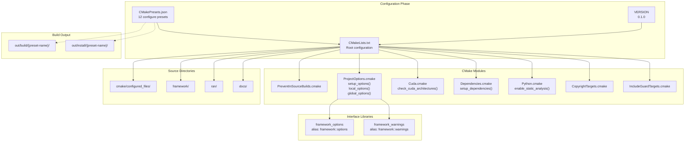
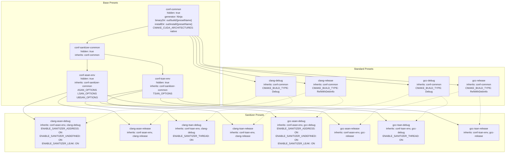
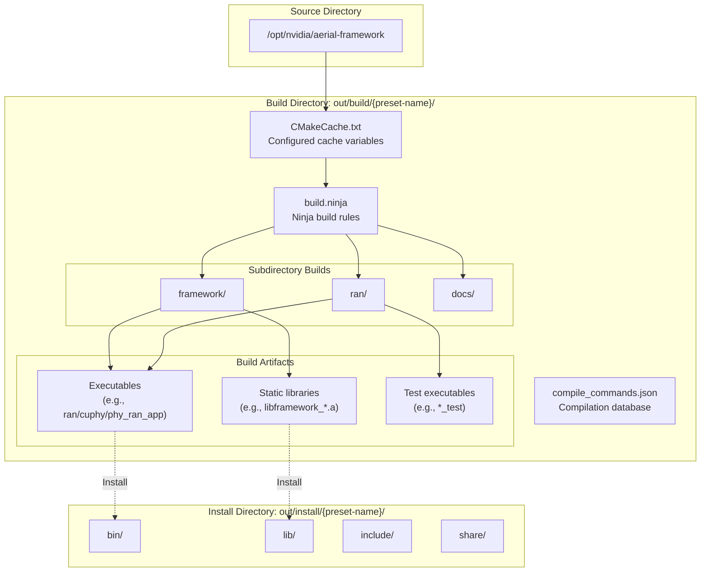

<!-- source: DeepWiki mcp.deepwiki.com · repo NVIDIA/aerial-framework · page 2.2 Building the Project · fetched 2026-10-26 -->

# Building the Project

<details>
<summary>Relevant source files</summary>

The following files were used as context for generating this wiki page:

- [CMakeLists.txt](CMakeLists.txt)
- [CMakePresets.json](CMakePresets.json)
- [README.md](README.md)

</details>


This page provides comprehensive instructions for building the NVIDIA Aerial Framework using CMake. It covers configuration presets, build types, sanitizer configurations, and common build options. For information about setting up the development environment and container, see [Development Environment Setup](#2.1). For details about the underlying CMake module architecture and dependency management, see [CMake Configuration](#4.1) and [Dependency Management with CPM](#4.3).

## Overview

The Aerial Framework uses CMake 3.23+ with a preset-based configuration system. The build system supports:
- Multiple compilers (GCC, Clang)
- Multiple build types (Debug, RelWithDebInfo)
- Sanitizer configurations (AddressSanitizer, ThreadSanitizer, UndefinedBehaviorSanitizer, LeakSanitizer)
- CUDA 12.9 with native GPU architecture detection
- C++20 standard with extensions disabled
- Ninja build generator for fast parallel builds

The project is organized into three main subdirectories that are built:
- `framework/` - Core framework components
- `ran/` - Radio Access Network implementations
- `docs/` - Documentation generation

Sources: [CMakeLists.txt:16-44](), [CMakePresets.json:1-32](), [README.md:126-139]()

## Build System Architecture



Sources: [CMakeLists.txt:16-112](), [CMakePresets.json:8-32]()

## Available Build Presets

The project defines 12 CMake configuration presets organized by compiler and build type. All presets use the Ninja generator and set `CMAKE_CUDA_ARCHITECTURES` to `native` for automatic GPU architecture detection.

### Standard Build Presets

| Preset Name | Compiler | Build Type | Description |
|-------------|----------|------------|-------------|
| `gcc-debug` | GCC | Debug | Debug symbols, no optimization (-g -O0) |
| `gcc-release` | GCC | RelWithDebInfo | Release with debug info (-O3 -g) |
| `clang-debug` | Clang | Debug | Debug symbols, no optimization (-g -O0) |
| `clang-release` | Clang | RelWithDebInfo | Release with debug info (-O3 -g) |

### Sanitizer Build Presets

| Preset Name | Compiler | Sanitizers | Environment Variables |
|-------------|----------|------------|----------------------|
| `clang-asan-debug` | Clang | ASan + UBSan + LSan | `ASAN_OPTIONS`, `LSAN_OPTIONS`, `UBSAN_OPTIONS` |
| `clang-asan-release` | Clang | ASan + UBSan + LSan | `ASAN_OPTIONS`, `LSAN_OPTIONS`, `UBSAN_OPTIONS` |
| `clang-tsan-debug` | Clang | TSan | `TSAN_OPTIONS` |
| `clang-tsan-release` | Clang | TSan | `TSAN_OPTIONS` |
| `gcc-asan-debug` | GCC | ASan + UBSan + LSan | `ASAN_OPTIONS`, `LSAN_OPTIONS`, `UBSAN_OPTIONS` |
| `gcc-asan-release` | GCC | ASan + UBSan + LSan | `ASAN_OPTIONS`, `LSAN_OPTIONS`, `UBSAN_OPTIONS` |
| `gcc-tsan-debug` | GCC | TSan | `TSAN_OPTIONS` |
| `gcc-tsan-release` | GCC | TSan | `TSAN_OPTIONS` |

Sources: [CMakePresets.json:8-182]()

## Preset Inheritance Structure



Sources: [CMakePresets.json:10-182]()

## Basic Build Workflow

### Step 1: Configure

Select a preset and configure the build:

```bash
cmake --preset clang-release
```

This command:
1. Reads configuration from [CMakePresets.json:1-288]()
2. Executes [CMakeLists.txt:16-112]() root configuration
3. Validates CUDA architectures via [Cuda.cmake]() module
4. Sets up compiler options through [ProjectOptions.cmake]()
5. Fetches dependencies via [Dependencies.cmake]()
6. Creates build directory at `out/build/clang-release/`

### Step 2: Build

Compile the configured project:

```bash
cmake --build out/build/clang-release
```

Or build specific targets:

```bash
cmake --build out/build/clang-release --target <target-name>
```

### Step 3: Run Tests

Execute the test suite using CTest:

```bash
ctest --preset clang-release
```

Test presets match configuration presets and include environment variables for GoogleTest and Google Benchmark color output and timing.

Sources: [README.md:130-139](), [CMakePresets.json:184-287]()

## Build Configuration Flow

```mermaid
graph LR
    subgraph "User Input"
        PresetCmd["cmake --preset clang-release"]
    end
    
    subgraph "CMakePresets.json Processing"
        LoadPreset["Load clang-release preset"]
        InheritConfCommon["Inherit from conf-common"]
        SetCompiler["Set CMAKE_CXX_COMPILER=clang++<br/>CMAKE_C_COMPILER=clang"]
        SetBuildType["Set CMAKE_BUILD_TYPE=RelWithDebInfo"]
        SetPaths["Set binaryDir: out/build/clang-release<br/>installDir: out/install/clang-release"]
        SetCuda["Set CMAKE_CUDA_ARCHITECTURES=native"]
        
        LoadPreset --> InheritConfCommon
        InheritConfCommon --> SetCompiler
        InheritConfCommon --> SetPaths
        InheritConfCommon --> SetCuda
        LoadPreset --> SetBuildType
    end
    
    subgraph "CMakeLists.txt Execution"
        ReadVersion["Read VERSION file<br/>Extract PROJECT_VERSION_BASE"]
        DeclareProject["project(framework<br/>VERSION {version}<br/>LANGUAGES CXX C ASM CUDA)"]
        CheckCuda["check_cuda_architectures()"]
        SetupOptions["setup_options()<br/>local_options()<br/>global_options()"]
        SetupDeps["setup_dependencies()"]
        EnableAnalysis["enable_static_analysis()"]
        AddSubdirs["add_subdirectory(framework)<br/>add_subdirectory(ran)<br/>add_subdirectory(docs)"]
        
        ReadVersion --> DeclareProject
        DeclareProject --> CheckCuda
        CheckCuda --> SetupOptions
        SetupOptions --> SetupDeps
        SetupDeps --> EnableAnalysis
        EnableAnalysis --> AddSubdirs
    end
    
    subgraph "Output"
        BuildFiles["Ninja build files<br/>in out/build/clang-release/"]
    end
    
    PresetCmd --> LoadPreset
    SetCuda --> ReadVersion
    AddSubdirs --> BuildFiles
```



Sources: [CMakeLists.txt:31-96](), [CMakePresets.json:56-75]()

## Build Types and Compiler Flags

### Debug Build Type

Debug builds (`CMAKE_BUILD_TYPE=Debug`) are configured with:
- Debug symbols enabled (`-g`)
- No optimization (`-O0`)
- Assertions enabled (no `-DNDEBUG`)
- Line info generation for profiling (`--generate-line-info` for CUDA)

Used by: `gcc-debug`, `clang-debug`, and all `-debug` sanitizer presets.

### RelWithDebInfo Build Type

Release with debug info builds (`CMAKE_BUILD_TYPE=RelWithDebInfo`) are configured with:
- Full optimization (`-O3`)
- Debug symbols enabled (`-g`)
- Assertions enabled (no `-DNDEBUG` by default)
- Suitable for profiling with Nsight Systems

Used by: `gcc-release`, `clang-release`, and all `-release` sanitizer presets.

Note: The project uses `RelWithDebInfo` instead of `Release` to retain debug symbols for profiling while maintaining release-level optimization.

Sources: [CMakePresets.json:34-75]()

## Sanitizer Configurations

### AddressSanitizer (ASan) + UndefinedBehaviorSanitizer (UBSan) + LeakSanitizer (LSan)

Detects memory errors, undefined behavior, and memory leaks. Enabled via:
- `ENABLE_SANITIZER_ADDRESS=ON`
- `ENABLE_SANITIZER_UNDEFINED=ON`
- `ENABLE_SANITIZER_LEAK=ON`

Environment variables configured in [CMakePresets.json:84-92]():
```bash
ASAN_OPTIONS="protect_shadow_gap=0:check_initialization_order=1:strict_init_order=1:print_stats=1:atexit=1"
LSAN_OPTIONS="print_stats=1:suppressions=${sourceDir}/tools/lsan_suppressions.txt"
UBSAN_OPTIONS="print_stats=1:halt_on_error=1:suppressions=${sourceDir}/tools/ubsan_suppressions.txt"
```

Available presets: `clang-asan-debug`, `clang-asan-release`, `gcc-asan-debug`, `gcc-asan-release`

### ThreadSanitizer (TSan)

Detects data races and threading issues. Enabled via:
- `ENABLE_SANITIZER_THREAD=ON`

Environment variables configured in [CMakePresets.json:95-101]():
```bash
TSAN_OPTIONS="print_stats=1:halt_on_error=1:suppressions=${sourceDir}/tools/tsan_suppressions.txt"
```

Available presets: `clang-tsan-debug`, `clang-tsan-release`, `gcc-tsan-debug`, `gcc-tsan-release`

**Note**: TSan is mutually exclusive with ASan/LSan. Do not enable both simultaneously.

Sources: [CMakePresets.json:78-182]()

## Common Build Options

The following CMake cache variables can be set to customize the build:

| Variable | Default | Description |
|----------|---------|-------------|
| `CMAKE_CXX_STANDARD` | `20` | C++ standard version |
| `CMAKE_CXX_EXTENSIONS` | `OFF` | Disable GNU extensions |
| `CMAKE_POSITION_INDEPENDENT_CODE` | `ON` | Enable PIC for all static libraries |
| `CMAKE_CUDA_ARCHITECTURES` | `native` | CUDA GPU architectures to target |
| `ENABLE_SANITIZER_ADDRESS` | `OFF` | Enable AddressSanitizer |
| `ENABLE_SANITIZER_LEAK` | `OFF` | Enable LeakSanitizer |
| `ENABLE_SANITIZER_UNDEFINED` | `OFF` | Enable UndefinedBehaviorSanitizer |
| `ENABLE_SANITIZER_THREAD` | `OFF` | Enable ThreadSanitizer |
| `ENABLE_IWYU` | `OFF` | Enable include-what-you-use analysis |
| `BUILD_DOCS` | Varies | Build documentation with Doxygen/Sphinx |
| `ENFORCE_DOCSTRINGS` | Varies | Fail build on missing docstrings |
| `CMAKE_SKIP_INSTALL_RULES` | `OFF` | Skip install rule generation |

### Setting Custom Options

Override options via command line:

```bash
cmake --preset clang-release -DCMAKE_CUDA_ARCHITECTURES="80;89" -DENABLE_IWYU=ON
```

Or create a `CMakeUserPresets.json` file for persistent local settings:

```json
{
    "version": 3,
    "configurePresets": [
        {
            "name": "my-custom",
            "inherits": "clang-release",
            "cacheVariables": {
                "CMAKE_CUDA_ARCHITECTURES": "80;89",
                "BUILD_DOCS": "ON"
            }
        }
    ]
}
```

Sources: [CMakeLists.txt:18-29](), [CMakePresets.json:16-18]()

## Build Output Structure



Sources: [CMakePresets.json:14-15](), [CMakeLists.txt:95-96]()

## Common Build Targets

### Primary Targets

The build system automatically creates targets for all source subdirectories:

- **All** - Default target, builds everything
  ```bash
  cmake --build out/build/clang-release
  ```

- **framework** - Build framework libraries only
  ```bash
  cmake --build out/build/clang-release --target framework
  ```

- **ran** - Build RAN components
  ```bash
  cmake --build out/build/clang-release --target ran
  ```

### Code Quality Targets

Defined in [CopyrightTargets.cmake]() and [IncludeGuardTargets.cmake]():

- **check-copyright** - Verify SPDX copyright headers
  ```bash
  cmake --build out/build/clang-release --target check-copyright
  ```

- **fix-copyright** - Automatically fix copyright headers
  ```bash
  cmake --build out/build/clang-release --target fix-copyright
  ```

- **check-include-guards** - Verify include guard format
  ```bash
  cmake --build out/build/clang-release --target check-include-guards
  ```

- **fix-include-guards** - Automatically fix include guards
  ```bash
  cmake --build out/build/clang-release --target fix-include-guards
  ```

### Documentation Targets

Defined in [docs/]() subdirectory:

- **docs** - Build all documentation (Doxygen + Sphinx)
  ```bash
  cmake --build out/build/clang-release --target docs
  ```

- **check-docstrings** - Verify docstring presence and format
  ```bash
  cmake --build out/build/clang-release --target check-docstrings
  ```

### Testing Targets

Test executables are automatically registered with CTest. Run all tests:

```bash
ctest --preset clang-release
```

Run specific test patterns:

```bash
ctest --preset clang-release -R "framework"
```

Sources: [CMakeLists.txt:69-102]()

## Running Tests

### Test Preset Configuration

Each configure preset has a matching test preset that inherits common test settings from `test-common` [CMakePresets.json:184-202]():

```json
{
    "output": {
        "outputOnFailure": true,
        "verbosity": "verbose"
    },
    "execution": {
        "noTestsAction": "error",
        "stopOnFailure": true
    },
    "environment": {
        "BENCHMARK_COLOR": "1",
        "GTEST_COLOR": "1",
        "GTEST_PRINT_TIME": "1"
    }
}
```

### Test Execution Examples

Run all tests for a preset:
```bash
ctest --preset clang-release
```

Run tests with verbose output:
```bash
ctest --preset clang-release --verbose
```

Run only tests matching a pattern:
```bash
ctest --preset clang-release -R "^framework_"
```

Run tests in parallel (4 jobs):
```bash
ctest --preset clang-release -j4
```

Re-run only failed tests:
```bash
ctest --preset clang-release --rerun-failed
```

Sources: [CMakePresets.json:184-287]()

## Compiler Selection and Caching

### Compiler Specification

Compilers are specified in preset cache variables [CMakePresets.json:38-42](), [CMakePresets.json:60-64]():

```json
"cacheVariables": {
    "CMAKE_C_COMPILER": "gcc",
    "CMAKE_CXX_COMPILER": "g++",
    "CMAKE_BUILD_TYPE": "Debug"
}
```

The CUDA compiler (`nvcc`) is automatically detected by CMake when `CUDA` is listed in `project()` languages [CMakeLists.txt:44]().

### Compiler Caching

The build system supports compiler caching with `ccache` or `sccache` for faster incremental builds. This is configured through the [ProjectOptions.cmake]() module. See [Compiler Caching](#7.3) for details.

Sources: [CMakeLists.txt:39-44](), [CMakePresets.json:38-75]()

## CUDA Architecture Configuration

### Native Architecture Detection

By default, all presets set `CMAKE_CUDA_ARCHITECTURES` to `native` [CMakePresets.json:17]():

```json
"cacheVariables": {
    "CMAKE_CUDA_ARCHITECTURES": "native"
}
```

This auto-detects the GPU architecture of the system during configuration. The [Cuda.cmake]() module validates that CUDA architectures are properly set via `check_cuda_architectures()` [CMakeLists.txt:47-48]().

### Explicit Architecture Targeting

Override for specific architectures:

```bash
# Target Ampere (compute capability 8.0) and Ada Lovelace (8.9)
cmake --preset clang-release -DCMAKE_CUDA_ARCHITECTURES="80;89"

# Target only Hopper (compute capability 9.0)
cmake --preset clang-release -DCMAKE_CUDA_ARCHITECTURES="90"
```

Common NVIDIA GPU architectures:
- `75` - Turing (T4)
- `80` - Ampere (A100)
- `86` - Ampere (RTX 30xx)
- `89` - Ada Lovelace (RTX 40xx, L40S)
- `90` - Hopper (H100)

Sources: [CMakePresets.json:16-18](), [CMakeLists.txt:46-48]()

## Python Environment Integration

The project includes Python components that can be installed after building the C++/CUDA framework. The [Python.cmake]() module is loaded [CMakeLists.txt:62]() to enable static analysis tools.

### Installing Python Packages

After building the framework, install the RAN Python package:

```bash
cd ran/py && uv sync
```

This uses `uv` (ultra-fast Python package installer) to set up the Python environment with all dependencies.

Sources: [README.md:137-139](), [CMakeLists.txt:62-63]()

## Troubleshooting Build Issues

### CUDA Architecture Not Set

**Error**: "CMake Error: CMAKE_CUDA_ARCHITECTURES must be set"

**Solution**: Ensure you're using a preset or explicitly set:
```bash
cmake --preset clang-release  # Uses native
# OR
cmake -S . -B build -DCMAKE_CUDA_ARCHITECTURES=native
```

### Out-of-Source Build Violation

**Error**: "In-source builds not allowed"

**Solution**: The project enforces out-of-source builds via [PreventInSourceBuilds.cmake]() [CMakeLists.txt:50](). Always build in a separate directory (presets automatically use `out/build/{preset-name}/`).

### Sanitizer Conflicts

**Error**: Crashes or conflicts when running sanitizer builds

**Solution**: 
- Do not mix TSan with ASan/LSan (they are mutually exclusive)
- Use only one sanitizer preset at a time
- Check suppression files in `tools/*_suppressions.txt`

### Missing Dependencies

**Error**: "Could not find package XYZ"

**Solution**: Dependencies are automatically fetched via CPM in [Dependencies.cmake](). Ensure:
- Internet connection is available for first-time builds
- CPM cache directory is writable
- See [Dependency Management with CPM](#4.3) for details

### Compilation Warnings as Errors

**Error**: Build fails on warnings

**Solution**: The project treats warnings as errors by default (configured in [CompilerWarnings.cmake]()). Either fix the warnings or temporarily disable with:
```bash
cmake --preset clang-release -DWARNINGS_AS_ERRORS=OFF
```

Sources: [CMakeLists.txt:50-60]()

## Build System Variables

### Version Information

The project version is read from the `VERSION` file [CMakeLists.txt:31-36]():

```cmake
file(STRINGS "${CMAKE_SOURCE_DIR}/VERSION" PROJECT_VERSION_FULL)
string(STRIP "${PROJECT_VERSION_FULL}" PROJECT_VERSION_FULL)
string(REGEX MATCH "^[0-9]+\\.[0-9]+\\.[0-9]+" PROJECT_VERSION_BASE "${PROJECT_VERSION_FULL}")
```

The full version (e.g., `0.1.0-rc.3`) is stored in `PROJECT_VERSION_FULL`, while the base version (e.g., `0.1.0`) is used for CMake's `project(VERSION)`.

### Git Information

Git SHA information is captured [CMakeLists.txt:79-82]():

```cmake
set(GIT_SHA "Unknown" CACHE STRING "SHA this build was generated from")
string(SUBSTRING "${GIT_SHA}" 0 8 GIT_SHORT_SHA)
```

This is typically set by CI/CD systems or can be manually specified:
```bash
cmake --preset clang-release -DGIT_SHA=$(git rev-parse HEAD)
```

### Position Independent Code

Position-independent code is enabled globally [CMakeLists.txt:27-29]():

```cmake
# Enable position-independent code globally for all static libraries
# Required for CUDA device linking and potential shared library usage
set(CMAKE_POSITION_INDEPENDENT_CODE ON)
```

This is required for CUDA device linking and future shared library support.

Sources: [CMakeLists.txt:27-82]()

---

