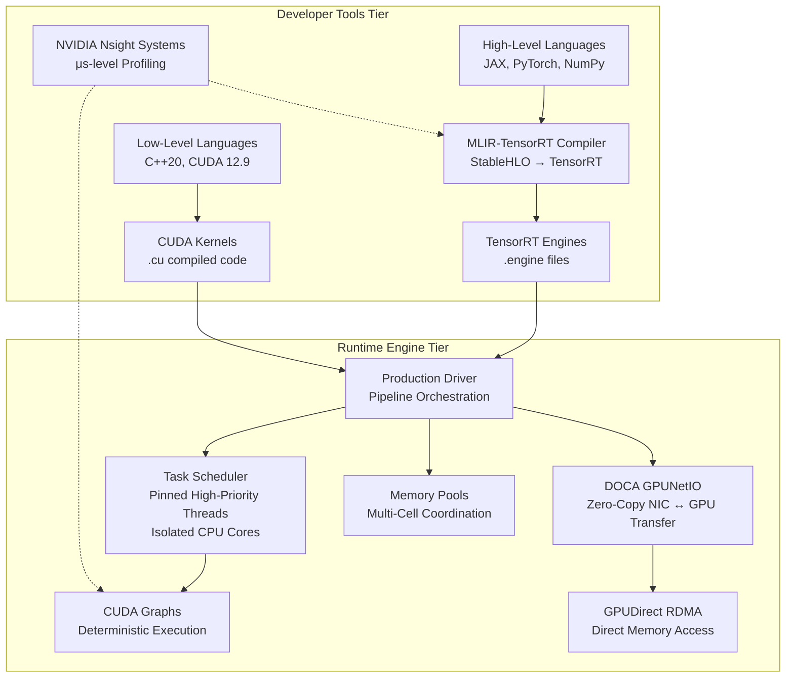
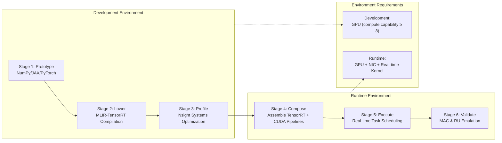
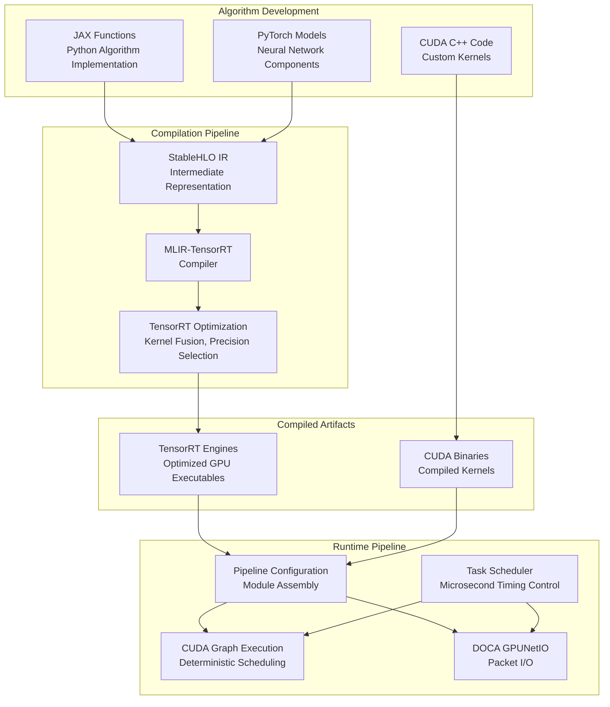

<!-- source: DeepWiki mcp.deepwiki.com · repo NVIDIA/aerial-framework · page 3 Framework Architecture · fetched 2026-10-26 -->

# Framework Architecture

Relevant source files

The following files were used as context for generating this wiki page:

- [README.md](README.md)

## Purpose and Scope

This document provides a comprehensive overview of the NVIDIA Aerial Framework's architecture, explaining its two-tier design and the development workflow that bridges algorithm development to real-time execution. The framework is designed to meet the microsecond-latency requirements of 3GPP Radio Access Networks while maintaining developer productivity.

For detailed information about specific components:
- Developer tools (JAX/PyTorch compilation, MLIR-TensorRT, profiling) are covered in [Developer Tools](#3.1)
- Runtime components (CUDA graphs, task scheduler, DOCA GPUNetIO) are detailed in [Runtime Engine](#3.2)
- The six-stage development workflow is explained in [Development Workflow](#3.3)

For build system configuration and project setup, see [Build System](#4).

**Sources:** [README.md:1-178]()

## Overview

The Aerial Framework addresses the fundamental challenge of 3GPP RAN signal processing: achieving microsecond-level latency while maintaining developer productivity. It accomplishes this through a two-tier architecture that cleanly separates algorithm development from runtime execution.

The framework combines:
1. **Developer Tools** - Tools to convert Python/JAX/PyTorch and C++/CUDA into pipelines of GPU-native code
2. **Runtime Engine** - Coordinates the execution of GPU pipelines with network interfaces

This separation allows developers to prototype algorithms in high-level languages (Python, JAX, PyTorch) and then compile them to optimized GPU code that executes with deterministic, real-time performance.

**Sources:** [README.md:46-61]()

## Two-Tier Architecture

**Diagram: Two-Tier Architecture Components**

The framework's architecture consists of two distinct tiers that work together to enable the development-to-deployment workflow:

### Developer Tools Tier

The Developer Tools tier provides the environment for algorithm development and optimization. It supports:

- **Multi-language development**: Algorithms can be authored in high-level languages (JAX, PyTorch, NumPy) or low-level languages (C++20, CUDA 12.9)
- **JAX → TensorRT compilation**: JAX programs are exported to StableHLO intermediate representation and lowered to TensorRT engines using the MLIR-TensorRT compiler
- **Performance profiling**: NVIDIA Nsight Systems provides microsecond-level profiling capabilities for optimization
- **AI-native integration**: Seamless integration with AI frameworks enables end-to-end differentiability

The output of this tier consists of compiled TensorRT engines (`.engine` files) and CUDA kernels that can be deployed to the runtime environment.

**Sources:** [README.md:50-55]()

### Runtime Engine Tier

The Runtime Engine tier provides deterministic, real-time execution of compiled pipelines. It consists of:

- **Production Driver**: Orchestrates pipeline execution, manages memory pools, and coordinates multi-cell operations
- **Task Scheduler**: Manages pinned, high-priority threads on isolated CPU cores to enforce microsecond slot timing
- **CUDA Graphs**: GPU operations execute as CUDA graphs with TensorRT integration for deterministic execution
- **DOCA GPUNetIO**: Provides inline GPU networking with zero-copy packet transfer between NIC and GPU
- **GPUDirect RDMA**: Enables direct memory access between network interface and GPU memory

This tier is designed to meet the strict latency requirements of 3GPP RAN workloads, with execution timing controlled at the microsecond level.

**Sources:** [README.md:56-61]()

## Development and Runtime Environments

**Diagram: Development and Runtime Environment Separation**

The Aerial Framework distinguishes between two operational environments:

### Development Environment

The Development environment is designed for algorithm prototyping and optimization. It requires:
- GPU with compute capability ≥ 8.0
- Standard Linux system (real-time kernel not required)

This environment is accessible to any developer with a recent NVIDIA GPU and supports the first three workflow stages: Prototype, Lower, and Profile.

### Runtime Environment

The Runtime environment is designed for deployment and validation. It requires:
- GPU with compute capability ≥ 8.0
- High-performance NIC (for DOCA GPUNetIO)
- Real-time Linux kernel (for deterministic scheduling)
- MAC and RU emulators (for PHY validation)

This environment supports the final three workflow stages: Compose, Execute, and Validate.

**Sources:** [README.md:74-124]()

## Six-Stage Development Workflow

The framework provides a six-stage workflow that bridges development productivity with runtime performance:

| Stage | Description | Environment | Input | Output |
|-------|-------------|-------------|-------|--------|
| **Prototype** | Write and validate algorithms in high-level languages | Development | Algorithm requirements | NumPy/JAX/PyTorch implementation |
| **Lower** | Compile Python code into GPU executables | Development | JAX/PyTorch functions | TensorRT engines, CUDA kernels |
| **Profile** | Optimize performance with profiling tools | Development | Compiled code | Performance metrics, optimizations |
| **Compose** | Assemble engines and kernels into modular pipelines | Runtime | TensorRT engines, CUDA kernels | Pipeline configuration |
| **Execute** | Run with real-time task scheduling and networking | Runtime | Pipeline configuration | Live execution |
| **Validate** | Test PHY applications with MAC/RU emulators | Runtime | Complete pipeline | Standards-compliant validation |

**Table: Six-Stage Development Workflow**

This workflow bridges:
- **Development Productivity**: Write in high-level languages with rich ecosystems
- **Runtime Performance**: Execute with the speed and determinism of optimized C++
- **Low Latency Requirements**: Meet strict timing and latency constraints for 3GPP RAN

For detailed explanations of each stage, see [Development Workflow](#3.3).

**Sources:** [README.md:82-124]()

## Pipeline Composition and Execution

**Diagram: Pipeline Composition from Algorithm to Runtime Execution**

### Algorithm-to-Runtime Flow

The framework enables a structured flow from algorithm development to runtime execution:

1. **Algorithm Development**: Algorithms are implemented in JAX, PyTorch, or CUDA C++
2. **Compilation**: JAX and PyTorch code is lowered to StableHLO, then compiled through MLIR-TensorRT to produce optimized TensorRT engines. CUDA C++ is compiled directly to binaries.
3. **Compiled Artifacts**: The result is a collection of TensorRT engines and CUDA binaries that can be deployed
4. **Runtime Pipeline**: The production driver assembles these compiled artifacts into pipelines, which execute through CUDA graphs with deterministic scheduling and DOCA GPUNetIO for networking

This architecture ensures that the same codebase can be used for prototyping, simulation, testing, and deployment, with clean separation between algorithm logic and runtime execution details.

**Sources:** [README.md:46-61](), [README.md:82-124]()

## Integration with NVIDIA Technologies

The framework integrates deeply with NVIDIA's technology stack:

- **CUDA 12.9**: Provides the GPU computing foundation with support for CUDA graphs and deterministic execution
- **TensorRT**: Inference optimization engine that executes compiled neural network components
- **MLIR-TensorRT**: Compiler infrastructure that lowers StableHLO to TensorRT engines
- **DOCA GPUNetIO**: GPU-native networking stack enabling zero-copy packet transfer
- **GPUDirect RDMA**: Direct memory access between network adapters and GPU memory
- **Nsight Systems**: Profiling tool providing microsecond-level performance analysis

These technologies are integrated through the build system. For details on dependency management, see [Dependencies and Integration](#5) and [NVIDIA Technologies](#5.1).

**Sources:** [README.md:1-11](), [README.md:19](), [README.md:50-61]()

## Target Applications

The framework is designed for 3GPP Radio Access Networks with specific focus on:

- **5G Advanced (5G-A)**: Current generation standards requiring microsecond-level latency
- **6G networks**: Future generation standards with AI-native processing requirements
- **Signal processing workloads**: Applications with strict latency constraints and high throughput requirements

The repository includes an example AI-native PUSCH (Physical Uplink Shared Channel) pipeline demonstrating the framework's capabilities for real-time PHY processing.

**Sources:** [README.md:14](), [README.md:32]()

## Key Architectural Characteristics

The framework's architecture is characterized by:

1. **Clean Separation**: Algorithm development is decoupled from runtime execution, allowing independent optimization of each
2. **Modular Pipelines**: End-to-end pipelines are composed from compiled, executable modules
3. **Deterministic Execution**: CUDA graphs and task scheduling ensure predictable, microsecond-level timing
4. **Zero-Copy Data Paths**: DOCA GPUNetIO and GPUDirect RDMA eliminate CPU memory copies
5. **Observability**: Built-in hooks for profiling and monitoring throughout the development process
6. **Unified Codebase**: The same components are reused across prototyping, simulation, testing, and deployment

These characteristics enable the framework to meet the stringent requirements of real-time signal processing while maintaining developer productivity.

**Sources:** [README.md:24-32]()

---

