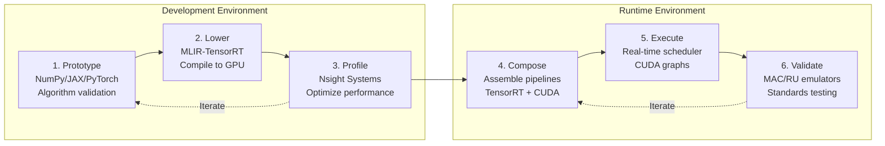
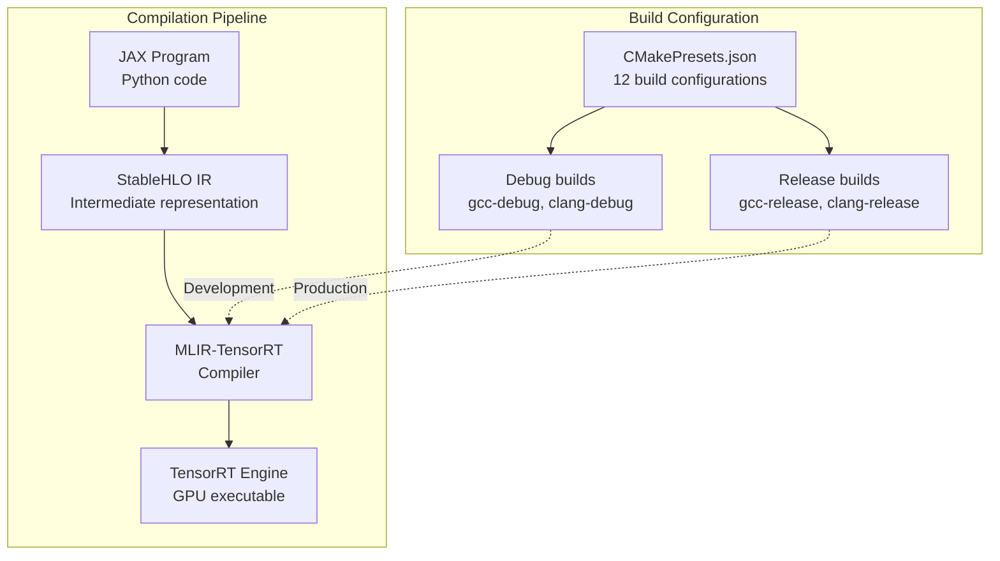
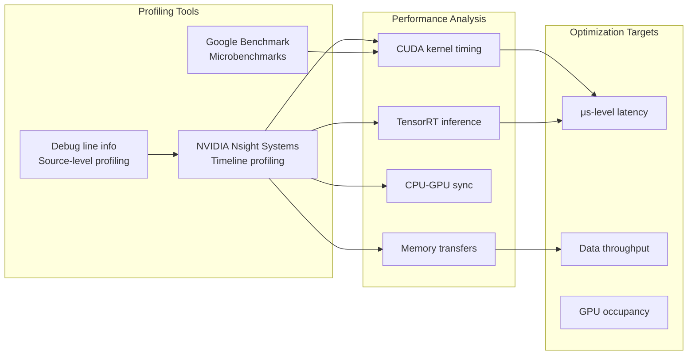
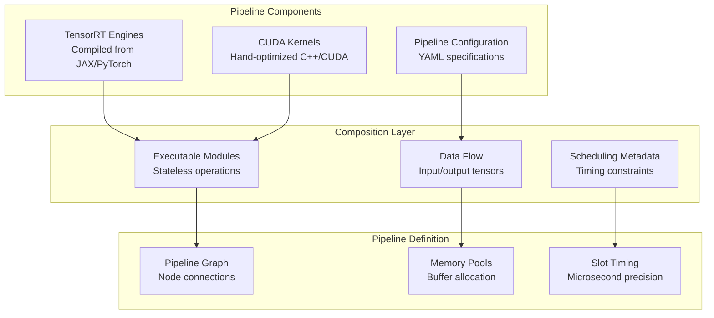
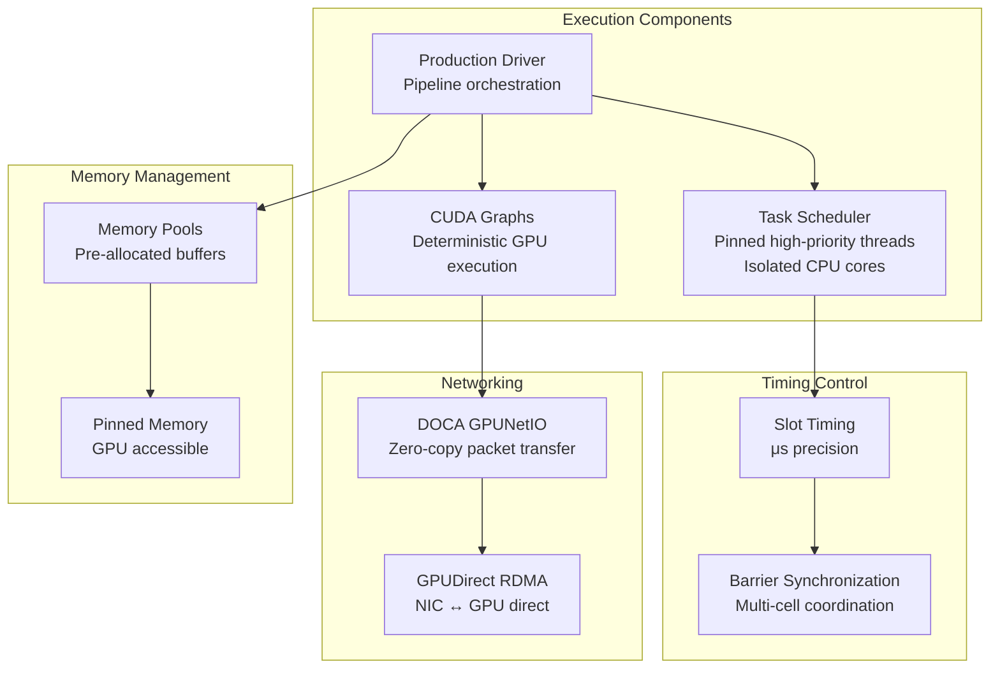
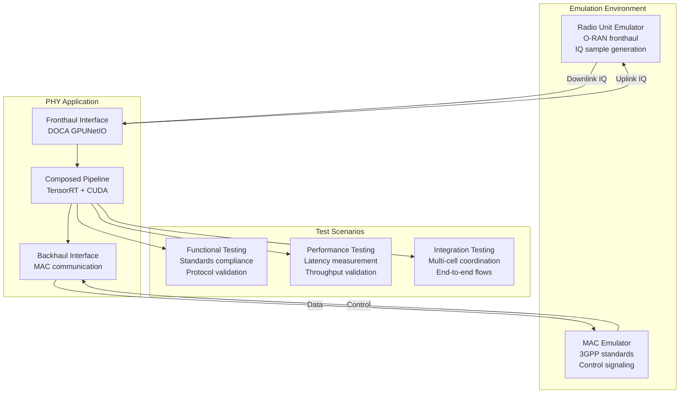
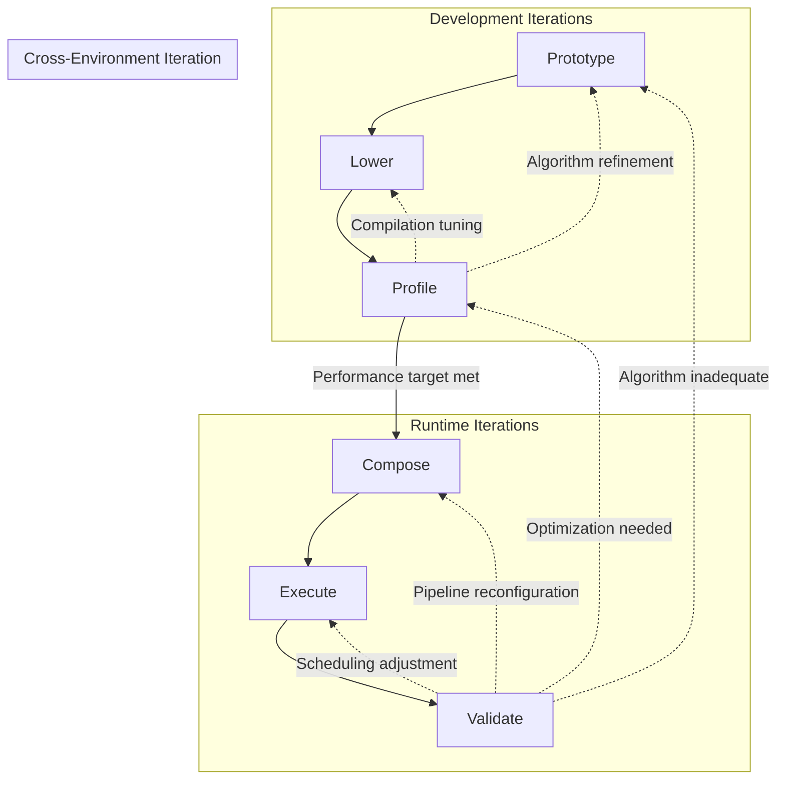

<!-- source: DeepWiki mcp.deepwiki.com · repo NVIDIA/aerial-framework · page 3.3 Development Workflow · fetched 2026-10-26 -->

# Development Workflow

<details>
<summary>Relevant source files</summary>

The following files were used as context for generating this wiki page:

- [CMakePresets.json](CMakePresets.json)
- [README.md](README.md)

</details>


## Purpose and Scope

This page documents the six-stage development workflow of the NVIDIA Aerial Framework, which bridges algorithm prototyping to production deployment for real-time signal processing applications. The workflow separates concerns between **Development** (prototype, lower, profile) and **Runtime** (compose, execute, validate) environments, enabling developers to iterate on algorithms in high-level languages while meeting microsecond-level latency requirements in production.

For detailed information about the tools used during development stages, see [Developer Tools](#3.1). For runtime execution mechanics, see [Runtime Engine](#3.2). For build system configuration supporting this workflow, see [Build System](#4).

**Sources:** [README.md:63-124]()

---

## Workflow Overview

The Aerial Framework workflow consists of six stages organized into two environments:



**Workflow Stages and Their Purposes:**

| Stage | Environment | Description | Primary Tools |
|-------|-------------|-------------|---------------|
| Prototype | Development | Write and validate algorithms | NumPy, JAX, PyTorch, Jupyter |
| Lower | Development | Compile to GPU executables | MLIR-TensorRT, StableHLO |
| Profile | Development | Optimize performance | Nsight Systems, benchmarks |
| Compose | Runtime | Assemble modular pipelines | TensorRT engines, CUDA kernels |
| Execute | Runtime | Run with real-time scheduling | CUDA graphs, task scheduler |
| Validate | Runtime | Test with standards compliance | MAC emulator, RU emulator |

**Sources:** [README.md:82-118]()

---

## Development Environment

The development environment supports algorithm creation and optimization without requiring specialized hardware beyond a modern GPU (compute capability ≥ 8). Developers work in high-level languages and use compilation tools to generate optimized GPU code.

### Stage 1: Prototype

**Purpose:** Rapidly develop and validate signal processing algorithms using high-level Python frameworks with rich scientific computing ecosystems.

**Key Activities:**
- Implement algorithms in NumPy/JAX/PyTorch
- Validate correctness with test vectors
- Explore design alternatives
- Develop in Jupyter notebooks for interactive iteration

**Example Workflow:**
1. Define algorithm in NumPy for clarity
2. Port to JAX for GPU acceleration and automatic differentiation
3. Validate numerical accuracy against reference implementations
4. Iterate on algorithm design

The framework provides example prototypes in Jupyter notebooks located in the repository tutorials. For instance, the PUSCH receiver tutorial demonstrates prototyping a complete receiver chain in NumPy before lowering to GPU.

**Hardware Requirements:**
- Modern NVIDIA GPU (compute capability ≥ 8)
- No specialized networking hardware required
- Standard development workstation

**Sources:** [README.md:76-77](), [README.md:90-94](), [README.md:148-158]()

---

### Stage 2: Lower

**Purpose:** Compile high-level Python code (JAX/PyTorch) into optimized TensorRT engines that can execute on GPU with deterministic performance.



**Compilation Process:**
1. **Export to StableHLO:** JAX programs are exported to StableHLO intermediate representation
2. **Lower to TensorRT:** MLIR-TensorRT compiler transforms StableHLO to TensorRT operations
3. **Engine Generation:** TensorRT generates optimized execution engines specific to target GPU architecture
4. **Serialization:** Engines can be serialized for deployment

**Build Configurations:**
The framework supports multiple build presets for different compilation scenarios defined in [CMakePresets.json:8-183]():

**Standard Builds:**
- `gcc-debug` - GCC compiler with debug symbols (`-g -O0`)
- `gcc-release` - GCC compiler optimized (`-O3 -DNDEBUG`) with debug info
- `clang-debug` - Clang compiler with debug symbols
- `clang-release` - Clang compiler optimized with debug info

**GPU Architecture Selection:**
The preset configuration uses `CMAKE_CUDA_ARCHITECTURES: native` to automatically detect and target the GPU present on the build system [CMakePresets.json:17]().

**Typical Build Commands:**
```bash
# Configure for release build with clang
cmake --preset clang-release

# Build TensorRT engines and framework
cmake --build out/build/clang-release

# Install Python packages
cd ran/py && uv sync
```

**Sources:** [README.md:51-52](), [README.md:95-98](), [CMakePresets.json:8-183](), [README.md:131-139]()

---

### Stage 3: Profile

**Purpose:** Optimize algorithm performance using microsecond-level profiling tools to identify bottlenecks and ensure real-time requirements can be met.



**Profiling Workflow:**

1. **Enable Debug Information:**
   - Debug builds generate line-level profiling information
   - Use `clang-debug` or `gcc-debug` presets for development profiling

2. **Run Nsight Systems:**
   - Capture timeline traces showing CUDA operations
   - Analyze kernel execution times
   - Identify CPU-GPU synchronization points
   - Measure TensorRT engine inference times

3. **Benchmark Microkernels:**
   - Use Google Benchmark for repeatable measurements
   - Output JSON results for analysis
   - Compare different algorithm implementations

4. **Iterate on Optimization:**
   - Return to Prototype stage to refine algorithms
   - Modify kernel implementations
   - Adjust memory access patterns
   - Re-lower and re-profile

**Build Support for Profiling:**
The framework's CMake configuration includes dedicated support for benchmarking [CMakePresets.json:184-287](). Test presets ensure profiling tools are properly configured with environment variables for colored output and timing information.

**Test Preset Configuration:**
- `BENCHMARK_COLOR: 1` - Enable colored benchmark output
- `GTEST_COLOR: 1` - Enable colored test output  
- `GTEST_PRINT_TIME: 1` - Show timing for tests

**Sources:** [README.md:53](), [README.md:99-102](), [CMakePresets.json:197-201]()

---

## Runtime Environment

The runtime environment requires specialized hardware (GPU with DOCA-capable NIC) and real-time kernel configuration to execute pipelines with deterministic microsecond-level latency. This environment is where compiled TensorRT engines and CUDA kernels are assembled into production pipelines.

### Stage 4: Compose

**Purpose:** Assemble compiled TensorRT engines and hand-optimized CUDA kernels into modular, reusable pipelines that can be orchestrated by the runtime driver.



**Composition Process:**

1. **Modular Design:**
   - Each processing stage becomes an executable module
   - Modules expose standardized input/output interfaces
   - Stateless design enables parallel execution

2. **Pipeline Configuration:**
   - Define module connections in YAML or programmatic APIs
   - Specify memory allocation strategies
   - Configure timing constraints for real-time execution

3. **Integration Points:**
   - TensorRT engines integrate as opaque execution nodes
   - CUDA kernels interface through tensor APIs
   - Mix AI inference with traditional signal processing

4. **Testing:**
   - Unit test individual modules
   - Integration test pipeline assemblies
   - Validate data flow correctness

**Build Configurations for Testing:**
The framework provides sanitizer-enabled builds to validate composition correctness:

- `clang-asan-debug` / `clang-asan-release` - AddressSanitizer, UndefinedBehaviorSanitizer, LeakSanitizer [CMakePresets.json:104-124]()
- `clang-tsan-debug` / `clang-tsan-release` - ThreadSanitizer [CMakePresets.json:126-142]()
- `gcc-asan-debug` / `gcc-asan-release` - GCC with ASan/UBSan/LSan [CMakePresets.json:144-164]()
- `gcc-tsan-debug` / `gcc-tsan-release` - GCC with TSan [CMakePresets.json:166-182]()

**Sanitizer Environment Variables:**
- `ASAN_OPTIONS` - AddressSanitizer configuration [CMakePresets.json:89]()
- `LSAN_OPTIONS` - LeakSanitizer suppressions [CMakePresets.json:90]()
- `UBSAN_OPTIONS` - UndefinedBehaviorSanitizer settings [CMakePresets.json:91]()
- `TSAN_OPTIONS` - ThreadSanitizer configuration [CMakePresets.json:100]()

**Sources:** [README.md:105-107](), [CMakePresets.json:78-182]()

---

### Stage 5: Execute

**Purpose:** Run assembled pipelines with deterministic, microsecond-level task scheduling and GPU-native networking to meet real-time latency requirements.



**Execution Architecture:**

1. **Task Scheduler:**
   - Pinned threads on isolated CPU cores
   - High-priority scheduling (CAP_SYS_NICE capability)
   - Microsecond-level slot timing enforcement
   - Minimal jitter through real-time kernel support

2. **CUDA Graphs:**
   - Pre-recorded GPU operation sequences
   - Deterministic execution times
   - Reduced kernel launch overhead
   - Integration with TensorRT engine execution

3. **GPU-Native Networking:**
   - DOCA GPUNetIO for zero-copy packet I/O
   - GPUDirect RDMA eliminates CPU memory copies
   - Packets flow directly: NIC ↔ GPU memory
   - Fronthaul interface (O-RAN) support

4. **Memory Management:**
   - Pre-allocated memory pools
   - GPU-accessible pinned memory
   - Minimal allocation during execution
   - Buffer recycling for sustained throughput

**Test Preset Execution:**
Tests can be executed using matching test presets [CMakePresets.json:184-287]():

```bash
# Run tests for release build
ctest --preset clang-release

# Run with sanitizers
ctest --preset clang-asan-debug
```

**Test Configuration:**
- `outputOnFailure: true` - Display output for failed tests
- `noTestsAction: error` - Fail if no tests found
- `stopOnFailure: true` - Stop at first failure

**Sources:** [README.md:57-60](), [README.md:108-111](), [CMakePresets.json:184-287]()

---

### Stage 6: Validate

**Purpose:** Test complete Physical Layer (PHY) applications against standards-compliant emulators to verify functional correctness and latency requirements.



**Validation Components:**

1. **Radio Unit (RU) Emulator:**
   - Generates O-RAN compliant fronthaul traffic
   - Emulates IQ sample transmission/reception
   - Tests DOCA GPUNetIO integration
   - Validates packet timing and ordering

2. **MAC Emulator:**
   - Standards-compliant 3GPP protocol implementation
   - Generates scheduling grants and control signaling
   - Validates PHY processing results
   - Tests backhaul communication interfaces

3. **Test Execution:**
   - Functional validation against 3GPP test vectors
   - Latency measurement under load
   - Throughput benchmarking
   - Multi-cell coordination testing

4. **Iteration:**
   - Return to Compose stage to adjust pipeline configuration
   - Refine memory allocation strategies
   - Optimize scheduling parameters
   - Address protocol compliance issues

**Build Variants for Validation:**

Debug builds for development validation:
- `gcc-debug` / `clang-debug` - Full debugging symbols [CMakePresets.json:34-65]()

Release builds for performance validation:
- `gcc-release` / `clang-release` - Optimized with debug info [CMakePresets.json:45-75]()

Sanitizer builds for robustness testing:
- ASan/UBSan/LSan variants - Memory safety [CMakePresets.json:104-164]()
- TSan variants - Concurrency correctness [CMakePresets.json:126-182]()

**Sources:** [README.md:79](), [README.md:112-116]()

---

## Workflow Integration and Iteration

The six-stage workflow is designed for iterative refinement with multiple feedback loops:



**Iteration Patterns:**

1. **Algorithm Development Loop (Prototype → Lower → Profile):**
   - Rapid prototyping in Python
   - Compile and benchmark
   - Profile for bottlenecks
   - Return to prototype if performance inadequate

2. **Pipeline Configuration Loop (Compose → Execute → Validate):**
   - Assemble pipeline modules
   - Execute with real-time constraints
   - Validate against emulators
   - Adjust configuration as needed

3. **Cross-Environment Refinement:**
   - Profile in development environment
   - Deploy to runtime environment
   - Discover real-world latency issues
   - Return to algorithm development if needed

**Best Practices:**

| Practice | Rationale |
|----------|-----------|
| Start with NumPy prototypes | Verify algorithm correctness before optimization |
| Use debug builds for profiling | Line-level information aids optimization |
| Test with sanitizers early | Catch memory/threading issues before runtime |
| Validate incrementally | Test individual modules before full pipeline |
| Profile in production-like conditions | Development timing may differ from runtime |
| Version TensorRT engines | Track which algorithm version deployed |

**Build System Support:**

The CMake preset architecture directly supports this workflow:
- Development uses debug builds for iteration speed [CMakePresets.json:34-75]()
- Profiling uses release builds with debug info [CMakePresets.json:52-53]()
- Validation uses sanitizer builds for robustness [CMakePresets.json:78-182]()
- Production uses optimized release builds [CMakePresets.json:45-75]()

**Sources:** [README.md:120-124](), [CMakePresets.json:8-287]()

---

## Hardware Requirements by Stage

Different workflow stages have different hardware requirements:

| Stage | GPU | Real-time Kernel | DOCA-capable NIC | Rationale |
|-------|-----|------------------|------------------|-----------|
| Prototype | Required (≥ CC 8.0) | No | No | Algorithm development on any modern GPU |
| Lower | Required | No | No | Compilation requires target GPU architecture |
| Profile | Required | No | No | Performance measurement on target hardware |
| Compose | Required | No | No | Pipeline assembly and testing |
| Execute | Required | **Required** | **Required** | Real-time scheduling and networking |
| Validate | Required | **Required** | **Required** | Full system integration testing |

**Development Environment:**
- Standard workstation with modern NVIDIA GPU
- Ubuntu or other Linux distribution
- Docker container for consistent environment
- No specialized networking hardware

**Runtime Environment:**
- NVIDIA GPU with DOCA support
- Real-time Linux kernel (PREEMPT_RT)
- DOCA-capable NIC (ConnectX series)
- Properly configured CPU isolation for real-time threads

**Sources:** [README.md:76-79]()

---

## Summary

The Aerial Framework's six-stage workflow provides a systematic path from algorithm prototyping to production deployment:

1. **Prototype** - Rapid development in high-level Python frameworks
2. **Lower** - Compilation to optimized GPU executables via MLIR-TensorRT
3. **Profile** - Microsecond-level performance optimization with Nsight Systems
4. **Compose** - Assembly of modular pipelines from TensorRT and CUDA components
5. **Execute** - Real-time execution with deterministic scheduling and GPU networking
6. **Validate** - Standards-compliant testing with MAC and RU emulators

This workflow successfully bridges the gap between development productivity (high-level languages, rich tooling) and runtime performance (deterministic execution, microsecond latency) required for 3GPP RAN applications. The separation of Development and Runtime environments allows developers to work on standard hardware while ensuring production deployments meet strict real-time requirements.

The build system's 12 CMake presets ([CMakePresets.json]()) support this workflow with appropriate configurations for each stage, from debug builds for development iteration to release builds for production deployment, with sanitizer builds ensuring correctness throughout.

**Sources:** [README.md:63-124](), [CMakePresets.json:1-289]()

---

