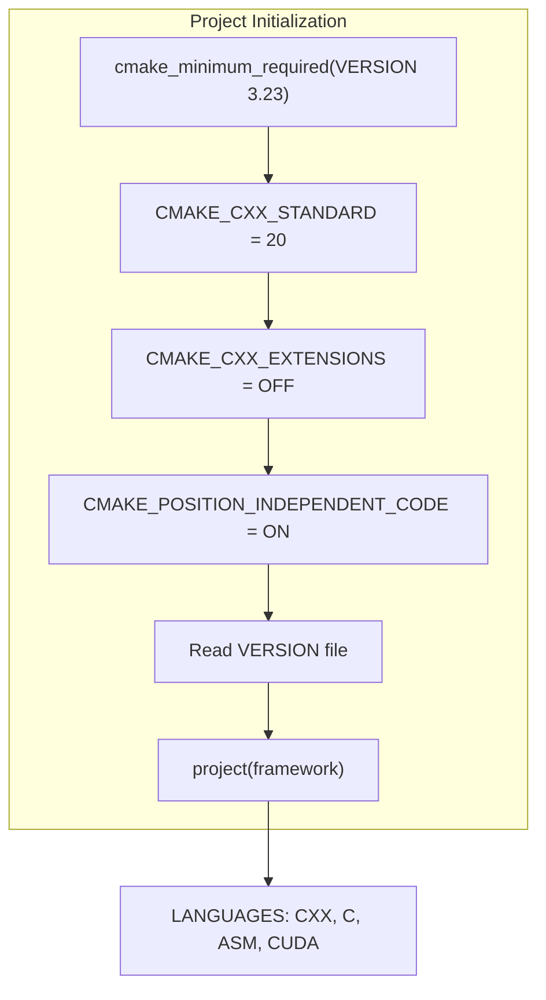
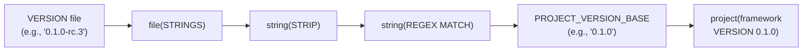
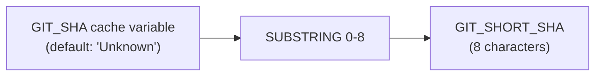
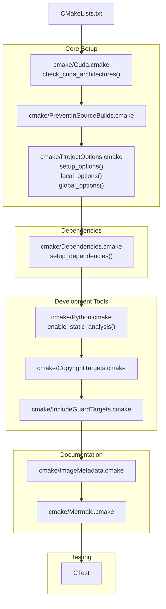
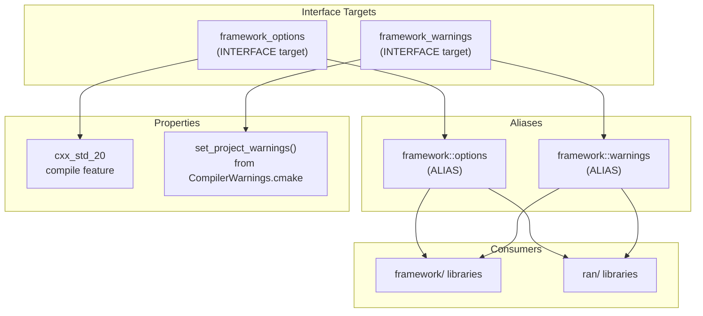
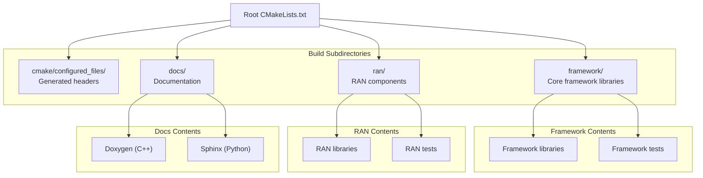
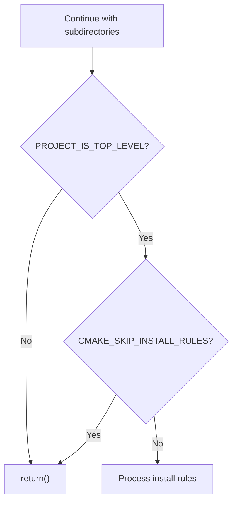

<!-- source: DeepWiki mcp.deepwiki.com · repo NVIDIA/aerial-framework · page 4.1 CMake Configuration · fetched 2026-10-26 -->

# CMake Configuration

<details>
<summary>Relevant source files</summary>

The following files were used as context for generating this wiki page:

- [CMakeLists.txt](CMakeLists.txt)
- [cmake/CompilerWarnings.cmake](cmake/CompilerWarnings.cmake)

</details>


## Purpose and Scope

This document explains the root `CMakeLists.txt` structure, project initialization, global build settings, and subdirectory organization. It covers the core CMake project configuration that establishes the foundation for the entire Aerial Framework build system.

For information about specific build configurations and presets, see [Build Presets and Configurations](#4.2). For dependency management details, see [Dependency Management with CPM](#4.3). For CUDA-specific build settings, see [CUDA and GPU Configuration](#4.4). For compiler warning configurations, see [Compiler Warnings and Code Quality](#4.5).

## Project Initialization

### CMake Version and Language Standards

The root CMakeLists.txt establishes fundamental build requirements at [CMakeLists.txt:16-44]():



**CMake 3.23 Requirement**: The minimum version is set to 3.23, which is required for `FILE_SET HEADERS` support, enabling proper header file propagation in modern CMake targets [CMakeLists.txt:16]().

**C++ Standard**: The project uses C++20 as the default standard [CMakeLists.txt:19-21](). The configuration checks if `CMAKE_CXX_STANDARD` is already defined to allow external override before setting it.

**Extensions Disabled**: `CMAKE_CXX_EXTENSIONS` is set to `OFF` to ensure standard-conforming C++20 rather than GNU extensions (`-std=c++20` vs `-std=gnu++20`) [CMakeLists.txt:25](). This prevents conflicts when compiling with precompiled headers enabled.

**Position-Independent Code**: `CMAKE_POSITION_INDEPENDENT_CODE` is globally enabled for all static libraries [CMakeLists.txt:29](). This is required for CUDA device linking and enables potential shared library usage.

Sources: [CMakeLists.txt:16-29]()

### Version Management

The project version is read from a `VERSION` file at the repository root:



The version handling process [CMakeLists.txt:31-36]():

1. **Read full version**: `file(STRINGS)` reads the complete version string (e.g., `0.1.0-rc.3`)
2. **Strip whitespace**: Removes any leading/trailing whitespace
3. **Extract base version**: Regex extracts only the numeric portion (`0.1.0`) for CMake's `VERSION` parameter, which requires semver format
4. **Store full version**: `PROJECT_VERSION_FULL` retains the complete version string including pre-release identifiers

Sources: [CMakeLists.txt:31-36]()

### Project Declaration

The `project()` command establishes the project identity [CMakeLists.txt:39-44]():

| Parameter | Value | Purpose |
|-----------|-------|---------|
| Name | `framework` | Project name |
| VERSION | `${PROJECT_VERSION_BASE}` | Semantic version (e.g., 0.1.0) |
| DESCRIPTION | `""` | Empty description |
| HOMEPAGE_URL | `"%%myurl%%"` | Placeholder URL |
| LANGUAGES | `CXX C ASM CUDA` | Enabled languages |

The four enabled languages support:
- **CXX**: C++20 for core framework code
- **C**: C libraries and interfaces
- **ASM**: Assembly for low-level optimizations
- **CUDA**: GPU kernels and device code

Sources: [CMakeLists.txt:39-44]()

## Global Build Settings

### Symbol Visibility

The build system configures symbol visibility for shared libraries [CMakeLists.txt:77]():

```cmake
set(CMAKE_CXX_VISIBILITY_PRESET hidden)
```

This sets the default visibility to `hidden`, meaning only explicitly exported symbols are visible in shared libraries. This reduces binary size, improves load times, and prevents symbol collisions.

Sources: [CMakeLists.txt:77]()

### Git SHA Tracking

Build metadata includes the Git commit SHA [CMakeLists.txt:79-82]():



The `GIT_SHA` cache variable can be set during configuration to track the exact commit used for the build. It defaults to `"Unknown"` if not provided. A shortened 8-character version (`GIT_SHORT_SHA`) is extracted for display purposes.

Sources: [CMakeLists.txt:79-82]()

## CMake Module Inclusion

The root CMakeLists.txt orchestrates the build system by including specialized CMake modules in a specific order:



### Module Inclusion Order

The modules are included in this specific sequence [CMakeLists.txt:47-90]():

1. **cmake/Cuda.cmake** [CMakeLists.txt:47-48](): Validates that CUDA architectures are properly set via `check_cuda_architectures()`. See [CUDA and GPU Configuration](#4.4) for details.

2. **cmake/PreventInSourceBuilds.cmake** [CMakeLists.txt:50](): Prevents users from building directly in the source tree, enforcing out-of-source builds.

3. **cmake/ProjectOptions.cmake** [CMakeLists.txt:51-57](): Establishes compiler options through three functions:
   - `setup_options()`: Defines configurable build options
   - `local_options()`: Sets project-specific compiler flags
   - `global_options()`: Configures global compiler settings

4. **cmake/Dependencies.cmake** [CMakeLists.txt:59-60](): Fetches and configures all external dependencies via `setup_dependencies()`. See [Dependency Management with CPM](#4.3).

5. **cmake/Python.cmake** [CMakeLists.txt:62-67](): Sets up Python environment and enables static analysis tools (clang-tidy, include-what-you-use). The `add_fix_includes_target()` function creates a target for fixing include directives if `ENABLE_IWYU` is enabled.

6. **cmake/CopyrightTargets.cmake** [CMakeLists.txt:70](): Adds `check-copyright` and `fix-copyright` targets for SPDX header validation. See [Copyright and License Enforcement](#6.6).

7. **cmake/IncludeGuardTargets.cmake** [CMakeLists.txt:71](): Adds targets to validate and fix include guards in header files.

8. **cmake/ImageMetadata.cmake** [CMakeLists.txt:74](): Configures image metadata handling for documentation.

9. **cmake/Mermaid.cmake** [CMakeLists.txt:75](): Sets up Mermaid diagram processing for documentation generation.

10. **CTest** [CMakeLists.txt:90](): Enables the CTest testing framework for running unit tests and benchmarks.

Sources: [CMakeLists.txt:47-90]()

## Target Organization

The build system creates two foundational interface targets that propagate settings across the entire project:



### framework_options Target

The `framework_options` interface target is configured at [CMakeLists.txt:84]():

```cmake
target_compile_features(framework_options INTERFACE cxx_std_${CMAKE_CXX_STANDARD})
```

This target propagates the C++20 standard requirement to all consumers. Any target that links to `framework_options` (via the `framework::options` alias) automatically receives the C++20 compile feature.

### framework_warnings Target

The `framework_warnings` interface target is populated by the `set_project_warnings()` function from [cmake/CompilerWarnings.cmake](). This function configures compiler-specific warning flags for:
- **MSVC**: `/W4`, `/WX` (if warnings-as-errors)
- **Clang**: `-Wall`, `-Wextra`, `-Wshadow`, `-Wpedantic`, etc.
- **GCC**: Clang warnings plus `-Wmisleading-indentation`, `-Wduplicated-cond`, etc.
- **CUDA**: `--Werror all-warnings`, `-Xcompiler -Werror`

See [Compiler Warnings and Code Quality](#4.5) for detailed warning configurations.

### Target Aliases

Namespaced aliases are created [CMakeLists.txt:86-87]():

```cmake
add_library(framework::options ALIAS framework_options)
add_library(framework::warnings ALIAS framework_warnings)
```

The `framework::` namespace follows modern CMake best practices, making it clear these are imported/interface targets and preventing name collisions with system libraries.

Sources: [CMakeLists.txt:84-87](), [cmake/CompilerWarnings.cmake:20-145]()

## Project Structure

### Subdirectory Organization

The project is organized into three main subdirectories added to the build [CMakeLists.txt:93-102]():



### Subdirectory Details

| Subdirectory | Line | Purpose |
|--------------|------|---------|
| `cmake/configured_files` | [CMakeLists.txt:93]() | Contains CMake-generated configuration headers (e.g., version information, build settings) |
| `framework` | [CMakeLists.txt:95]() | Core framework libraries, headers, and tests |
| `ran` | [CMakeLists.txt:96]() | Radio Access Network (RAN) components for 5G/6G signal processing |
| `docs` | [CMakeLists.txt:102]() | Documentation generation (Doxygen for C++, Sphinx for Python) |

### Documentation Ordering

The `docs` subdirectory is intentionally added after the main project targets [CMakeLists.txt:98-102]():

```cmake
# cmake-format: off
# Add docs after the main project targets so doxygen and sphinx targets can reference them
# When BUILD_DOCS or ENFORCE_DOCSTRINGS is OFF, docs become warning-only targets
# cmake-format: on
add_subdirectory(docs)
```

This ordering allows documentation targets to reference existing library targets for API documentation extraction. When `BUILD_DOCS` or `ENFORCE_DOCSTRINGS` is disabled, documentation errors become warnings rather than build failures.

Sources: [CMakeLists.txt:93-102]()

## Top-Level Project Checks

The CMakeLists.txt includes safety checks to prevent unintended operations in non-top-level contexts [CMakeLists.txt:104-111]():



### PROJECT_IS_TOP_LEVEL Check

At [CMakeLists.txt:105-107](), the build system checks if this project is the top-level project:

```cmake
if(NOT PROJECT_IS_TOP_LEVEL)
    return()
endif()
```

When the Aerial Framework is included as a subproject via `add_subdirectory()` from another CMake project, `PROJECT_IS_TOP_LEVEL` is `FALSE`. In this case, the build returns early to avoid processing install rules or other top-level-only configurations that might conflict with the parent project.

### CMAKE_SKIP_INSTALL_RULES Check

At [CMakeLists.txt:109-111](), a second check prevents install rule processing:

```cmake
if(CMAKE_SKIP_INSTALL_RULES)
    return()
endif()
```

The `CMAKE_SKIP_INSTALL_RULES` variable allows users to explicitly disable install targets even when building as the top-level project, which is useful for development builds where installation is unnecessary.

Sources: [CMakeLists.txt:104-111]()

## Build Flow Summary

The complete CMakeLists.txt execution flow can be visualized as:

```mermaid
graph TD
    Start["CMake Invocation"]
    
    subgraph "Initialization"
        MinVer["Check CMake >= 3.23"]
        Standards["Set C++20, disable extensions, enable PIC"]
        ReadVer["Read VERSION file"]
        ProjDecl["Declare project with CXX/C/ASM/CUDA"]
    end
    
    subgraph "Configuration"
        ValidateCuda["Validate CUDA architectures"]
        SetupOpts["Setup compiler options"]
        LoadDeps["Load dependencies via CPM"]
        EnableAnalysis["Enable static analysis"]
    end
    
    subgraph "Code Quality"
        Copyright["Add copyright targets"]
        IncGuard["Add include guard targets"]
        Images["Setup image metadata"]
        Mermaid["Setup Mermaid diagrams"]
    end
    
    subgraph "Build Targets"
        CreateOptions["Create framework_options target"]
        CreateWarnings["Create framework_warnings target"]
        EnableTest["Enable CTest"]
        ConfigFiles["Generate configured files"]
        AddFramework["Add framework/ subdirectory"]
        AddRan["Add ran/ subdirectory"]
        AddDocs["Add docs/ subdirectory"]
    end
    
    subgraph "Finalization"
        TopLevelCheck{"Top-level project?"}
        SkipInstallCheck{"Skip install rules?"}
        InstallRules["Process install rules"]
        Done["Build system ready"]
    end
    
    Start --> MinVer
    MinVer --> Standards
    Standards --> ReadVer
    ReadVer --> ProjDecl
    
    ProjDecl --> ValidateCuda
    ValidateCuda --> SetupOpts
    SetupOpts --> LoadDeps
    LoadDeps --> EnableAnalysis
    
    EnableAnalysis --> Copyright
    Copyright --> IncGuard
    IncGuard --> Images
    Images --> Mermaid
    
    Mermaid --> CreateOptions
    CreateOptions --> CreateWarnings
    CreateWarnings --> EnableTest
    EnableTest --> ConfigFiles
    ConfigFiles --> AddFramework
    AddFramework --> AddRan
    AddRan --> AddDocs
    
    AddDocs --> TopLevelCheck
    TopLevelCheck -->|No| Done
    TopLevelCheck -->|Yes| SkipInstallCheck
    SkipInstallCheck -->|Yes| Done
    SkipInstallCheck -->|No| InstallRules
    InstallRules --> Done
```



This flow ensures:
1. **Validation first**: CUDA architectures and build environment are validated before processing
2. **Dependencies early**: External libraries are fetched before building project targets
3. **Quality gates**: Copyright, include guards, and documentation checks are established
4. **Logical ordering**: Targets are created before subdirectories that depend on them
5. **Safe finalization**: Install rules only process in appropriate contexts

Sources: [CMakeLists.txt:1-112]()

---

