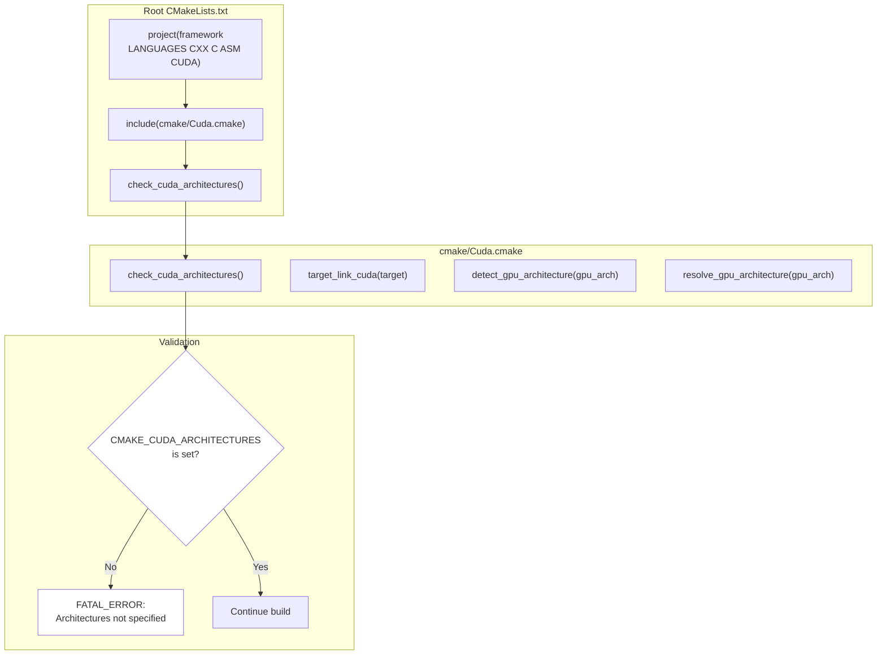
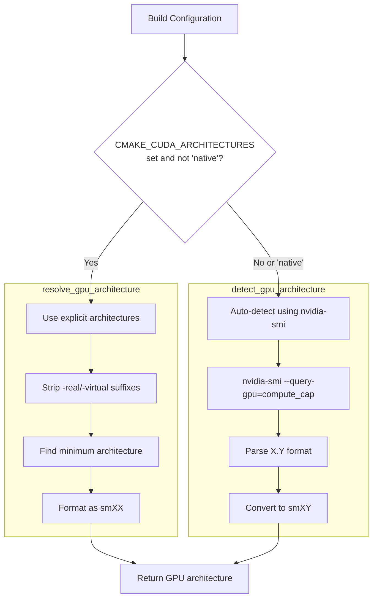
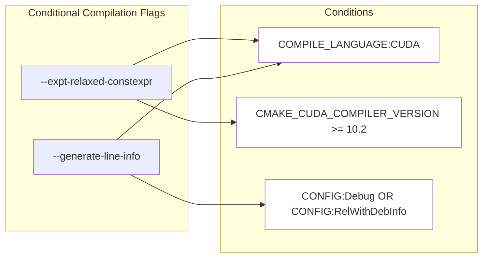

<!-- source: DeepWiki mcp.deepwiki.com · repo NVIDIA/aerial-framework · page 4.4 CUDA and GPU Configuration · fetched 2026-10-26 -->

# CUDA and GPU Configuration

<details>
<summary>Relevant source files</summary>

The following files were used as context for generating this wiki page:

- [CMakeLists.txt](CMakeLists.txt)
- [cmake/Cuda.cmake](cmake/Cuda.cmake)

</details>


## Purpose and Scope

This document describes the CUDA and GPU configuration system in the Aerial Framework build infrastructure. It covers CUDA compilation settings, GPU architecture detection and selection, device code linking, and CUDA-specific compiler flags. The configuration is implemented in [cmake/Cuda.cmake]() and integrated into the root CMake configuration.

For information about general build configurations and presets, see [Build Presets and Configurations](#4.2). For NVIDIA-specific dependencies like TensorRT and MathDx, see [NVIDIA Technologies](#5.1).

**Sources:** [cmake/Cuda.cmake:1-196](), [CMakeLists.txt:44-48]()

---

## CUDA Language Integration

CUDA is enabled as a project language alongside C++ and C in the root CMakeLists.txt. The framework requires CUDA to be available and properly configured before proceeding with the build.



**Diagram: CUDA Language Enablement Flow**

The project must specify `CMAKE_CUDA_ARCHITECTURES` (e.g., `"native"`, `"75;80;86"`) before configuration. If not set, `check_cuda_architectures()` raises a fatal error at line 79-80 of cmake/Cuda.cmake.

**Sources:** [CMakeLists.txt:44](), [CMakeLists.txt:47-48](), [cmake/Cuda.cmake:75-84]()

---

## The `target_link_cuda` Macro

The `target_link_cuda` macro is the primary interface for configuring CUDA compilation on individual targets. It applies necessary CUDA properties, compilation flags, and linker settings.

### Macro Signature

```cmake
target_link_cuda(target [CUDA_WARNINGS])
```

- **`target`**: The CMake target to configure for CUDA
- **`CUDA_WARNINGS`**: Optional parameter (currently parsed but not used)

**Sources:** [cmake/Cuda.cmake:22-72]()

### Applied Configuration

```mermaid
graph TB
    subgraph "target_link_cuda Macro"
        Input["target_link_cuda(my_target)"]
        EnableLang["enable_language(CUDA)"]
        
        subgraph "Standard Configuration"
            CudaStd["CMAKE_CUDA_STANDARD =<br/>CMAKE_CXX_STANDARD"]
            PIC["POSITION_INDEPENDENT_CODE = ON"]
        end
        
        subgraph "Device Linking"
            SepComp["CUDA_SEPARABLE_COMPILATION = ON"]
            ResolveSyms["CUDA_RESOLVE_DEVICE_SYMBOLS = ON"]
        end
        
        subgraph "Compiler Flags"
            RelaxedConstexpr["--expt-relaxed-constexpr<br/>(CUDA >= 10.2)"]
            LineInfo["--generate-line-info<br/>(Debug/RelWithDebInfo)"]
        end
        
        subgraph "Platform-Specific"
            AppleRpath["BUILD_RPATH<br/>(macOS only)"]
            WinWarning["Visual Studio warning<br/>(Windows)"]
        end
    end
    
    Input --> EnableLang
    EnableLang --> CudaStd
    CudaStd --> PIC
    PIC --> SepComp
    SepComp --> ResolveSyms
    ResolveSyms --> RelaxedConstexpr
    RelaxedConstexpr --> LineInfo
    LineInfo --> AppleRpath
    AppleRpath --> WinWarning
    
    style Input fill:#fff
```



**Diagram: target_link_cuda Configuration Pipeline**

**Sources:** [cmake/Cuda.cmake:22-72]()

### Key Properties and Flags

| Property/Flag | Value | Purpose | Source Lines |
|---------------|-------|---------|--------------|
| `CMAKE_CUDA_STANDARD` | Same as `CMAKE_CXX_STANDARD` | Align CUDA and C++ standards | [31-33]() |
| `POSITION_INDEPENDENT_CODE` | `ON` | Enable PIC for static library linking | [36]() |
| `CUDA_SEPARABLE_COMPILATION` | `ON` | Allow device functions in separate TUs | [40]() |
| `CUDA_RESOLVE_DEVICE_SYMBOLS` | `ON` | Resolve device symbols when linking static libraries | [43]() |
| `--expt-relaxed-constexpr` | Conditional | Enable relaxed constexpr in device code (CUDA ≥10.2) | [47-51]() |
| `--generate-line-info` | Debug/RelWithDebInfo | Enable line-level profiling and debugging | [54-58]() |

**Sources:** [cmake/Cuda.cmake:31-58]()

### Separable Compilation and Device Linking

The framework enables **separable compilation** (also known as relocatable device code) to support modular CUDA code organization:

```cmake
set_target_properties(${target} PROPERTIES CUDA_SEPARABLE_COMPILATION ON)
set_target_properties(${target} PROPERTIES CUDA_RESOLVE_DEVICE_SYMBOLS ON)
```

**Why This Matters:**
- **CUDA_SEPARABLE_COMPILATION**: Allows device functions and kernels to be defined in separate compilation units and linked together later. Without this, all device code must be compiled into a single translation unit.
- **CUDA_RESOLVE_DEVICE_SYMBOLS**: Ensures device symbols are properly resolved when linking against static libraries containing CUDA code, preventing undefined symbol errors.

**Sources:** [cmake/Cuda.cmake:38-43]()

### Debug Build Line Info

For Debug and RelWithDebInfo configurations, the macro adds `--generate-line-info`:

```cmake
target_compile_options(
    ${target}
    PRIVATE
        $<$<AND:$<COMPILE_LANGUAGE:CUDA>,$<OR:$<CONFIG:Debug>,$<CONFIG:RelWithDebInfo>>>:--generate-line-info>
)
```

This enables:
- **Line-level profiling** in Nsight Systems and Nsight Compute
- **Source-level debugging** with cuda-gdb
- **Better stack traces** in error reporting

**Trade-off:** Increases binary size and slightly reduces performance, so only enabled for debug configurations.

**Sources:** [cmake/Cuda.cmake:53-58]()

---

## GPU Architecture Detection and Resolution

The framework provides two functions for determining the target GPU architecture at build time.

### Architecture Resolution Strategy



**Diagram: GPU Architecture Resolution Logic**

**Sources:** [cmake/Cuda.cmake:104-195]()

### Function: `detect_gpu_architecture`

Detects the actual GPU present on the system using `nvidia-smi`:

```cmake
detect_gpu_architecture(gpu_arch)
```

**Implementation:**
1. Execute `nvidia-smi --query-gpu=compute_cap --format=csv,noheader`
2. Parse compute capability (e.g., "8.0", "9.0")
3. Use first GPU if multiple GPUs present
4. Convert to `smXY` format (e.g., "8.0" → "sm80")

**Error Handling:** Raises `FATAL_ERROR` if nvidia-smi fails or no GPU detected.

**Sources:** [cmake/Cuda.cmake:104-133]()

### Function: `resolve_gpu_architecture`

Intelligently resolves GPU architecture from `CMAKE_CUDA_ARCHITECTURES` or auto-detects:

```cmake
resolve_gpu_architecture(gpu_arch)
```

**Behavior:**

| CMAKE_CUDA_ARCHITECTURES | Behavior | Result Example |
|--------------------------|----------|----------------|
| `"80;86;90"` | Use minimum (LCD) | `"sm80"` |
| `"90-real"` | Strip suffix, use value | `"sm90"` |
| `"native"` | Auto-detect via nvidia-smi | `"sm80"` (H100) |
| Not set or empty | Auto-detect via nvidia-smi | `"sm80"` (H100) |

**Why LCD Strategy:** Using the lowest common denominator ensures binaries/libraries work on all specified architectures.

**Sources:** [cmake/Cuda.cmake:159-195]()

### Architecture Validation

At project configuration, `check_cuda_architectures()` validates that `CMAKE_CUDA_ARCHITECTURES` is set:

```cmake
function(check_cuda_architectures)
    if(CMAKE_CUDA_COMPILER AND PROJECT_IS_TOP_LEVEL)
        if(NOT DEFINED CMAKE_CUDA_ARCHITECTURES OR CMAKE_CUDA_ARCHITECTURES STREQUAL "")
            message(
                FATAL_ERROR "CMAKE_CUDA_ARCHITECTURES is empty or not set. "
                            "Please specify target GPU architectures (e.g., 'native', '75;80;86').")
        endif()
        message(STATUS "CMAKE_CUDA_ARCHITECTURES=\"${CMAKE_CUDA_ARCHITECTURES}\"")
    endif()
endfunction()
```

**Validation Rules:**
- Only enforced when `PROJECT_IS_TOP_LEVEL` (not when used as subdirectory)
- Only checked if `CMAKE_CUDA_COMPILER` is available
- Fatal error prevents misconfigured builds

**Sources:** [cmake/Cuda.cmake:75-84]()

---

## Compilation Flags and Properties

### Global Settings

Set in the root CMakeLists.txt before project initialization:

| Setting | Value | Purpose | Source |
|---------|-------|---------|--------|
| `CMAKE_CXX_STANDARD` | `20` | C++20 standard | [19-21]() |
| `CMAKE_CXX_EXTENSIONS` | `OFF` | Disable GNU extensions | [25]() |
| `CMAKE_POSITION_INDEPENDENT_CODE` | `ON` | Required for CUDA device linking | [29]() |

**Sources:** [CMakeLists.txt:19-29]()

### CUDA-Specific Flags

Applied by `target_link_cuda`:



**Diagram: Conditional CUDA Compilation Flags**

**Sources:** [cmake/Cuda.cmake:47-58]()

#### `--expt-relaxed-constexpr`

Enables relaxed `constexpr` semantics in device code, allowing more host `constexpr` functions to be used in device contexts.

**Conditions:**
- `COMPILE_LANGUAGE:CUDA` (only for `.cu` files)
- `CMAKE_CUDA_COMPILER_VERSION >= 10.2`

**Implementation:**
```cmake
target_compile_options(
    ${target}
    PRIVATE
        $<$<AND:$<COMPILE_LANGUAGE:CUDA>,$<VERSION_GREATER_EQUAL:${CMAKE_CUDA_COMPILER_VERSION},10.2>>:--expt-relaxed-constexpr>
)
```

**Sources:** [cmake/Cuda.cmake:45-51]()

#### `--generate-line-info`

Embeds source line information into CUDA binaries for profiling and debugging.

**Conditions:**
- `COMPILE_LANGUAGE:CUDA`
- `CONFIG:Debug` OR `CONFIG:RelWithDebInfo`

**Use Cases:**
- Line-level profiling in Nsight Systems (see [Developer Tools](#3.1))
- Source correlation in Nsight Compute
- Kernel line-level timing analysis

**Implementation:**
```cmake
target_compile_options(
    ${target}
    PRIVATE
        $<$<AND:$<COMPILE_LANGUAGE:CUDA>,$<OR:$<CONFIG:Debug>,$<CONFIG:RelWithDebInfo>>>:--generate-line-info>
)
```

**Sources:** [cmake/Cuda.cmake:53-58]()

---

## Platform-Specific Configuration

### macOS RPATH Configuration

On macOS, the CUDA runtime needs to locate `libcuda.dylib` at runtime. The macro adds necessary RPATH:

```cmake
if(APPLE)
    # We need to add the path to the driver (libcuda.dylib) as an rpath, so that the static cuda
    # runtime can find it at runtime.
    set_property(TARGET ${target} PROPERTY BUILD_RPATH ${CMAKE_CUDA_IMPLICIT_LINK_DIRECTORIES})
endif()
```

**Purpose:** Ensures executables can find the CUDA driver without requiring `DYLD_LIBRARY_PATH` environment variables.

**Sources:** [cmake/Cuda.cmake:60-64]()

### Windows Visual Studio Warning

On Windows, CUDA compilation outside the Visual Studio Command Prompt may fail. The macro issues a warning:

```cmake
if(WIN32 AND "$ENV{VSCMD_VER}" STREQUAL "")
    message(
        WARNING
            "Compiling CUDA on Windows outside the Visual Studio Command prompt or without running `vcvarsall.bat x64` probably fails"
    )
endif()
```

**Detected by:** Checking if `VSCMD_VER` environment variable is set (present in VS Command Prompt).

**Sources:** [cmake/Cuda.cmake:66-71]()

---

## Integration with Build System

### Usage in Project Targets

Targets that require CUDA compilation use `target_link_cuda` after target creation:

```cmake
add_library(my_cuda_library src/kernel.cu src/host.cpp)
target_compile_features(my_cuda_library PRIVATE cxx_std_20)
target_link_libraries(my_cuda_library PRIVATE framework::options framework::warnings)
target_link_cuda(my_cuda_library)
```

**Order Matters:** `target_link_cuda` must be called after `add_library`/`add_executable` and `target_compile_features`.

**Sources:** [cmake/Cuda.cmake:17-20]()

### Architecture Selection Examples

**Example 1: Native Architecture**
```cmake
cmake -DCMAKE_CUDA_ARCHITECTURES=native ..
```
Auto-detects the GPU on the build machine using nvidia-smi.

**Example 2: Multiple Architectures**
```cmake
cmake -DCMAKE_CUDA_ARCHITECTURES="75;80;86" ..
```
Builds for Turing (sm75), Ampere (sm80), and Hopper (sm86). Runtime resolution uses sm75 (lowest).

**Example 3: Architecture with Modifier**
```cmake
cmake -DCMAKE_CUDA_ARCHITECTURES="90-real" ..
```
Builds only real code (not virtual PTX) for Hopper sm90.

**Sources:** [cmake/Cuda.cmake:75-84](), [cmake/Cuda.cmake:159-195]()

---

## CUDA Standard Alignment

The framework automatically aligns CUDA standard with C++ standard:

```cmake
# use the same C++ standard if not specified
if("${CMAKE_CUDA_STANDARD}" STREQUAL "")
    set(CMAKE_CUDA_STANDARD "${CMAKE_CXX_STANDARD}")
endif()
```

**Result:** With `CMAKE_CXX_STANDARD=20` (set in root CMakeLists.txt), CUDA also uses C++20 standard, ensuring consistent language features across host and device code.

**Sources:** [cmake/Cuda.cmake:30-33](), [CMakeLists.txt:19-21]()

---

## Summary of Key Functions and Properties

### Functions

| Function | Purpose | Input | Output |
|----------|---------|-------|--------|
| `target_link_cuda(target)` | Apply CUDA configuration to target | Target name | N/A |
| `check_cuda_architectures()` | Validate CMAKE_CUDA_ARCHITECTURES is set | None | Fatal error if not set |
| `detect_gpu_architecture(gpu_arch)` | Auto-detect GPU using nvidia-smi | Variable name | Sets variable to smXX |
| `resolve_gpu_architecture(gpu_arch)` | Resolve arch from CMAKE or detect | Variable name | Sets variable to smXX |

### Properties Set by `target_link_cuda`

| Property | Value | Effect |
|----------|-------|--------|
| `POSITION_INDEPENDENT_CODE` | `ON` | Enables PIC for all sources |
| `CUDA_SEPARABLE_COMPILATION` | `ON` | Enables separate compilation of device code |
| `CUDA_RESOLVE_DEVICE_SYMBOLS` | `ON` | Resolves device symbols when linking |
| `BUILD_RPATH` (macOS) | `CMAKE_CUDA_IMPLICIT_LINK_DIRECTORIES` | Locates CUDA driver at runtime |

### Compiler Flags

| Flag | When Applied | Purpose |
|------|--------------|---------|
| `--expt-relaxed-constexpr` | CUDA ≥10.2 | Relaxed constexpr in device code |
| `--generate-line-info` | Debug/RelWithDebInfo | Line-level profiling/debugging |

**Sources:** [cmake/Cuda.cmake:1-196](), [CMakeLists.txt:44-48]()

---

