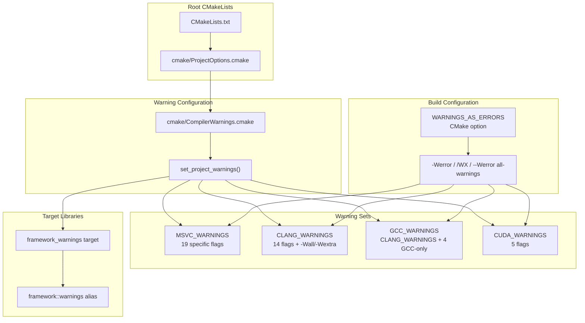
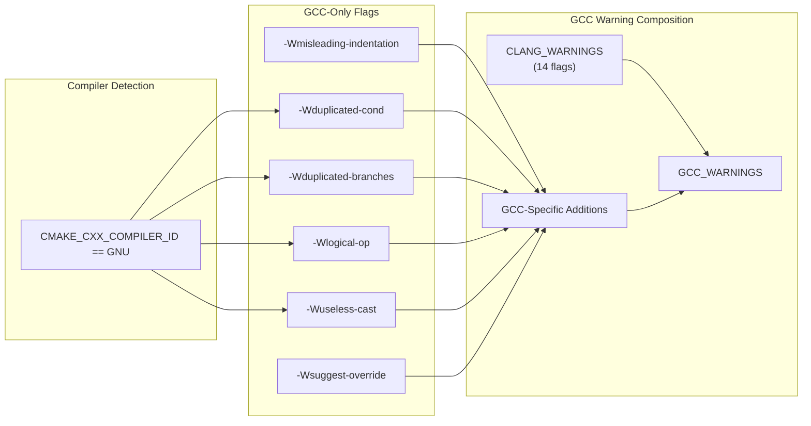
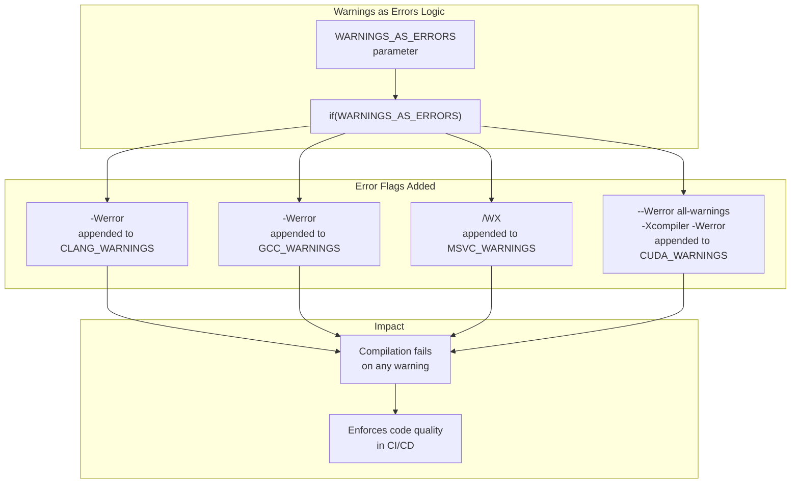
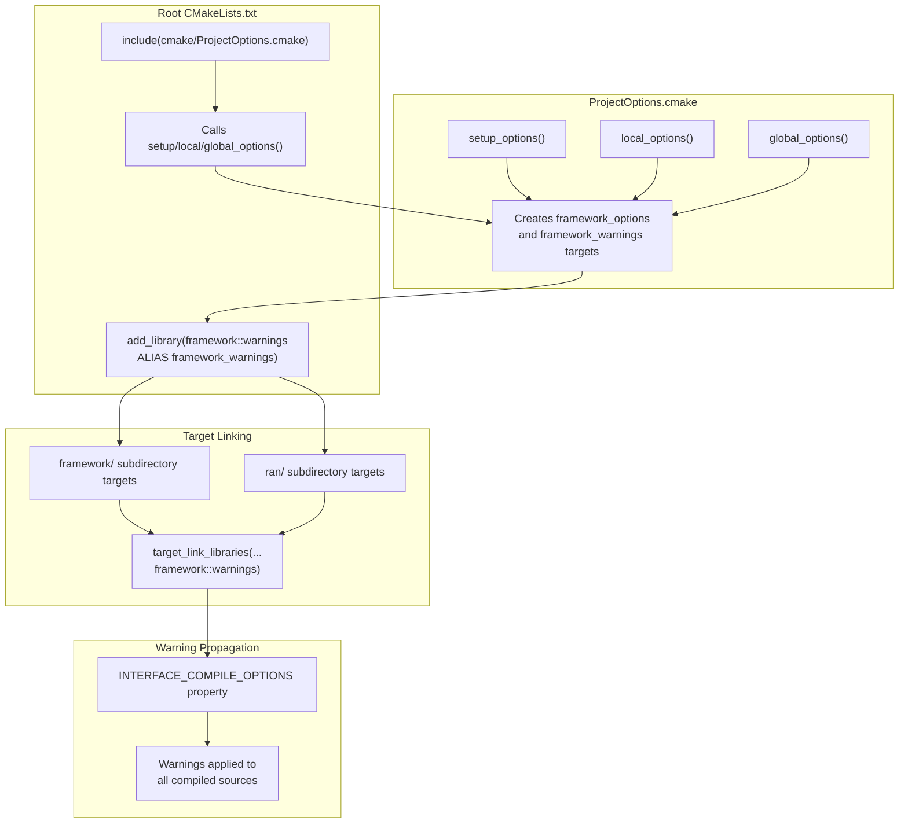
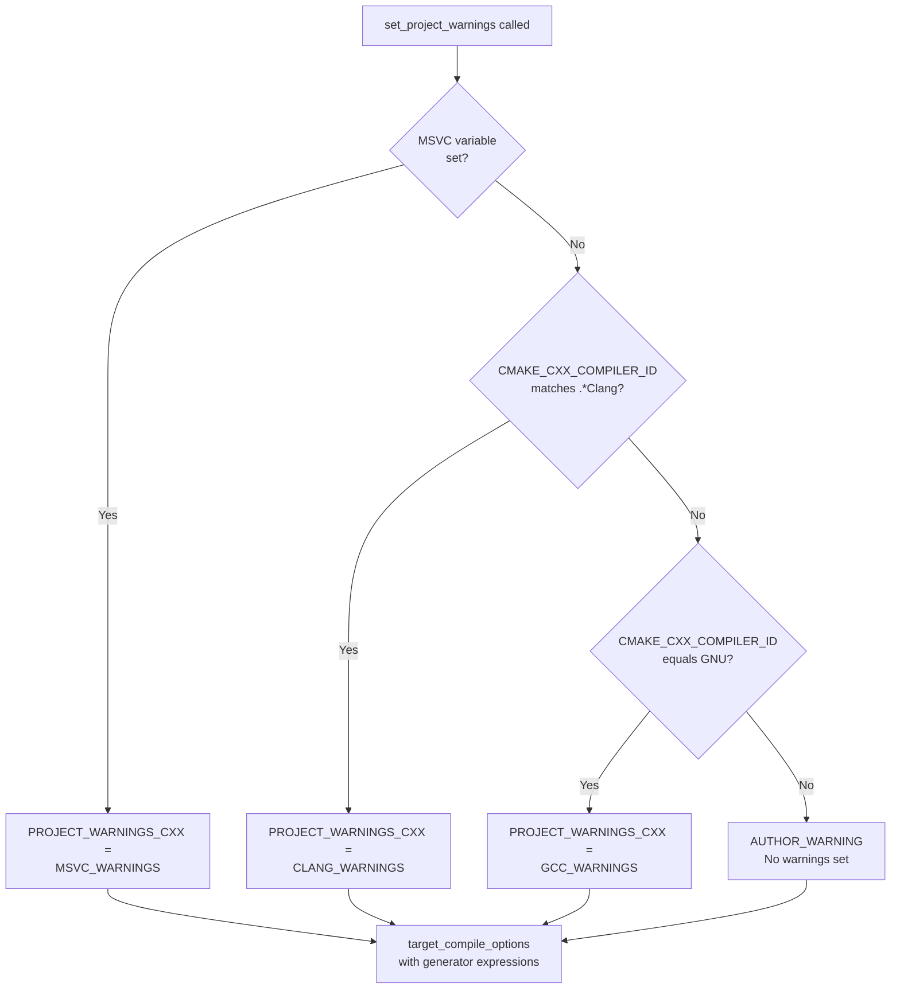

<!-- source: DeepWiki mcp.deepwiki.com · repo NVIDIA/aerial-framework · page 4.5 Compiler Warnings and Code Quality · fetched 2026-10-26 -->

# Compiler Warnings and Code Quality

<details>
<summary>Relevant source files</summary>

The following files were used as context for generating this wiki page:

- [CMakeLists.txt](CMakeLists.txt)
- [cmake/CompilerWarnings.cmake](cmake/CompilerWarnings.cmake)

</details>


## Purpose and Scope

This page documents the compiler warning configuration system used throughout the NVIDIA Aerial Framework build system. It explains the `set_project_warnings` function, compiler-specific warning sets, and the warnings-as-errors enforcement policy. This system ensures code quality by enabling comprehensive compiler diagnostics across C, C++, and CUDA code.

For static analysis tools like clang-tidy, see [C++ Static Analysis](#6.2). For general build system configuration, see [CMake Configuration](#4.1).

**Sources:** [cmake/CompilerWarnings.cmake:1-146](), [CMakeLists.txt:84-87]()

## Warning System Architecture

The warning system is implemented in [cmake/CompilerWarnings.cmake]() and provides a single function `set_project_warnings` that configures compiler warnings for a target interface library. This library is then aliased as `framework::warnings` and linked to targets throughout the project to propagate warning settings.



**Diagram: Warning System Architecture and Data Flow**

The `framework_warnings` target is created by calling `set_project_warnings` with the target name and warning configuration parameters. The function detects the active compiler and applies the appropriate warning flags using generator expressions to handle multi-language compilation (C, C++, CUDA).

**Sources:** [cmake/CompilerWarnings.cmake:20-145](), [CMakeLists.txt:51-57](), [CMakeLists.txt:84-87]()

## The set_project_warnings Function

The `set_project_warnings` function is defined at [cmake/CompilerWarnings.cmake:20-145]() with the following signature:

```cmake
set_project_warnings(
    project_name
    WARNINGS_AS_ERRORS
    MSVC_WARNINGS
    CLANG_WARNINGS
    GCC_WARNINGS
    CUDA_WARNINGS)
```

### Function Parameters

| Parameter | Type | Description |
|-----------|------|-------------|
| `project_name` | Target Name | The CMake target to apply warnings to (typically `framework_warnings`) |
| `WARNINGS_AS_ERRORS` | Boolean | Whether to treat warnings as compilation errors |
| `MSVC_WARNINGS` | List | Warning flags for MSVC compiler (defaults provided if empty) |
| `CLANG_WARNINGS` | List | Warning flags for Clang compiler (defaults provided if empty) |
| `GCC_WARNINGS` | List | Warning flags for GCC compiler (defaults provided if empty) |
| `CUDA_WARNINGS` | List | Warning flags for CUDA nvcc compiler (defaults provided if empty) |

The function populates default warning sets if any parameter list is empty, then applies the appropriate set to the target based on the detected compiler using CMake's `CMAKE_CXX_COMPILER_ID` variable.

**Sources:** [cmake/CompilerWarnings.cmake:20-27]()

## Compiler-Specific Warning Sets

### MSVC Warnings

For the Microsoft Visual C++ compiler, the framework enables 19 specific warnings beyond the baseline `/W4` level. These warnings are defined at [cmake/CompilerWarnings.cmake:28-59]().

| Warning Flag | Description |
|--------------|-------------|
| `/W4` | Baseline reasonable warnings level |
| `/w14242` | Conversion from type1 to type2, possible loss of data |
| `/w14254` | Operator conversion with possible data loss in bit fields |
| `/w14263` | Member function does not override base class virtual function |
| `/w14265` | Class has virtual functions but destructor is not virtual |
| `/w14287` | Unsigned/negative constant mismatch |
| `/we4289` | Loop control variable used outside for-loop scope (error level) |
| `/w14296` | Expression is always a boolean value |
| `/w14311` | Pointer truncation from type1 to type2 |
| `/w14545` | Expression before comma evaluates to function missing argument list |
| `/w14546` | Function call before comma missing argument list |
| `/w14547` | Operator before comma has no effect |
| `/w14549` | Operator before comma has no effect; did you intend different operator? |
| `/w14555` | Expression has no effect |
| `/w14619` | Pragma warning with non-existent warning number |
| `/w14640` | Thread-unsafe static member initialization |
| `/w14826` | Sign-extended conversion causing unexpected runtime behavior |
| `/w14905` | Wide string literal cast to LPSTR |
| `/w14906` | String literal cast to LPWSTR |
| `/w14928` | Illegal copy-initialization with multiple implicit conversions |
| `/permissive-` | Standards conformance mode |

Note that `/we4289` is set to error level (`/we`) rather than warning level because it catches a common C++ standards violation.

**Sources:** [cmake/CompilerWarnings.cmake:28-60]()

### Clang Warnings

The Clang warning set includes 14 specific flags beyond the baseline `-Wall` and `-Wextra`. These are defined at [cmake/CompilerWarnings.cmake:62-82]().

| Warning Flag | Description |
|--------------|-------------|
| `-Wall` | Enable all standard warnings |
| `-Wextra` | Enable extra warnings beyond -Wall |
| `-Wshadow` | Variable declaration shadows one from parent context |
| `-Wnon-virtual-dtor` | Class with virtual functions has non-virtual destructor |
| `-Wold-style-cast` | C-style casts detected |
| `-Wcast-align` | Potential performance issues from casts |
| `-Wunused` | Any unused entities |
| `-Woverloaded-virtual` | Virtual function overloaded (not overridden) |
| `-Wpedantic` | Non-standard C++ usage |
| `-Wconversion` | Type conversions that may lose data |
| `-Wsign-conversion` | Sign conversions |
| `-Wnull-dereference` | Null pointer dereference detected |
| `-Wdouble-promotion` | Float implicitly promoted to double |
| `-Wformat=2` | Security issues in printf-like functions |
| `-Wimplicit-fallthrough` | Switch case fallthrough without explicit annotation |

**Sources:** [cmake/CompilerWarnings.cmake:62-83]()

### GCC Warnings

The GCC warning set starts with all Clang warnings (since GCC supports most of them) and adds GCC-specific warnings. This is defined at [cmake/CompilerWarnings.cmake:85-105]().



**Diagram: GCC Warning Set Composition**

The GCC-specific warnings are:

| Warning Flag | Description | Requires GCC? |
|--------------|-------------|---------------|
| `-Wmisleading-indentation` | Indentation implies blocks where blocks do not exist | No (also in Clang 3.6+) |
| `-Wduplicated-cond` | If/else chain has duplicated conditions | Yes |
| `-Wduplicated-branches` | If/else branches have duplicated code | Yes |
| `-Wlogical-op` | Logical operations used where bitwise probably wanted | Yes |
| `-Wuseless-cast` | Cast to the same type | Yes |
| `-Wsuggest-override` | Overridden member function not marked override/final | No (also in Clang) |

The function checks `CMAKE_CXX_COMPILER_ID STREQUAL "GNU"` at [cmake/CompilerWarnings.cmake:91-101]() to only add the true GCC-only warnings when compiling with GCC, not when using Clang.

**Sources:** [cmake/CompilerWarnings.cmake:85-105]()

### CUDA Warnings

CUDA warnings are more limited than host compiler warnings, focusing on the most critical issues. The default set is defined at [cmake/CompilerWarnings.cmake:107-109]():

| Warning Flag | Description |
|--------------|-------------|
| `-Wall` | Enable all standard CUDA warnings |
| `-Wextra` | Enable extra CUDA warnings |
| `-Wunused` | Unused entities in CUDA code |
| `-Wconversion` | Type conversions in CUDA code |
| `-Wshadow` | Variable shadowing in CUDA code |

CUDA warnings apply to both device code (compiled by nvcc) and host code when invoked through the CUDA compiler driver.

**Sources:** [cmake/CompilerWarnings.cmake:107-109]()

## Warnings as Errors Policy

When the `WARNINGS_AS_ERRORS` parameter is true, all warnings are elevated to errors, causing compilation to fail if any warning is emitted. This is enabled by checking the boolean parameter at [cmake/CompilerWarnings.cmake:111-119]().



**Diagram: Warnings as Errors Enforcement Flow**

### Platform-Specific Error Flags

| Compiler | Error Flag | Notes |
|----------|-----------|-------|
| Clang | `-Werror` | Treats all enabled warnings as errors |
| GCC | `-Werror` | Treats all enabled warnings as errors |
| MSVC | `/WX` | Treats all enabled warnings as errors |
| CUDA | `--Werror all-warnings` | Treats CUDA device warnings as errors |
| CUDA Host | `"SHELL:-Xcompiler -Werror"` | Passes `-Werror` to host compiler via `-Xcompiler` |

The CUDA error configuration is more complex because nvcc requires both:
1. `--Werror all-warnings` for device code warnings
2. `"SHELL:-Xcompiler -Werror"` to pass the error flag through to the host compiler for host code

The `SHELL:` prefix prevents CMake from escaping the space in `-Xcompiler -Werror`, ensuring it's passed as a single argument to nvcc.

**Sources:** [cmake/CompilerWarnings.cmake:111-119]()

## Target Application

The warnings are applied to targets using CMake's `target_compile_options` with generator expressions to handle different compilation languages. This occurs at [cmake/CompilerWarnings.cmake:137-144]().

```cmake
target_compile_options(
    ${project_name}
    INTERFACE 
    # C++ warnings
    $<$<COMPILE_LANGUAGE:CXX>:${PROJECT_WARNINGS_CXX}>
    # C warnings
    $<$<COMPILE_LANGUAGE:C>:${PROJECT_WARNINGS_C}>
    # CUDA warnings
    $<$<COMPILE_LANGUAGE:CUDA>:${PROJECT_WARNINGS_CUDA}>)
```

### Generator Expression Conditions

The function uses three CMake generator expressions to conditionally apply warnings based on the source file language:

| Generator Expression | Applies To | Warning Set Used |
|---------------------|------------|------------------|
| `$<$<COMPILE_LANGUAGE:CXX>:...>` | C++ source files (.cpp, .cxx, .cc) | `PROJECT_WARNINGS_CXX` (MSVC/Clang/GCC) |
| `$<$<COMPILE_LANGUAGE:C>:...>` | C source files (.c) | `PROJECT_WARNINGS_C` (same as CXX) |
| `$<$<COMPILE_LANGUAGE:CUDA>:...>` | CUDA source files (.cu) | `PROJECT_WARNINGS_CUDA` |

Note that C warnings are set equal to C++ warnings at [cmake/CompilerWarnings.cmake:133](). This is intentional because the framework uses C++20 and treats C code with the same rigor.

**Sources:** [cmake/CompilerWarnings.cmake:133-144]()

## Integration with Project Targets

The warning system integrates with the project through two interface libraries created in the root `CMakeLists.txt`:



**Diagram: Warning Target Integration and Propagation**

The key steps in the integration are:

1. **Target Creation**: [cmake/ProjectOptions.cmake]() calls `set_project_warnings` to create the `framework_warnings` interface library
2. **Aliasing**: [CMakeLists.txt:87]() creates `framework::warnings` alias for namespace consistency
3. **Linking**: Individual targets in `framework/` and `ran/` directories link to `framework::warnings`
4. **Propagation**: CMake propagates the INTERFACE compile options to all source files in linked targets

This architecture allows centralized warning configuration while maintaining per-target flexibility. Any target can override warnings by adding compiler flags after linking to `framework::warnings`, or skip warnings entirely by not linking to it.

**Sources:** [CMakeLists.txt:51-57](), [CMakeLists.txt:84-87](), [cmake/CompilerWarnings.cmake:137-145]()

## Compiler Detection Logic

The function determines which warning set to apply using CMake's built-in compiler identification variables. This logic is at [cmake/CompilerWarnings.cmake:121-130]().



**Diagram: Compiler Detection and Warning Set Selection**

The detection order is:
1. **MSVC** first (checked via `MSVC` CMake variable)
2. **Clang** next (matches `CMAKE_CXX_COMPILER_ID` against regex `.*Clang` to catch both Clang and AppleClang)
3. **GCC** next (exact match for `CMAKE_CXX_COMPILER_ID STREQUAL "GNU"`)
4. **Unknown** compiler triggers an `AUTHOR_WARNING` message but continues with empty warnings

This order ensures that when using clang-cl on Windows (which sets both `CMAKE_CXX_COMPILER_ID` to Clang and can set `MSVC`), the MSVC warnings take precedence for Windows compatibility.

**Sources:** [cmake/CompilerWarnings.cmake:121-130]()

## Relationship to Build Presets

The `WARNINGS_AS_ERRORS` option is typically controlled by build presets defined in `CMakePresets.json`. Different presets can enable or disable this option:

| Preset Type | WARNINGS_AS_ERRORS | Purpose |
|-------------|-------------------|---------|
| Development presets | Usually OFF | Allow warnings during active development |
| CI/CD presets | Usually ON | Enforce clean builds in continuous integration |
| Release presets | Usually ON | Ensure production code has no warnings |

This flexibility allows developers to iterate quickly while ensuring that code merged to main branches is warning-free.

For more details on build presets, see [Build Presets and Configurations](#4.2).

**Sources:** [cmake/CompilerWarnings.cmake:111-119]()

## Summary

The compiler warning system in the NVIDIA Aerial Framework provides:

- **Comprehensive Coverage**: 19 MSVC warnings, 14 Clang warnings, 18 GCC warnings, and 5 CUDA warnings
- **Multi-Language Support**: Separate warning sets for C, C++, and CUDA with automatic detection
- **Quality Enforcement**: Optional warnings-as-errors mode for CI/CD and production builds
- **Compiler Awareness**: Automatic detection and adaptation to MSVC, Clang, GCC, and nvcc
- **Modular Design**: Centralized configuration via interface library with per-target flexibility

The `set_project_warnings` function at [cmake/CompilerWarnings.cmake:20-145]() encapsulates this functionality and is invoked during project setup to create the `framework::warnings` target that all project code links against.

**Sources:** [cmake/CompilerWarnings.cmake:1-146](), [CMakeLists.txt:51-57](), [CMakeLists.txt:84-87]()

---

