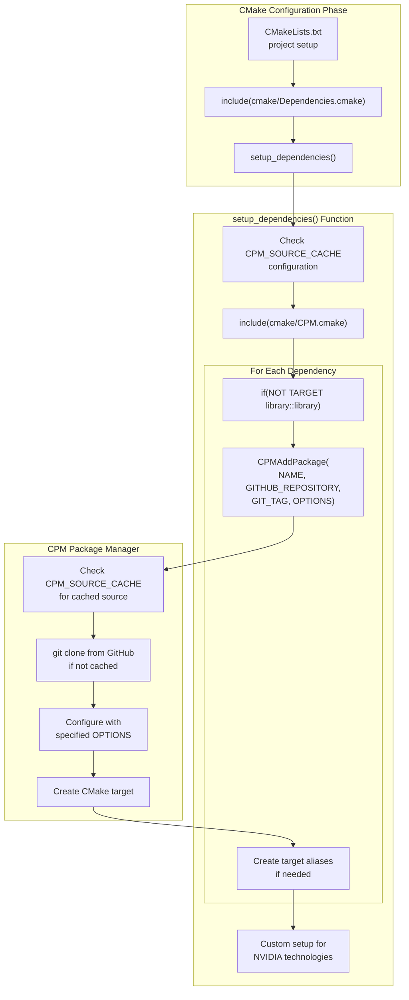
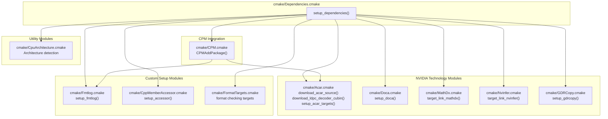
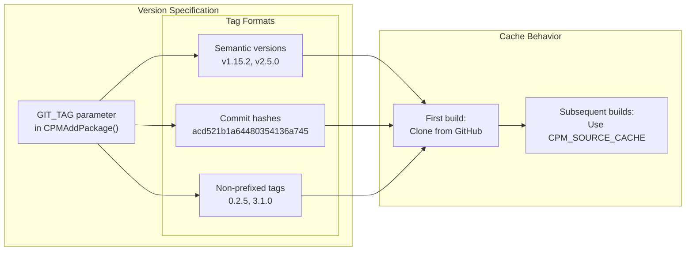

<!-- source: DeepWiki mcp.deepwiki.com · repo NVIDIA/aerial-framework · page 5 Dependencies and Integration · fetched 2026-10-26 -->

# Dependencies and Integration

<details>
<summary>Relevant source files</summary>

The following files were used as context for generating this wiki page:

- [ATTRIBUTION.md](ATTRIBUTION.md)
- [cmake/Dependencies.cmake](cmake/Dependencies.cmake)

</details>


## Purpose and Scope

This page provides a comprehensive overview of the Aerial Framework's dependency management system, including how external libraries are fetched, integrated, and configured. The framework uses CPM (CMake Package Manager) to manage over 20 external dependencies spanning NVIDIA technologies, testing frameworks, utility libraries, and data handling tools.

For detailed information about specific dependency categories, see:
- NVIDIA-specific technologies (Aerial SDK, DOCA, TensorRT, MathDx, GDRCopy): [NVIDIA Technologies](#5.1)
- Third-party open-source libraries (GoogleTest, CLI11, fmt, Quill, etc.): [Third-Party Libraries](#5.2)

For build system configuration details, see [Dependency Management with CPM](#4.3).

Sources: [cmake/Dependencies.cmake:1-411]()

## Dependency Management Architecture

The framework uses **CPM (CMake Package Manager)** version 0.40.8 as its primary dependency management tool. All dependency configuration is centralized in the `setup_dependencies()` function, which systematically checks for and fetches required libraries.

### CPM Source Cache Configuration

CPM uses a source cache to avoid re-downloading dependencies across multiple builds. The cache location is configurable through multiple methods with the following precedence:

| Priority | Method | Default Value |
|----------|--------|---------------|
| 1 | CMake variable `-DCPM_SOURCE_CACHE=/path` | User-specified path |
| 2 | Environment variable `$CPM_SOURCE_CACHE` | User-specified path |
| 3 | Framework default | `$HOME/.cache/CPM` |

Sources: [cmake/Dependencies.cmake:18-29]()

### Dependency Fetch Workflow



**Diagram: Dependency Fetch Workflow**

The `setup_dependencies()` function in [cmake/Dependencies.cmake:37-410]() orchestrates dependency fetching:

1. **Target Check**: Each dependency is guarded by `if(NOT TARGET library::library)` to avoid duplicate fetches
2. **CPMAddPackage**: Fetches dependencies from GitHub with pinned tags
3. **Alias Creation**: Creates standard namespace aliases (e.g., `phmap::phmap`, `tl::expected`)
4. **Custom Setup**: NVIDIA technologies use dedicated setup modules

Sources: [cmake/Dependencies.cmake:37-410]()

## Dependency Categories

The framework's 20+ dependencies are organized into five categories:

| Category | Dependencies | Purpose |
|----------|-------------|---------|
| **NVIDIA Technologies** | Aerial SDK (ACAR), DOCA, TensorRT, MathDx, GDRCopy | GPU acceleration, RAN processing, networking |
| **Testing & Benchmarking** | GoogleTest 1.15.2, Google Benchmark 1.9.4, cpp-member-accessor | Unit tests, performance testing, private member access |
| **Core C++ Utilities** | CLI11 2.5.0, fmt 10.2.1, Quill 10.0.1, fmtlog, GSL-Lite 1.0.1, Backward-cpp 1.6 | CLI parsing, formatting, logging, core guidelines, stack traces |
| **Data & Configuration** | yaml-cpp 0.8.0, libyaml 0.2.5, phmap 2.0.0, range-v3, tl::expected 1.3.1 | YAML parsing, parallel hashmaps, ranges, error handling |
| **Type Safety & Reflection** | NamedType 1.1.0, WiseEnum 3.1.0 | Strong typing, enum reflection |
| **Build Tools** | Format.cmake 1.8.2, cmake_template | Code formatting, build infrastructure |

Sources: [cmake/Dependencies.cmake:43-406](), [ATTRIBUTION.md:1-794]()

## CMake Module Architecture

The dependency system is split across multiple specialized CMake modules:



**Diagram: CMake Module Dependencies**

### Module Responsibilities

| Module | Functions/Targets | Purpose |
|--------|-------------------|---------|
| `Dependencies.cmake` | `setup_dependencies()` | Central orchestrator for all dependencies |
| `CPM.cmake` | `CPMAddPackage()` | Fetch packages from GitHub/Git |
| `Acar.cmake` | `download_acar_source()`, `download_ldpc_decoder_cubin()`, `setup_acar_targets()` | Aerial SDK integration |
| `Doca.cmake` | `setup_doca()` | DOCA GPUNetIO integration |
| `MathDx.cmake` | `target_link_mathdx()` | cuFFTDx, cuBLASDx, cuRANDDx, cuSOLVERDx |
| `Nvinfer.cmake` | `target_link_nvinfer()` | TensorRT inference engine |
| `GDRCopy.cmake` | `setup_gdrcopy()` | GPU Direct RDMA library |
| `Fmtlog.cmake` | `setup_fmtlog()` | Fast logging with Aerial SDK patches |
| `CppMemberAccessor.cmake` | `setup_accessor()` | Private member access for testing |
| `FormatTargets.cmake` | Format checking targets | clang-format, cmake-format integration |

Sources: [cmake/Dependencies.cmake:31-33](), [cmake/Dependencies.cmake:164-179](), [cmake/Dependencies.cmake:286-296](), [cmake/Dependencies.cmake:72-74](), [cmake/Dependencies.cmake:409]()

## Dependency Integration Patterns

### Pattern 1: Direct CPMAddPackage

Most third-party libraries use the standard `CPMAddPackage()` pattern:

```cmake
if(NOT TARGET CLI11::CLI11)
    CPMAddPackage(
        NAME CLI11
        GITHUB_REPOSITORY CLIUtils/CLI11
        GIT_TAG v2.5.0
        SYSTEM YES
    )
endif()
```

This pattern applies to: GoogleTest, Google Benchmark, CLI11, Quill, WiseEnum, GSL-Lite, NamedType, yaml-cpp, range-v3, tl::expected.

Sources: [cmake/Dependencies.cmake:77-87](), [cmake/Dependencies.cmake:44-54](), [cmake/Dependencies.cmake:89-103]()

### Pattern 2: Download-Only + Manual Target Creation

Libraries without CMake support or requiring custom configuration:

```cmake
if(NOT TARGET phmap::phmap)
    CPMAddPackage(
        NAME parallel_hashmap
        GITHUB_REPOSITORY greg7mdp/parallel-hashmap
        GIT_TAG v2.0.0
        OPTIONS "PHMAP_BUILD_TESTS OFF" "PHMAP_BUILD_EXAMPLES OFF"
        DOWNLOAD_ONLY YES
        SYSTEM YES
    )
    
    add_library(phmap INTERFACE)
    target_include_directories(phmap SYSTEM INTERFACE "${parallel_hashmap_SOURCE_DIR}/")
    add_library(phmap::phmap ALIAS phmap)
endif()
```

This pattern applies to: phmap, WiseEnum (additional BUILD_INTERFACE).

Sources: [cmake/Dependencies.cmake:196-218](), [cmake/Dependencies.cmake:105-129]()

### Pattern 3: Custom Setup Functions

NVIDIA technologies require complex setup with environment detection and custom compilation flags:

```cmake
if(NOT TARGET gdrcopy::gdrcopy)
    include(${CMAKE_SOURCE_DIR}/cmake/GDRCopy.cmake)
    setup_gdrcopy()
endif()

if(NOT TARGET mathdx::cufftdx)
    include(${CMAKE_SOURCE_DIR}/cmake/MathDx.cmake)
endif()

if(NOT TARGET nvinfer::nvinfer)
    include(${CMAKE_SOURCE_DIR}/cmake/Nvinfer.cmake)
endif()
```

These modules provide wrapper functions like `target_link_mathdx()` and `target_link_nvinfer()` for downstream targets.

Sources: [cmake/Dependencies.cmake:163-179]()

### Pattern 4: Aerial SDK Multi-Phase Setup

The Aerial SDK requires a three-phase setup process:

```cmake
# Phase 1: Download source for patches
download_acar_source()
download_ldpc_decoder_cubin()

# Phase 2: Setup fmt and fmtlog dependencies
if(NOT TARGET fmtlog::fmtlog)
    include(${CMAKE_SOURCE_DIR}/cmake/Fmtlog.cmake)
    setup_fmtlog(${aerial_sdk_SOURCE_DIR})
endif()

# Phase 3: Configure and add Aerial SDK targets
setup_acar_targets()
```

This complex setup is necessary because:
- fmtlog requires patches from the Aerial SDK source tree
- Aerial SDK depends on fmt and fmtlog being available
- LDPC decoder requires pre-compiled CUDA binaries

Sources: [cmake/Dependencies.cmake:286-296]()

## Version Pinning Strategy

All dependencies use pinned versions to ensure reproducible builds:



**Diagram: Version Pinning and Caching**

### Version Examples

| Library | GIT_TAG | Format |
|---------|---------|--------|
| GoogleTest | `v1.15.2` | Semantic with v prefix |
| Google Benchmark | `v1.9.4` | Semantic with v prefix |
| CLI11 | `v2.5.0` | Semantic with v prefix |
| Quill | `v10.0.1` | Semantic with v prefix |
| WiseEnum | `3.1.0` | Semantic without v prefix |
| libyaml | `0.2.5` | Semantic without v prefix |
| yaml-cpp | `0.8.0` | Semantic without v prefix |
| fmtlog | `acd521b1a64480354136a745c511358da1ec7dc5` | Full commit hash |
| range-v3 | `ca1388fb9da8e69314dda222dc7b139ca84e092f` | Full commit hash |

Sources: [cmake/Dependencies.cmake:48-51](), [cmake/Dependencies.cmake:60-63](), [cmake/Dependencies.cmake:478-479]() in ATTRIBUTION.md

## Target Naming Conventions

The framework enforces consistent target naming with namespace aliases:

| Library | Upstream Target | Framework Alias | Created By |
|---------|----------------|-----------------|------------|
| CLI11 | `CLI11` | `CLI11::CLI11` | Upstream |
| Quill | `quill` | `quill::quill` | Upstream |
| WiseEnum | `wise_enum` | `wise_enum::wise_enum` | [Dependencies.cmake:125-127]() |
| Backward | `backward` | `Backward::Backward` | [Dependencies.cmake:145-147]() |
| GSL-Lite | `gsl-lite` | `gsl::gsl-lite` | Upstream |
| GDRCopy | `gdrcopy` | `gdrcopy::gdrcopy` | [GDRCopy.cmake]() |
| NamedType | `NamedType` | N/A | Header-only |
| phmap | `phmap` | `phmap::phmap` | [Dependencies.cmake:217]() |
| libyaml | `yaml` / `yaml_static` | `libyaml::libyaml` | [Dependencies.cmake:235-241]() |
| yaml-cpp | `yaml-cpp` | `yaml-cpp::yaml-cpp` | [Dependencies.cmake:263-265]() |
| fmt | `fmt` | `fmt::fmt` | Upstream |
| fmtlog | `fmtlog` | `fmtlog::fmtlog` | [Fmtlog.cmake]() |
| range-v3 | `range-v3` | `range-v3::range-v3` | Upstream |
| tl::expected | `expected` | `tl::expected` | [Dependencies.cmake:403-405]() |

Targets are linked using:
```cmake
target_link_libraries(my_target PRIVATE phmap::phmap)
target_link_libraries(my_target PRIVATE tl::expected)
```

Sources: [cmake/Dependencies.cmake:77-406]()

## Conditional Dependency Fetching

Some dependencies are only fetched when specific features are enabled:

```cmake
if(BUILD_TESTING)
    if(NOT TARGET GTest::gtest_main)
        CPMAddPackage(NAME googletest ...)
    endif()
    
    if(NOT TARGET benchmark::benchmark)
        CPMAddPackage(NAME benchmark ...)
    endif()
    
    if(NOT TARGET accessor::accessor)
        include(${CMAKE_SOURCE_DIR}/cmake/CppMemberAccessor.cmake)
        setup_accessor()
    endif()
endif() # BUILD_TESTING
```

This ensures development-only dependencies are not fetched for production builds.

Sources: [cmake/Dependencies.cmake:43-75]()

## Format.cmake Integration

The framework integrates Format.cmake for code quality tools, with custom configuration to prevent clang-format from processing JSON files:

```cmake
CPMAddPackage(
    NAME Format.cmake
    GITHUB_REPOSITORY TheLartians/Format.cmake
    GIT_TAG v1.8.2
    SYSTEM YES
)

# Configure clang-format extensions
set(CLANGFORMAT_EXTENSIONS 
    "c,h,m,mm,cc,cp,cpp,c++,cxx,hh,hpp,hxx,inc,inl,ccm,cppm,cxxm,c++m,cu,cuh,proto,protodevel,java,js,ts,cs,sv,svh,v,vh"
)

# Set via git config
execute_process(
    COMMAND ${GIT_EXECUTABLE} config clangformat.extensions "${CLANGFORMAT_EXTENSIONS}"
    WORKING_DIRECTORY ${CMAKE_SOURCE_DIR}
)
```

JSON files are explicitly excluded because clang-format does not support them properly.

Sources: [cmake/Dependencies.cmake:299-363]()

## Licensing Overview

All dependencies are open-source with permissive licenses. The framework's [ATTRIBUTION.md]() file documents each library's license:

| License Type | Count | Libraries |
|--------------|-------|-----------|
| **MIT License** | 11 | fmt, Quill, NamedType, GDRCopy, backward-cpp, libyaml, yaml-cpp, fmtlog, GSL-Lite, cpp-member-accessor |
| **BSD 3-Clause** | 2 | GoogleTest, CLI11 |
| **Apache 2.0** | 3 | Format.cmake, phmap, Google Benchmark |
| **Boost Software License** | 2 | WiseEnum, range-v3 |
| **CC0 1.0 Universal** | 1 | tl::expected (Public Domain) |
| **Unlicense** | 1 | cmake_template (Public Domain) |

All licenses are compatible with the framework's Apache 2.0 license.

Sources: [ATTRIBUTION.md:1-794]()

## Special Dependency Cases

### fmtlog with Aerial SDK Patches

The fmtlog library requires patches from the Aerial SDK source tree:

```cmake
# Download Aerial SDK source first
download_acar_source()

# Setup fmtlog with patches
if(NOT TARGET fmtlog::fmtlog)
    include(${CMAKE_SOURCE_DIR}/cmake/Fmtlog.cmake)
    setup_fmtlog(${aerial_sdk_SOURCE_DIR})
endif()
```

The `setup_fmtlog()` function applies Aerial SDK-specific patches before building.

Sources: [cmake/Dependencies.cmake:286-293]()

### LDPC Decoder CUDA Binary

The LDPC decoder component requires a pre-compiled CUDA binary:

```cmake
download_ldpc_decoder_cubin()
```

This binary is downloaded separately from the main Aerial SDK source.

Sources: [cmake/Dependencies.cmake:287]()

### cpp-member-accessor (Testing Only)

The cpp-member-accessor library enables testing of private class members:

```cmake
if(BUILD_TESTING)
    if(NOT TARGET accessor::accessor)
        include(${CMAKE_SOURCE_DIR}/cmake/CppMemberAccessor.cmake)
        setup_accessor()
    endif()
endif()
```

This is only included when `BUILD_TESTING` is enabled.

Sources: [cmake/Dependencies.cmake:71-74]()

## Integration with Build System

Dependencies are integrated early in the CMake configuration:

```cmake
# Root CMakeLists.txt
project(aerial-framework)

include(cmake/ProjectOptions.cmake)
include(cmake/CompilerWarnings.cmake)
include(cmake/Cuda.cmake)

# Fetch all dependencies
include(cmake/Dependencies.cmake)
setup_dependencies()

# Now dependencies are available for all subdirectories
add_subdirectory(framework)
add_subdirectory(ran)
```

This ensures all targets created in subdirectories can link against the fetched dependencies.

Sources: [cmake/Dependencies.cmake:1-411]()

---

