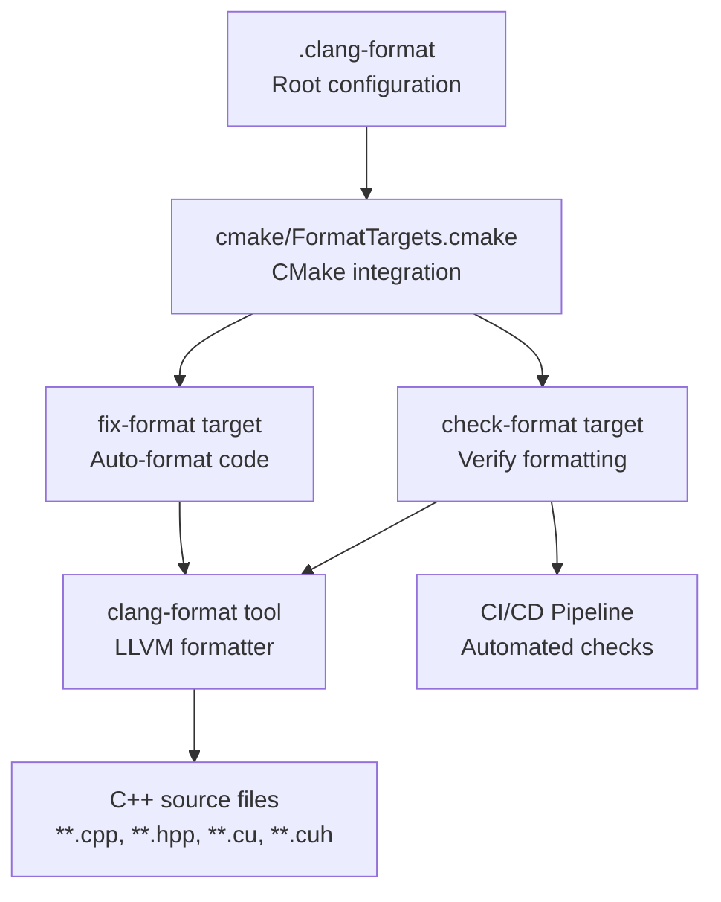
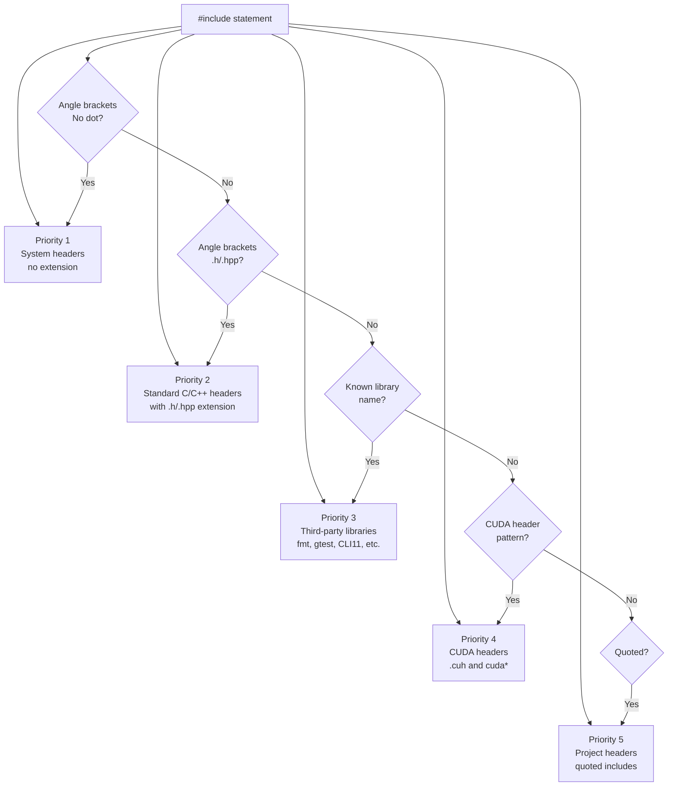
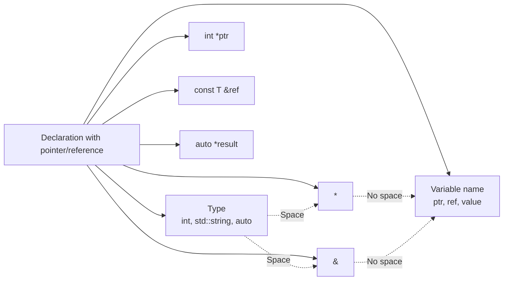

<!-- source: DeepWiki mcp.deepwiki.com · repo NVIDIA/aerial-framework · page 6.1 C++ Code Formatting · fetched 2026-10-26 -->

# C++ Code Formatting

<details>
<summary>Relevant source files</summary>

The following files were used as context for generating this wiki page:

- [.clang-format](.clang-format)

</details>


## Purpose and Scope

This document explains the C++ code formatting rules enforced by `clang-format` in the NVIDIA Aerial Framework. The configuration defines precise rules for line length, indentation, brace style, pointer alignment, include ordering, and line breaking behavior. All C++ source files (`.cpp`, `.hpp`, `.h`, `.cu`, `.cuh`) must conform to these rules.

For information about C++ static analysis and linting, see [C++ Static Analysis](#6.2). For automated copyright header enforcement, see [Copyright and License Enforcement](#6.6). For CMake file formatting, see [CMake Formatting](#6.4).

**Sources:** [.clang-format:1-262]()

---

## Configuration Overview

The Aerial Framework uses a customized LLVM-based code style defined in `.clang-format` at the repository root. The configuration enforces consistent formatting across the entire codebase and is integrated into the build system through CMake targets.

### Key Configuration Parameters

| Setting | Value | Description |
|---------|-------|-------------|
| `BasedOnStyle` | `LLVM` | Foundation style, customized with overrides |
| `Language` | `Cpp` | Applies to C++ and CUDA files |
| `Standard` | `Latest` | Uses the latest C++ standard features |
| `ColumnLimit` | `100` | Maximum line length in characters |
| `IndentWidth` | `4` | Spaces per indentation level |
| `TabWidth` | `8` | Tab character width (for display) |
| `UseTab` | `Never` | Always use spaces, never tab characters |
| `PointerAlignment` | `Right` | `int *ptr` not `int* ptr` |
| `ReferenceAlignment` | `Pointer` | References follow pointer alignment |

**Sources:** [.clang-format:1-6](), [.clang-format:96-96](), [.clang-format:154-154](), [.clang-format:193-196](), [.clang-format:247-254]()

### Build System Integration



**Sources:** [.clang-format:1-262]()

---

## Line Length and Breaking

### Column Limit

The configuration enforces a strict **100-character line limit** to maintain readability on various display sizes and when viewing code side-by-side.

```cpp
// Acceptable - within 100 characters
auto result = performComplexCalculation(param1, param2, param3);

// Requires breaking - exceeds 100 characters
auto result = performComplexCalculationWithVeryLongName(
    parameter1,
    parameter2,
    parameter3,
    parameter4
);
```

**Sources:** [.clang-format:96-96]()

### Line Breaking Configuration

| Setting | Value | Effect |
|---------|-------|--------|
| `BinPackArguments` | `false` | Each argument on its own line when breaking |
| `BinPackParameters` | `false` | Each parameter on its own line when breaking |
| `AlignAfterOpenBracket` | `AlwaysBreak` | Break after opening parenthesis/bracket |
| `AllowAllArgumentsOnNextLine` | `true` | Can move all args to next line |
| `AllowAllParametersOfDeclarationOnNextLine` | `true` | Can move all params to next line |
| `BreakBeforeTernaryOperators` | `true` | Break before `?` and `:` |
| `BreakBeforeBinaryOperators` | `None` | Break after binary operators |
| `BreakStringLiterals` | `true` | Break long string literals |

**Sources:** [.clang-format:62-63](), [.clang-format:5-5](), [.clang-format:45-46](), [.clang-format:88-95]()

### Continuation Indentation

When lines are broken, continuation lines use an indentation of **8 spaces** (double the normal indentation):

```cpp
// Function call with line breaks
auto result = someFunction(
        argument1,    // +8 spaces from function start
        argument2,
        argument3
);

// Constructor initializer lists
MyClass::MyClass()
        : member1(value1)    // +8 spaces
        , member2(value2)
        , member3(value3) {}
```

**Sources:** [.clang-format:99-100]()

---

## Indentation Rules

### Basic Indentation

| Element | Indentation | Configuration |
|---------|-------------|---------------|
| Block scope | `+4 spaces` | `IndentWidth: 4` |
| Access modifiers | `-4 spaces` (flush with class) | `AccessModifierOffset: -4` |
| Case labels | Same as switch | `IndentCaseLabels: false` |
| Case blocks | Not indented | `IndentCaseBlocks: false` |
| Preprocessor directives | No indentation | `IndentPPDirectives: None` |
| Namespace contents | No indentation | `NamespaceIndentation: None` |
| Goto labels | Indented | `IndentGotoLabels: true` |

```cpp
class MyClass {
public:    // Flush with class keyword (-4 offset)
    void method() {    // +4 spaces
        switch (value) {
        case 1:    // No additional indent
            doSomething();    // +4 from switch
            break;
        }
    }
    
private:    // Flush with class keyword
    int member;
};

namespace aerial {
class Component {    // No namespace indentation
    void process();
};
}  // namespace aerial
```

**Sources:** [.clang-format:4-4](), [.clang-format:147-152](), [.clang-format:154-154](), [.clang-format:175-175]()

### Tab Policy

The configuration strictly prohibits tab characters. All indentation uses spaces:

- `UseTab: Never` - Tab key inserts spaces
- `TabWidth: 8` - Tabs display as 8 spaces (if present)
- `IndentWidth: 4` - Actual indentation level

**Sources:** [.clang-format:253-254]()

---

## Brace Placement and Style

### Brace Wrapping Strategy

The configuration uses **Attach** brace style (K&R style) where opening braces attach to the preceding statement:

```cpp
class MyClass {    // Brace attaches to class
    void method() {    // Brace attaches to function
        if (condition) {    // Brace attaches to if
            // code
        } else {    // else attaches, brace attaches
            // code
        }
    }
};

namespace aerial {    // Brace attaches to namespace
// contents
}  // namespace aerial
```

**Sources:** [.clang-format:65-83](), [.clang-format:90-90]()

### Brace Wrapping Configuration

| Context | Behavior | Setting |
|---------|----------|---------|
| After class | No wrap | `AfterClass: false` |
| After function | No wrap | `AfterFunction: false` |
| After namespace | No wrap | `AfterNamespace: false` |
| After control statement | Never wrap | `AfterControlStatement: Never` |
| Before else | No wrap | `BeforeElse: false` |
| Before catch | No wrap | `BeforeCatch: false` |
| Empty functions | Split | `SplitEmptyFunction: true` |
| Empty records | Split | `SplitEmptyRecord: true` |

**Sources:** [.clang-format:65-83]()

### Short Constructs on Single Lines

| Construct | Single Line Allowed | Configuration |
|-----------|---------------------|---------------|
| Functions | Yes (all) | `AllowShortFunctionsOnASingleLine: All` |
| Lambdas | Yes (all) | `AllowShortLambdasOnASingleLine: All` |
| Enums | Yes | `AllowShortEnumsOnASingleLine: true` |
| If statements | Never | `AllowShortIfStatementsOnASingleLine: Never` |
| Loops | Never | `AllowShortLoopsOnASingleLine: false` |
| Blocks | Never | `AllowShortBlocksOnASingleLine: Never` |
| Case labels | No | `AllowShortCaseLabelsOnASingleLine: false` |

```cpp
// Allowed - short function
int getX() { return x_; }

// Allowed - short lambda
auto pred = [](int x) { return x > 0; };

// Allowed - short enum
enum class State { IDLE, RUNNING, STOPPED };

// Not allowed - if must break
if (condition) {
    doSomething();
}
```

**Sources:** [.clang-format:48-55]()

---

## Include File Ordering

The Aerial Framework enforces a strict **5-priority include ordering system** that groups headers by their source and purpose. This is one of the most complex aspects of the formatting configuration.

### Include Priority System



**Sources:** [.clang-format:114-146]()

### Priority Categories

| Priority | Pattern | Examples | Regex |
|----------|---------|----------|-------|
| **1** | System headers (no extension) | `#include <iostream>`, `#include <vector>` | `<[a-zA-Z_][a-zA-Z0-9_]*>` |
| **2** | Standard C/C++ headers (with extension) | `#include <stdio.h>`, `#include <memory.hpp>` | `<.*\.h(pp)?>` |
| **3** | Third-party libraries | `#include <fmt/core.h>`, `#include <gtest/gtest.h>` | `<(fmt\|gtest\|gmock\|CLI11\|CLI\|gsl-lite\|accessor\|wise_enum)(/.*\|\.h\|\.hpp)>` |
| **4** | CUDA headers | `#include <cuda_runtime.h>`, `#include <kernel.cuh>` | `^<cuda[^>]*>$`, `^<.*\.cuh>$` |
| **5** | Project headers | `#include "aerial/framework/core.hpp"` | `^".*"$` |

**Sources:** [.clang-format:115-139]()

### Example Include Block

```cpp
// Priority 1: System headers (no extension)
#include <algorithm>
#include <memory>
#include <vector>

// Priority 2: Standard headers (with extension)
#include <cstdint.h>
#include <stdio.h>

// Priority 3: Third-party libraries
#include <CLI/CLI.hpp>
#include <fmt/format.h>
#include <gtest/gtest.h>

// Priority 4: CUDA headers
#include <cuda_runtime.h>
#include <device.cuh>

// Priority 5: Project headers
#include "aerial/framework/component.hpp"
#include "aerial/ran/physical_layer.hpp"
```

**Sources:** [.clang-format:114-146]()

### Main Header Detection Disabled

The configuration explicitly disables clang-format's "main header" heuristics that would normally prioritize `foo.hpp` in `foo.cpp`:

```yaml
IncludeIsMainRegex: '^$'        # Empty regex - matches nothing
IncludeIsMainSourceRegex: '^$'  # Empty regex - matches nothing
```

This ensures all headers strictly follow the 5-priority ordering without special cases.

**Sources:** [.clang-format:141-146]()

### Include Grouping

```yaml
IncludeBlocks: Regroup  # Automatically group includes by priority
SortIncludes: true      # Sort alphabetically within each group
```

The formatter automatically:
1. Groups includes by priority level
2. Adds blank lines between priority groups
3. Sorts alphabetically within each group
4. Removes duplicate includes

**Sources:** [.clang-format:114-114](), [.clang-format:206-206]()

---

## Pointer and Reference Alignment

### Alignment Rules

The configuration enforces **right-aligned** pointers and references:

```cpp
// Correct - right-aligned
int *ptr;
const std::string &ref;
auto *result = factory.create();

// Incorrect - left-aligned
int* ptr;
const std::string& ref;
auto* result = factory.create();
```

**Configuration:**
- `PointerAlignment: Right` - Align `*` to the right (with variable)
- `ReferenceAlignment: Pointer` - References follow pointer alignment
- `DerivePointerAlignment: false` - Do not detect from existing code

**Sources:** [.clang-format:102-102](), [.clang-format:193-196]()

### Pointer Alignment in Declarations



**Sources:** [.clang-format:193-196]()

### Qualifier and Const Placement

```yaml
QualifierAlignment: Leave    # Don't reorder const/volatile
SpaceAroundPointerQualifiers: Default
```

The formatter does not automatically rearrange `const` qualifiers:

```cpp
// Both styles are preserved as written
int const *ptr1;    // East const
const int *ptr2;    // West const
```

**Sources:** [.clang-format:195-212]()

---

## Spacing Rules

### Function and Control Statement Spacing

| Context | Space Before `(` | Configuration |
|---------|------------------|---------------|
| Function declaration | No | `AfterFunctionDeclarationName: false` |
| Function definition | No | `AfterFunctionDefinitionName: false` |
| Control statements (`if`, `for`, `while`) | Yes | `AfterControlStatements: true` |
| Macros in control positions | Yes | `AfterIfMacros: true` |
| Overloaded operators | No | `AfterOverloadedOperator: false` |
| Range-based for loop `:` | Yes | `SpaceBeforeRangeBasedForLoopColon: true` |

```cpp
// Function calls - no space
void myFunction(int x, int y);
result = calculate(a, b);

// Control statements - space before (
if (condition) { }
while (running) { }
for (int i = 0; i < n; ++i) { }

// Range-based for - space before :
for (auto &elem : container) { }
```

**Sources:** [.clang-format:219-231]()

### Operator and Assignment Spacing

| Element | Spacing | Configuration |
|---------|---------|---------------|
| Assignment operators | Space before and after | `SpaceBeforeAssignmentOperators: true` |
| After C-style cast | No space | `SpaceAfterCStyleCast: false` |
| After logical NOT | No space | `SpaceAfterLogicalNot: false` |
| After template keyword | Space | `SpaceAfterTemplateKeyword: true` |
| Before case colon | No space | `SpaceBeforeCaseColon: false` |

```cpp
// Assignment - spaces around
int x = 42;
value += delta;

// C-style cast - no space after
auto ptr = (int *)buffer;

// Logical NOT - no space after
if (!condition) { }

// Template - space after keyword
template <typename T>
```

**Sources:** [.clang-format:209-218]()

### Parentheses and Brackets

```yaml
SpacesInParens: Never           # No spaces inside ()
SpacesInSquareBrackets: false   # No spaces inside []
SpacesInAngles: Never           # No spaces inside <>
SpaceInEmptyBlock: false        # No space in {}
SpaceBeforeSquareBrackets: false # No space before [
```

```cpp
// Correct
func(arg);
array[index];
std::vector<int>;
if (x) {}

// Incorrect
func( arg );
array[ index ];
std::vector< int >;
if (x) { }
```

**Sources:** [.clang-format:232-246]()

---

## Comment Formatting

### Comment Alignment

```yaml
AlignTrailingComments:
  Kind: Always              # Always align trailing comments
  OverEmptyLines: 0        # Don't align over empty lines
SpacesBeforeTrailingComments: 1  # One space before //
ReflowComments: true       # Reformat comment text to fit line limit
```

```cpp
int x = 1;      // First comment
int value = 2;  // Second comment - aligned with first

int a = 3;  // Not aligned with above due to empty line below

int b = 4;  // New alignment group
```

**Sources:** [.clang-format:42-44](), [.clang-format:197-197](), [.clang-format:234-234]()

### Comment Pragma Recognition

```yaml
CommentPragmas: '^ IWYU pragma:'  # Recognize Include What You Use directives
```

Comments containing IWYU pragmas are specially recognized:

```cpp
#include <vector>  // IWYU pragma: keep
#include <map>     // IWYU pragma: export
```

**Sources:** [.clang-format:97-97]()

---

## Template and Concept Formatting

### Template Declarations

```yaml
AlwaysBreakTemplateDeclarations: MultiLine
BreakBeforeConceptDeclarations: Always
SpaceAfterTemplateKeyword: true
```

```cpp
// Single-line template - no break
template <typename T> void simple(T value);

// Multi-line template - break after template
template <typename T, typename U>
void complex(T first, U second);

// Concepts - always break before
template <typename T>
requires Sortable<T>
void sort(T &container);
```

**Sources:** [.clang-format:59-59](), [.clang-format:89-89](), [.clang-format:211-211]()

### Requires Clause Positioning

```yaml
RequiresClausePosition: OwnLine
RequiresExpressionIndentation: OuterScope
IndentRequiresClause: true
```

```cpp
// Requires clause on own line
template <typename T>
requires Comparable<T> && Copyable<T>
class Container {
    // ...
};
```

**Sources:** [.clang-format:153-153](), [.clang-format:201-202]()

---

## Constructor and Inheritance Formatting

### Constructor Initializer Lists

```yaml
BreakConstructorInitializers: BeforeColon
ConstructorInitializerIndentWidth: 8
PackConstructorInitializers: BinPack
```

```cpp
// Constructor with initializer list
MyClass::MyClass(int x, int y, int z)
        : member1_(x)    // Colon on separate line, +8 indent
        , member2_(y)
        , member3_(z) {}

// Short initializer can pack
MyClass::MyClass() : x_(0), y_(0) {}
```

**Sources:** [.clang-format:93-93](), [.clang-format:99-99](), [.clang-format:181-181]()

### Inheritance Lists

```yaml
BreakInheritanceList: BeforeColon
```

```cpp
// Inheritance list - colon on separate line
class Derived
        : public Base1
        , public Base2
        , public Base3 {
    // ...
};
```

**Sources:** [.clang-format:94-94]()

---

## Special Macros and Attributes

### Recognized Macros

The configuration defines several macro categories that receive special formatting treatment:

#### For-Each Macros

```yaml
ForEachMacros:
  - foreach
  - Q_FOREACH
  - BOOST_FOREACH
```

These macros are formatted like `for` loops with control statement spacing.

**Sources:** [.clang-format:108-111]()

#### If-Like Macros

```yaml
IfMacros:
  - KJ_IF_MAYBE
```

These macros receive the same spacing as `if` statements.

**Sources:** [.clang-format:112-113]()

#### Attribute Macros

```yaml
AttributeMacros:
  - __capability
```

These macros are treated as attributes and formatted accordingly.

**Sources:** [.clang-format:60-61]()

#### Statement Macros

```yaml
StatementMacros:
  - Q_UNUSED
  - QT_REQUIRE_VERSION
```

**Sources:** [.clang-format:250-252]()

#### Whitespace-Sensitive Macros

```yaml
WhitespaceSensitiveMacros:
  - BOOST_PP_STRINGIZE
  - CF_SWIFT_NAME
  - NS_SWIFT_NAME
  - PP_STRINGIZE
  - STRINGIZE
```

The formatter preserves exact whitespace in these macro invocations.

**Sources:** [.clang-format:256-261]()

---

## Namespace Formatting

### Namespace Style

```yaml
NamespaceIndentation: None       # Don't indent namespace contents
FixNamespaceComments: true       # Add closing comments
CompactNamespaces: false         # Don't merge nested namespaces
ShortNamespaceLines: 1           # Compact if 1 line or less
```

```cpp
// Standard namespace formatting
namespace aerial {
namespace framework {

class Component {    // No indentation
    void process();
};

}  // namespace framework
}  // namespace aerial

// Short namespace - can be compact
namespace detail { inline constexpr int kValue = 42; }
```

**Sources:** [.clang-format:98-98](), [.clang-format:107-107](), [.clang-format:175-175](), [.clang-format:204-204]()

---

## Empty Lines and EOF

### Empty Line Management

```yaml
MaxEmptyLinesToKeep: 1             # Collapse multiple blank lines
KeepEmptyLinesAtTheStartOfBlocks: true
KeepEmptyLinesAtEOF: false        # Remove trailing blank lines
InsertNewlineAtEOF: true          # Ensure file ends with newline
```

```cpp
// Allowed - single blank line
void function1() { }

void function2() { }

// Not allowed - multiple blank lines get collapsed


// File must end with exactly one newline character
```

**Sources:** [.clang-format:157-157](), [.clang-format:168-169](), [.clang-format:174-174]()

### Line Ending Style

```yaml
LineEnding: DeriveLF  # Use LF line endings (Unix style)
```

The formatter uses Unix-style line endings (`\n`) consistent with the repository's `.gitattributes` configuration.

**Sources:** [.clang-format:171-171]()

---

## Penalty System for Line Breaking

The formatter uses a penalty-based system to decide where to break long lines. Lower penalties are preferred:

| Break Location | Penalty | Configuration |
|----------------|---------|---------------|
| Assignment | 2 | `PenaltyBreakAssignment: 2` |
| Template declaration | 10 | `PenaltyBreakTemplateDeclaration: 10` |
| Before first call parameter | 19 | `PenaltyBreakBeforeFirstCallParameter: 19` |
| Return type on own line | 60 | `PenaltyReturnTypeOnItsOwnLine: 60` |
| First `<<` operator | 120 | `PenaltyBreakFirstLessLess: 120` |
| Comment | 300 | `PenaltyBreakComment: 300` |
| Scope resolution `::` | 500 | `PenaltyBreakScopeResolution: 500` |
| String literal | 1000 | `PenaltyBreakString: 1000` |
| Excess character | 1,000,000 | `PenaltyExcessCharacter: 1000000` |

This penalty system means:
- Assignments break easily
- String literals are kept intact when possible
- Comments are rarely broken
- Scope resolution operators (`::`) stay together
- Exceeding the column limit is heavily penalized

**Sources:** [.clang-format:182-192]()

---

## Usage and Enforcement

### CMake Integration

The `.clang-format` configuration is enforced through CMake targets defined in the build system:

```bash
# Check formatting (CI/CD usage)
cmake --build build --target check-format

# Automatically fix formatting
cmake --build build --target fix-format
```

The `check-format` target verifies all C++ files conform to the style and returns a non-zero exit code if violations are found. The `fix-format` target automatically reformats all files in place.

**Sources:** [.clang-format:1-262]()

### Scope of Formatted Files

The formatting rules apply to all C++ and CUDA source files:

- **C++ Headers**: `*.h`, `*.hpp`
- **C++ Source**: `*.cpp`
- **CUDA Headers**: `*.cuh`
- **CUDA Source**: `*.cu`

The configuration is recursively applied to all subdirectories in `framework/`, `ran/`, and other source directories.

---

## Summary Table

| Category | Key Settings | Values |
|----------|--------------|--------|
| **Line Management** | Column limit | 100 characters |
| | Line ending | LF (Unix) |
| | Max empty lines | 1 |
| **Indentation** | Indent width | 4 spaces |
| | Continuation indent | 8 spaces |
| | Use tabs | Never |
| **Braces** | Style | Attach (K&R) |
| | Short functions | Allowed on single line |
| | Short if/loops | Not allowed |
| **Pointers** | Alignment | Right (`int *ptr`) |
| | Reference alignment | Same as pointers |
| **Includes** | Sorting | 5-priority system |
| | System headers | Priority 1 |
| | Third-party libs | Priority 3 |
| | CUDA headers | Priority 4 |
| | Project headers | Priority 5 (quoted) |
| **Spacing** | After function name | No space |
| | Before control statement | Space |
| | Around operators | Spaces |
| **Breaking** | Bin packing | Disabled |
| | Arguments per line | One when breaking |
| | Break after open bracket | Always |

**Sources:** [.clang-format:1-262]()

---

