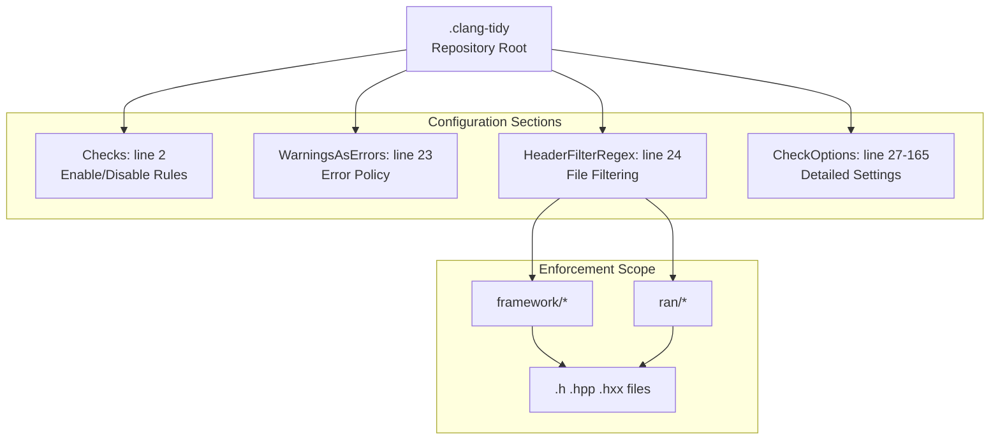
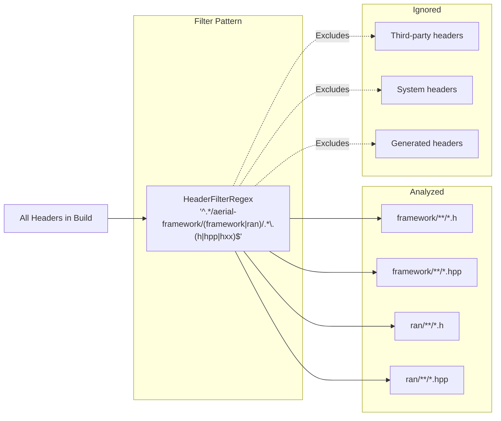
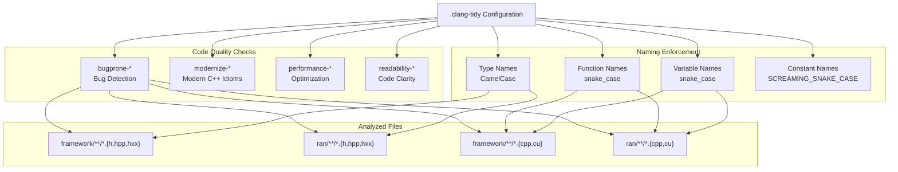

<!-- source: DeepWiki mcp.deepwiki.com · repo NVIDIA/aerial-framework · page 6.2 C++ Static Analysis · fetched 2026-10-26 -->

# C++ Static Analysis

<details>
<summary>Relevant source files</summary>

The following files were used as context for generating this wiki page:

- [.clang-tidy](.clang-tidy)

</details>


## Purpose and Scope

This document details the C++ static analysis configuration using `clang-tidy` for the NVIDIA Aerial Framework. The configuration enforces code quality through 130+ enabled checks, comprehensive naming conventions following a Rust-like style, and automated verification of code patterns. For C++ code formatting rules, see [C++ Code Formatting](#6.1). For Python linting, see [Python Code Quality](#6.3).

Sources: [.clang-tidy:1-165]()

## Configuration File Structure

The static analysis configuration is defined in `.clang-tidy` at the repository root. This YAML file specifies which checks to enable, naming conventions for all C++ language constructs, and file filtering rules for selective analysis.

### Configuration Location and Format



**Diagram: clang-tidy Configuration Structure**

The configuration file is processed by `clang-tidy` during static analysis runs, either through IDE integration or explicit build system targets.

Sources: [.clang-tidy:1-26]()

## Check Categories

The framework enables most clang-tidy checks but explicitly disables categories that conflict with the project's coding style or produce excessive false positives.

### Enabled Check Groups

All checks are enabled by default via the wildcard pattern `*` on line 2. This includes:

| Check Category | Purpose |
|----------------|---------|
| `bugprone-*` | Detect code patterns likely to cause bugs |
| `cert-*` | CERT C++ Secure Coding Standard compliance |
| `clang-analyzer-*` | Deep static analysis checks |
| `concurrency-*` | Thread safety and concurrency issues |
| `cppcoreguidelines-*` | C++ Core Guidelines enforcement |
| `modernize-*` | Modern C++ idiom suggestions |
| `performance-*` | Performance optimization opportunities |
| `portability-*` | Cross-platform portability issues |
| `readability-*` | Code readability improvements |

### Disabled Check Groups

The following check categories are explicitly disabled to align with project conventions:

```yaml
-abseil-*          # Not using Abseil library
-altera-*          # FPGA-specific checks not applicable
-android-*         # Not targeting Android platform
-fuchsia-*         # Not targeting Fuchsia OS
-google-*          # Not following Google C++ Style Guide
-llvm*             # Not following LLVM coding style
-zircon-*          # Not targeting Zircon kernel
```

Sources: [.clang-tidy:2-10]()

### Individual Check Exclusions

Specific checks are disabled to accommodate project design patterns:

| Disabled Check | Reason |
|----------------|--------|
| `modernize-use-trailing-return-type` | Project uses traditional return type syntax |
| `readability-else-after-return` | Early returns improve readability |
| `readability-static-accessed-through-instance` | Allows instance member access for consistency |
| `readability-avoid-const-params-in-decls` | Const parameters in declarations are acceptable |
| `cppcoreguidelines-non-private-member-variables-in-classes` | Public members allowed in data structures |
| `misc-non-private-member-variables-in-classes` | Same as above |
| `misc-no-recursion` | Recursion is allowed where appropriate |
| `misc-use-anonymous-namespace` | Static functions preferred over anonymous namespaces |
| `misc-use-internal-linkage` | Explicit linkage control preferred |
| `misc-include-cleaner` | Include optimization handled separately |
| `performance-enum-size` | Enum size optimization not required |
| `readability-identifier-length` | Custom length rules configured separately |
| `boost-use-ranges` | Not using Boost library |

Sources: [.clang-tidy:9-22]()

## Header Filtering

The `HeaderFilterRegex` configuration limits analysis to framework headers, excluding third-party dependencies and system headers.



**Diagram: Header Filtering Scope**

The regex pattern `^.*/aerial-framework/(framework|ran)/.*\.(h|hpp|hxx)$` ensures that only project-owned headers in the `framework/` and `ran/` directories are analyzed, with file extensions `.h`, `.hpp`, or `.hxx`.

Sources: [.clang-tidy:24]()

## Naming Conventions

The framework enforces comprehensive naming conventions following a Rust-like style: `CamelCase` for types, `snake_case` for functions and variables, and `SCREAMING_SNAKE_CASE` for constants and macros.

### Type Names (CamelCase)

All type-level constructs use `CamelCase`:

```mermaid
graph TB
    TypeNaming["readability-identifier-naming"]
    
    subgraph "Type Constructs - CamelCase"
        Class["ClassCase: CamelCase<br/>line 40"]
        Struct["StructCase: CamelCase<br/>line 42"]
        Enum["EnumCase: CamelCase<br/>line 44"]
        Union["UnionCase: CamelCase<br/>line 46"]
        Typedef["TypedefCase: CamelCase<br/>line 48"]
        TypeAlias["TypeAliasCase: CamelCase<br/>line 50"]
        Using["UsingCase: CamelCase<br/>line 52"]
    end
    
    subgraph "Template Constructs - CamelCase"
        TemplateParam["TemplateParameterCase: CamelCase<br/>line 134"]
        TemplateTemplate["TemplateTemplateParameterCase: CamelCase<br/>line 136"]
        Concept["ConceptCase: CamelCase<br/>line 138"]
    end
    
    subgraph "Enum Values - CamelCase"
        EnumConstant["EnumConstantCase: CamelCase<br/>line 120"]
        ScopedEnum["ScopedEnumConstantCase: CamelCase<br/>line 122"]
    end
    
    TypeNaming --> Class
    TypeNaming --> Struct
    TypeNaming --> Enum
    TypeNaming --> Union
    TypeNaming --> Typedef
    TypeNaming --> TypeAlias
    TypeNaming --> Using
    TypeNaming --> TemplateParam
    TypeNaming --> TemplateTemplate
    TypeNaming --> Concept
    TypeNaming --> EnumConstant
    TypeNaming --> ScopedEnum
```



**Diagram: Type Naming Convention Mapping**

Examples:
- Class: `SignalProcessor`, `CudaGraph`
- Struct: `PacketHeader`, `BufferDescriptor`
- Enum: `ErrorCode`, `ProcessingState`
- Enum constant: `ErrorCode::Success`, `State::Running`
- Template parameter: `template<typename ElementType>`
- Concept: `template<Numeric T>`

Sources: [.clang-tidy:39-52](), [.clang-tidy:119-122](), [.clang-tidy:133-138]()

### Function and Method Names (snake_case)

All callable entities use `snake_case`:

| Entity Type | Configuration | Line |
|-------------|---------------|------|
| Function | `FunctionCase: lower_case` | 58 |
| Method | `MethodCase: lower_case` | 60 |
| Class Method | `ClassMethodCase: lower_case` | 62 |
| Static Method | `StaticMethodCase: lower_case` | 64 |
| Private Method | `PrivateMethodCase: lower_case` | 66 |
| Public Method | `PublicMethodCase: lower_case` | 68 |
| Protected Method | `ProtectedMethodCase: lower_case` | 70 |
| Constexpr Function | `ConstexprFunctionCase: lower_case` | 72 |

Examples:
- Function: `process_signal()`, `allocate_buffer()`
- Method: `cuda_graph.launch()`, `scheduler.enqueue()`
- Static method: `Factory::create_instance()`
- Constexpr function: `constexpr auto compute_size()`

Sources: [.clang-tidy:57-72]()

### Variable and Member Names (snake_case)

All variable-like entities use `snake_case`:

```mermaid
graph TB
    VarNaming["readability-identifier-naming"]
    
    subgraph "Variables - snake_case"
        Variable["VariableCase: lower_case<br/>line 78"]
        LocalVar["LocalVariableCase: lower_case<br/>line 80"]
        Parameter["ParameterCase: lower_case<br/>line 82"]
        StaticVar["StaticVariableCase: lower_case<br/>line 84"]
        GlobalVar["GlobalVariableCase: lower_case<br/>line 86"]
    end
    
    subgraph "Members - snake_case + suffix"
        Member["MemberCase: lower_case<br/>line 88"]
        PrivateMember["PrivateMemberCase: lower_case<br/>PrivateMemberSuffix: '_'<br/>lines 90, 162"]
        PublicMember["PublicMemberCase: lower_case<br/>line 92"]
        ProtectedMember["ProtectedMemberCase: lower_case<br/>ProtectedMemberSuffix: '_'<br/>lines 94, 164"]
    end
    
    subgraph "Special Cases"
        ConstMember["ConstantMemberCase: lower_case<br/>ConstantMemberSuffix: '_'<br/>lines 110, 112"]
        LocalConst["LocalConstantCase: lower_case<br/>line 114"]
        StaticConst["StaticConstantCase: lower_case<br/>line 106"]
    end
    
    VarNaming --> Variable
    VarNaming --> LocalVar
    VarNaming --> Parameter
    VarNaming --> StaticVar
    VarNaming --> GlobalVar
    VarNaming --> Member
    VarNaming --> PrivateMember
    VarNaming --> PublicMember
    VarNaming --> ProtectedMember
    VarNaming --> ConstMember
    VarNaming --> LocalConst
    VarNaming --> StaticConst
```



**Diagram: Variable and Member Naming Conventions**

Examples:
- Local variable: `int buffer_size = 1024;`
- Parameter: `void process(const Packet& packet)`
- Private member: `class Processor { int state_; };`
- Protected member: `class Base { int count_; };`
- Const member: `class Config { const int max_size_; };`
- Local const: `const auto result = compute();`

Sources: [.clang-tidy:77-94](), [.clang-tidy:106-114](), [.clang-tidy:161-164]()

### Constant Names (SCREAMING_SNAKE_CASE)

True constants (not const-qualified parameters or local variables) use `SCREAMING_SNAKE_CASE`:

| Entity Type | Configuration | Line | Notes |
|-------------|---------------|------|-------|
| Constant | `ConstantCase: UPPER_CASE` | 102 | Global constants |
| Global Constant | `GlobalConstantCase: UPPER_CASE` | 104 | File-scope constants |
| Class Constant | `ClassConstantCase: UPPER_CASE` | 108 | Static member constants |
| Constexpr Variable | `ConstexprVariableCase: UPPER_CASE` | 116 | Compile-time constants |
| Static Constexpr | `StaticConstexprVariableCase: UPPER_CASE` | 118 | Static compile-time constants |
| Value Template Parameter | `ValueTemplateParameterCase: UPPER_CASE` | 142 | Non-type template parameters |

**Important distinction**: The configuration treats local const variables and const parameters as regular variables (using `snake_case`), reserving `SCREAMING_SNAKE_CASE` for true compile-time or global constants.

Examples:
- Global constant: `constexpr int MAX_BUFFER_SIZE = 4096;`
- Class constant: `static constexpr size_t DEFAULT_ALIGNMENT = 64;`
- Template parameter: `template<int BUFFER_COUNT>`
- Local const (lowercase): `const auto buffer = allocate();`
- Const parameter (lowercase): `void process(const int size)`

Sources: [.clang-tidy:101-118](), [.clang-tidy:127-128](), [.clang-tidy:141-142]()

### Namespace and Macro Names

Namespaces follow `snake_case` while macros use `SCREAMING_SNAKE_CASE`:

| Entity Type | Configuration | Line |
|-------------|---------------|------|
| Namespace | `NamespaceCase: lower_case` | 148 |
| Inline Namespace | `InlineNamespaceCase: lower_case` | 150 |
| Macro | `MacroCase: UPPER_CASE` | 156 |

Examples:
- Namespace: `namespace aerial::ran { }`
- Inline namespace: `inline namespace v1 { }`
- Macro: `#define MAX_THREADS 128`

Sources: [.clang-tidy:147-156]()

## Naming Convention Summary Table

The following table summarizes all naming conventions with their corresponding check options:

| Construct Category | Style | Examples | Configuration Lines |
|-------------------|-------|----------|-------------------|
| **Types** | CamelCase | `SignalProcessor`, `BufferType` | 39-52 |
| **Functions/Methods** | snake_case | `process_signal()`, `get_size()` | 57-72 |
| **Variables** | snake_case | `buffer_size`, `packet_count` | 77-94 |
| **Private/Protected Members** | snake_case + `_` | `state_`, `buffer_` | 90, 94, 161-164 |
| **True Constants** | SCREAMING_SNAKE_CASE | `MAX_SIZE`, `DEFAULT_VALUE` | 101-118 |
| **Local Const Variables** | snake_case | `const auto result` | 114 |
| **Const Parameters** | snake_case | `void f(const int size)` | 127-128 |
| **Enum Values** | CamelCase | `State::Running`, `Error::Success` | 119-122 |
| **Template Parameters** | CamelCase | `typename ElementType` | 133-138 |
| **Namespaces** | snake_case | `aerial::framework` | 147-150 |
| **Macros** | SCREAMING_SNAKE_CASE | `AERIAL_ASSERT` | 156 |

Sources: [.clang-tidy:39-156]()

## Special Configuration Options

### Cognitive Complexity

The `readability-function-cognitive-complexity` check is configured to ignore macros, preventing false positives from macro-generated code:

```yaml
readability-function-cognitive-complexity.IgnoreMacros: true
```

This prevents complexity warnings from macro expansions that may appear complex but are actually straightforward.

Sources: [.clang-tidy:32-33]()

### Swappable Parameters

The `bugprone-easily-swappable-parameters` check is configured with a minimum length of 3 parameters:

```yaml
bugprone-easily-swappable-parameters.MinimumLength: 3
```

This only warns when three or more consecutive parameters have the same type, reducing false positives from pairs like `(int width, int height)`.

Sources: [.clang-tidy:34-35]()

### Short Variable Names

Single-letter coordinate variables are allowed as exceptions to identifier length checks:

```yaml
readability-identifier-length.IgnoredVariableNames: 'x|y|z'
readability-identifier-length.IgnoredParameterNames: 'x|y|z'
```

This permits common mathematical coordinate names while still enforcing meaningful names elsewhere.

Sources: [.clang-tidy:28-31]()

## Warnings Policy

The configuration explicitly disables treating warnings as errors:

```yaml
WarningsAsErrors: ''
```

This allows static analysis to report issues without failing the build, enabling gradual improvement of code quality without blocking development.

Sources: [.clang-tidy:23]()

## Integration with Build System

The `.clang-tidy` configuration is automatically discovered by clang-tidy when run from any subdirectory of the repository. The build system likely provides targets for running static analysis, similar to the format and copyright check targets documented in [C++ Code Formatting](#6.1) and [Copyright and License Enforcement](#6.6).

### Running Static Analysis

Static analysis can be invoked through:
- **IDE integration**: VSCode and other IDEs automatically use `.clang-tidy` when configured with clangd or similar language servers
- **Command-line**: `clang-tidy` can be run directly on source files
- **CMake integration**: Build system targets likely exist for repository-wide analysis
- **CI/CD**: Automated checks during continuous integration

The `HeaderFilterRegex` ensures that only framework code is analyzed, excluding third-party dependencies from reports.

Sources: [.clang-tidy:24]()

## Check Configuration Map

The following diagram maps check categories to their enforcement locations in the codebase:



**Diagram: Static Analysis Enforcement Scope**

The configuration enforces checks on both headers (filtered by `HeaderFilterRegex`) and source files (all `.cpp` and `.cu` files in the build).

Sources: [.clang-tidy:1-165]()

## Related Configuration

This static analysis configuration works in concert with other code quality tools:
- **Formatting**: [C++ Code Formatting](#6.1) defines code style via `.clang-format`
- **Documentation**: [Documentation with Doxygen](#6.5) enforces docstring presence
- **Copyright**: [Copyright and License Enforcement](#6.6) validates SPDX headers

Together, these tools maintain consistent, high-quality C++ code throughout the framework.

---

