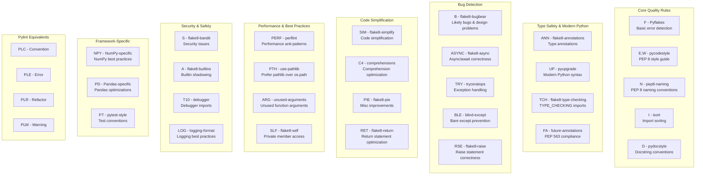
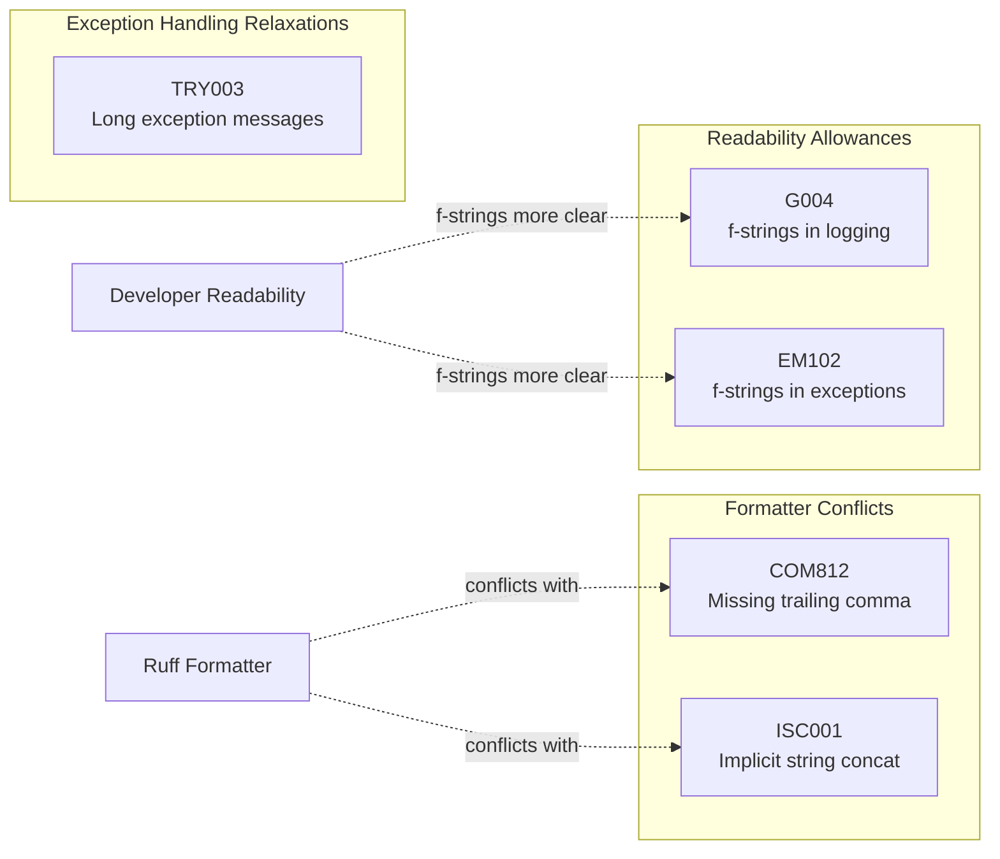
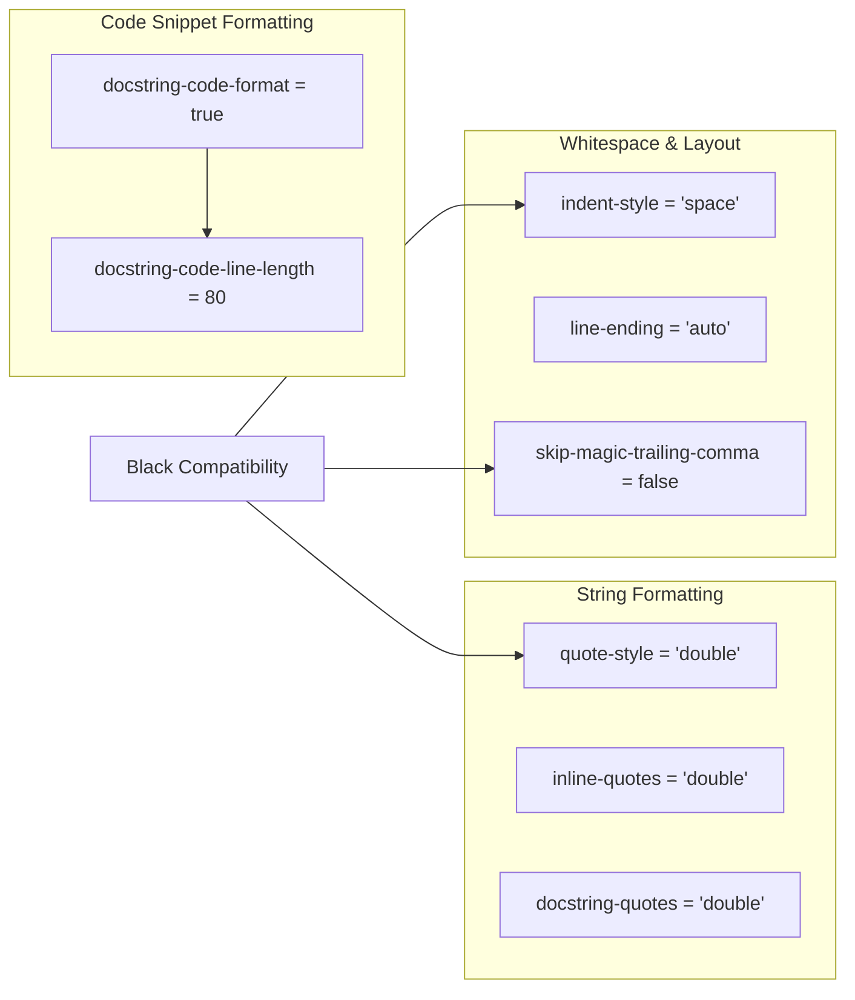

<!-- source: DeepWiki mcp.deepwiki.com · repo NVIDIA/aerial-framework · page 6.3 Python Code Quality · fetched 2026-10-26 -->

# Python Code Quality

<details>
<summary>Relevant source files</summary>

The following files were used as context for generating this wiki page:

- [.ruff.toml](.ruff.toml)

</details>


This page describes the Python code quality enforcement system used in the Aerial Framework. The framework uses **Ruff** as a comprehensive linting and formatting tool that replaces multiple traditional Python tools (black, isort, flake8, pylint) with a single, fast Rust-based implementation.

For C++ code quality enforcement, see [C++ Code Formatting](#6.1) and [C++ Static Analysis](#6.2). For CMake formatting, see [CMake Formatting](#6.4). For documentation standards, see [Documentation with Doxygen](#6.5).

---

## Configuration Overview

The Python code quality system is configured through a single TOML file that controls both linting and formatting behavior. Ruff enforces strict PEP compliance, comprehensive type annotations, and NumPy-style docstring conventions.

**Configuration File:** `.ruff.toml`

### Target Environment

| Setting | Value | Purpose |
|---------|-------|---------|
| **Target Version** | Python 3.12 | `.ruff.toml:40` |
| **Line Length** | 100 characters | `.ruff.toml:36` (matches Black) |
| **Indent Width** | 4 spaces | `.ruff.toml:37` |
| **Quote Style** | Double quotes (`"`) | `.ruff.toml:248` |

### Excluded Directories

The following directories are excluded from linting:

```
.git, .venv, .mypy_cache, .pytest_cache, .ruff_cache, .tox, .nox,
__pypackages__, _build, build, dist, venv, node_modules, site-packages
```

**Sources:** [.ruff.toml:6-33]()

---

## Rule Categories

Ruff enables **over 40 distinct rule categories** covering style, correctness, performance, security, and maintainability. This provides comprehensive code quality enforcement beyond what traditional single-purpose tools offer.

### Enabled Rule Sets



**Sources:** [.ruff.toml:44-143]()

### Rule Set Details

| Category | Code | Focus Area | Example Rules |
|----------|------|------------|---------------|
| **Pyflakes** | F | Syntax & logic errors | Undefined variables, unused imports |
| **pycodestyle** | E, W | PEP 8 compliance | Line length, whitespace, indentation |
| **pep8-naming** | N | Naming conventions | Class names, function names, constants |
| **isort** | I | Import organization | Import ordering, grouping |
| **pydocstyle** | D | Docstring format | NumPy convention, completeness |
| **flake8-annotations** | ANN | Type hints | Missing annotations, Any usage |
| **flake8-bugbear** | B | Bug patterns | Mutable defaults, unused loop vars |
| **flake8-simplify** | SIM | Code simplification | Unnecessary if/else, dict comprehensions |
| **perflint** | PERF | Performance | Inefficient operations, unnecessary copies |
| **flake8-bandit** | S | Security | Unsafe functions, hardcoded secrets |
| **NumPy-specific** | NPY | NumPy usage | Deprecated functions, type stubs |
| **Pylint** | PLC/PLE/PLR/PLW | Comprehensive checks | 50+ additional rules |

**Sources:** [.ruff.toml:44-143]()

---

## Ignored Rules

A minimal set of rules are disabled to prevent conflicts with the formatter or allow common practical patterns:



**Rationale:**
- **COM812, ISC001**: Conflict with the formatter's automatic decisions about trailing commas and string concatenation
- **TRY003**: Allows inline exception messages instead of requiring separate exception classes for every error
- **G004, EM102**: Permits f-strings in logging and exceptions for improved readability despite slight performance cost

**Sources:** [.ruff.toml:145-161]()

---

## Per-File Rule Exceptions

Different file types have tailored rule sets to accommodate their specific patterns:

### Package Init Files

```python
# **/src/**/__init__.py and **/tests/**/__init__.py
# Allowed exception: TID252 (relative imports)
```

**Rationale:** `__init__.py` files commonly use relative imports to expose package contents.

**Sources:** [.ruff.toml:163-170]()

### Test Files

```python
# **/tests/**/*.py
# Allowed exceptions:
#   S101  - Use of assert (required for pytest)
#   T201  - print statements (debugging)
#   TID252 - Relative imports (test utilities)
#   PT011 - pytest.raises without match parameter
#   PT012 - pytest.raises multiple statements
```

**Rationale:** Test files require asserts, may use print for debugging, and have relaxed import/exception handling requirements.

**Sources:** [.ruff.toml:172-179]()

---

## Type Annotation Enforcement

The framework enforces comprehensive type annotations to improve code maintainability and catch errors early:

### Annotation Configuration

| Setting | Value | Effect |
|---------|-------|--------|
| `allow-star-arg-any` | `false` | Disallow `*args: Any` - must specify actual types |
| `ignore-fully-untyped` | `false` | Enforce annotations even in untyped modules |
| `suppress-dummy-args` | `true` | Allow `_` arguments without annotations |

```python
# ❌ Not allowed
def process_data(*args: Any, **kwargs: Any) -> None:
    pass

# ✅ Required
def process_data(*values: int, **options: str) -> None:
    pass
```

### TYPE_CHECKING Import Optimization

The `TCH` (flake8-type-checking) rule set with `strict = true` enforces separation of runtime and type-checking-only imports:

```python
from typing import TYPE_CHECKING

if TYPE_CHECKING:
    from collections.abc import Sequence
    import numpy.typing as npt

def process_array(data: "npt.NDArray[np.float32]") -> "Sequence[float]":
    """Type imports only evaluated during static analysis."""
    ...
```

**Benefits:**
- Reduces runtime import overhead
- Prevents circular import issues
- Explicitly separates type-only dependencies

**Sources:** [.ruff.toml:215-220](), [.ruff.toml:237-240]()

---

## Docstring Conventions

The framework uses **NumPy-style docstrings** for consistency with scientific Python conventions:

### NumPy Docstring Format

```python
def calculate_fft(
    signal: npt.NDArray[np.complex64],
    normalize: bool = False,
) -> npt.NDArray[np.complex64]:
    """
    Compute Fast Fourier Transform of input signal.

    Parameters
    ----------
    signal : NDArray[complex64]
        Input time-domain signal to transform.
    normalize : bool, optional
        If True, normalize output by signal length, by default False.

    Returns
    -------
    NDArray[complex64]
        Frequency-domain representation of input signal.

    Raises
    ------
    ValueError
        If signal is empty or contains NaN/Inf values.

    Examples
    --------
    >>> signal = np.array([1+0j, 0+0j, 1+0j, 0+0j])
    >>> result = calculate_fft(signal)
    >>> result.shape
    (4,)
    """
    ...
```

### Docstring Code Formatting

Code snippets within docstrings are automatically formatted with a line length of 80 characters:

```toml
docstring-code-format = true
docstring-code-line-length = 80
```

**Sources:** [.ruff.toml:185-187](), [.ruff.toml:260-263]()

---

## Import Organization

Ruff's `isort` implementation enforces consistent import ordering:

### Import Configuration

```toml
[lint.isort]
known-first-party = ["ran"]
combine-as-imports = true
split-on-trailing-comma = true
```

### Import Order

```python
# 1. Standard library imports (alphabetical)
import os
import sys
from pathlib import Path

# 2. Third-party imports (alphabetical)
import numpy as np
import torch
from typing import TYPE_CHECKING

# 3. First-party imports (alphabetical)
from ran.phy.pusch import decoder
from ran.utils.config import load_yaml

# TYPE_CHECKING imports (conditional)
if TYPE_CHECKING:
    from ran.scheduler import TaskScheduler
```

### Import Style Rules

- **Ban relative imports**: `ban-relative-imports = "all"` enforces absolute imports throughout
- **Combine as imports**: `from module import a as x, b as y` instead of separate lines
- **Split on trailing comma**: Multi-line imports when trailing comma present

**Sources:** [.ruff.toml:193-201](), [.ruff.toml:233-235]()

---

## Complexity Limits

The framework enforces code complexity constraints to maintain readability and testability:

### McCabe Complexity

```toml
[lint.mccabe]
max-complexity = 10
```

**Cyclomatic complexity** measures the number of linearly independent paths through code. Functions exceeding 10 decision points must be refactored.

```python
# ❌ Complexity = 12 (too high)
def process_packet(packet):
    if packet.type == "data":
        if packet.encrypted:
            if packet.compression == "gzip":
                # ... deep nesting continues
                
# ✅ Refactored into smaller functions
def process_packet(packet):
    if packet.type == "data":
        return handle_data_packet(packet)
    # ... simpler logic per function
```

### Pylint-Style Limits

| Metric | Limit | Rule |
|--------|-------|------|
| **Function arguments** | 8 max | `max-args = 8` |
| **Branch count** | 12 max | `max-branches = 12` |
| **Return statements** | 6 max | `max-returns = 6` |
| **Statements per function** | 50 max | `max-statements = 50` |

**Sources:** [.ruff.toml:189-191](), [.ruff.toml:208-213]()

---

## Formatting Configuration

Ruff's formatter provides Black-compatible formatting with additional features:

### Formatting Settings



### Magic Trailing Comma

Like Black, Ruff respects "magic trailing commas" to control formatting:

```python
# Single line (no trailing comma)
short_list = [1, 2, 3]

# Multi-line (trailing comma forces line breaks)
long_list = [
    "very_long_item_one",
    "very_long_item_two",
    "very_long_item_three",  # ← magic trailing comma
]
```

**Sources:** [.ruff.toml:246-266](), [.ruff.toml:202-207]()

---

## Security and Safety Rules

The framework enables `flake8-bandit` (S) rules to detect common security issues:

### Security Checks

```python
# ❌ S105: Hardcoded password
password = "admin123"

# ❌ S106: Hardcoded password in argument
def connect(password="default_pass"):
    ...

# ❌ S108: Hardcoded /tmp path (insecure)
temp_file = "/tmp/data.txt"

# ✅ Secure alternatives
from pathlib import Path
import tempfile

password = os.environ.get("DB_PASSWORD")
temp_file = Path(tempfile.gettempdir()) / "data.txt"
```

### Additional Safety Rules

- **A (flake8-builtins)**: Prevents shadowing Python builtins like `list`, `dict`, `str`
- **T10 (debugger)**: Flags `import pdb` or `breakpoint()` calls before production
- **LOG (logging-format)**: Enforces proper logging practices (e.g., lazy % formatting)

**Sources:** [.ruff.toml:107-108](), [.ruff.toml:139-140]()

---

## Pytest Style Configuration

For test files, Ruff enforces consistent pytest conventions:

### Pytest Configuration

```toml
[lint.flake8-pytest-style]
fixture-parentheses = false
mark-parentheses = false
parametrize-names-type = "tuple"
parametrize-values-type = "tuple"
parametrize-values-row-type = "tuple"
```

### Example Test Style

```python
import pytest

# ✅ Correct: no parentheses on fixture decorator
@pytest.fixture
def sample_data():
    return [1, 2, 3, 4, 5]

# ✅ Correct: no parentheses on mark
@pytest.mark.slow
def test_heavy_computation():
    ...

# ✅ Correct: tuple parametrization
@pytest.mark.parametrize(
    ("input_val", "expected"),
    (
        (1, 2),
        (3, 6),
        (5, 10),
    ),
)
def test_doubling(input_val, expected):
    assert input_val * 2 == expected
```

**Sources:** [.ruff.toml:225-231]()

---

## Integration with Build System

Ruff is integrated into the development workflow through:

### Automatic Formatting

```bash
# Format all Python files
ruff format .

# Check formatting without making changes
ruff format --check .
```

### Linting

```bash
# Lint with automatic fixes
ruff check --fix .

# Lint without fixes (CI mode)
ruff check .
```

### Fixable Rules

All enabled rules are marked as fixable when possible:

```toml
fixable = ["ALL"]
unfixable = []
```

This means running `ruff check --fix` will automatically correct violations where safe to do so.

**Sources:** [.ruff.toml:182-183]()

---

## Rule Categories Summary

The following diagram maps high-level quality objectives to specific Ruff rule categories:

```mermaid
graph TB
    subgraph "Code Quality Objectives"
        Correctness["Correctness"]
        Style["Style & Consistency"]
        Maintainability["Maintainability"]
        Performance["Performance"]
        Security["Security"]
        Documentation["Documentation"]
    end
    
    subgraph "Ruff Rule Categories"
        F_Rules["F - Pyflakes"]
        B_Rules["B - Bugbear"]
        PLE_Rules["PLE - Pylint Errors"]
        
        E_Rules["E,W - pycodestyle"]
        N_Rules["N - Naming"]
        I_Rules["I - Import sorting"]
        Q_Rules["Q - Quote style"]
        
        PLR_Rules["PLR - Pylint Refactor"]
        SIM_Rules["SIM - Simplify"]
        C4_Rules["C4 - Comprehensions"]
        ANN_Rules["ANN - Annotations"]
        
        PERF_Rules["PERF - Performance"]
        NPY_Rules["NPY - NumPy"]
        
        S_Rules["S - Bandit Security"]
        A_Rules["A - Builtins"]
        
        D_Rules["D - Docstrings"]
        TCH_Rules["TCH - Type checking"]
    end
    
    Correctness --> F_Rules
    Correctness --> B_Rules
    Correctness --> PLE_Rules
    
    Style --> E_Rules
    Style --> N_Rules
    Style --> I_Rules
    Style --> Q_Rules
    
    Maintainability --> PLR_Rules
    Maintainability --> SIM_Rules
    Maintainability --> C4_Rules
    Maintainability --> ANN_Rules
    
    Performance --> PERF_Rules
    Performance --> NPY_Rules
    
    Security --> S_Rules
    Security --> A_Rules
    
    Documentation --> D_Rules
    Documentation --> TCH_Rules
```



**Sources:** [.ruff.toml:44-143]()

---

## Comparison with Traditional Tools

Ruff replaces multiple traditional Python tools with a single, fast implementation:

| Traditional Tool | Ruff Equivalent | Purpose |
|------------------|-----------------|---------|
| **black** | `ruff format` | Code formatting |
| **isort** | `ruff check --select I` | Import sorting |
| **flake8** | `ruff check --select E,W,F` | Style & errors |
| **pylint** | `ruff check --select PL*` | Comprehensive linting |
| **pydocstyle** | `ruff check --select D` | Docstring conventions |
| **bandit** | `ruff check --select S` | Security scanning |
| **pyupgrade** | `ruff check --select UP` | Syntax modernization |

**Performance Advantage:** Ruff is written in Rust and runs 10-100× faster than traditional Python-based tools, making it suitable for pre-commit hooks and CI pipelines.

**Sources:** [.ruff.toml:1-3]()

---

