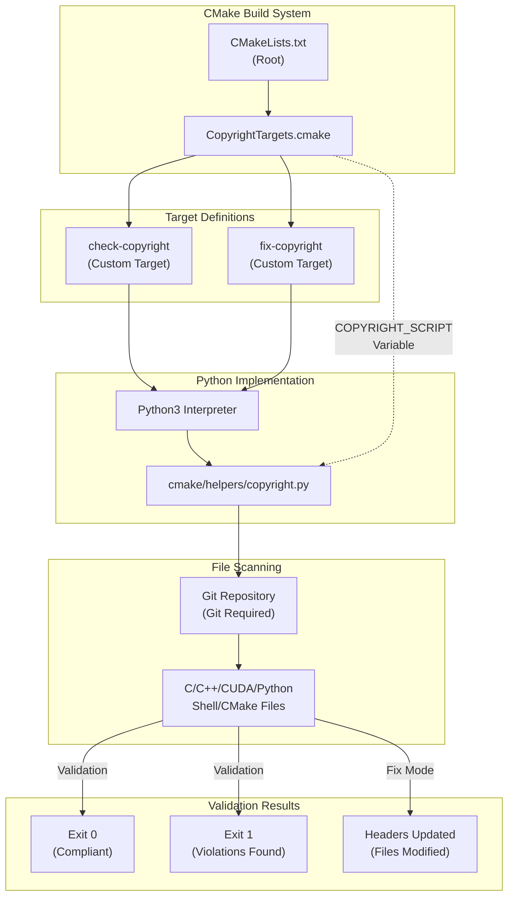
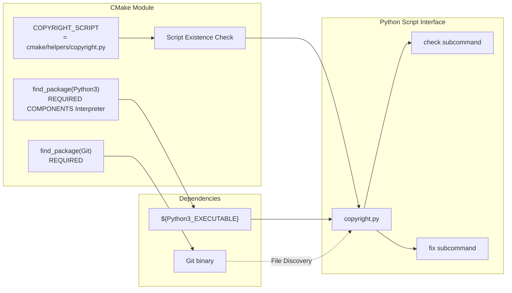
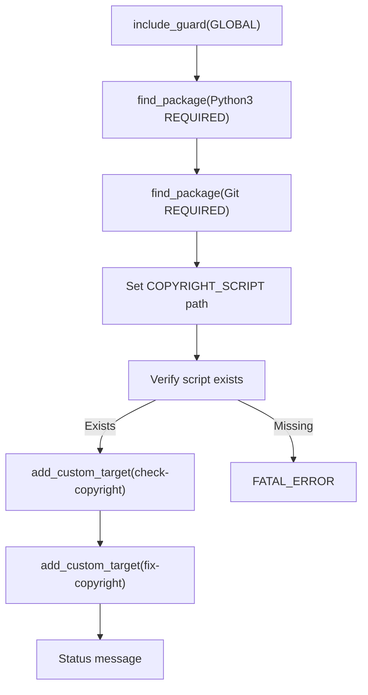

<!-- source: DeepWiki mcp.deepwiki.com · repo NVIDIA/aerial-framework · page 6.6 Copyright and License Enforcement · fetched 2026-10-26 -->

# Copyright and License Enforcement

<details>
<summary>Relevant source files</summary>

The following files were used as context for generating this wiki page:

- [cmake/CopyrightTargets.cmake](cmake/CopyrightTargets.cmake)

</details>


## Purpose and Scope

This document describes the automated copyright header validation and enforcement system in the NVIDIA Aerial Framework. The system ensures all source files contain proper SPDX-compliant copyright headers with NVIDIA's Apache 2.0 license information. This enforcement is implemented through CMake targets that scan, validate, and optionally fix copyright headers across C/C++/CUDA/Python/Shell/CMake files.

For information about other code quality enforcement, see [C++ Code Formatting](#6.1), [C++ Static Analysis](#6.2), and [Python Code Quality](#6.3). For license and attribution details, see [License and Attribution](#9.1).

---

## SPDX Copyright Header Format

All source files in the repository must include an SPDX-compliant copyright header at the beginning of the file. The expected format includes three key SPDX tags:

| SPDX Tag | Purpose | Value |
|----------|---------|-------|
| `SPDX-FileCopyrightText` | Copyright holder and year | `Copyright (c) 2025 NVIDIA CORPORATION & AFFILIATES. All rights reserved.` |
| `SPDX-License-Identifier` | License type | `Apache-2.0` |
| License Body | Full license text | Apache 2.0 license with URL and disclaimer |

The complete header format as shown in [cmake/CopyrightTargets.cmake:1-14]():

```
SPDX-FileCopyrightText: Copyright (c) 2025 NVIDIA CORPORATION & AFFILIATES. All rights reserved.
SPDX-License-Identifier: Apache-2.0

Licensed under the Apache License, Version 2.0 (the "License");
you may not use this file except in compliance with the License.
You may obtain a copy of the License at

http://www.apache.org/licenses/LICENSE-2.0

Unless required by applicable law or agreed to in writing, software
distributed under the License is distributed on an "AS IS" BASIS,
WITHOUT WARRANTIES OR CONDITIONS OF ANY KIND, either express or implied.
See the License for the specific language governing permissions and
limitations under the License.
```

The header must be wrapped in comment syntax appropriate to the file type (e.g., `#` for Python/CMake/Shell, `//` for C++/CUDA).

**Sources:** [cmake/CopyrightTargets.cmake:1-14]()

---

## Copyright Enforcement Architecture



The copyright enforcement system consists of three layers: CMake target definitions, Python script execution, and file scanning/validation logic. The [cmake/CopyrightTargets.cmake]() module creates two custom targets that invoke a Python script to process files discovered through Git.

**Sources:** [cmake/CopyrightTargets.cmake:16-54]()

---

## Copyright Enforcement Targets

### check-copyright Target

The `check-copyright` target performs validation-only checking of copyright headers. It scans all tracked source files and reports violations without modifying any files.

**Target Definition:** [cmake/CopyrightTargets.cmake:38-43]()

```cmake
add_custom_target(
    check-copyright
    COMMAND ${Python3_EXECUTABLE} ${COPYRIGHT_SCRIPT} check
    WORKING_DIRECTORY ${CMAKE_SOURCE_DIR}
    COMMENT "Checking copyright headers for SPDX compliance"
    VERBATIM)
```

**Behavior:**
- Executes `${COPYRIGHT_SCRIPT} check` via Python3 interpreter
- Runs from `${CMAKE_SOURCE_DIR}` (repository root)
- Exit code 0: All files compliant
- Exit code 1: Violations found (reported to stdout)
- No file modifications performed

### fix-copyright Target

The `fix-copyright` target automatically repairs non-compliant copyright headers by adding or updating SPDX tags and license text.

**Target Definition:** [cmake/CopyrightTargets.cmake:46-51]()

```cmake
add_custom_target(
    fix-copyright
    COMMAND ${Python3_EXECUTABLE} ${COPYRIGHT_SCRIPT} fix
    WORKING_DIRECTORY ${CMAKE_SOURCE_DIR}
    COMMENT "Fixing copyright headers to ensure SPDX compliance"
    VERBATIM)
```

**Behavior:**
- Executes `${COPYRIGHT_SCRIPT} fix` via Python3 interpreter
- Modifies files in-place to add/update headers
- Preserves existing file content after header
- Applies language-specific comment syntax

**Sources:** [cmake/CopyrightTargets.cmake:38-51]()

---

## Implementation Components



The implementation requires two external tools: Python3 interpreter (found via `find_package`) and Git (for repository file discovery). The script path is stored in the `COPYRIGHT_SCRIPT` variable and validated at configuration time.

**Sources:** [cmake/CopyrightTargets.cmake:23-32](), [cmake/CopyrightTargets.cmake:34-36]()

---

## File Type Coverage

The copyright enforcement system scans multiple file types across the codebase:

| File Type | Extensions | Comment Syntax |
|-----------|-----------|----------------|
| C/C++ Source | `.c`, `.cpp`, `.cc`, `.cxx` | `//` or `/* */` |
| C/C++ Headers | `.h`, `.hpp`, `.hxx` | `//` or `/* */` |
| CUDA | `.cu`, `.cuh` | `//` or `/* */` |
| Python | `.py` | `#` |
| Shell | `.sh`, `.bash` | `#` |
| CMake | `.cmake`, `CMakeLists.txt` | `#` |

The comment syntax is automatically detected and applied based on file extension when fixing headers.

**Note:** The specific file extensions and scanning logic are implemented in [cmake/helpers/copyright.py](), which is invoked by the CMake targets defined in [cmake/CopyrightTargets.cmake]().

**Sources:** [cmake/CopyrightTargets.cmake:18-19]()

---

## Usage Examples

### Running Copyright Validation

To check if all files have compliant copyright headers:

```bash
# From build directory
cmake --build . --target check-copyright

# Or using make/ninja directly
make check-copyright
ninja check-copyright
```

**Expected Output:**
- Success: No output, exit code 0
- Failure: List of non-compliant files, exit code 1

### Fixing Copyright Headers

To automatically fix non-compliant headers:

```bash
# From build directory
cmake --build . --target fix-copyright

# Or using make/ninja directly
make fix-copyright
ninja fix-copyright
```

**Warning:** The `fix-copyright` target modifies files in-place. Review changes with `git diff` before committing.

### Integration with CI/CD

The `check-copyright` target is typically added to CI pipelines to prevent merging code with missing or incorrect copyright headers:

```yaml
# Example CI step
- name: Validate Copyright Headers
  run: cmake --build build --target check-copyright
```

**Sources:** [cmake/CopyrightTargets.cmake:38-51]()

---

## Module Initialization



The [cmake/CopyrightTargets.cmake]() module initialization sequence ensures all dependencies are available before creating targets. The script includes an `include_guard(GLOBAL)` directive at [cmake/CopyrightTargets.cmake:21]() to prevent multiple inclusions.

**Script Validation:** [cmake/CopyrightTargets.cmake:30-32]()

```cmake
if(NOT EXISTS "${COPYRIGHT_SCRIPT}")
    message(FATAL_ERROR "CopyrightTargets.cmake: copyright.py not found at ${COPYRIGHT_SCRIPT}")
endif()
```

If the Python script is missing, configuration fails immediately with a fatal error rather than producing non-functional targets.

**Status Logging:** [cmake/CopyrightTargets.cmake:53-54]()

```cmake
message(
    STATUS "CopyrightTargets: Created copyright checking targets (check-copyright, fix-copyright)")
```

**Sources:** [cmake/CopyrightTargets.cmake:21-54]()

---

## Integration with Build System

The `CopyrightTargets.cmake` module is included from the root `CMakeLists.txt` during project configuration. The targets are available immediately after CMake configuration completes:

```bash
# Configuration phase
cmake -S . -B build -G Ninja

# Targets available after configuration
cmake --build build --target check-copyright
cmake --build build --target fix-copyright
```

The targets do not depend on any compiled artifacts and can be invoked without building the project:

```bash
# Check headers without building anything
cmake --build build --target check-copyright --config Debug
```

Both targets execute from `${CMAKE_SOURCE_DIR}`, ensuring they operate on source files rather than build artifacts.

**Sources:** [cmake/CopyrightTargets.cmake:41-49]()

---

## Error Handling

### Missing Python Interpreter

If Python3 is not found, CMake configuration fails at [cmake/CopyrightTargets.cmake:24]():

```
CMake Error at cmake/CopyrightTargets.cmake:24 (find_package):
  Could not find a package configuration file provided by "Python3" with
  any of the following names:
    Python3Config.cmake
    python3-config.cmake
```

### Missing Git

If Git is not found, CMake configuration fails at [cmake/CopyrightTargets.cmake:35]():

```
CMake Error at cmake/CopyrightTargets.cmake:35 (find_package):
  Could not find a package configuration file provided by "Git"
```

### Missing Python Script

If `copyright.py` does not exist, configuration fails with a custom error message at [cmake/CopyrightTargets.cmake:30-32]():

```
CMake Error at cmake/CopyrightTargets.cmake:31 (message):
  CopyrightTargets.cmake: copyright.py not found at /path/to/cmake/helpers/copyright.py
```

**Sources:** [cmake/CopyrightTargets.cmake:24-35]()

---

## Summary

The copyright enforcement system provides automated SPDX compliance validation through two CMake targets:

| Target | Mode | File Modification | Exit on Error |
|--------|------|-------------------|---------------|
| `check-copyright` | Validation | No | Yes (exit 1) |
| `fix-copyright` | Repair | Yes (in-place) | No |

The system integrates with the development workflow through:
- Pre-commit validation (developers run `check-copyright` locally)
- CI/CD enforcement (automated builds fail on violations)
- Bulk fixing (maintainers run `fix-copyright` to update headers)

This ensures all code entering the repository maintains consistent copyright headers and SPDX license identifiers as required by NVIDIA's Apache 2.0 licensing.

**Sources:** [cmake/CopyrightTargets.cmake]()

---

