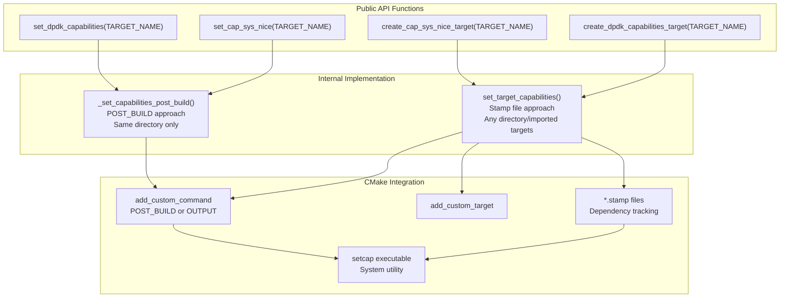
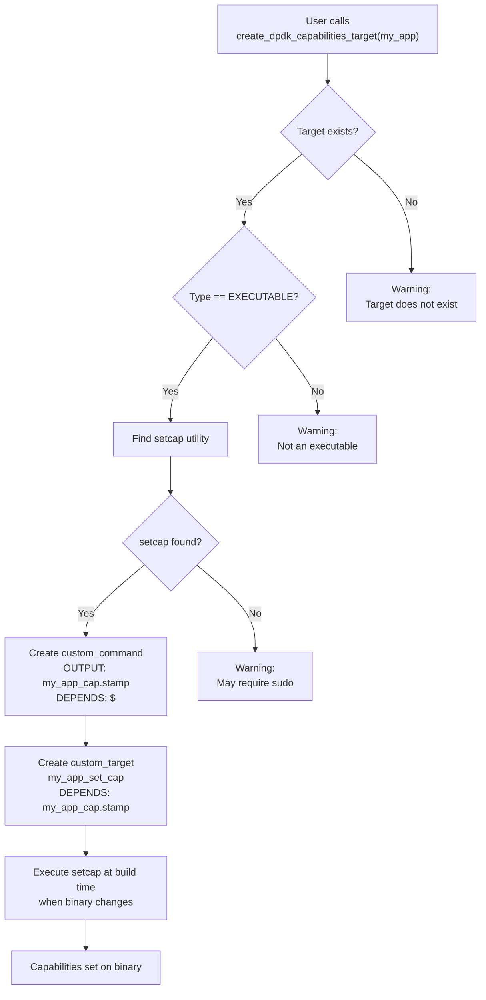
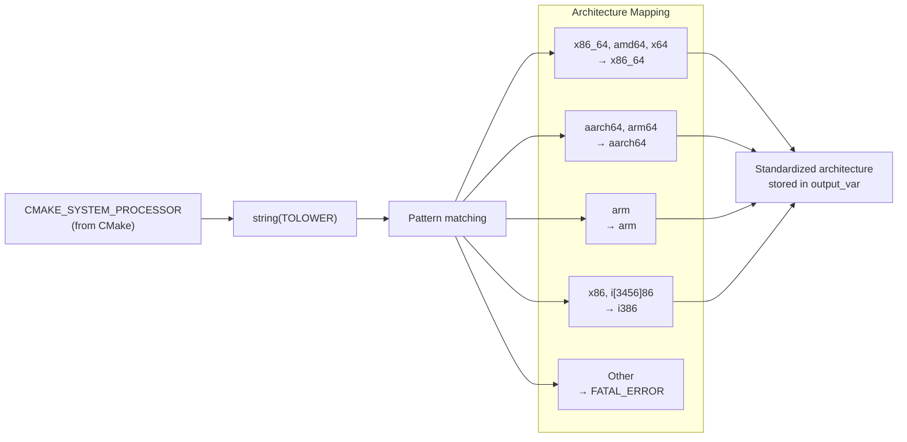
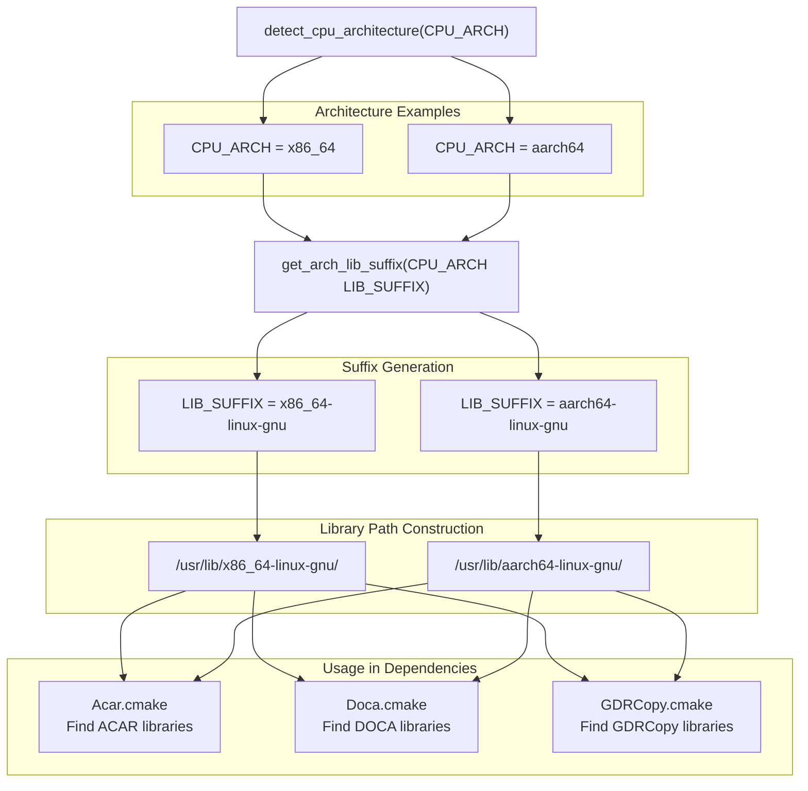
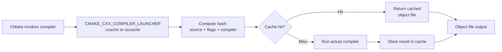
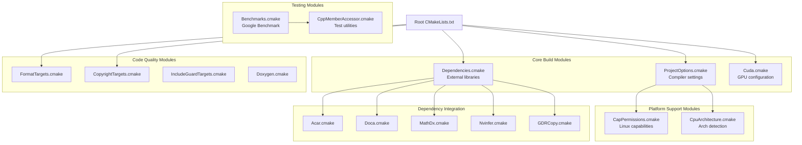

<!-- source: DeepWiki mcp.deepwiki.com · repo NVIDIA/aerial-framework · page 7 Advanced Topics · fetched 2026-10-26 -->

# Advanced Topics

<details>
<summary>Relevant source files</summary>

The following files were used as context for generating this wiki page:

- [cmake/CapPermissions.cmake](cmake/CapPermissions.cmake)
- [cmake/CpuArchitecture.cmake](cmake/CpuArchitecture.cmake)

</details>


## Purpose and Scope

This page documents specialized build system features and utilities in the NVIDIA Aerial Framework that address cross-platform concerns, security requirements, and build optimization. These modules provide infrastructure for setting Linux capabilities on executables, detecting CPU architectures for multi-platform builds, caching compiler outputs, and other advanced CMake utilities.

For general build system configuration, see [CMake Configuration](#4.1). For dependency management, see [Dependency Management with CPM](#4.3). For standard compiler settings, see [Compiler Warnings and Code Quality](#4.5).

---

## Linux Capabilities Management

The Aerial Framework requires elevated permissions for DPDK networking operations and real-time thread scheduling without running as root. The [cmake/CapPermissions.cmake:1-111]() module provides functions to set Linux capabilities on executable targets using the `setcap` utility.

### Capabilities Overview

Linux capabilities partition root privileges into distinct units. The framework uses two capability sets:

| Capability Set | Capabilities | Purpose |
|----------------|--------------|---------|
| DPDK Operations | `cap_net_raw`, `cap_net_admin`, `cap_sys_rawio`, `cap_ipc_lock`, `cap_dac_override`, `cap_sys_admin`, `cap_sys_nice` | Enable DPDK DevX/TIS operations for GPU-accelerated networking |
| Real-Time Scheduling | `cap_sys_nice` | Allow setting high-priority thread scheduling policies without root |

The capabilities are set with `eip` flags (effective, inheritable, permitted) as defined in [cmake/CapPermissions.cmake:17-19]().

### Architecture: Capability Setting Functions



**Sources:** [cmake/CapPermissions.cmake:1-111]()

### Function Reference

#### Simple POST_BUILD Functions

The `_set_capabilities_post_build()` internal function [cmake/CapPermissions.cmake:24-40]() attaches a `POST_BUILD` command to the target. This approach works only for targets defined in the same `CMakeLists.txt` file due to CMake limitations.

**Public wrappers:**
- `set_dpdk_capabilities(TARGET_NAME)` [cmake/CapPermissions.cmake:94-97](): Sets DPDK capability set
- `set_cap_sys_nice(TARGET_NAME)` [cmake/CapPermissions.cmake:99-101](): Sets only `cap_sys_nice`

**Limitations:**
- Target must be defined in the same directory
- Cannot be used with imported targets from `find_package()`
- Cannot be used with targets from subdirectories

#### Universal Stamp File Functions

The `set_target_capabilities()` function [cmake/CapPermissions.cmake:48-92]() uses stamp files to work around CMake's directory-scoping limitations. It creates a custom command that:

1. Depends on `$<TARGET_FILE:${TARGET_NAME}>` [cmake/CapPermissions.cmake:81]()
2. Runs `setcap` when the binary changes
3. Touches a `.stamp` file to track completion [cmake/CapPermissions.cmake:69,80]()
4. Creates a custom target that runs as part of `ALL` [cmake/CapPermissions.cmake:86]()

**Public wrappers:**
- `create_cap_sys_nice_target(TARGET_NAME)` [cmake/CapPermissions.cmake:103-105]()
- `create_dpdk_capabilities_target(TARGET_NAME)` [cmake/CapPermissions.cmake:107-110]()

**Advantages:**
- Works with imported targets
- Works across directory boundaries
- Only runs when binary actually changes

### Error Handling

The module performs validation checks:

| Check | Location | Behavior |
|-------|----------|----------|
| Target exists | [cmake/CapPermissions.cmake:50-53]() | Warning if target doesn't exist |
| Target type | [cmake/CapPermissions.cmake:55-64]() | Warning if not EXECUTABLE |
| `setcap` availability | [cmake/CapPermissions.cmake:27,66-68]() | Warning if utility not found |

When `setcap` is unavailable, a warning message indicates that applications may require `sudo` or privileged containers [cmake/CapPermissions.cmake:38-39,89-91]().

### Capability Setting Flow



**Sources:** [cmake/CapPermissions.cmake:48-92]()

### Usage Examples

```cmake
# In ran/phy/pusch/CMakeLists.txt
add_executable(pusch_decoder pusch_decoder.cpp)

# Approach 1: Same directory, POST_BUILD
set_dpdk_capabilities(pusch_decoder)

# Approach 2: Universal stamp file (works anywhere)
create_dpdk_capabilities_target(pusch_decoder)

# For real-time scheduling only
create_cap_sys_nice_target(pusch_decoder)
```

**Sources:** [cmake/CapPermissions.cmake:1-111]()

---

## CPU Architecture Detection

The [cmake/CpuArchitecture.cmake:1-92]() module provides functions to detect the target CPU architecture and generate architecture-specific library path suffixes for cross-platform builds. This is essential for locating pre-compiled libraries in multi-arch Linux installations.

### Supported Architectures

The module standardizes architecture names from CMake's `CMAKE_SYSTEM_PROCESSOR`:

| Input Values | Standardized Output | Library Suffix |
|--------------|---------------------|----------------|
| `x86_64`, `amd64`, `x64` | `x86_64` | `x86_64-linux-gnu` |
| `aarch64`, `arm64` | `aarch64` | `aarch64-linux-gnu` |
| `arm` | `arm` | `arm-linux-gnueabihf` |
| `x86`, `i[3456]86` | `i386` | `i386-linux-gnu` |

These mappings are defined in [cmake/CpuArchitecture.cmake:33-44]() and [cmake/CpuArchitecture.cmake:75-82]().

### Architecture Detection Flow



**Sources:** [cmake/CpuArchitecture.cmake:30-57]()

### Function Reference

#### detect_cpu_architecture()

Detects the target architecture and returns a standardized identifier.

**Signature:**
```cmake
detect_cpu_architecture(output_var)
```

**Parameters:**
- `output_var`: Variable name to store the detected architecture

**Implementation:** [cmake/CpuArchitecture.cmake:30-57]()

**Algorithm:**
1. Convert `CMAKE_SYSTEM_PROCESSOR` to lowercase [cmake/CpuArchitecture.cmake:31]()
2. Match against known architecture patterns [cmake/CpuArchitecture.cmake:33-44]()
3. Log detected architecture via `message(STATUS)` [cmake/CpuArchitecture.cmake:53]()
4. Fatal error if architecture is unsupported [cmake/CpuArchitecture.cmake:46-50]()

#### get_arch_lib_suffix()

Returns the standard library directory suffix for multi-arch installations.

**Signature:**
```cmake
get_arch_lib_suffix(arch output_var)
```

**Parameters:**
- `arch`: Architecture name from `detect_cpu_architecture()`
- `output_var`: Variable name to store the suffix

**Implementation:** [cmake/CpuArchitecture.cmake:74-91]()

**Suffix Format:** The returned suffix follows Debian/Ubuntu multi-arch conventions where libraries are installed in `/usr/lib/<suffix>/` directories.

### Library Path Resolution



**Sources:** [cmake/CpuArchitecture.cmake:30-91]()

### Error Conditions

The module enforces architecture support through fatal errors:

**Unsupported Architecture Detection:**
```cmake
# cmake/CpuArchitecture.cmake:46-50
message(FATAL_ERROR
    "Unsupported CPU architecture: ${CMAKE_SYSTEM_PROCESSOR_LOWER}. "
    "Supported CPU architectures: x86_64, amd64, x64, aarch64, arm64, arm, x86, i[3456]86"
)
```

**Unsupported Library Suffix:**
```cmake
# cmake/CpuArchitecture.cmake:84-85
message(FATAL_ERROR "Unsupported CPU architecture for library suffix: ${arch}. "
                    "Supported CPU architectures: x86_64, aarch64, arm, i386")
```

### Usage Example

```cmake
# Detect architecture
detect_cpu_architecture(TARGET_ARCH)

# Get library suffix for path construction
get_arch_lib_suffix(${TARGET_ARCH} ARCH_LIB_SUFFIX)

# Use in library search paths
find_library(DOCA_GPUNETIO_LIB
    NAMES doca_gpunetio
    PATHS /opt/mellanox/doca/lib/${ARCH_LIB_SUFFIX}
    REQUIRED
)
```

**Sources:** [cmake/CpuArchitecture.cmake:1-92]()

---

## Compiler Caching

The build system supports compiler caching through `ccache` and `sccache` to accelerate incremental builds. Compiler caching stores compiled object files keyed by source content and compiler flags, avoiding recompilation when switching branches or rebuilding from scratch.

### Cache Types

| Cache Tool | Language Support | Backend | Use Case |
|------------|------------------|---------|----------|
| `ccache` | C, C++, CUDA | Local filesystem | Single-machine development |
| `sccache` | C, C++, CUDA, Rust | Local, Redis, S3, GCS | Distributed teams, CI/CD |

### Integration

The build system auto-detects cache tools during CMake configuration:

```cmake
# Auto-detection in ProjectOptions.cmake or Dependencies.cmake
find_program(CCACHE_PROGRAM ccache)
find_program(SCCACHE_PROGRAM sccache)

if(CCACHE_PROGRAM)
    set(CMAKE_C_COMPILER_LAUNCHER ${CCACHE_PROGRAM})
    set(CMAKE_CXX_COMPILER_LAUNCHER ${CCACHE_PROGRAM})
    set(CMAKE_CUDA_COMPILER_LAUNCHER ${CCACHE_PROGRAM})
elseif(SCCACHE_PROGRAM)
    set(CMAKE_C_COMPILER_LAUNCHER ${SCCACHE_PROGRAM})
    set(CMAKE_CXX_COMPILER_LAUNCHER ${SCCACHE_PROGRAM})
    set(CMAKE_CUDA_COMPILER_LAUNCHER ${SCCACHE_PROGRAM})
endif()
```

### Configuration

Cache behavior is controlled through environment variables:

**ccache:**
```bash
# Set cache directory
export CCACHE_DIR=/workspace/.cache/ccache
export CCACHE_MAXSIZE=10G

# Enable compression
export CCACHE_COMPRESS=1
export CCACHE_COMPRESSLEVEL=6
```

**sccache:**
```bash
# Local cache
export SCCACHE_DIR=/workspace/.cache/sccache

# S3 backend for CI/CD
export SCCACHE_BUCKET=my-build-cache
export SCCACHE_REGION=us-east-1
```

### Compiler Launcher Flow



### Performance Impact

Expected speedup scenarios:

| Scenario | Without Cache | With Cache (Hit) | Speedup |
|----------|---------------|------------------|---------|
| Full rebuild after `git checkout` | 15 minutes | 30 seconds | 30× |
| Incremental rebuild (10 files changed) | 45 seconds | 10 seconds | 4.5× |
| CI/CD fresh build | 15 minutes | 2 minutes | 7.5× |

**Note:** Cache effectiveness depends on cache hit rate, network latency (for distributed caches), and compilation patterns.

---

## Helper CMake Modules

The `cmake/` directory contains specialized utility modules beyond the core build system.

### CppMemberAccessor Module

Provides compile-time member access utilities for C++ reflection and testing. This module enables accessing private/protected members for unit testing without modifying class definitions.

**Common Use Cases:**
- Unit testing private methods
- Mocking protected virtual functions
- Accessing private data members for verification

**Implementation Pattern:**
```cmake
# Adds preprocessor definitions to enable member accessor macros
target_compile_definitions(my_test PRIVATE 
    ENABLE_MEMBER_ACCESS
)
```

The actual accessor macros are typically defined in C++ headers included by test files, allowing syntax like:

```cpp
// Test accesses private member through macro
auto private_value = PRIVATE_MEMBER_ACCESS(MyClass, my_instance, private_field_);
```

### Module Organization



### Additional Utility Modules

The `cmake/` directory contains 20+ specialized modules. While detailed documentation for all modules is beyond this page's scope, key categories include:

**Dependency Integration:** `Acar.cmake`, `Doca.cmake`, `MathDx.cmake`, `Nvinfer.cmake`, `GDRCopy.cmake` - See [NVIDIA Technologies](#5.1) for details.

**Code Quality Enforcement:** `FormatTargets.cmake`, `CopyrightTargets.cmake`, `IncludeGuardTargets.cmake` - See [Development Guide](#6) for details.

**Warnings Configuration:** `CompilerWarnings.cmake` - See [Compiler Warnings and Code Quality](#4.5).

**Documentation Generation:** `Doxygen.cmake` - See [Documentation with Doxygen](#6.5).

**Package Management:** `CPM.cmake` - See [Dependency Management with CPM](#4.3).

**Sources:** Based on repository structure from high-level architecture diagrams.

---

## Summary

The advanced build system modules provide essential infrastructure for:

1. **Security**: Setting Linux capabilities for DPDK networking and real-time scheduling without root privileges through `CapPermissions.cmake`
2. **Portability**: Detecting CPU architectures and generating correct library paths for cross-platform builds through `CpuArchitecture.cmake`
3. **Performance**: Accelerating incremental builds through compiler caching with `ccache`/`sccache` integration
4. **Testing**: Enabling advanced test patterns through helper modules like `CppMemberAccessor.cmake`

These modules work together to support the framework's requirements for deterministic, microsecond-precision execution on GPU-accelerated hardware across x86_64 and aarch64 platforms.

---

