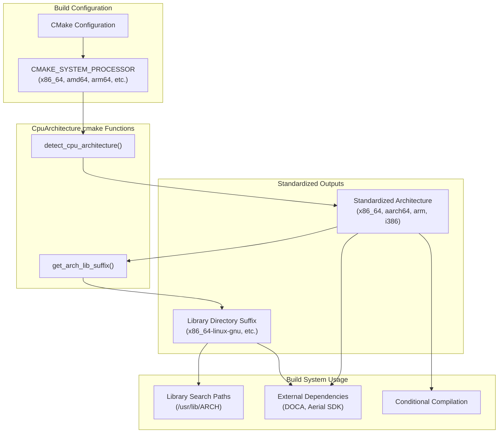
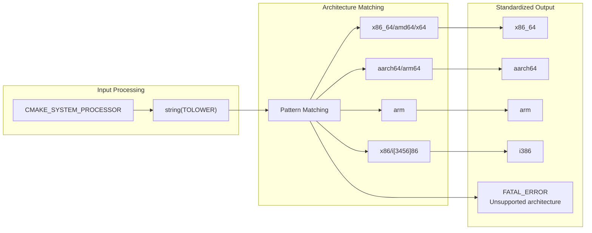
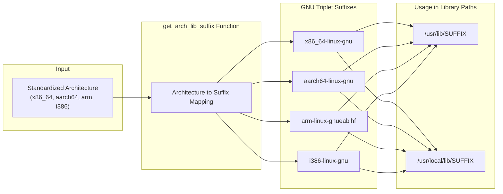
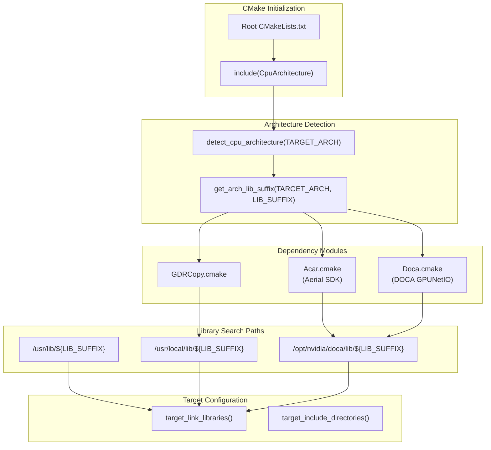

<!-- source: DeepWiki mcp.deepwiki.com · repo NVIDIA/aerial-framework · page 7.2 CPU Architecture Detection · fetched 2026-10-26 -->

# CPU Architecture Detection

<details>
<summary>Relevant source files</summary>

The following files were used as context for generating this wiki page:

- [cmake/CpuArchitecture.cmake](cmake/CpuArchitecture.cmake)

</details>


## Purpose and Scope

This document describes the CPU architecture detection system used by the Aerial Framework build system. The system provides standardized architecture identification and library path suffix determination for cross-platform builds targeting x86_64 and ARM architectures. This functionality enables the build system to correctly locate architecture-specific libraries, select appropriate pre-built binaries, and configure platform-dependent compilation settings.

For information about GPU architecture detection and CUDA configuration, see [CUDA and GPU Configuration](#4.4). For general CMake configuration and build settings, see [CMake Configuration](#4.1).

## System Overview

The CPU architecture detection system consists of two primary functions defined in `cmake/CpuArchitecture.cmake`:

1. **`detect_cpu_architecture`**: Normalizes various CPU architecture identifiers into standardized names
2. **`get_arch_lib_suffix`**: Maps standardized architecture names to Linux multi-arch library directory suffixes

These functions abstract away platform-specific processor naming variations and provide consistent identifiers used throughout the build system for dependency management, library linking, and conditional compilation.



**Sources:** [cmake/CpuArchitecture.cmake:1-92]()

## Architecture Detection Function

The `detect_cpu_architecture` function normalizes the `CMAKE_SYSTEM_PROCESSOR` variable into one of four standardized architecture identifiers. This normalization handles variations in how different CMake generators and platforms report the processor type.

### Function Signature

```cmake
detect_cpu_architecture(output_var)
```

**Parameters:**
- `output_var`: Variable name to store the detected standardized architecture string

### Architecture Normalization Logic

The function performs case-insensitive matching on `CMAKE_SYSTEM_PROCESSOR` and maps various processor identifiers to standardized names:

| Input Identifiers | Standardized Output | Description |
|------------------|---------------------|-------------|
| `x86_64`, `amd64`, `x64` | `x86_64` | Intel/AMD 64-bit processors |
| `aarch64`, `arm64` | `aarch64` | ARM 64-bit processors |
| `arm` | `arm` | ARM 32-bit processors |
| `x86`, `i386`, `i486`, `i586`, `i686` | `i386` | Intel/AMD 32-bit processors |

If the processor type does not match any supported architecture, the function terminates the build with a `FATAL_ERROR` message listing all supported architectures.



### Implementation Details

The detection logic is implemented in [cmake/CpuArchitecture.cmake:30-57]() with the following key steps:

1. **Case normalization**: [cmake/CpuArchitecture.cmake:31]() converts `CMAKE_SYSTEM_PROCESSOR` to lowercase for consistent matching
2. **Pattern matching**: [cmake/CpuArchitecture.cmake:33-44]() uses conditional branches to match against known processor identifiers
3. **Error handling**: [cmake/CpuArchitecture.cmake:46-50]() provides detailed error message with list of supported architectures
4. **Status reporting**: [cmake/CpuArchitecture.cmake:53]() outputs the detected architecture to CMake logs
5. **Variable export**: [cmake/CpuArchitecture.cmake:54-56]() sets the output variable in parent scope

**Sources:** [cmake/CpuArchitecture.cmake:30-57]()

## Library Path Suffix Generation

The `get_arch_lib_suffix` function translates standardized architecture identifiers into the multi-arch library directory naming convention used by Debian-based Linux distributions. This suffix is appended to `/usr/lib` to form paths like `/usr/lib/x86_64-linux-gnu`.

### Function Signature

```cmake
get_arch_lib_suffix(arch output_var)
```

**Parameters:**
- `arch`: Standardized architecture identifier (from `detect_cpu_architecture`)
- `output_var`: Variable name to store the library directory suffix

### Library Suffix Mapping

The function performs a direct mapping from standardized architectures to GNU triplet-based directory suffixes:

| Architecture | Library Suffix | Example Full Path |
|--------------|----------------|-------------------|
| `x86_64` | `x86_64-linux-gnu` | `/usr/lib/x86_64-linux-gnu` |
| `aarch64` | `aarch64-linux-gnu` | `/usr/lib/aarch64-linux-gnu` |
| `arm` | `arm-linux-gnueabihf` | `/usr/lib/arm-linux-gnueabihf` |
| `i386` | `i386-linux-gnu` | `/usr/lib/i386-linux-gnu` |

Note that ARM 32-bit uses the `gnueabihf` (hard-float ABI) suffix rather than `gnueabi`, which is the modern standard for ARM Linux distributions.



### Implementation Details

The suffix generation is implemented in [cmake/CpuArchitecture.cmake:74-91]() with straightforward conditional branches:

1. **Architecture matching**: [cmake/CpuArchitecture.cmake:75-82]() matches the input architecture against known values
2. **Error handling**: [cmake/CpuArchitecture.cmake:84-85]() provides a fatal error for unsupported architectures
3. **Variable export**: [cmake/CpuArchitecture.cmake:88-90]() sets the output variable in parent scope

**Sources:** [cmake/CpuArchitecture.cmake:74-91]()

## Integration with Build System

The CPU architecture detection functions integrate with several components of the Aerial Framework build system:

### External Dependency Configuration

Architecture detection is critical for locating architecture-specific builds of external dependencies, particularly NVIDIA technologies:

- **DOCA GPUNetIO**: Library files organized under `lib/<arch-suffix>/` directories
- **Aerial SDK**: Pre-built binaries provided for specific architectures
- **GDRCopy**: Kernel modules and libraries with architecture-specific paths

### Library Search Path Configuration

The library suffix is used to construct `CMAKE_PREFIX_PATH` and `CMAKE_LIBRARY_PATH` entries:

```
/usr/lib/${ARCH_LIB_SUFFIX}
/usr/local/lib/${ARCH_LIB_SUFFIX}
/opt/nvidia/doca/lib/${ARCH_LIB_SUFFIX}
```

### Cross-Compilation Support

While the framework primarily targets native builds, the architecture detection system provides foundation for future cross-compilation scenarios:

- Distinguishes between `CMAKE_SYSTEM_PROCESSOR` (target) and host processor
- Enables conditional compilation of architecture-specific code paths
- Supports multi-arch development environments



**Sources:** [cmake/CpuArchitecture.cmake:1-92]()

## Error Handling and Diagnostics

The architecture detection system provides clear error messages and diagnostic output:

### Successful Detection

When architecture detection succeeds, a status message is logged:

```
-- Target CPU architecture detected: x86_64
```

This output appears during CMake configuration and helps verify that the build system correctly identified the target platform.

### Unsupported Architecture

If an unsupported processor type is encountered, the build fails immediately with:

```
CMake Error: Unsupported CPU architecture: <processor_name>.
Supported CPU architectures: x86_64, amd64, x64, aarch64, arm64, arm, x86, i[3456]86
```

This prevents silent failures and provides clear guidance on which platforms are supported.

### Library Suffix Errors

Similarly, if an unsupported architecture is passed to `get_arch_lib_suffix`, the build fails with:

```
CMake Error: Unsupported CPU architecture for library suffix: <arch>.
Supported CPU architectures: x86_64, aarch64, arm, i386
```

This error indicates a programming error where architecture detection succeeded but produced an unexpected output.

**Sources:** [cmake/CpuArchitecture.cmake:46-50](), [cmake/CpuArchitecture.cmake:84-85]()

## Platform Support Matrix

The CPU architecture detection system currently supports the following platform combinations:

| OS | Architecture | CMAKE_SYSTEM_PROCESSOR | Detected Arch | Library Suffix |
|----|--------------|------------------------|---------------|----------------|
| Ubuntu 22.04 x86_64 | Intel/AMD 64-bit | `x86_64` | `x86_64` | `x86_64-linux-gnu` |
| Ubuntu 22.04 ARM64 | ARM 64-bit | `aarch64` | `aarch64` | `aarch64-linux-gnu` |
| Debian 12 x86_64 | Intel/AMD 64-bit | `x86_64` | `x86_64` | `x86_64-linux-gnu` |
| RHEL 9 x86_64 | Intel/AMD 64-bit | `x86_64` | `x86_64` | `x86_64-linux-gnu` |
| Jetson (ARM64) | NVIDIA Tegra | `aarch64` | `aarch64` | `aarch64-linux-gnu` |

The Aerial Framework is primarily developed and tested on x86_64 platforms with NVIDIA GPUs. ARM64 support enables deployment on NVIDIA Grace Hopper systems and Jetson embedded platforms.

**Sources:** [cmake/CpuArchitecture.cmake:24-28]()

## Usage Examples

### Basic Architecture Detection

To detect the CPU architecture in a CMake project:

```cmake
include(CpuArchitecture)

detect_cpu_architecture(MY_TARGET_ARCH)
message(STATUS "Building for architecture: ${MY_TARGET_ARCH}")
```

### Library Path Configuration

To construct architecture-specific library search paths:

```cmake
include(CpuArchitecture)

detect_cpu_architecture(TARGET_ARCH)
get_arch_lib_suffix(${TARGET_ARCH} ARCH_LIB_SUFFIX)

list(APPEND CMAKE_PREFIX_PATH "/usr/lib/${ARCH_LIB_SUFFIX}")
list(APPEND CMAKE_PREFIX_PATH "/usr/local/lib/${ARCH_LIB_SUFFIX}")
list(APPEND CMAKE_PREFIX_PATH "/opt/nvidia/doca/lib/${ARCH_LIB_SUFFIX}")
```

### Conditional Compilation

To enable architecture-specific code or features:

```cmake
include(CpuArchitecture)

detect_cpu_architecture(TARGET_ARCH)

if(TARGET_ARCH STREQUAL "x86_64")
    target_compile_definitions(mylib PRIVATE ARCH_X86_64)
    target_sources(mylib PRIVATE src/arch/x86_64/optimized.cpp)
elseif(TARGET_ARCH STREQUAL "aarch64")
    target_compile_definitions(mylib PRIVATE ARCH_AARCH64)
    target_sources(mylib PRIVATE src/arch/aarch64/optimized.cpp)
endif()
```

**Sources:** [cmake/CpuArchitecture.cmake:16-29](), [cmake/CpuArchitecture.cmake:59-73]()

---

