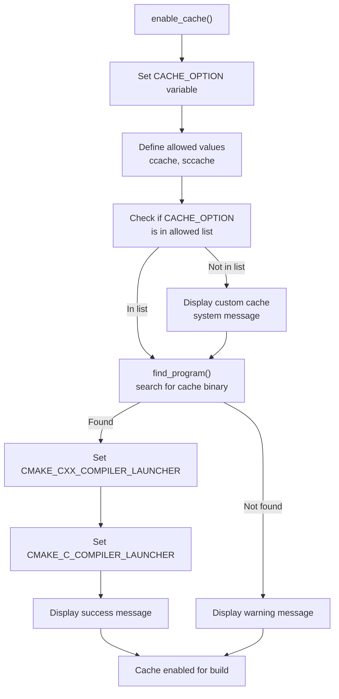
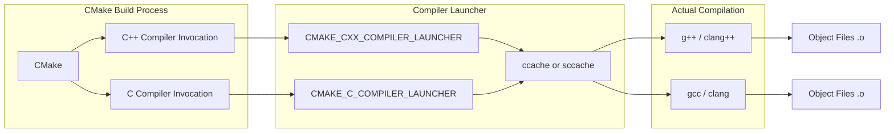
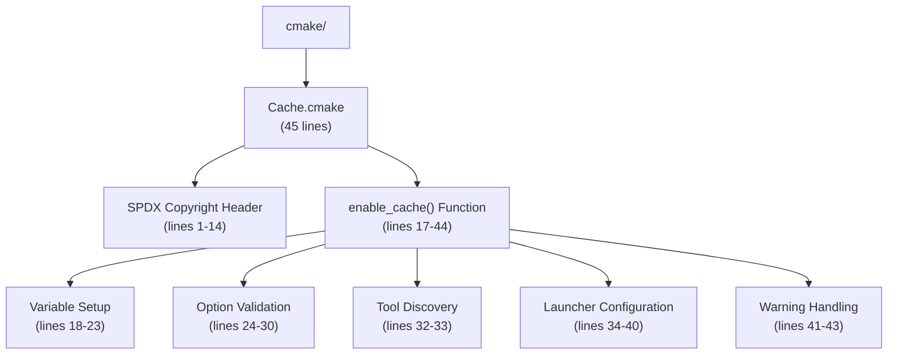

<!-- source: DeepWiki mcp.deepwiki.com · repo NVIDIA/aerial-framework · page 7.3 Compiler Caching · fetched 2026-10-26 -->

# Compiler Caching

<details>
<summary>Relevant source files</summary>

The following files were used as context for generating this wiki page:

- [cmake/Cache.cmake](cmake/Cache.cmake)

</details>


## Purpose and Scope

This document describes the compiler cache integration system implemented in the Aerial Framework build system. Compiler caching significantly accelerates incremental builds by caching compilation results and reusing them when source files haven't changed. This page covers the supported cache systems (`ccache` and `sccache`), the configuration mechanism, and the CMake integration that enables transparent caching for both C and C++ compilations.

For information about overall build system configuration, see [CMake Configuration](#4.1). For details on CUDA-specific compilation settings, see [CUDA and GPU Configuration](#4.4).

## Overview

Compiler caching is a build optimization technique that stores the results of compilation operations and reuses them when the same source code is compiled again with identical compiler flags. This dramatically reduces build times for incremental builds where only a small percentage of source files have changed. The Aerial Framework supports two industry-standard compiler cache systems through a unified configuration interface.

**Compilation Process Without Caching:**
```
Source File → Compiler → Object File (full compilation every time)
```

**Compilation Process With Caching:**
```
Source File → Cache Tool → Cache Hit? → Cached Object File (fast)
                        ↓ Cache Miss
                        → Compiler → Object File → Store in Cache
```

The cache system is transparent to the build process and requires no changes to source code or individual target definitions.

Sources: [cmake/Cache.cmake:1-45]()

## Supported Cache Systems

The Aerial Framework supports two compiler cache implementations:

| Cache System | Description | Typical Use Case |
|--------------|-------------|------------------|
| **ccache** | C/C++ Compiler Cache - Local filesystem-based cache | Single developer workstations |
| **sccache** | Shared Compilation Cache - Supports distributed cache backends (Redis, S3, GCS) | CI/CD systems and build farms |

Both systems provide identical functionality from the CMake integration perspective, differing primarily in their storage backend capabilities.

### ccache

`ccache` is a compiler cache for C and C++ that stores compiled object files locally on the filesystem. It is ideal for individual developer machines where cache persistence between builds is desired.

### sccache

`sccache` is Mozilla's shared compilation cache that supports multiple backend storage options including cloud storage (AWS S3, Google Cloud Storage) and Redis. This makes it suitable for distributed build environments where multiple machines can share a common cache.

Sources: [cmake/Cache.cmake:18-22]()

## Cache Selection and Configuration

### CACHE_OPTION CMake Variable

The cache system is configured through the `CACHE_OPTION` CMake cache variable, which specifies which compiler cache tool to use.

**Default Configuration:**
```cmake
CACHE_OPTION = "ccache"
```

**Allowed Values:**
- `"ccache"` - Use ccache if available
- `"sccache"` - Use sccache if available
- Custom value - Use a custom compiler cache tool (searches for executable with that name)

The `CACHE_OPTION` is a CMake cache string variable, allowing it to be configured via:
- CMake command line: `-DCACHE_OPTION=sccache`
- CMake GUI
- CMakePresets.json cache variables
- CMake cache file

Sources: [cmake/Cache.cmake:18-23]()

## Implementation Architecture

### enable_cache Function

The compiler cache integration is implemented through the `enable_cache()` function defined in [cmake/Cache.cmake:17-44](). This function is designed to be called during CMake project configuration.



**enable_cache() Function Flow**

Sources: [cmake/Cache.cmake:17-44]()

### Cache Tool Discovery

The function uses CMake's `find_program()` to locate the cache executable:

```cmake
find_program(CACHE_BINARY NAMES ${CACHE_OPTION_VALUES})
```

This searches the system PATH for executables named in `CACHE_OPTION_VALUES`, which includes both `ccache` and `sccache`. The search prioritizes the tool specified in `CACHE_OPTION` but will fall back to the other supported tool if available.

**Search Behavior:**
1. Searches for executables in system PATH
2. Returns the first match found
3. Prioritizes explicitly supported tools (`ccache`, `sccache`)
4. Stores result in `CACHE_BINARY` variable

Sources: [cmake/Cache.cmake:32-33]()

### CMake Compiler Launcher Integration

When a cache tool is found, the function configures CMake's compiler launcher mechanism:



**Compiler Launcher Chain**

The integration is achieved by setting two CMake properties:

| CMake Variable | Purpose | Set in Code |
|----------------|---------|-------------|
| `CMAKE_CXX_COMPILER_LAUNCHER` | Prepends cache tool to C++ compilation commands | [cmake/Cache.cmake:35-37]() |
| `CMAKE_C_COMPILER_LAUNCHER` | Prepends cache tool to C compilation commands | [cmake/Cache.cmake:38-40]() |

These variables are set as cache variables with type `FILEPATH`, making them persistent across CMake runs and visible in CMake GUIs.

**Resulting Compilation Command:**
```
Without cache: g++ -c source.cpp -o source.o
With cache:    ccache g++ -c source.cpp -o source.o
```

The cache tool transparently intercepts the compilation, checks its cache, and either returns a cached result or invokes the actual compiler.

Sources: [cmake/Cache.cmake:33-40]()

## Message and Status Reporting

### Success Message

When a cache tool is successfully found and configured, the function displays:

```
-- <path/to/cache/binary> found and enabled
```

This confirms that caching is active for the current build. The full path to the cache binary is displayed, allowing verification of which tool and version is being used.

Sources: [cmake/Cache.cmake:34]()

### Custom Cache System Message

If `CACHE_OPTION` is set to a value other than the explicitly supported `ccache` or `sccache`, the function displays an informational message:

```
-- Using custom compiler cache system: '<custom_name>', 
   explicitly supported entries are ccache;sccache
```

This allows advanced users to specify custom cache tools while informing them which tools are officially supported.

Sources: [cmake/Cache.cmake:26-29]()

### Warning Message

If the requested cache tool is not found in the system PATH, a warning is issued:

```
-- <cache_option> is enabled but was not found. Not using it
```

This is a warning rather than an error, allowing the build to proceed without caching rather than failing. This is important for portability, as developers without the cache tool installed can still build the project.

Sources: [cmake/Cache.cmake:42]()

## Integration with Build System

### Invocation in Root CMakeLists.txt

The `enable_cache()` function must be called from the project's root CMakeLists.txt file early in the configuration process, before any targets are defined. This ensures that all subsequent target compilations benefit from caching.

**Typical Integration Pattern:**
```cmake
include(cmake/Cache.cmake)
enable_cache()
```

### Interaction with Compiler Settings

The compiler launcher mechanism works transparently with all other compiler settings including:

- Compiler warning flags (see [Compiler Warnings and Code Quality](#4.5))
- CUDA compilation (see [CUDA and GPU Configuration](#4.4))
- Sanitizer builds (see [Build Presets and Configurations](#4.2))
- Optimization levels and debug information

The cache tool sees the complete compiler command including all flags, ensuring that cache hits only occur when compilation parameters are identical.

### Effect on Build Performance

**Cold Build Performance:**
- First build with cache: Same speed as without cache (populates cache)
- Cache miss overhead: Minimal (<5% typically)

**Warm Build Performance:**
- Full rebuild with no changes: 10-100x faster (cache hits on all files)
- Incremental build: Significantly faster for unchanged files
- Switching branches: Faster if other branch files are cached

**Cache Storage:**
- Default cache sizes: 5-50 GB (configurable)
- Cache eviction: LRU (Least Recently Used) when size limit reached

Sources: [cmake/Cache.cmake:1-45]()

## Configuration Examples

### Using ccache (Default)

No explicit configuration needed; `ccache` is the default:

```bash
cmake --preset gcc-debug
```

Or explicitly specify:

```bash
cmake --preset gcc-debug -DCACHE_OPTION=ccache
```

### Using sccache

Specify `sccache` as the cache option:

```bash
cmake --preset gcc-debug -DCACHE_OPTION=sccache
```

### Using a Custom Cache Tool

Specify any executable name:

```bash
cmake --preset gcc-debug -DCACHE_OPTION=my_custom_cache
```

The system will search for `my_custom_cache` in the PATH and use it if found.

### Disabling Cache

To disable caching, set `CACHE_OPTION` to an invalid value that won't be found:

```bash
cmake --preset gcc-debug -DCACHE_OPTION=none
```

This will trigger the "not found" warning and proceed without caching.

Sources: [cmake/Cache.cmake:1-45]()

## Code Entity Reference

### Functions

| Function Name | Defined In | Purpose |
|---------------|-----------|---------|
| `enable_cache()` | [cmake/Cache.cmake:17-44]() | Main function to enable and configure compiler caching |

### CMake Variables

| Variable Name | Type | Scope | Purpose |
|---------------|------|-------|---------|
| `CACHE_OPTION` | STRING (cache) | Global | Specifies which cache tool to use |
| `CACHE_OPTION_VALUES` | List | Function local | List of supported cache tools: `ccache`, `sccache` |
| `CACHE_OPTION_INDEX` | Integer | Function local | Index of `CACHE_OPTION` in supported list |
| `CACHE_BINARY` | FILEPATH | Function local | Path to found cache executable |
| `CMAKE_CXX_COMPILER_LAUNCHER` | FILEPATH (cache) | Global | Launcher for C++ compiler |
| `CMAKE_C_COMPILER_LAUNCHER` | FILEPATH (cache) | Global | Launcher for C compiler |

### File Structure



**Cache.cmake Module Structure**

Sources: [cmake/Cache.cmake:1-45]()

---

