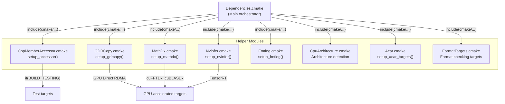
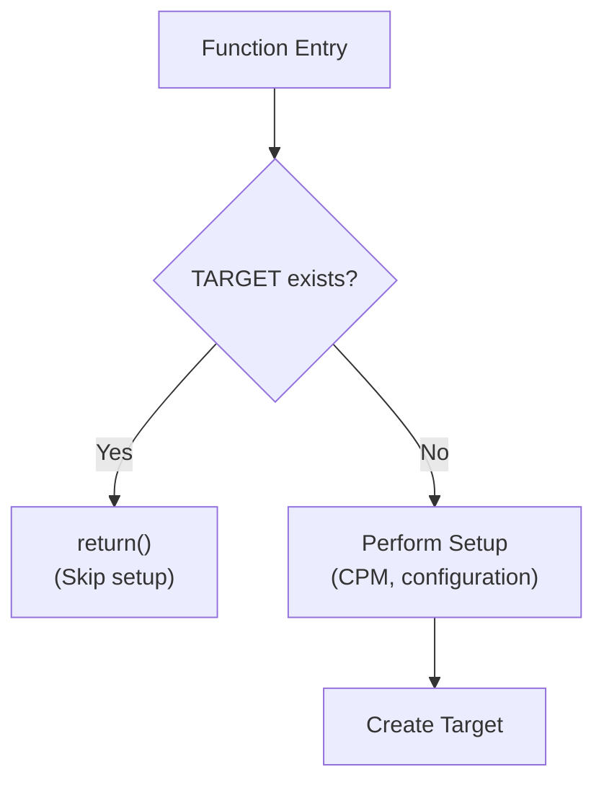
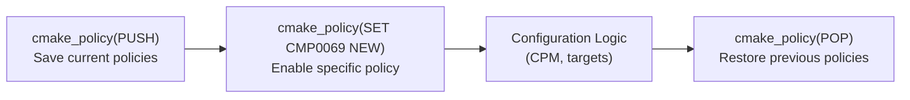

<!-- source: DeepWiki mcp.deepwiki.com · repo NVIDIA/aerial-framework · page 7.4 Helper CMake Modules · fetched 2026-10-26 -->

# Helper CMake Modules

<details>
<summary>Relevant source files</summary>

The following files were used as context for generating this wiki page:

- [cmake/CppMemberAccessor.cmake](cmake/CppMemberAccessor.cmake)
- [cmake/Dependencies.cmake](cmake/Dependencies.cmake)

</details>


## Purpose and Scope

Helper CMake modules provide specialized utility functions and configurations that support specific build system features beyond the core compilation and linking tasks. These modules encapsulate reusable setup logic for third-party libraries, architecture detection, capability management, and other advanced build requirements.

This page documents the utility CMake modules that provide specialized functionality, such as `CppMemberAccessor.cmake` for testing utilities. For information about:
- Core dependency management patterns, see [Dependency Management with CPM](#4.3)
- NVIDIA-specific integrations (Aerial SDK, DOCA, TensorRT), see [NVIDIA Technologies](#5.1)
- CPU architecture detection, see [CPU Architecture Detection](#7.2)
- Linux capabilities for executables, see [Linux Capabilities Management](#7.1)

## Overview of Helper Modules

The Aerial Framework build system includes several specialized helper modules that are conditionally included based on build requirements. These modules follow a consistent pattern of providing `setup_*()` functions that check for existing targets before performing configuration.

### Module Organization



**Sources:** [cmake/Dependencies.cmake:1-410](), [cmake/CppMemberAccessor.cmake:1-46]()

### Helper Module Categories

| Module | Purpose | Conditional Usage | Primary Function |
|--------|---------|-------------------|------------------|
| `CppMemberAccessor.cmake` | C++ member accessor for testing | `BUILD_TESTING` only | `setup_accessor()` |
| `GDRCopy.cmake` | GPU Direct RDMA memory copy | Always if not found | `setup_gdrcopy()` |
| `MathDx.cmake` | NVIDIA MathDx libraries (cuFFT, cuBLAS, etc.) | Always if not found | Setup targets |
| `Nvinfer.cmake` | TensorRT inference library | Always if not found | Setup targets |
| `Fmtlog.cmake` | Fast logging library with patches | Always if not found | `setup_fmtlog()` |
| `CpuArchitecture.cmake` | CPU architecture detection | Always | Detection functions |
| `Acar.cmake` | Aerial SDK integration | Always if not found | `setup_acar_targets()` |
| `FormatTargets.cmake` | Code formatting targets | Always | Target creation |

**Sources:** [cmake/Dependencies.cmake:72-74](), [cmake/Dependencies.cmake:164-166](), [cmake/Dependencies.cmake:172-173](), [cmake/Dependencies.cmake:177-179](), [cmake/Dependencies.cmake:291-293](), [cmake/Dependencies.cmake:32-33](), [cmake/Dependencies.cmake:286-287](), [cmake/Dependencies.cmake:296-297](), [cmake/Dependencies.cmake:409]()

## CppMemberAccessor Module

The `CppMemberAccessor.cmake` module provides integration for the `cpp-member-accessor` library, which enables compile-time reflection and access to private class members in C++20. This utility is used exclusively for testing purposes to verify internal class state without exposing implementation details through public interfaces.

### Module Structure

```mermaid
graph LR
    Entry["include(cmake/CppMemberAccessor.cmake)"]
    Guard["include_guard(GLOBAL)"]
    CPMInclude["include(cmake/CPM.cmake)"]
    
    Function["setup_accessor()"]
    TargetCheck{"TARGET accessor::accessor<br/>exists?"}
    Return["return()"]
    
    PolicyPush["cmake_policy(PUSH)"]
    PolicySet["cmake_policy(SET CMP0069 NEW)<br/>(IPO/LTO detection)"]
    
    CPMAdd["cpmaddpackage(accessor_lib)"]
    Fetch["GitHub: hliberacki/cpp-member-accessor<br/>Tag: 5e4d52f82006d14c63488eadca757f893b85824b"]
    
    AliasCheck{"TARGET accessor::accessor?"}
    CreateAlias["add_library(accessor::accessor ALIAS accessor)"]
    
    PolicyPop["cmake_policy(POP)"]
    
    Entry --> Guard
    Guard --> CPMInclude
    CPMInclude --> Function
    
    Function --> TargetCheck
    TargetCheck -->|"Yes"| Return
    TargetCheck -->|"No"| PolicyPush
    
    PolicyPush --> PolicySet
    PolicySet --> CPMAdd
    CPMAdd --> Fetch
    Fetch --> AliasCheck
    AliasCheck -->|"No"| CreateAlias
    AliasCheck -->|"Yes"| PolicyPop
    CreateAlias --> PolicyPop
```



**Sources:** [cmake/CppMemberAccessor.cmake:16-46]()

### Function: setup_accessor()

The `setup_accessor()` function performs the following operations:

1. **Target Existence Check** - Returns early if `accessor::accessor` target already exists [cmake/CppMemberAccessor.cmake:22-24]()
2. **Policy Management** - Enables CMake policy CMP0069 for portable IPO/LTO support detection [cmake/CppMemberAccessor.cmake:26-28]()
3. **Package Fetching** - Uses CPM to fetch the library from GitHub with a specific commit hash [cmake/CppMemberAccessor.cmake:30-38]()
4. **Alias Creation** - Creates a namespaced alias `accessor::accessor` if upstream doesn't provide one [cmake/CppMemberAccessor.cmake:40-42]()
5. **Policy Restoration** - Restores previous policy settings [cmake/CppMemberAccessor.cmake:44]()

### Usage in Dependencies

The module is conditionally included only when testing is enabled:

```cmake
if(BUILD_TESTING)
    if(NOT TARGET accessor::accessor)
        include(${CMAKE_SOURCE_DIR}/cmake/CppMemberAccessor.cmake)
        setup_accessor()
    endif()
endif()
```

This pattern ensures the dependency is only fetched and configured when tests are being built, minimizing unnecessary downloads and configuration time for production builds.

**Sources:** [cmake/Dependencies.cmake:71-74](), [cmake/CppMemberAccessor.cmake:1-46]()

### CMake Policy CMP0069

The module temporarily enables CMake policy CMP0069, which controls how the `INTERPROCEDURAL_OPTIMIZATION` target property is handled:

- **Purpose**: Enables portable detection of compiler support for Interprocedural Optimization (IPO) / Link-Time Optimization (LTO)
- **Scope**: Only affects the `setup_accessor()` function via `cmake_policy(PUSH/POP)` [cmake/CppMemberAccessor.cmake:26-44]()
- **Reason**: The upstream `cpp-member-accessor` library may benefit from IPO/LTO optimizations, and this policy ensures proper detection across different compilers

**Sources:** [cmake/CppMemberAccessor.cmake:26-28]()

## Other Helper Modules

### GDRCopy Module

Provides GPU Direct RDMA (Remote Direct Memory Access) support for zero-copy data transfer between GPU and network adapters. The module searches for the GDRCopy library in system paths and creates the `gdrcopy::gdrcopy` target.

**Inclusion Pattern:**
```cmake
if(NOT TARGET gdrcopy::gdrcopy)
    include(${CMAKE_SOURCE_DIR}/cmake/GDRCopy.cmake)
    setup_gdrcopy()
endif()
```

**Sources:** [cmake/Dependencies.cmake:163-166]()

### MathDx Module

Integrates NVIDIA MathDx header-only libraries for GPU-accelerated mathematical operations:
- **cuFFTDx**: Fast Fourier Transform operations
- **cuBLASDx**: Basic Linear Algebra Subprograms
- **cuRANDDx**: Random number generation
- **cuSOLVERDx**: Linear solver operations

The module provides the `target_link_mathdx()` function for linking specific components.

**Sources:** [cmake/Dependencies.cmake:168-173]()

### Nvinfer Module

Sets up TensorRT's `nvinfer` library for GPU inference operations. Creates the `nvinfer::nvinfer` target and provides the `target_link_nvinfer()` function for linking.

**Sources:** [cmake/Dependencies.cmake:175-179]()

### Fmtlog Module

Configures the fmtlog fast logging library with patches from the Aerial SDK. The module:
1. Accepts the Aerial SDK source directory as a parameter
2. Applies patches specific to the Aerial Framework's requirements
3. Creates the `fmtlog::fmtlog` target

**Inclusion Pattern:**
```cmake
# Download aerial_sdk source to access fmtlog patch file
download_acar_source()

# Setup fmtlog with patches from aerial_sdk
if(NOT TARGET fmtlog::fmtlog)
    include(${CMAKE_SOURCE_DIR}/cmake/Fmtlog.cmake)
    setup_fmtlog(${aerial_sdk_SOURCE_DIR})
endif()
```

**Sources:** [cmake/Dependencies.cmake:285-293]()

### CpuArchitecture Module

Provides utility functions for detecting CPU architecture and determining library path suffixes. Used for cross-platform builds and architecture-specific library path resolution. See [CPU Architecture Detection](#7.2) for detailed documentation.

**Sources:** [cmake/Dependencies.cmake:32]()

### Acar Module

Integrates the NVIDIA Aerial SDK (ACAR) with functions for downloading source code and setting up targets. Provides:
- `download_acar_source()` - Downloads Aerial SDK source
- `download_ldpc_decoder_cubin()` - Downloads LDPC decoder CUDA binaries
- `setup_acar_targets()` - Configures Aerial SDK targets

**Sources:** [cmake/Dependencies.cmake:33](), [cmake/Dependencies.cmake:286-287](), [cmake/Dependencies.cmake:296]()

### FormatTargets Module

Creates user-friendly targets for code formatting and checking. Integrates with Format.cmake (TheLartians/Format.cmake) and configures Git extensions for clang-format. Creates targets like `check-format` and `fix-format`.

**Sources:** [cmake/Dependencies.cmake:298-363](), [cmake/Dependencies.cmake:409]()

## Common Patterns

All helper modules in the Aerial Framework follow consistent design patterns for maintainability and predictability.

### Pattern: Include Guard

Every helper module uses `include_guard(GLOBAL)` to prevent multiple inclusion:

```cmake
include_guard(GLOBAL)
```

This ensures the module is processed only once per CMake configuration, even if included from multiple locations. The `GLOBAL` scope means the guard applies across the entire project, including subdirectories.

**Sources:** [cmake/CppMemberAccessor.cmake:16]()

### Pattern: Target Existence Checking

Before performing expensive operations (downloading, building, configuring), modules check if the target already exists:



**Example from CppMemberAccessor:**
```cmake
function(setup_accessor)
    if(TARGET accessor::accessor)
        return() # Already set up
    endif()
    # ... setup logic ...
endfunction()
```

This pattern provides:
- **Idempotency**: Safe to call setup functions multiple times
- **Performance**: Avoids redundant work
- **Parent Project Support**: Respects targets provided by parent projects

**Sources:** [cmake/CppMemberAccessor.cmake:22-24]()

### Pattern: Function Encapsulation

Setup logic is encapsulated in functions (typically named `setup_*()`) to isolate variable scope and prevent pollution of parent scope:

```cmake
function(setup_accessor)
    # Variables and logic here don't leak to parent scope
    cmake_policy(PUSH)
    # ... configuration ...
    cmake_policy(POP)
endfunction()
```

**Benefits:**
- Variables created inside functions don't affect parent scope
- CMake policies can be safely modified with PUSH/POP
- Clear entry points for configuration

**Sources:** [cmake/CppMemberAccessor.cmake:21-45]()

### Pattern: Namespaced Aliases

Modules create namespaced aliases (using `::` notation) for consistency with modern CMake practices:

```cmake
if(NOT TARGET accessor::accessor AND TARGET accessor)
    add_library(accessor::accessor ALIAS accessor)
endif()
```

This pattern:
- Provides uniform target naming across all dependencies
- Follows CMake's recommended naming convention
- Ensures compatibility when upstream projects use different target names

**Sources:** [cmake/CppMemberAccessor.cmake:40-42]()

### Pattern: CPM Integration

Helper modules use CPM (CMake Package Manager) for fetching external dependencies:

```cmake
cpmaddpackage(
    NAME accessor_lib
    GITHUB_REPOSITORY hliberacki/cpp-member-accessor
    GIT_TAG 5e4d52f82006d14c63488eadca757f893b85824b
    SYSTEM YES
)
```

**Key Properties:**
- `NAME`: Package identifier for CPM cache
- `GITHUB_REPOSITORY`: Source location
- `GIT_TAG`: Specific commit hash for reproducibility
- `SYSTEM YES`: Mark includes as system headers (suppress warnings)

**Sources:** [cmake/CppMemberAccessor.cmake:30-38]()

### Pattern: Policy Management

Modules use `cmake_policy(PUSH)` and `cmake_policy(POP)` to temporarily modify CMake behavior without affecting parent scope:



This ensures policy changes are localized and don't leak to other parts of the build system.

**Sources:** [cmake/CppMemberAccessor.cmake:26-44]()

## Integration with Dependencies

The `Dependencies.cmake` file serves as the central orchestrator that includes and invokes all helper modules. The integration follows a consistent structure:

### Orchestration Flow

```mermaid
graph TD
    Setup["setup_dependencies()<br/>Main function"]
    
    subgraph "Conditional Inclusion"
        Testing{"BUILD_TESTING?"}
        TestDeps["GoogleTest, Benchmark<br/>CppMemberAccessor"]
    end
    
    subgraph "Always-Included Dependencies"
        CLI11["CLI11::CLI11"]
        Quill["quill::quill"]
        WiseEnum["wise_enum"]
        Backward["Backward::Backward"]
        GSL["gsl::gsl-lite"]
    end
    
    subgraph "Helper Module Invocation"
        GDRCopyCheck{"TARGET gdrcopy?"}
        GDRCopySetup["include(GDRCopy.cmake)<br/>setup_gdrcopy()"]
        
        MathDxCheck{"TARGET mathdx?"}
        MathDxInclude["include(MathDx.cmake)"]
        
        NvinferCheck{"TARGET nvinfer?"}
        NvinferInclude["include(Nvinfer.cmake)"]
        
        FmtlogCheck{"TARGET fmtlog?"}
        FmtlogSetup["include(Fmtlog.cmake)<br/>setup_fmtlog()"]
    end
    
    subgraph "Post-Configuration"
        FormatInc["include(FormatTargets.cmake)"]
    end
    
    Setup --> Testing
    Testing -->|"Yes"| TestDeps
    Testing -->|"No"| CLI11
    TestDeps --> CLI11
    
    CLI11 --> Quill
    Quill --> WiseEnum
    WiseEnum --> Backward
    Backward --> GSL
    
    GSL --> GDRCopyCheck
    GDRCopyCheck -->|"No"| GDRCopySetup
    GDRCopyCheck -->|"Yes"| MathDxCheck
    GDRCopySetup --> MathDxCheck
    
    MathDxCheck -->|"No"| MathDxInclude
    MathDxCheck -->|"Yes"| NvinferCheck
    MathDxInclude --> NvinferCheck
    
    NvinferCheck -->|"No"| NvinferInclude
    NvinferCheck -->|"Yes"| FmtlogCheck
    NvinferInclude --> FmtlogCheck
    
    FmtlogCheck -->|"No"| FmtlogSetup
    FmtlogCheck -->|"Yes"| FormatInc
    FmtlogSetup --> FormatInc
```



**Sources:** [cmake/Dependencies.cmake:37-410]()

### Invocation Examples

The `Dependencies.cmake` file demonstrates the standard invocation pattern for helper modules:

**Testing Dependencies:**
```cmake
if(BUILD_TESTING)
    if(NOT TARGET accessor::accessor)
        include(${CMAKE_SOURCE_DIR}/cmake/CppMemberAccessor.cmake)
        setup_accessor()
    endif()
endif()
```

**GPU Direct RDMA:**
```cmake
if(NOT TARGET gdrcopy::gdrcopy)
    include(${CMAKE_SOURCE_DIR}/cmake/GDRCopy.cmake)
    setup_gdrcopy()
endif()
```

**Format Targets:**
```cmake
include(${CMAKE_SOURCE_DIR}/cmake/FormatTargets.cmake)
```

**Sources:** [cmake/Dependencies.cmake:71-74](), [cmake/Dependencies.cmake:163-166](), [cmake/Dependencies.cmake:409]()

### Variable Scope Isolation

The entire dependency setup is wrapped in a function to prevent variable leakage:

```cmake
# Done as a function so that updates to variables like CMAKE_CXX_FLAGS don't propagate out to other targets
function(setup_dependencies)
    # All dependency configuration here
endfunction()
```

This ensures that:
- Flag modifications (e.g., `CMAKE_CXX_FLAGS`, `CMAKE_POSITION_INDEPENDENT_CODE`) only affect dependencies
- Parent and sibling targets aren't inadvertently modified
- Build configuration remains predictable

**Sources:** [cmake/Dependencies.cmake:35-37](), [cmake/Dependencies.cmake:270]()

### CPM Source Cache Configuration

Before including any helper modules, `Dependencies.cmake` configures the CPM source cache location:

```cmake
if(NOT DEFINED CPM_SOURCE_CACHE AND NOT DEFINED ENV{CPM_SOURCE_CACHE})
    set(ENV{CPM_SOURCE_CACHE} "$ENV{HOME}/.cache/CPM")
    message(STATUS "CPM source cache: $ENV{HOME}/.cache/CPM (default)")
else()
    # User override detected
endif()
```

This provides:
- **Default Location**: `~/.cache/CPM` for downloaded dependencies
- **User Override**: Via CMake variable or environment variable
- **Build Speed**: Shared cache across multiple builds and projects

**Sources:** [cmake/Dependencies.cmake:18-29]()

## Summary

Helper CMake modules in the Aerial Framework provide specialized, reusable configuration logic for external dependencies and build system features. These modules follow consistent patterns:

- **Include Guards**: Prevent multiple inclusion with `include_guard(GLOBAL)`
- **Function Encapsulation**: Isolate variable scope with `setup_*()` functions
- **Target Checking**: Skip redundant work with `if(TARGET ...)`
- **Namespaced Aliases**: Provide consistent target naming
- **CPM Integration**: Fetch dependencies reproducibly with commit hashes
- **Policy Management**: Localize CMake policy changes with PUSH/POP

The `CppMemberAccessor.cmake` module exemplifies these patterns, providing C++ member access utilities for testing while maintaining clean integration with the broader build system through conditional inclusion and proper target management.

**Sources:** [cmake/CppMemberAccessor.cmake:1-46](), [cmake/Dependencies.cmake:1-410]()

---

