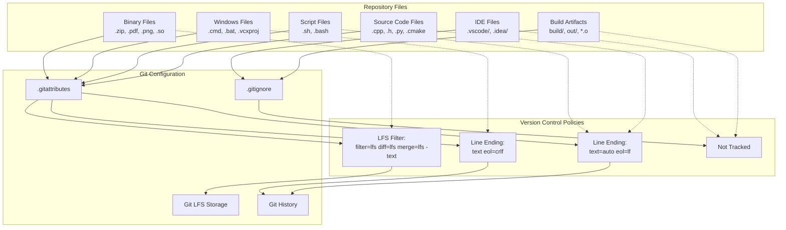
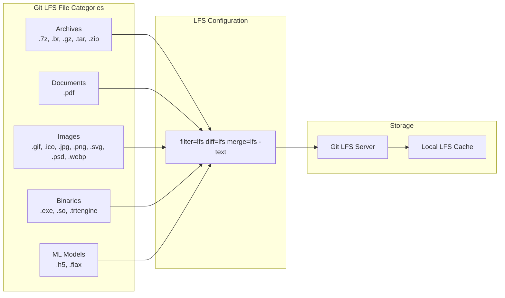
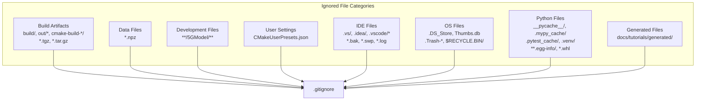
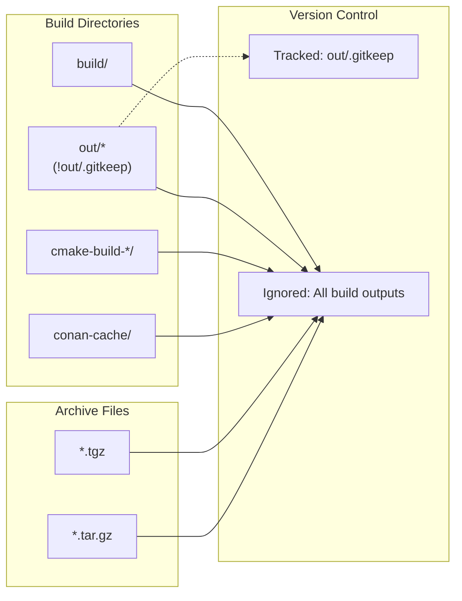
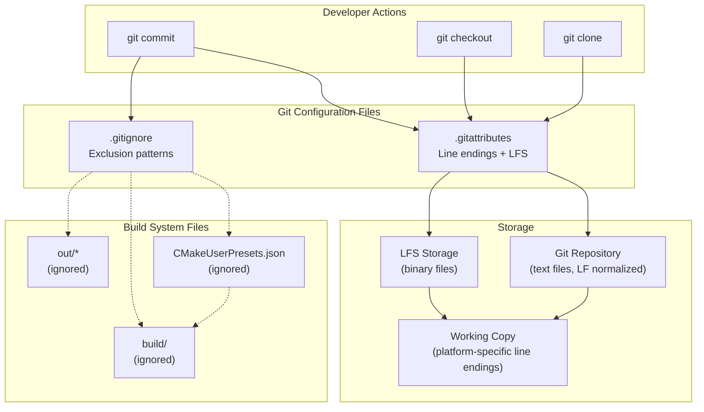

<!-- source: DeepWiki mcp.deepwiki.com · repo NVIDIA/aerial-framework · page 8 Version Control Configuration · fetched 2026-10-26 -->

# Version Control Configuration

<details>
<summary>Relevant source files</summary>

The following files were used as context for generating this wiki page:

- [.gitattributes](.gitattributes)
- [.gitignore](.gitignore)

</details>


This document describes the Git configuration for the NVIDIA Aerial Framework repository, including line ending normalization, Git Large File System (LFS) integration for binary files, and ignored build artifacts and development files.

For detailed information about line ending normalization and Git LFS file patterns, see [Git Attributes and LFS](#8.1). For comprehensive documentation of ignored files and directories, see [Git Ignore Patterns](#8.2).

## Configuration Overview

The repository uses two primary Git configuration files to manage version control behavior:

| Configuration File | Purpose | Location |
|-------------------|---------|----------|
| `.gitattributes` | Line ending normalization and Git LFS tracking | Repository root |
| `.gitignore` | Excludes build artifacts, IDE files, and temporary files | Repository root |

These configurations ensure consistent repository behavior across different development platforms (Linux, Windows, macOS) and prevent large binary files from bloating the repository history.

Sources: [.gitattributes:1-35](), [.gitignore:1-59]()

## Version Control Architecture

The following diagram shows how version control configuration affects different file types in the repository:



Sources: [.gitattributes:1-35](), [.gitignore:1-59]()

## Line Ending Normalization

The repository enforces consistent line endings across all platforms using the `.gitattributes` configuration. The default policy normalizes all text files to LF (Unix-style) line endings:

```
* text=auto eol=lf
```

This configuration [.gitattributes:4]() ensures that:
- All text files are stored in the repository with LF line endings
- Files are automatically converted to the appropriate format on checkout
- Developers on Windows, Linux, and macOS have consistent working copies

### Platform-Specific Line Endings

Windows-specific files are configured to use CRLF line endings [.gitattributes:5-7]():

| File Pattern | Line Ending | Purpose |
|--------------|-------------|---------|
| `*.cmd`, `*.CMD` | CRLF | Windows command scripts |
| `*.bat`, `*.BAT` | CRLF | Windows batch files |
| `*.vcxproj`, `*.vcxproj.filters` | CRLF | Visual Studio project files |

Sources: [.gitattributes:1-7]()

## Git Large File System (LFS) Integration

Binary files are tracked using Git LFS to prevent repository bloat. The following diagram shows the file types managed by LFS:



### LFS File Types

The repository tracks the following file types with Git LFS [.gitattributes:10-34]():

**Archives**
- `.7z`, `.br`, `.gz`, `.tar`, `.zip` - Compressed archives

**Documents**
- `.pdf` - Documentation files

**Images**
- `.gif`, `.ico`, `.jpg`, `.png`, `.svg`, `.psd`, `.webp` - Image formats

**Binaries and Libraries**
- `.exe` - Executable files
- `.so` - Shared object libraries (Linux)
- `.trtengine` - TensorRT engine files

**Machine Learning Models**
- `.h5` - HDF5 model files
- `.flax` - Flax framework model files

Sources: [.gitattributes:10-34]()

## Ignored Files and Directories

The `.gitignore` configuration prevents version control tracking of build artifacts, temporary files, and environment-specific files. These files are organized into the following categories:



### Ignored Directory Summary

| Category | Patterns | Purpose |
|----------|----------|---------|
| Build outputs | `build/`, `out/*`, `cmake-build-*/`, `conan-cache/` | CMake build directories |
| Archives | `*.tgz`, `*.tar.gz` | Compressed build artifacts |
| Data files | `*.npz` | NumPy data arrays |
| Development | `**/5GModel/**` | Development-specific files |
| User settings | `CMakeUserPresets.json` | Per-developer CMake configuration |
| IDE files | `.vs/`, `.idea/`, `.vscode/*` | IDE-specific settings (with exceptions) |
| OS files | `.DS_Store`, `Thumbs.db`, `.Trash-*` | Platform-specific system files |
| Python | `__pycache__/`, `.venv/`, `.mypy_cache/` | Python runtime and tooling |
| Generated docs | `docs/tutorials/generated/` | Auto-generated Jupyter notebooks |

### Preserved IDE Files

While most IDE files are ignored, the following VSCode configuration files are explicitly tracked [.gitignore:23-26]():

- `.vscode/settings.json` - Workspace settings
- `.vscode/tasks.json` - Build tasks
- `.vscode/launch.json` - Debugging configurations
- `.vscode/extensions.json` - Recommended extensions

Sources: [.gitignore:1-59]()

## Build Output Exclusions

Build artifacts are comprehensively excluded to prevent accidental commits of generated files:



The `out/` directory uses a `.gitkeep` file [.gitignore:4]() to maintain the directory structure while ignoring all contents.

Sources: [.gitignore:1-8]()

## Python Environment Exclusions

Python-specific files and directories are excluded to prevent tracking of virtual environments and cache files:

| Pattern | Description |
|---------|-------------|
| `__pycache__/` | Python bytecode cache directories |
| `.mypy_cache/` | MyPy type checker cache |
| `.pytest_cache/` | Pytest test cache |
| `.venv/` | Python virtual environments |
| `.coverage*` | Code coverage data files |
| `**.egg-info/` | Python package metadata |
| `*.whl` | Python wheel packages |
| `ran/py/.env.python` | Python environment configuration |

Sources: [.gitignore:47-55]()

## Configuration File Relationships

The following diagram shows how Git configuration files interact with the build system and development environment:



Sources: [.gitattributes:1-35](), [.gitignore:1-59]()

## Best Practices

### For Contributors

1. **Install Git LFS** before cloning the repository to properly handle binary files
2. **Do not modify** `.gitattributes` without reviewing impact on all platforms
3. **Add new binary types** to LFS configuration before committing large files
4. **Use `CMakeUserPresets.json`** for personal build settings (this file is ignored)
5. **Verify line endings** match the repository policy before committing text files

### For Repository Maintainers

1. **Test LFS configuration** when adding new binary file types
2. **Update `.gitignore`** when new build artifacts or tools are introduced
3. **Document exceptions** when tracking files that would normally be ignored
4. **Maintain `.gitkeep` files** in empty directories that should be tracked
5. **Review Git configuration** when cross-platform issues are reported

Sources: [.gitattributes:1-35](), [.gitignore:1-59]()

---

