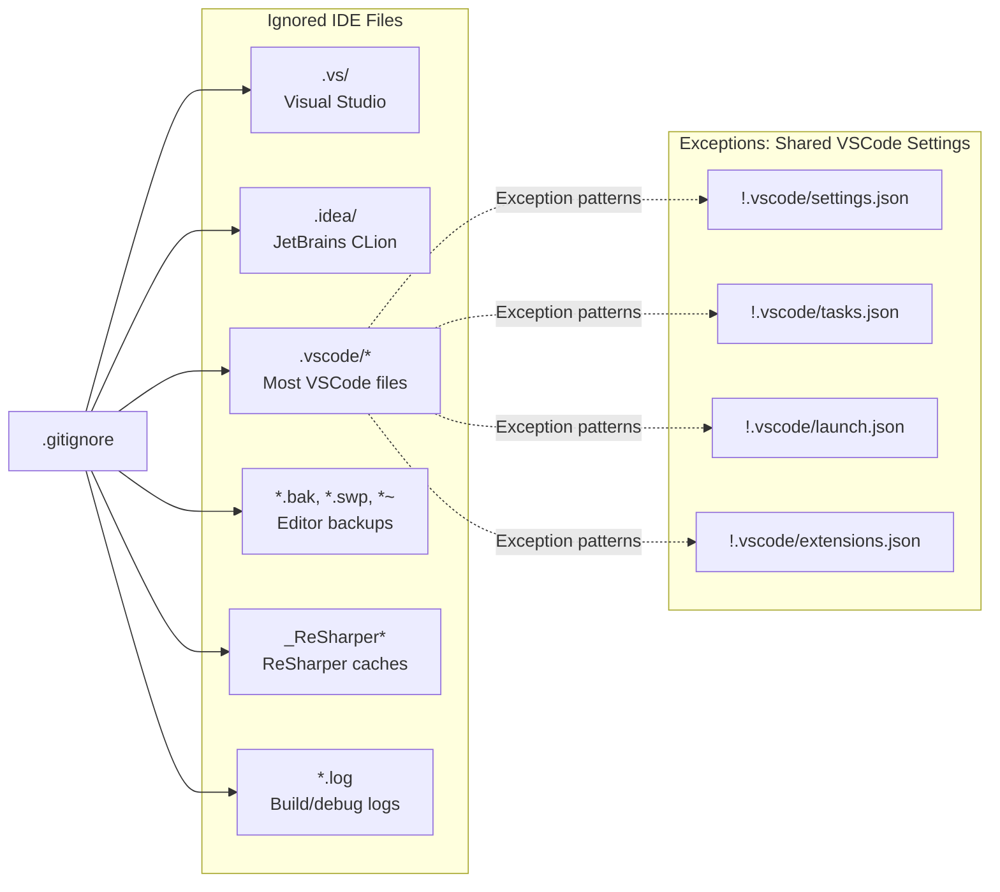
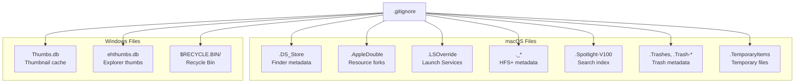

<!-- source: DeepWiki mcp.deepwiki.com · repo NVIDIA/aerial-framework · page 8.2 Git Ignore Patterns · fetched 2026-10-26 -->

# Git Ignore Patterns

<details>
<summary>Relevant source files</summary>

The following files were used as context for generating this wiki page:

- [.gitignore](.gitignore)

</details>


## Purpose and Scope

This document describes the Git ignore patterns configured in [.gitignore:1-59]() that prevent build artifacts, generated files, and environment-specific configurations from being committed to the repository. These patterns ensure clean version control by excluding files that are either generated during build/development or specific to individual developer environments.

For information about line ending normalization and binary file handling with Git LFS, see [Git Attributes and LFS](#8.1).

## Overview of Ignore Categories

The `.gitignore` file organizes exclusion patterns into seven functional categories, each serving a specific purpose in maintaining a clean repository.

**Ignore Pattern Categories**

```mermaid
graph TB
    GitIgnore[".gitignore File"]
    
    BuildArtifacts["Build Artifacts<br/>build/, out/, cmake-build-*"]
    Archives["Binary Archives<br/>*.tgz, *.tar.gz"]
    DataFiles["Data Files<br/>*.npz"]
    DevFiles["Development Files<br/>5GModel/"]
    UserSettings["User Settings<br/>CMakeUserPresets.json"]
    IDEFiles["IDE Files<br/>.vscode/, .idea/, .vs/"]
    PythonFiles["Python Generated<br/>__pycache__/, .venv/, .mypy_cache/"]
    OSFiles["OS Files<br/>.DS_Store, Thumbs.db"]
    
    GitIgnore --> BuildArtifacts
    GitIgnore --> Archives
    GitIgnore --> DataFiles
    GitIgnore --> DevFiles
    GitIgnore --> UserSettings
    GitIgnore --> IDEFiles
    GitIgnore --> PythonFiles
    GitIgnore --> OSFiles
    
    BuildArtifacts -.-> "CMake build system"
    Archives -.-> "Package distribution"
    DataFiles -.-> "NumPy data arrays"
    DevFiles -.-> "Developer experimentation"
    UserSettings -.-> "Local CMake overrides"
    IDEFiles -.-> "VSCode, CLion, Visual Studio"
    PythonFiles -.-> "Python runtime & tools"
    OSFiles -.-> "macOS, Windows, Linux"
```

**Sources:** [.gitignore:1-59]()

## Build Directory Patterns

The build system generates numerous artifacts that must be excluded from version control to prevent repository bloat and merge conflicts.

### CMake Build Directories

The following patterns exclude CMake build output:

| Pattern | Purpose | Generated By |
|---------|---------|--------------|
| `build/` | Default CMake build directory | CMake configuration, see [CMake Configuration](#4.1) |
| `out/*` | Alternative output directory | Custom build scripts |
| `cmake-build-*/` | CLion-style build directories | CLion IDE with CMake presets |
| `conan-cache/` | Conan package cache | Conan package manager (if used) |

The exception `!out/.gitkeep` [.gitignore:4]() preserves the `out/` directory structure while ignoring its contents.

**Sources:** [.gitignore:2-6]()

### Archive and Binary Files

Compressed archives and binary distributions are excluded to avoid storing large binary blobs:

```
*.tgz
*.tar.gz
```

These patterns prevent compiled distribution packages from being committed. See [Dependency Management with CPM](#4.3) for how external dependencies are fetched instead.

**Sources:** [.gitignore:7-8]()

### Data Files

Machine learning and signal processing data arrays are excluded:

```
*.npz
```

The `.npz` format is NumPy's compressed array format, commonly used for storing tensor data in prototyping workflows. See [Developer Tools](#3.1) for information about the JAX/PyTorch development workflow that generates these files.

**Sources:** [.gitignore:11-12]()

## Development Environment Patterns

### User-Specific CMake Configuration

```
CMakeUserPresets.json
```

This file allows developers to override CMake presets locally without affecting the shared `CMakePresets.json`. Excluding it prevents individual build preferences from being propagated to other developers. See [Build Presets and Configurations](#4.2) for the shared preset system.

**Sources:** [.gitignore:17-18]()

### Experimental Development Directories

```
**/5GModel/**
```

The `5GModel/` pattern excludes experimental or work-in-progress 3GPP model implementations from any location in the repository tree. This allows developers to maintain local research directories without cluttering version control.

**Sources:** [.gitignore:14-15]()

## IDE Configuration Files

Most IDE-generated files are ignored, with selective exceptions for shared VSCode settings.

### Excluded IDE Files

The following patterns exclude IDE-specific configuration:



**Sources:** [.gitignore:20-31]()

### VSCode Exception Pattern

The pattern `.vscode/` [.gitignore:22]() ignores the directory, but four exception patterns [.gitignore:23-26]() using the `!` prefix preserve specific configuration files:

- `!.vscode/settings.json` - Shared editor settings
- `!.vscode/tasks.json` - Build task definitions
- `!.vscode/launch.json` - Debug configurations
- `!.vscode/extensions.json` - Recommended extensions

This approach ensures consistent development experience across the team while allowing personal workspace customizations. See [Development Environment Setup](#2.1) for devcontainer configuration.

## Python Generated Files

Python development generates various cache and virtual environment files that must be excluded.

### Python Pattern Categories

| Pattern | Description | Generated By |
|---------|-------------|--------------|
| `__pycache__/` | Python bytecode cache | Python interpreter |
| `.mypy_cache/` | Type checking cache | mypy static type checker |
| `.pytest_cache/` | Test execution cache | pytest test framework |
| `.venv/` | Virtual environment | Python venv/virtualenv |
| `.coverage*` | Coverage data files | pytest-cov plugin |
| `**.egg-info/` | Package metadata | pip/setuptools |
| `*.whl` | Wheel distribution files | Python packaging |
| `ran/py/.env.python` | Environment variables | Local Python configuration |

**Sources:** [.gitignore:48-55]()

### Generated Tutorial Notebooks

```
docs/tutorials/generated/
```

This pattern excludes Jupyter notebooks that are programmatically generated from Python source files (`.py` → `.ipynb` conversion). The source `.py` files are version-controlled; the generated notebooks are build artifacts.

**Sources:** [.gitignore:58-59]()

## OS-Specific Files

Operating system metadata files are ignored to prevent cross-platform conflicts.

**OS-Generated File Mapping**



**Sources:** [.gitignore:34-45]()

### macOS-Specific Patterns

macOS generates metadata files for Finder and HFS+ filesystem features:

- `.DS_Store` - Directory view settings and icon positions
- `.AppleDouble`, `._*` - Resource forks and extended attributes
- `.Spotlight-V100` - Spotlight search index
- `.Trashes`, `.Trash-*` - Trash folder metadata

### Windows-Specific Patterns

Windows creates thumbnail caches and recycle bin metadata:

- `Thumbs.db`, `ehthumbs.db` - Thumbnail cache databases
- `$RECYCLE.BIN/` - Recycle bin contents

## Container Environment Configuration

```
container/.env
```

This pattern excludes environment variable files in the container configuration directory. The `container/compose.yaml` file (see [Development Environment Setup](#2.1)) may reference `.env` files for secrets or local customization that should not be committed.

**Sources:** [.gitignore:45]()

## Pattern Precedence and Exceptions

The `.gitignore` file uses Git's negation pattern (`!`) to create exceptions to broader ignore rules. Understanding the precedence is crucial:

1. Later patterns override earlier ones
2. Negation patterns (`!prefix`) create exceptions
3. Directory patterns (`path/`) match only directories
4. Wildcard patterns (`*`, `**`) enable recursive matching

### Example: VSCode Exception Pattern

```
.vscode/              # Ignore entire directory
!.vscode/settings.json    # Exception: track this file
!.vscode/tasks.json       # Exception: track this file
!.vscode/launch.json      # Exception: track this file
!.vscode/extensions.json  # Exception: track this file
```

The broad `.vscode/` pattern is negated for specific configuration files, allowing shared team settings while ignoring personal workspace state.

**Sources:** [.gitignore:22-26]()

### Example: Out Directory Pattern

```
out/*           # Ignore all contents of out/
!out/.gitkeep   # Exception: track the .gitkeep file
```

This preserves the directory structure in version control (via `.gitkeep`) while ignoring all actual build outputs.

**Sources:** [.gitignore:3-4]()

## Relationship to Build System

The ignore patterns directly correspond to outputs from various build system components:

**Build System Output Mapping**

```mermaid
graph TB
    subgraph "Build System Components"
        CMakeConfig["CMakeLists.txt<br/>CMakePresets.json"]
        CPM["CPM.cmake<br/>Package manager"]
        Benchmark["Benchmarks.cmake<br/>Performance tests"]
        Format["FormatTargets.cmake<br/>Code formatting"]
        Copyright["CopyrightTargets.cmake<br/>License checks"]
    end
    
    subgraph "Ignored Build Artifacts"
        BuildDir["build/, cmake-build-*"]
        ConanCache["conan-cache/"]
        BenchmarkOut["benchmark_results/"]
        FormatTemp["Temporary format files"]
        Logs["*.log files"]
    end
    
    subgraph "Ignored Python Artifacts"
        PythonCache["__pycache__/"]
        MyPy[".mypy_cache/"]
        Pytest[".pytest_cache/"]
        Venv[".venv/"]
    end
    
    CMakeConfig --> BuildDir
    CPM --> ConanCache
    Benchmark --> BenchmarkOut
    Format --> FormatTemp
    Copyright --> Logs
    
    PythonTools["Python tooling<br/>ruff, mypy, pytest"] --> PythonCache
    PythonTools --> MyPy
    PythonTools --> Pytest
    PythonTools --> Venv
    
    GitIgnore[".gitignore patterns"] -.-> BuildDir
    GitIgnore -.-> ConanCache
    GitIgnore -.-> BenchmarkOut
    GitIgnore -.-> FormatTemp
    GitIgnore -.-> Logs
    GitIgnore -.-> PythonCache
    GitIgnore -.-> MyPy
    GitIgnore -.-> Pytest
    GitIgnore -.-> Venv
```



**Sources:** [.gitignore:1-59]()

Key mappings:

- `build/` directories contain CMake-generated Makefiles, object files, and executables
- `cmake-build-*/` directories are created by CLion when using CMake presets
- `__pycache__/` contains Python bytecode from Python tools (ruff, type checkers)
- `.mypy_cache/` is generated during static type checking in Python code quality checks

## Best Practices

### Adding New Patterns

When adding new ignore patterns:

1. **Use directory patterns** (`path/`) instead of recursive wildcards when possible for better performance
2. **Group related patterns** under descriptive comments for maintainability
3. **Document exceptions** with inline comments explaining why specific files are tracked
4. **Test patterns** using `git check-ignore -v <file>` to verify matching

### Verifying Ignore Status

To check if a file is ignored:

```bash
git check-ignore -v path/to/file
```

This displays which pattern in `.gitignore` matches the file.

### Global vs. Repository Patterns

Some patterns (like `.DS_Store`, `Thumbs.db`) could be in a global `.gitignore` configured via:

```bash
git config --global core.excludesfile ~/.gitignore_global
```

However, this repository includes them explicitly to ensure consistent behavior across all contributors without requiring global Git configuration.

**Sources:** [.gitignore:1-59]()

## Summary

The `.gitignore` configuration prevents 59 different patterns from being committed, organized into seven categories:

1. **Build artifacts** - CMake directories, archives, data files
2. **User settings** - `CMakeUserPresets.json`, experimental directories
3. **IDE files** - With selective VSCode exceptions for shared settings
4. **Python files** - Caches, virtual environments, package metadata
5. **OS files** - macOS Finder metadata, Windows thumbnail caches
6. **Container environment** - Docker Compose environment files
7. **Generated documentation** - Converted tutorial notebooks

These patterns integrate with the build system (see [CMake Configuration](#4.1)), development environment (see [Development Environment Setup](#2.1)), and code quality tools (see [Development Guide](#6)) to maintain a clean, portable repository.

**Sources:** [.gitignore:1-59]()

---

