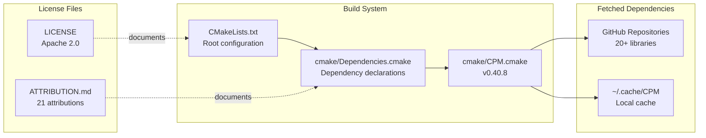
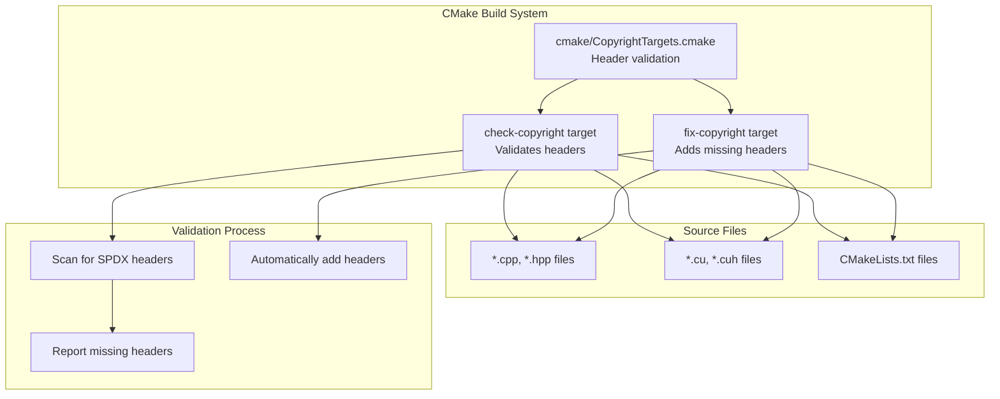

<!-- source: DeepWiki mcp.deepwiki.com · repo NVIDIA/aerial-framework · page 9.1 License and Attribution · fetched 2026-10-26 -->

# License and Attribution

<details>
<summary>Relevant source files</summary>

The following files were used as context for generating this wiki page:

- [ATTRIBUTION.md](ATTRIBUTION.md)
- [LICENSE](LICENSE)

</details>


This document provides comprehensive information about the licensing terms for the NVIDIA Aerial Framework and attribution for all third-party open-source libraries integrated into the project. It covers the main project license, copyright ownership, and the complete list of external dependencies with their respective licenses.

For information about contributing to the project, see [Contributing Guidelines](#9.2). For security policies, see [Security Policy](#9.3).

---

## Project License

The NVIDIA Aerial Framework is licensed under the **Apache License, Version 2.0** (January 2004). The full license text is available in [LICENSE:1-210]().

### Copyright Information

```
Copyright 2025 NVIDIA Corporation
```

The project's source code files include SPDX license identifiers in their headers, which are automatically validated and enforced through the build system (see License Enforcement section below).

### Additional Licensing Terms

When using the Aerial container from NGC (NVIDIA GPU Cloud) and building the Aerial Framework, users download NVIDIA and third-party software governed by additional licenses and terms. Comprehensive acknowledgements are available at:

```
https://docs.nvidia.com/aerial/framework/latest/acknowledgements.html
```

**Sources:** [LICENSE:1-210]()

---

## Third-Party Open Source Dependencies

The Aerial Framework integrates 21 open-source libraries, each with its own licensing terms. All attributions are documented in [ATTRIBUTION.md:1-794](). The project uses permissive licenses compatible with commercial use.

### Dependency Summary Table

| Library | Version | License | Primary Use |
|---------|---------|---------|-------------|
| **cmake_template** | 1015c6b8841 | Unlicense (Public Domain) | CMake build system templates |
| **fmt** | 10.2.1 | MIT | String formatting |
| **GoogleTest** | 1.15.2 | BSD 3-Clause | Unit testing framework |
| **CLI11** | 2.5.0 | BSD 3-Clause | Command-line parsing |
| **wise_enum** | 3.1.0 | Boost Software License 1.0 | Enum reflection |
| **Format.cmake** | 1.8.2 | Apache 2.0 | Code formatting integration |
| **NamedType** | 1.1.0 | MIT | Type-safe wrappers |
| **cpp-member-accessor** | (commit) | MIT | Member access utilities |
| **phmap** | 2.0.0 | Apache 2.0 | Parallel hash maps |
| **Quill** | 10.0.1 | MIT | High-performance logging |
| **Google Benchmark** | 1.9.4 | Apache 2.0 | Performance benchmarking |
| **GSL-Lite** | 1.0.1 | MIT | C++ Core Guidelines support |
| **GDRCopy** | 2.5 | MIT | GPU Direct RDMA |
| **backward-cpp** | 1.6 | MIT | Stack trace generation |
| **libyaml** | 0.2.5 | MIT | YAML parsing (C library) |
| **yaml-cpp** | 0.8.0 | MIT | YAML parsing (C++ wrapper) |
| **fmtlog** | acd521b | MIT | Fast logging |
| **range-v3** | ca1388f | Boost Software License 1.0 | Range algorithms |
| **tl::expected** | 1.3.1 | CC0 1.0 (Public Domain) | Error handling |

**Sources:** [ATTRIBUTION.md:1-794]()

---

## License Categories

The following diagram categorizes dependencies by license type and shows their relationships:

```mermaid
graph TB
    subgraph "Aerial Framework"
        MainProject["NVIDIA Aerial Framework<br/>Apache 2.0<br/>Copyright 2025 NVIDIA"]
    end
    
    subgraph "Public Domain / Permissive"
        Unlicense["cmake_template<br/>Unlicense"]
        CC0["tl::expected 1.3.1<br/>CC0 1.0"]
    end
    
    subgraph "MIT Licensed Libraries"
        fmt["fmt 10.2.1"]
        NamedType["NamedType 1.1.0"]
        MemberAccessor["cpp-member-accessor"]
        Quill["Quill 10.0.1"]
        GSL["GSL-Lite 1.0.1"]
        GDRCopy["GDRCopy 2.5"]
        Backward["backward-cpp 1.6"]
        libyaml["libyaml 0.2.5"]
        yamlcpp["yaml-cpp 0.8.0"]
        fmtlog["fmtlog"]
    end
    
    subgraph "BSD 3-Clause Licensed"
        GoogleTest["GoogleTest 1.15.2"]
        CLI11["CLI11 2.5.0"]
    end
    
    subgraph "Apache 2.0 Licensed"
        FormatCmake["Format.cmake 1.8.2"]
        phmap["phmap 2.0.0"]
        Benchmark["Google Benchmark 1.9.4"]
    end
    
    subgraph "Boost Software License"
        WiseEnum["wise_enum 3.1.0"]
        rangev3["range-v3"]
    end
    
    MainProject --> Unlicense
    MainProject --> CC0
    MainProject --> fmt
    MainProject --> NamedType
    MainProject --> MemberAccessor
    MainProject --> Quill
    MainProject --> GSL
    MainProject --> GDRCopy
    MainProject --> Backward
    MainProject --> libyaml
    MainProject --> yamlcpp
    MainProject --> fmtlog
    MainProject --> GoogleTest
    MainProject --> CLI11
    MainProject --> FormatCmake
    MainProject --> phmap
    MainProject --> Benchmark
    MainProject --> WiseEnum
    MainProject --> rangev3
```



**Sources:** [ATTRIBUTION.md:1-794](), [LICENSE:1-210]()

---

## License Type Details

### Permissive Licenses Used

All dependencies use permissive licenses that allow:
- Commercial use
- Modification
- Distribution
- Private use

#### MIT License (10 libraries)
The most common license in the dependency tree. Key libraries include `fmt`, `Quill`, `GDRCopy`, `yaml-cpp`, and `GSL-Lite`. All require preservation of copyright notice and permission notice in redistributions.

**Example:** [ATTRIBUTION.md:40-64]() (fmt license text)

#### BSD 3-Clause License (2 libraries)
Used by `GoogleTest` and `CLI11`. Requires copyright notice, conditions list, and disclaimer in redistributions. Prohibits using copyright holder's name for endorsement without permission.

**Example:** [ATTRIBUTION.md:68-101]() (GoogleTest license text)

#### Apache License 2.0 (3 libraries + main project)
Used by `Format.cmake`, `phmap`, `Google Benchmark`, and the Aerial Framework itself. Includes patent grant provisions and requires preservation of attribution notices.

**Example:** [ATTRIBUTION.md:171-189]() (Format.cmake license text)

#### Boost Software License 1.0 (2 libraries)
Used by `wise_enum` and `range-v3`. Highly permissive, requiring only that copyright notices and the license be included in software copies (not object code).

**Example:** [ATTRIBUTION.md:139-167]() (wise_enum license text)

#### Public Domain (2 libraries)
- **Unlicense:** `cmake_template` is released to public domain
- **CC0 1.0 Universal:** `tl::expected` uses Creative Commons CC0, waiving all copyright

**Sources:** [ATTRIBUTION.md:5-794]()

---

## Dependency Integration via CPM

Dependencies are fetched and integrated using CPM (CMake Package Manager). The dependency management system is documented in detail in [Dependency Management with CPM](#4.3).



**Sources:** [LICENSE:1-210](), [ATTRIBUTION.md:1-794]()

---

## Copyright Header Enforcement

The build system automatically enforces SPDX-compliant copyright headers on all source files through CMake targets defined in `cmake/CopyrightTargets.cmake`.

### SPDX Header Format

All C++ and CUDA source files must include:

```cpp
// SPDX-FileCopyrightText: Copyright (c) 2025 NVIDIA CORPORATION & AFFILIATES. All rights reserved.
// SPDX-License-Identifier: Apache-2.0
```

### Enforcement Targets



### Running Copyright Checks

To validate copyright headers:
```bash
cmake --build build --target check-copyright
```

To automatically fix missing headers:
```bash
cmake --build build --target fix-copyright
```

The enforcement system is integrated into the development workflow and documented in [Copyright and License Enforcement](#6.6).

**Sources:** Referenced in page [6.6](#6.6), implemented in `cmake/CopyrightTargets.cmake`

---

## Complete Attribution Reference

### Build System and CMake Utilities

**cmake_template (version 1015c6b8841)**  
Repository: https://github.com/cpp-best-practices/cmake_template  
License: Unlicense (Public Domain)  
Usage: Base CMake build system structure  
Attribution: [ATTRIBUTION.md:5-36]()

**Format.cmake (version 1.8.2)**  
Repository: https://github.com/TheLartians/Format.cmake  
License: Apache 2.0  
Usage: Automated code formatting integration  
Attribution: [ATTRIBUTION.md:171-189]()

### Core C++ Libraries

**fmt (version 10.2.1)**  
Repository: https://github.com/fmtlib/fmt  
License: MIT  
Usage: Fast, type-safe string formatting  
Attribution: [ATTRIBUTION.md:40-64]()

**CLI11 (version 2.5.0)**  
Repository: https://github.com/CLIUtils/CLI11  
License: BSD 3-Clause  
Usage: Command-line argument parsing  
Attribution: [ATTRIBUTION.md:105-135]()

**wise_enum (version 3.1.0)**  
Repository: https://github.com/quicknir/wise_enum  
License: Boost Software License 1.0  
Usage: Enum reflection and string conversion  
Attribution: [ATTRIBUTION.md:139-167]()

**NamedType (version 1.1.0)**  
Repository: https://github.com/joboccara/NamedType  
License: MIT  
Usage: Strong type aliases for improved type safety  
Attribution: [ATTRIBUTION.md:193-219]()

**cpp-member-accessor**  
Repository: https://github.com/hliberacki/cpp-member-accessor  
License: MIT  
Usage: Private member access utilities  
Attribution: [ATTRIBUTION.md:223-249]()

**GSL-Lite (version 1.0.1)**  
Repository: https://github.com/gsl-lite/gsl-lite  
License: MIT  
Usage: C++ Core Guidelines support library  
Attribution: [ATTRIBUTION.md:327-353]()

**tl::expected (version 1.3.1)**  
Repository: https://github.com/TartanLlama/expected  
License: CC0 1.0 Universal (Public Domain)  
Usage: Error handling with expected<T, E> type  
Attribution: [ATTRIBUTION.md:667-793]()

**range-v3 (commit ca1388f)**  
Repository: https://github.com/ericniebler/range-v3  
License: Boost Software License 1.0 (with additional licenses)  
Usage: Range algorithms and views  
Attribution: [ATTRIBUTION.md:508-663]()

### Data Structures and Algorithms

**phmap (version 2.0.0)**  
Repository: https://github.com/greg7mdp/parallel-hashmap  
License: Apache 2.0  
Usage: High-performance parallel hash maps  
Attribution: [ATTRIBUTION.md:253-271]()

### Logging Libraries

**Quill (version 10.0.1)**  
Repository: https://github.com/odygrd/quill  
License: MIT  
Usage: Asynchronous low-latency logging  
Attribution: [ATTRIBUTION.md:275-301]()

**fmtlog (commit acd521b)**  
Repository: https://github.com/MengRao/fmtlog  
License: MIT  
Usage: Fast formatting logger  
Attribution: [ATTRIBUTION.md:478-504]()

### Testing and Benchmarking

**GoogleTest (version 1.15.2)**  
Repository: https://github.com/google/googletest  
License: BSD 3-Clause  
Usage: C++ unit testing framework  
Attribution: [ATTRIBUTION.md:68-101]()

**Google Benchmark (version 1.9.4)**  
Repository: https://github.com/google/benchmark  
License: Apache 2.0  
Usage: Microbenchmarking library  
Attribution: [ATTRIBUTION.md:305-323]()

### Configuration and Parsing

**libyaml (version 0.2.5)**  
Repository: https://github.com/yaml/libyaml  
License: MIT  
Usage: YAML 1.1 parser and emitter (C library)  
Attribution: [ATTRIBUTION.md:417-444]()

**yaml-cpp (version 0.8.0)**  
Repository: https://github.com/jbeder/yaml-cpp  
License: MIT  
Usage: YAML parser and emitter (C++ wrapper)  
Attribution: [ATTRIBUTION.md:448-474]()

### GPU and System Utilities

**GDRCopy (version 2.5)**  
Repository: https://github.com/NVIDIA/gdrcopy  
License: MIT  
Usage: Low-latency GPU memory copy using GPUDirect RDMA  
Attribution: [ATTRIBUTION.md:357-383]()

**backward-cpp (version 1.6)**  
Repository: https://github.com/bombela/backward-cpp  
License: MIT  
Usage: Stack trace printing for debugging  
Attribution: [ATTRIBUTION.md:387-413]()

**Sources:** [ATTRIBUTION.md:1-794]()

---

## License Compatibility

All third-party licenses used in the Aerial Framework are compatible with the Apache 2.0 main project license and permit:

| License | Commercial Use | Modification | Distribution | Patent Grant |
|---------|---------------|--------------|--------------|--------------|
| Apache 2.0 | ✓ | ✓ | ✓ | ✓ |
| MIT | ✓ | ✓ | ✓ | - |
| BSD 3-Clause | ✓ | ✓ | ✓ | - |
| Boost Software License 1.0 | ✓ | ✓ | ✓ | - |
| Unlicense | ✓ | ✓ | ✓ | - |
| CC0 1.0 | ✓ | ✓ | ✓ | - |

The combination of these permissive licenses allows for:
- **Commercial deployment** of the Aerial Framework
- **Modification** of all components as needed
- **Redistribution** in source or binary form
- **Patent protection** via Apache 2.0's patent grant clause

**Sources:** [LICENSE:1-210](), [ATTRIBUTION.md:1-794]()

---

## Summary

The NVIDIA Aerial Framework is distributed under the Apache License 2.0, with copyright held by NVIDIA Corporation (2025). The project integrates 21 carefully selected open-source libraries, all using permissive licenses compatible with commercial use. License compliance is enforced through automated copyright header validation in the build system.

For detailed license texts of all dependencies, refer to [ATTRIBUTION.md:1-794](). For the complete Apache 2.0 license terms, see [LICENSE:1-210]().

---

