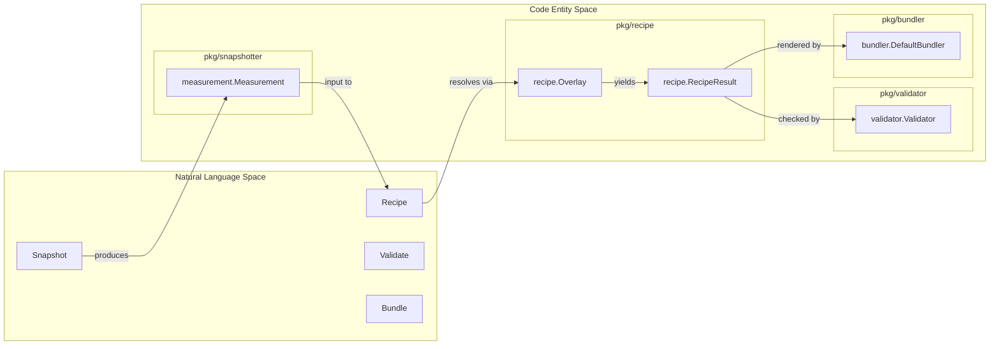
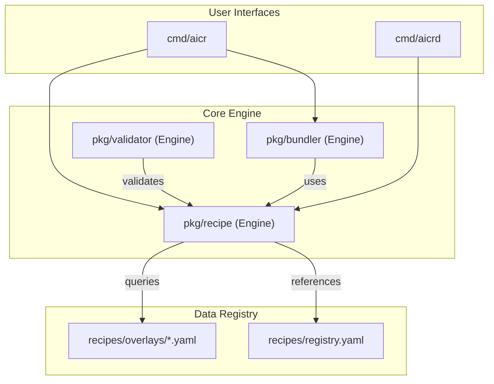

<!-- source: DeepWiki mcp.deepwiki.com · repo NVIDIA/aicr · page 1 AICR Overview · fetched 2026-10-26 -->

# AICR Overview

Relevant source files

The following files were used as context for generating this wiki page:

- [.claude/CLAUDE.md](.claude/CLAUDE.md)
- [.ctlptl-kwok.yaml](.ctlptl-kwok.yaml)
- [.github/PULL_REQUEST_TEMPLATE.md](.github/PULL_REQUEST_TEMPLATE.md)
- [.github/actions/README.md](.github/actions/README.md)
- [.github/copilot-instructions.md](.github/copilot-instructions.md)
- [AGENTS.md](AGENTS.md)
- [CHANGELOG.md](CHANGELOG.md)
- [CONTRIBUTING.md](CONTRIBUTING.md)
- [DEVELOPMENT.md](DEVELOPMENT.md)
- [README.md](README.md)
- [RELEASING.md](RELEASING.md)
- [cliff.toml](cliff.toml)
- [docs/README.md](docs/README.md)
- [docs/contributor/component.md](docs/contributor/component.md)
- [docs/integrator/data-flow.md](docs/integrator/data-flow.md)
- [docs/integrator/recipe-development.md](docs/integrator/recipe-development.md)
- [tools/bump](tools/bump)
- [tools/check-agents-sync](tools/check-agents-sync)
- [tools/common](tools/common)

The **NVIDIA AI Cluster Runtime (AICR)** is a suite of tools designed to automate the deployment of GPU-accelerated Kubernetes infrastructure. It replaces manual, error-prone setup processes with a deterministic, automated workflow that captures known-good combinations of drivers, operators, kernels, and system configurations as version-locked **recipes** [README.md:1-19]().

AICR ensures that AI/ML workloads run on infrastructure that is validated against NVIDIA's hardware standards, optimized for specific workload intents (e.g., training vs. inference), and secured with verifiable supply chain provenance [docs/README.md:1-4]().

## The Four-Stage Pipeline

AICR operates through a structured four-stage lifecycle that transforms raw system state into deployment-ready artifacts.

| Stage | Command | Purpose |
| :--- | :--- | :--- |
| **Snapshot** | `aicr snapshot` | Captures the "as-is" state of the cluster (OS, GPU, K8s, etc.) [docs/README.md:52-57](). |
| **Recipe** | `aicr recipe` | Matches the snapshot or query criteria against validated overlays to generate a configuration [docs/README.md:59-66](). |
| **Validate** | `aicr validate` | Compares the cluster's actual state against the recipe's constraints [docs/README.md:67-75](). |
| **Bundle** | `aicr bundle` | Materializes the recipe into Helm charts, ArgoCD manifests, and deployment scripts [docs/README.md:76-80](). |

### Pipeline Entity Mapping
The following diagram bridges high-level pipeline stages to the Go packages and data entities that implement them.

**Pipeline to Code Entity Map**

**Sources:** [pkg/recipe/resolve.go](), [pkg/bundler/bundler.go](), [pkg/validator/validator.go](), [docs/README.md:52-80]()

## Key Components

### Binaries
*   **`aicr` CLI**: A single binary built using `urfave/cli/v3` that provides the primary interface for all pipeline stages [DEVELOPMENT.md:176-181]().
*   **`aicrd` API Server**: A REST API server that exposes recipe generation and bundling capabilities for CI/CD integration and air-gapped environments [DEVELOPMENT.md:183-191]().

### In-Cluster Agents
*   **Snapshot Agent**: A Kubernetes Job that captures live cluster state (GPU hardware, drivers, OS) and stores it in a `ConfigMap` [README.md:62]().
*   **Validator Agent**: Orchestrates multi-phase validation (Deployment, Performance, Conformance) within the cluster [docs/README.md:71-75]().

### System Architecture
The architecture relies on a "base-plus-overlay" model where configurations are resolved through asymmetric matching of criteria (service, accelerator, OS, intent) [docs/README.md:64]().

**System Component Interaction**

**Sources:** [DEVELOPMENT.md:145-172](), [docs/integrator/recipe-development.md:75-86]()

## Detailed Sub-sections

For in-depth technical details, refer to the following child pages:

*   **[Getting Started](#1.1)**: Installation via Homebrew or install script, environment prerequisites, and a 2-minute quick-start walkthrough [README.md:21-54]().
*   **[Architecture Overview](#1.2)**: Conceptual deep-dive into the data model, the asymmetric matching algorithm, and the Kubernetes-native `cm://` URI scheme for I/O [docs/README.md:5-27]().

---
**Sources:** [README.md](), [DEVELOPMENT.md](), [docs/README.md](), [docs/integrator/recipe-development.md]()

---

