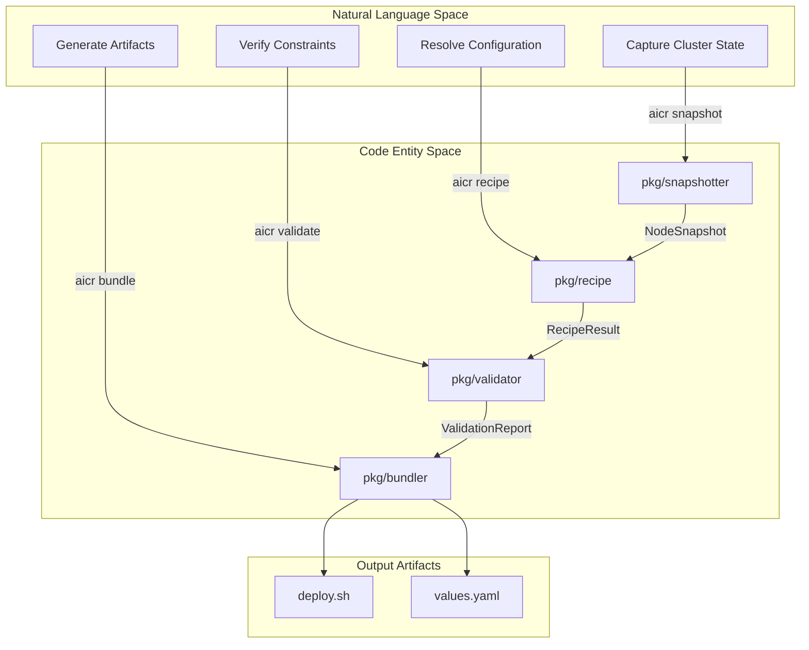
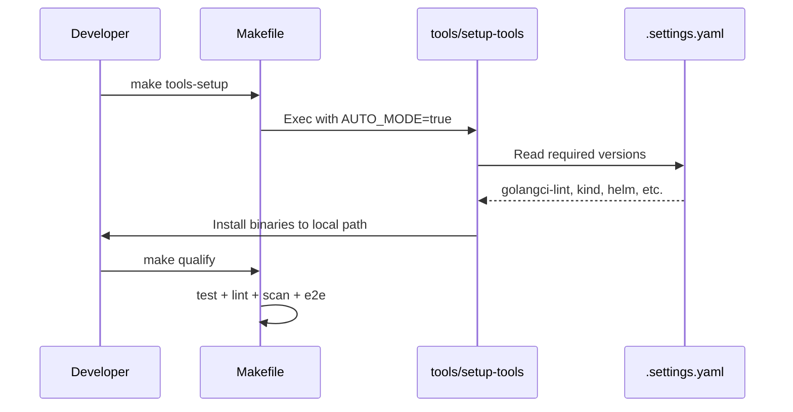

<!-- source: DeepWiki mcp.deepwiki.com · repo NVIDIA/aicr · page 1.1 Getting Started · fetched 2026-10-26 -->

# Getting Started

<details>
<summary>Relevant source files</summary>

The following files were used as context for generating this wiki page:

- [.claude/CLAUDE.md](.claude/CLAUDE.md)
- [.github/PULL_REQUEST_TEMPLATE.md](.github/PULL_REQUEST_TEMPLATE.md)
- [.github/actions/README.md](.github/actions/README.md)
- [.github/copilot-instructions.md](.github/copilot-instructions.md)
- [AGENTS.md](AGENTS.md)
- [CONTRIBUTING.md](CONTRIBUTING.md)
- [DEVELOPMENT.md](DEVELOPMENT.md)
- [RELEASING.md](RELEASING.md)
- [demos/README.md](demos/README.md)
- [demos/cuj2.md](demos/cuj2.md)
- [demos/examples/CUJ2-Test-Report.md](demos/examples/CUJ2-Test-Report.md)
- [demos/valid.md](demos/valid.md)
- [docs/user/installation.md](docs/user/installation.md)
- [install](install)
- [pkg/bundler/deployer/helm/helm.go](pkg/bundler/deployer/helm/helm.go)
- [pkg/bundler/deployer/helm/helm_test.go](pkg/bundler/deployer/helm/helm_test.go)
- [pkg/bundler/deployer/helm/templates/deploy.sh.tmpl](pkg/bundler/deployer/helm/templates/deploy.sh.tmpl)
- [pkg/bundler/deployer/helm/templates/undeploy.sh.tmpl](pkg/bundler/deployer/helm/templates/undeploy.sh.tmpl)
- [recipes/components/cert-manager/values.yaml](recipes/components/cert-manager/values.yaml)
- [tools/check-agents-sync](tools/check-agents-sync)
- [tools/common](tools/common)

</details>


The NVIDIA AI Cluster Runtime (AICR) is a technical framework designed to generate, validate, and deploy optimized Kubernetes configurations for GPU-accelerated workloads. This page provides the technical procedures for installing the `aicr` CLI, setting up the development environment, and executing the end-to-end pipeline.

## Installation Methods

AICR provides multiple distribution channels to ensure compatibility with various environments, ranging from local workstations to automated CI/CD pipelines.

### 1. Automated Install Script (Recommended)
The installation script automatically detects the host operating system and architecture (e.g., `linux/amd64`, `darwin/arm64`) and fetches the corresponding binary from GitHub Releases [install:219-232]().

```bash
# Install to default /usr/local/bin
curl -sfL https://raw.githubusercontent.com/NVIDIA/aicr/main/install | bash -s --

# Install to a custom directory (e.g., for non-root users)
curl -sfL https://raw.githubusercontent.com/NVIDIA/aicr/main/install | bash -s -- -d ~/.local/bin
```

### 2. Homebrew (macOS/Linux)
For users managing packages via Homebrew, AICR maintains a custom tap [docs/user/installation.md:16-21]().
```bash
brew tap NVIDIA/aicr
brew install aicr
```

### 3. Containerized Execution
AICR is available as a container image, which is ideal for stateless execution in ephemeral environments [docs/user/installation.md:124-132]().
```bash
docker pull ghcr.io/nvidia/aicr:latest
docker run --rm -v $(pwd):/workspace -w /workspace ghcr.io/nvidia/aicr:latest --version
```

### 4. Building from Source
For contributors or environments requiring custom builds, AICR requires Go 1.26+ [DEVELOPMENT.md:49]().
```bash
go install github.com/NVIDIA/aicr/cmd/aicr@latest
```

**Sources:** [install:1-135](), [docs/user/installation.md:1-100](), [DEVELOPMENT.md:43-53]()

---

## Environment Prerequisites

To utilize the full functionality of the AICR pipeline, the following environmental components are required:

| Component | Requirement | Purpose |
| :--- | :--- | :--- |
| **Go** | 1.26+ | Core runtime for building/running the CLI and API server [DEVELOPMENT.md:49]() |
| **Kubernetes** | 1.33+ | Target environment for snapshots and bundle deployment [.claude/CLAUDE.md:27]() |
| **NVIDIA Driver** | Compatible with hardware | Required for the `GPUCollector` to interface with `nvidia-smi` [docs/user/installation.md:166-175]() |
| **Tools** | `yq`, `helm`, `kubectl` | Essential for YAML processing and cluster interaction [DEVELOPMENT.md:53-69]() |

**Sources:** [DEVELOPMENT.md:43-70](), [.claude/CLAUDE.md:27-28](), [docs/user/installation.md:7-12]()

---

## Quick-Start Pipeline Walkthrough

The AICR lifecycle follows a strictly defined four-stage data flow: **Snapshot → Recipe → Validate → Bundle** [.claude/CLAUDE.md:14-25]().

### Data Flow and Code Entity Mapping
The following diagram bridges the conceptual pipeline stages to the internal Go packages and CLI commands.

**AICR Pipeline Architecture**

**Sources:** [.claude/CLAUDE.md:14-25](), [DEVELOPMENT.md:145-165](), [pkg/bundler/deployer/helm/helm.go:67-88]()

### Step 1: Snapshot
Capture the current state of the hardware and software environment. This utilizes the `pkg/collector` system to gather GPU, OS, and K8s metrics [DEVELOPMENT.md:194-203]().
```bash
aicr snapshot --output snapshot.yaml
```

### Step 2: Recipe Generation
Generate an optimized configuration based on the snapshot and user intent (e.g., training vs. inference) [demos/cuj2.md:7-15](). The `pkg/recipe` engine matches these inputs against the `ComponentRegistry` [DEVELOPMENT.md:204-210]().
```bash
aicr recipe \
  --snapshot snapshot.yaml \
  --intent training \
  --platform kubeflow \
  --output recipe.yaml
```

### Step 3: Validation
Verify that the target cluster meets the requirements defined in the recipe. This executes the `pkg/validator` logic, often deploying a temporary agent Job to the cluster [.claude/CLAUDE.md:87-91]().
```bash
aicr validate --recipe recipe.yaml --phase deployment --phase performance
```

### Step 4: Bundling and Deployment
The `pkg/bundler` transforms the validated recipe into a deployable Helm bundle [pkg/bundler/deployer/helm/helm.go:105-112](). This includes a generated `deploy.sh` script with retry logic and CRD race handling [pkg/bundler/deployer/helm/templates/deploy.sh.tmpl:84-100]().
```bash
# Generate the bundle
aicr bundle --recipe recipe.yaml --output ./my-bundle

# Deploy to the cluster
cd ./my-bundle
chmod +x deploy.sh
./deploy.sh
```

**Sources:** [demos/cuj2.md:7-46](), [.claude/CLAUDE.md:87-91](), [pkg/bundler/deployer/helm/helm.go:114-209](), [pkg/bundler/deployer/helm/templates/deploy.sh.tmpl:1-134]()

---

## Initial Setup for Developers

For contributors, the environment is managed via a centralized `.settings.yaml` file to ensure consistency between local development and CI pipelines [DEVELOPMENT.md:89-91]().

**Development Environment Initialization**


### Workflow Commands
| Command | Implementation | Purpose |
| :--- | :--- | :--- |
| `make tools-setup` | `tools/setup-tools` | Installs all required dev tools at pinned versions [DEVELOPMENT.md:94]() |
| `make build` | `cmd/aicr`, `cmd/aicrd` | Compiles the CLI and API server binaries [DEVELOPMENT.md:37]() |
| `make qualify` | `scripts/qualify.sh` | Runs full suite: lint, unit tests, vulnerability scan, and E2E [DEVELOPMENT.md:40]() |
| `make dev-env` | `tilt`, `kind` | Boots a local Kind cluster with Tilt hot-reloading [.claude/CLAUDE.md:52]() |

**Sources:** [DEVELOPMENT.md:19-41](), [DEVELOPMENT.md:88-101](), [.claude/CLAUDE.md:31-70]()

---

