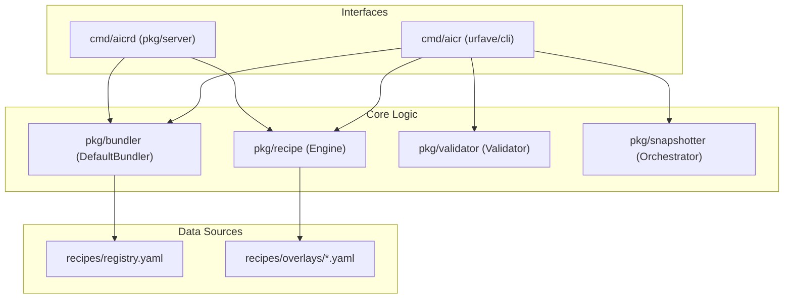

<!-- source: DeepWiki mcp.deepwiki.com · repo NVIDIA/aicr · page 1.2 Architecture Overview · fetched 2026-10-26 -->

# Architecture Overview

<details>
<summary>Relevant source files</summary>

The following files were used as context for generating this wiki page:

- [.claude/CLAUDE.md](.claude/CLAUDE.md)
- [.github/PULL_REQUEST_TEMPLATE.md](.github/PULL_REQUEST_TEMPLATE.md)
- [.github/actions/README.md](.github/actions/README.md)
- [.github/copilot-instructions.md](.github/copilot-instructions.md)
- [AGENTS.md](AGENTS.md)
- [CONTRIBUTING.md](CONTRIBUTING.md)
- [DEVELOPMENT.md](DEVELOPMENT.md)
- [README.md](README.md)
- [RELEASING.md](RELEASING.md)
- [ROADMAP.md](ROADMAP.md)
- [docs/README.md](docs/README.md)
- [docs/contributor/cli.md](docs/contributor/cli.md)
- [docs/contributor/component.md](docs/contributor/component.md)
- [docs/contributor/data.md](docs/contributor/data.md)
- [docs/design/002-validatorv2-adr.md](docs/design/002-validatorv2-adr.md)
- [docs/images/aicr-end-to-end.png](docs/images/aicr-end-to-end.png)
- [docs/integrator/automation.md](docs/integrator/automation.md)
- [docs/integrator/data-flow.md](docs/integrator/data-flow.md)
- [docs/integrator/kubernetes-deployment.md](docs/integrator/kubernetes-deployment.md)
- [docs/integrator/recipe-development.md](docs/integrator/recipe-development.md)
- [docs/user/agent-deployment.md](docs/user/agent-deployment.md)
- [docs/user/api-reference.md](docs/user/api-reference.md)
- [tools/check-agents-sync](tools/check-agents-sync)
- [tools/common](tools/common)

</details>


The NVIDIA AI Cluster Runtime (AICR) is a technical framework designed to bridge the gap between high-level AI infrastructure requirements and low-level Kubernetes configuration. It automates the complexity of matching GPU hardware, drivers, and operators to specific cloud environments and workload intents.

## System Workflow and Data Flow

AICR operates through a deterministic four-stage pipeline. Each stage transforms data from one representation to another, moving from a measurement of physical reality to a deployable software bundle.

Title: AICR Pipeline Data Flow
```mermaid
graph LR
    subgraph "Capture Phase"
        A["Cluster/Node"] -- "pkg/collector" --> B["Snapshot (YAML/JSON)"]
    [pkg/snapshotter/snapshotter.go:1-100]()
    end

    subgraph "Inference Phase"
        B -- "pkg/recipe" --> C["Recipe (Metadata)"]
        D["Criteria/Overlays"] -- "Deep Merge" --> C
    [pkg/recipe/engine.go:1-100]()
    end

    subgraph "Verification Phase"
        C -- "pkg/validator" --> E["Validation Report (CTRF)"]
        B -- "Constraint Check" --> E
    [pkg/validator/validator.go:1-100]()
    end

    subgraph "Materialization Phase"
        C -- "pkg/bundler" --> F["Deployment Bundle"]
        G["Component Registry"] -- "Template" --> F
    [pkg/bundler/bundler.go:1-100]()
    end
```

Sources: `README.md`, `.claude/CLAUDE.md`, `pkg/snapshotter/snapshotter.go`, `pkg/recipe/engine.go`, `pkg/validator/validator.go`, `pkg/bundler/bundler.go`

---

## Core Components and Relationships

The system is split into two primary interfaces—the `aicr` CLI and the `aicrd` API server—which both utilize a shared set of functional packages. This separation ensures that business logic for recipe resolution and bundle generation is consistent regardless of how it is invoked.

Title: Component Entity Relationship


**Implementation Details:**
- **CLI (`aicr`)**: Built using `urfave/cli/v3` [pkg/cli/cli.go:1-50](). It handles user interaction and I/O orchestration.
- **API Server (`aicrd`)**: A RESTful service [cmd/aicrd/main.go:1-30]() providing endpoints like `GET /v1/recipe` and `POST /v1/bundle` [pkg/api/server.go:1-100]().
- **Recipe Engine**: Resolves the "best fit" configuration using an asymmetric matching algorithm [pkg/recipe/engine.go:50-150]().
- **Bundler**: Materializes the recipe into Helm values or ArgoCD manifests [pkg/bundler/bundler.go:20-80]().

Sources: `DEVELOPMENT.md`, `pkg/cli/cli.go`, `pkg/api/server.go`, `pkg/recipe/engine.go`, `pkg/bundler/bundler.go`

---

## The Base-Plus-Overlay Data Model

AICR uses a hierarchical data model to manage configuration drift across different clouds and hardware types. This model relies on **Multi-Level Inheritance** [docs/integrator/recipe-development.md:90-110]().

1.  **Base Layer (`base.yaml`)**: Universal defaults for all GPU clusters.
2.  **Intermediate Layer (e.g., `eks.yaml`)**: Shared configurations for specific cloud providers or services.
3.  **Leaf Layer (e.g., `h100-eks-ubuntu-training.yaml`)**: Highly specific overrides for hardware, OS, and workload intent.

### Merge Logic
The `pkg/recipe` engine performs a deep merge of these layers. 
- **Constraints**: Merged by key; more specific layers overwrite base layers [docs/integrator/recipe-development.md:130-134]().
- **ComponentRefs**: Merged field-by-field if the name matches [docs/integrator/recipe-development.md:132-132]().
- **Asymmetric Matching**: A query for `service: eks` will match an EKS recipe, but a generic query will not match a specific hardware overlay unless explicitly requested [docs/README.md:64-64]().

Sources: `docs/integrator/recipe-development.md`, `docs/README.md`, `pkg/recipe/engine.go`

---

## ConfigMap URI Scheme

AICR implements a Kubernetes-native I/O scheme to facilitate automation within clusters. This is primarily used by the **Snapshot Agent** [docs/user/agent-deployment.md:32-35]().

The URI format is `cm://<namespace>/<name>`.

### Data Flow for Kubernetes I/O:
1.  **Write**: The `aicr snapshot --output cm://gpu-operator/aicr-snapshot` command creates or updates a ConfigMap [docs/user/agent-deployment.md:34-35]().
2.  **Read**: The `aicr recipe --snapshot cm://gpu-operator/aicr-snapshot` command retrieves the snapshot data directly from the cluster using the Kubernetes API [docs/user/agent-deployment.md:207-207]().

This scheme allows AICR to operate without requiring persistent volumes (PVs) for state storage, using the Etcd-backed ConfigMap as a transient data exchange layer.

Sources: `docs/user/agent-deployment.md`, `pkg/k8s/pod/pod.go` (inferred from URI usage)

---

## Infrastructure and Security Architecture

AICR's architecture is designed for high-trust environments through built-in supply chain security.

| Feature | Implementation |
| :--- | :--- |
| **Provenance** | SLSA Build Level 3 attestations generated during the GitHub Actions release pipeline [RELEASING.md:110-110](). |
| **Signing** | Keyless Sigstore signing via Fulcio and Rekor for all container images and binaries [RELEASING.md:112-112](). |
| **SBOM** | SPDX-formatted Software Bill of Materials generated for every release [RELEASING.md:111-111](). |
| **Verification** | The `aicr bundle verify` command checks checksums and attestations [README.md:47-47](). |

Sources: `RELEASING.md`, `README.md`, `.github/actions/README.md`

---

