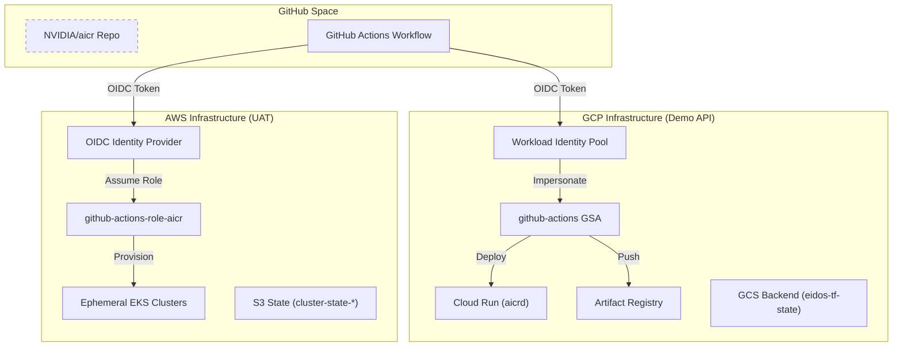
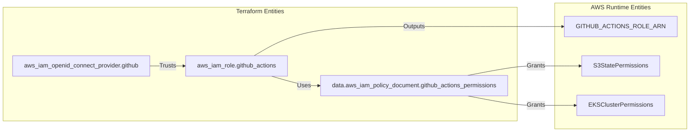

<!-- source: DeepWiki mcp.deepwiki.com · repo NVIDIA/aicr · page 10 Infrastructure · fetched 2026-10-26 -->

# Infrastructure

Relevant source files

The following files were used as context for generating this wiki page:

- [infra/demo-api-server/backend.tf](infra/demo-api-server/backend.tf)
- [infra/demo-api-server/federation.tf](infra/demo-api-server/federation.tf)
- [infra/demo-api-server/outputs.tf](infra/demo-api-server/outputs.tf)
- [infra/demo-api-server/registry.tf](infra/demo-api-server/registry.tf)
- [infra/demo-api-server/variables.tf](infra/demo-api-server/variables.tf)
- [infra/uat-aws-account/README.md](infra/uat-aws-account/README.md)
- [infra/uat-aws-account/federation.tf](infra/uat-aws-account/federation.tf)
- [infra/uat-aws-account/main.tf](infra/uat-aws-account/main.tf)
- [infra/uat-aws-account/outputs.tf](infra/uat-aws-account/outputs.tf)
- [infra/uat-aws-account/providers.tf](infra/uat-aws-account/providers.tf)
- [infra/uat-aws-account/variables.tf](infra/uat-aws-account/variables.tf)
- [tests/uat/aws/tests/cuj1-training/assert-recipe.yaml](tests/uat/aws/tests/cuj1-training/assert-recipe.yaml)
- [tests/uat/aws/tests/cuj1-training/assert-validate-multiphase.yaml](tests/uat/aws/tests/cuj1-training/assert-validate-multiphase.yaml)

The AICR project utilizes cloud infrastructure to host its public-facing demonstration services and to provide a robust environment for User Acceptance Testing (UAT). This infrastructure is managed as code using Terraform, ensuring reproducible environments across Google Cloud Platform (GCP) and Amazon Web Services (AWS).

The infrastructure is divided into two primary areas:
1.  **Demo API Server**: A GCP-based environment hosting the `aicrd` API server.
2.  **UAT AWS Account**: An AWS-based environment for executing end-to-end integration tests on real EKS clusters.

### Infrastructure Overview Diagram

This diagram illustrates the relationship between the GitHub repository, the OIDC federation, and the target cloud environments.

**Sources:**
- [infra/demo-api-server/federation.tf:46-72]()
- [infra/uat-aws-account/federation.tf:17-52]()
- [infra/demo-api-server/backend.tf:15-20]()

---

## Demo API Server Infrastructure

The Demo API Server infrastructure provides the hosting environment for the public `aicrd` instance. It is built on GCP using **Cloud Run** for serverless execution and **Artifact Registry** for container image management [infra/demo-api-server/variables.tf:29-41]().

Key characteristics include:
*   **State Management**: Terraform state is stored in a GCS bucket named `eidos-tf-state` with the prefix `demo` [infra/demo-api-server/backend.tf:16-19]().
*   **OIDC Federation**: Utilizes Google Cloud Workload Identity Federation to allow GitHub Actions to deploy without long-lived keys. It maps GitHub attributes like `assertion.repository` to GCP IAM principles [infra/demo-api-server/federation.tf:51-65]().
*   **Identity Scoping**: The federation is strictly limited to the `NVIDIA/aicr` repository [infra/demo-api-server/federation.tf:60-60]().

For details, see [Demo API Server Infrastructure](#10.1).

**Sources:**
- [infra/demo-api-server/backend.tf:1-20]()
- [infra/demo-api-server/federation.tf:1-81]()
- [infra/demo-api-server/variables.tf:1-42]()

---

## UAT AWS Account Setup

The UAT (User Acceptance Testing) infrastructure is designed to support the `uat-aws.yaml` workflow, which provisions ephemeral EKS clusters to validate AICR's pipeline on real hardware.

The setup focuses on secure, keyless access via AWS IAM OIDC:
*   **IAM Role**: A dedicated role `github-actions-role-aicr` is created for GitHub Actions [infra/uat-aws-account/variables.tf:30-34]().
*   **Scoped Permissions**: The role is granted broad permissions for EKS, EC2, and Auto Scaling to manage cluster lifecycles, but IAM permissions are strictly scoped to resources prefixed with `aicr-*` [infra/uat-aws-account/federation.tf:77-121]().
*   **Trust Policy**: Authentication is restricted to the `main` branch of the `NVIDIA/aicr` repository to prevent unauthorized workflows from provisioning expensive resources [infra/uat-aws-account/federation.tf:33-40]().

### Code Entity Mapping: AWS Federation

The following diagram maps the Terraform resources to the conceptual entities used in the UAT workflow.

For details, see [UAT AWS Account Setup](#10.2).

**Sources:**
- [infra/uat-aws-account/federation.tf:49-121]()
- [infra/uat-aws-account/README.md:1-30]()
- [infra/uat-aws-account/outputs.tf:28-31]()

---

## Child Pages

*   **[Demo API Server Infrastructure](#10.1)**: Deep dive into GCP Cloud Run deployment, Artifact Registry configuration, and Workload Identity Pool setup.
*   **[UAT AWS Account Setup](#10.2)**: Detailed breakdown of the AWS IAM policies, OIDC trust relationships, and Terraform variables for the UAT environment.

---

