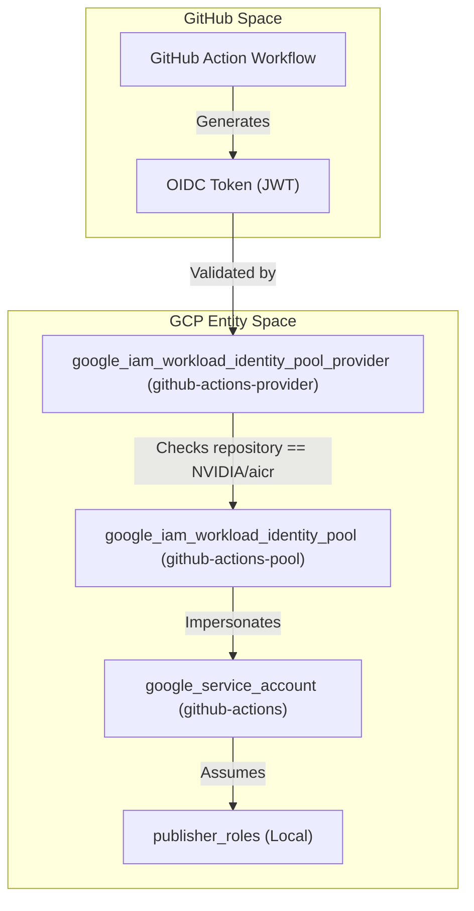
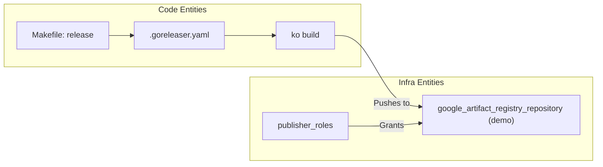

<!-- source: DeepWiki mcp.deepwiki.com · repo NVIDIA/aicr · page 10.1 Demo API Server Infrastructure · fetched 2026-10-26 -->

# Demo API Server Infrastructure

Relevant source files

The following files were used as context for generating this wiki page:

- [.github/actions/go-build-release/action.yml](.github/actions/go-build-release/action.yml)
- [infra/demo-api-server/backend.tf](infra/demo-api-server/backend.tf)
- [infra/demo-api-server/federation.tf](infra/demo-api-server/federation.tf)
- [infra/demo-api-server/outputs.tf](infra/demo-api-server/outputs.tf)
- [infra/demo-api-server/registry.tf](infra/demo-api-server/registry.tf)
- [infra/demo-api-server/variables.tf](infra/demo-api-server/variables.tf)

The Demo API Server infrastructure provides the hosting environment for the public-facing `aicrd` instance. This infrastructure is managed via Terraform and deployed to Google Cloud Platform (GCP). It leverages Cloud Run for serverless execution, Artifact Registry for container image management, and Workload Identity Federation to allow GitHub Actions to securely deploy updates without static credentials.

## Infrastructure Overview

The infrastructure is defined within the `infra/demo-api-server/` directory. It uses a remote backend to maintain state and organizes resources into functional areas: federation, registry, and service deployment.

### Terraform Backend and Variables
The Terraform state is stored in a Google Cloud Storage (GCS) bucket named `eidos-tf-state` with the prefix `demo` [infra/demo-api-server/backend.tf:15-20](). 

Key configuration variables include:
| Variable | Description | Default Value |
| :--- | :--- | :--- |
| `project_id` | The GCP Project hosting the demo | `eidosx` |
| `git_repo` | The source repository for OIDC matching | `NVIDIA/aicr` |
| `region` | GCP region for Cloud Run | `us-west1` |
| `location` | Artifact Registry location | `us` |

**Sources:**
- [infra/demo-api-server/backend.tf:15-20]()
- [infra/demo-api-server/variables.tf:16-41]()

## Workload Identity Federation

To enable secure CI/CD from GitHub Actions to GCP, the infrastructure implements OIDC federation. This removes the need for long-lived service account keys.

### Identity Mapping
The configuration creates a `google_iam_workload_identity_pool` named `github-actions-pool` [infra/demo-api-server/federation.tf:46-48](). A provider is configured to trust tokens issued by `https://token.actions.githubusercontent.com` [infra/demo-api-server/federation.tf:61-65]().

The federation logic uses an `attribute_condition` to ensure that only tokens originating from the `NVIDIA/aicr` repository can impersonate the deployment service account [infra/demo-api-server/federation.tf:60-60]().

### Identity Flow: GitHub to GCP
The following diagram illustrates how a GitHub Action workflow transitions from a Natural Language "Identity" to a concrete "Service Account" with specific GCP permissions.

**GitHub OIDC Federation Flow**

**Sources:**
- [infra/demo-api-server/federation.tf:16-72]()
- [infra/demo-api-server/variables.tf:23-27]()

## Artifact Registry

A Docker-format Artifact Registry repository named `demo` is provisioned to host the `aicrd` container images [infra/demo-api-server/registry.tf:16-22]().

### Lifecycle and Access Control
*   **Cleanup Policy:** The registry maintains a "keep-recent" policy, retaining only the 10 most recent image versions to manage storage costs [infra/demo-api-server/registry.tf:24-30]().
*   **Permissions:** The `github-actions` service account is granted `roles/artifactregistry.writer` and `roles/artifactregistry.reader` specifically for this repository [infra/demo-api-server/registry.tf:36-49]().

**Sources:**
- [infra/demo-api-server/registry.tf:16-50]()

## CI/CD Integration

The infrastructure provides specific outputs that are consumed by the GitHub Actions workflows to perform deployments.

### Required Deployment Outputs
The following outputs are used by the `auth` and `deploy` steps in the CI pipeline:
*   `IDENTITY_PROVIDER`: The full resource name of the Workload Identity Provider [infra/demo-api-server/outputs.tf:27-30]().
*   `SERVICE_ACCOUNT`: The email of the service account to impersonate [infra/demo-api-server/outputs.tf:22-25]().
*   `ARTIFACT_REGISTRY`: The full path to the Docker registry (e.g., `us-docker.pkg.dev/eidosx/demo`) [infra/demo-api-server/outputs.tf:32-35]().

### Release Process
When a release is triggered, the `.github/actions/go-build-release/action.yml` composite action handles the build and publication [action.yml:15-17](). It uses `ko` to build the container images and `make release` to push them to the registry defined in the Terraform outputs [action.yml:40-63]().

**Deployment Entity Mapping**

**Sources:**
- [infra/demo-api-server/outputs.tf:17-36]()
- [.github/actions/go-build-release/action.yml:40-64]()

## Security and Permissions

The `github-actions` service account is granted a scoped set of permissions defined in the `publisher_roles` local variable [infra/demo-api-server/federation.tf:16-29]().

| Role | Purpose |
| :--- | :--- |
| `roles/artifactregistry.writer` | Push new `aicrd` images |
| `roles/run.admin` | Create and update Cloud Run services |
| `roles/storage.objectAdmin` | Manage Terraform state in GCS |
| `roles/iam.serviceAccountUser` | Act as the runtime service account for Cloud Run |
| `roles/secretmanager.secretAccessor` | Access sensitive configuration if required |

Additionally, the `github-actions` user is allowed to use the default Compute Engine service account for tasks involving GKE clusters if necessary [infra/demo-api-server/federation.tf:75-79]().

**Sources:**
- [infra/demo-api-server/federation.tf:16-29]()
- [infra/demo-api-server/federation.tf:75-79]()

---

