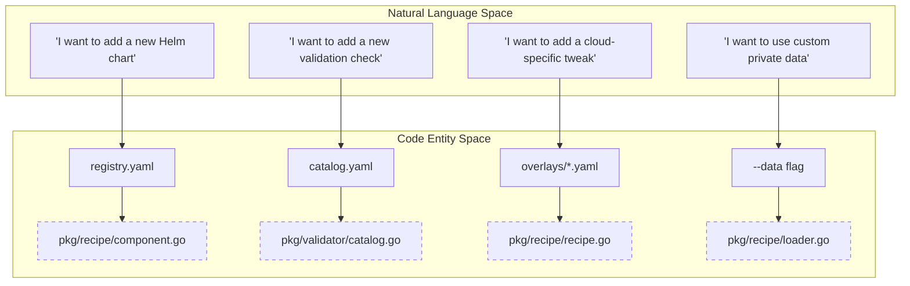
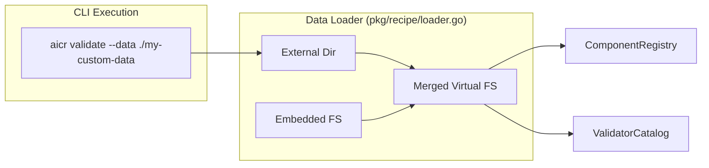

<!-- source: DeepWiki mcp.deepwiki.com · repo NVIDIA/aicr · page 11 Contributing and Extending AICR · fetched 2026-10-26 -->

# Contributing and Extending AICR

Relevant source files

The following files were used as context for generating this wiki page:

- [.claude/CLAUDE.md](.claude/CLAUDE.md)
- [.github/PULL_REQUEST_TEMPLATE.md](.github/PULL_REQUEST_TEMPLATE.md)
- [.github/actions/README.md](.github/actions/README.md)
- [.github/copilot-instructions.md](.github/copilot-instructions.md)
- [AGENTS.md](AGENTS.md)
- [CONTRIBUTING.md](CONTRIBUTING.md)
- [DEVELOPMENT.md](DEVELOPMENT.md)
- [RELEASING.md](RELEASING.md)
- [docs/contributor/validations.md](docs/contributor/validations.md)
- [docs/contributor/validator.md](docs/contributor/validator.md)
- [docs/integrator/validator-extension.md](docs/integrator/validator-extension.md)
- [tools/check-agents-sync](tools/check-agents-sync)
- [tools/common](tools/common)

This page provides a high-level guide for developers and integrators looking to contribute to the NVIDIA AI Cluster Runtime (AICR) or extend its capabilities with custom configurations. AICR is designed with an "Open Core" philosophy, allowing users to inject custom logic through a well-defined extension point: the `--data` flag.

## High-Level Extension Architecture

AICR separates its core logic from its data-driven configurations. Contributors can extend the system at several layers: the Component Registry, the Recipe Overlay system, or the Validator Catalog.

### Mapping Natural Language to Code Entities

The following diagram bridges conceptual extension points to their specific implementations and file locations within the repository.

**Extension Point Mapping**

**Sources:** [DEVELOPMENT.md:150-165](), [docs/contributor/validator.md:85-98](), [docs/contributor/validations.md:40-58](), [docs/integrator/validator-extension.md:3-16]()

---

## Adding Components and Overlays

AICR's recipe engine uses a base-plus-overlay model. Adding a new component involves registering it in the global registry and then referencing it within specific overlays that match cluster criteria (e.g., a specific GPU type or Cloud provider).

*   **Component Registry**: Located at `recipes/registry.yaml`, this file defines the source (Helm or Kustomize), health check assertions, and scheduling paths for every supported component. [recipes/registry.yaml:1-200]().
*   **Overlays**: YAML files in `recipes/overlays/` that define `componentRefs` and `constraints`. These are applied when the `Criteria` (intent, service, accelerator, etc.) match the cluster state. [pkg/recipe/recipe.go:1-100]().
*   **Validations**: Components can define internal checks that run during bundle generation to warn about missing configurations like `--workload-selector`. [docs/contributor/validations.md:7-17]().

For a step-by-step guide, see **[Adding Components and Overlays](#11.1)**.

**Sources:** [docs/contributor/validations.md:103-124](), [DEVELOPMENT.md:204-215]()

---

## Adding Validator Checks

Validators are isolated Kubernetes Jobs that verify the cluster state against the generated recipe. They are organized into three phases: `deployment`, `performance`, and `conformance`. [docs/contributor/validator.md:7-13]().

*   **Go-based Validators**: Built-in checks are written in Go and registered in `pkg/validator/`.
*   **Scaffolding**: Use `make generate-validator` to create the necessary boilerplate for new checks. [CONTRIBUTING.md:69-72]().
*   **The Catalog**: All validators must be registered in `recipes/validators/catalog.yaml` to be discoverable by the engine. [docs/contributor/validator.md:187-202]().

For details on implementing the `CheckFunc` interface and registering new checks, see **[Adding Validator Checks](#11.2)**.

**Sources:** [docs/contributor/validator.md:73-81](), [CONTRIBUTING.md:74-85]()

---

## External Data Extension (--data)

The `--data` flag is the primary mechanism for external integrators to override or extend AICR without modifying the core binary. When provided, AICR merges the contents of the specified directory with its internal embedded filesystem.

| Directory | Purpose | Merge Behavior |
| :--- | :--- | :--- |
| `registry.yaml` | Custom components | Overwrites internal registry |
| `overlays/` | Custom recipe logic | Merged with internal overlays |
| `validators/` | Custom health checks | Appended to or replaces catalog entries |
| `components/` | Custom values.yaml | Overrides internal component defaults |

**External Extension Workflow**

**Sources:** [docs/integrator/validator-extension.md:3-16](), [docs/integrator/validator-extension.md:92-113]()

---

## AI Assistant Guidelines (AGENTS.md)

For contributors using AI coding assistants (Claude, Copilot, etc.), AICR provides a canonical `AGENTS.md` file (synced from `.claude/CLAUDE.md`). This file contains the non-negotiable rules for the codebase, including:

*   **Error Handling**: Always use `pkg/errors` with structured error codes; never use `fmt.Errorf`. [AGENTS.md:123-138]().
*   **Context Discipline**: All I/O operations must use `context.WithTimeout`. [AGENTS.md:140-154]().
*   **Testing**: Mandatory use of the race detector (`-race`) and table-driven test patterns. [AGENTS.md:157-181]().
*   **Validation**: The `make qualify` target must pass before any PR submission to ensure linting, security, and tests are green. [AGENTS.md:37-41]().

**Sources:** [AGENTS.md:1-115](), [tools/check-agents-sync:1-35](), [.github/copilot-instructions.md:5-17]()

---

