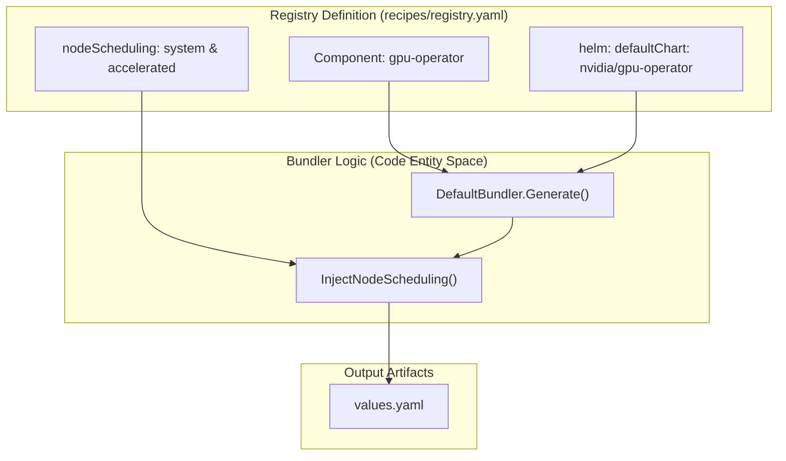
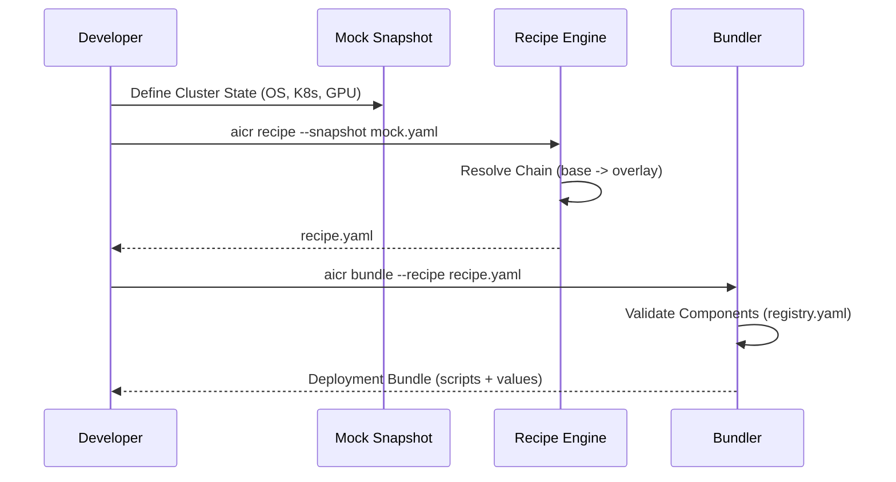

<!-- source: DeepWiki mcp.deepwiki.com · repo NVIDIA/aicr · page 11.1 Adding Components and Overlays · fetched 2026-10-26 -->

# Adding Components and Overlays

<details>
<summary>Relevant source files</summary>

The following files were used as context for generating this wiki page:

- [docs/contributor/validations.md](docs/contributor/validations.md)
- [docs/contributor/validator.md](docs/contributor/validator.md)
- [docs/integrator/validator-extension.md](docs/integrator/validator-extension.md)
- [examples/recipes/eks-gb200-ubuntu-training-with-validation.yaml](examples/recipes/eks-gb200-ubuntu-training-with-validation.yaml)
- [examples/recipes/eks-training.yaml](examples/recipes/eks-training.yaml)
- [examples/recipes/kind.yaml](examples/recipes/kind.yaml)
- [recipes/components/kai-scheduler/manifests/disable-runtime-class-injection.yaml](recipes/components/kai-scheduler/manifests/disable-runtime-class-injection.yaml)
- [recipes/overlays/base.yaml](recipes/overlays/base.yaml)
- [recipes/overlays/monitoring-hpa.yaml](recipes/overlays/monitoring-hpa.yaml)
- [recipes/registry.yaml](recipes/registry.yaml)
- [tests/chainsaw/ai-conformance/cluster/assert-skyhook.yaml](tests/chainsaw/ai-conformance/cluster/assert-skyhook.yaml)
- [tests/chainsaw/cli/cuj1-training/mock-snapshot.yaml](tests/chainsaw/cli/cuj1-training/mock-snapshot.yaml)

</details>


This page provides a technical guide for extending the AICR Recipe Engine by adding new components to the registry, creating recipe overlays, and defining validation constraints. AICR uses a declarative "base-plus-overlay" model where cluster requirements are resolved by matching a cluster's state (Snapshot) against a hierarchy of recipes.

## Component Registry

The `ComponentRegistry` is the single source of truth for how the AICR Bundler handles specific software packages. It maps abstract component names (e.g., `gpu-operator`) to concrete deployment configurations for Helm or Kustomize.

### Defining a New Component

To add a component, you must create an entry in `recipes/registry.yaml`. A component must define either a `helm` block or a `kustomize` block, but not both [recipes/registry.yaml:34-34]().

| Field | Description |
| :--- | :--- |
| `name` | Unique identifier used in recipe `componentRefs` [recipes/registry.yaml:21-21](). |
| `displayName` | Human-readable name for UI and logs [recipes/registry.yaml:22-22](). |
| `valueOverrideKeys` | Aliases for CLI flags (e.g., `--set gpuoperator:key=value`) [recipes/registry.yaml:23-23](). |
| `healthCheck.assertFile` | Path to a YAML file used by the validator to verify successful deployment [recipes/registry.yaml:46-47](). |
| `nodeScheduling` | JSON paths in the Helm `values.yaml` where AICR should inject node selectors and tolerations [recipes/registry.yaml:32-32](). |

### Node Scheduling Injection
AICR distinguishes between `system` and `accelerated` (GPU) scheduling tiers. When a user provides flags like `--system-node-selector`, the Bundler uses the paths defined in the registry to inject those values into the component's Helm values [recipes/registry.yaml:35-36]().

**Example Registry Entry:**
[recipes/registry.yaml:42-74]()


*Sources: [recipes/registry.yaml:42-74](), [docs/contributor/validations.md:20-36]()*

---

## Recipe Overlays

Overlays are `RecipeMetadata` resources that provide specialized configurations based on cluster criteria (Service, Accelerator, Intent, OS).

### Overlay Structure
Overlays are stored in `recipes/overlays/`. Each file defines:
1.  **Criteria**: When this overlay should be applied (e.g., `service: eks`) [recipes/overlays/monitoring-hpa.yaml:24-25]().
2.  **Constraints**: Version requirements or OS settings [recipes/overlays/base.yaml:23-25]().
3.  **ComponentRefs**: Specific versions and `values.yaml` files for components [recipes/overlays/base.yaml:27-33]().

### The Base-Plus-Overlay Model
All recipes eventually inherit from `base.yaml`. The `RecipeEngine` resolves a chain of overlays (e.g., `base` -> `eks` -> `eks-training`) by matching the Snapshot against the `criteria` block of each overlay.

**Example Base Recipe:**
[recipes/overlays/base.yaml:15-59]()

**Example Specialized Overlay (HPA):**
[recipes/overlays/monitoring-hpa.yaml:15-37]()

---

## Constraints and Remediation

Constraints define the "Contract" a cluster must meet. They are validated during the `readiness` phase of `aicr validate`.

### Constraint Schema
Constraints use a fully qualified measurement path: `{type}.{subtype}.{key}` [recipes/overlays/base.yaml:22-23]().

```yaml
constraints:
  - name: K8s.server.version
    value: ">= 1.32.4"
    severity: error
    remediation: "Upgrade Kubernetes to version 1.32.4 or later"
```
*Source: [examples/recipes/eks-gb200-ubuntu-training-with-validation.yaml:36-40]()*

### Component-Level Validations
Beyond global constraints, individual components can define validation functions in the registry to catch misconfigurations during the `bundle` phase [docs/contributor/validations.md:9-16]().

**Common Validation Functions:**
*   `CheckWorkloadSelectorMissing`: Warns if Skyhook is used for training without a workload selector [recipes/registry.yaml:185-190]().
*   `CheckAcceleratedSelectorMissing`: Warns if customizations are applied globally instead of targeting GPU nodes [recipes/registry.yaml:191-197]().

---

## Step-by-Step: Adding a Component

1.  **Update Registry**: Add the component to `recipes/registry.yaml`. Define the Helm repository, chart name, and `nodeScheduling` paths.
2.  **Add Values**: Create a default `values.yaml` in `recipes/components/<component-name>/values.yaml`.
3.  **Define Overlay**: Add a `componentRef` to an existing overlay (like `base.yaml`) or create a new overlay in `recipes/overlays/` if the component is environment-specific.
4.  **Add Health Check**: Create a `checks/<component-name>/health-check.yaml` to define which Kubernetes resources the validator should verify [recipes/registry.yaml:46-47]().

---

## Testing with KWOK and Mock Snapshots

To test a new component or overlay without real hardware, use a **Mock Snapshot**.

### Creating a Mock Snapshot
A mock snapshot provides the `measurements` (K8s version, OS, existing Helm charts) that the Recipe Engine uses to match criteria [tests/chainsaw/cli/cuj1-training/mock-snapshot.yaml:19-24]().

**Example Mock Snapshot Structure:**
[tests/chainsaw/cli/cuj1-training/mock-snapshot.yaml:19-71]()

### Validation Workflow
1.  **Generate Recipe**: `aicr recipe --snapshot mock-snapshot.yaml > recipe.yaml`
2.  **Validate**: `aicr validate --recipe recipe.yaml --snapshot mock-snapshot.yaml`
3.  **Bundle**: `aicr bundle --recipe recipe.yaml`


*Sources: [tests/chainsaw/cli/cuj1-training/mock-snapshot.yaml:1-18](), [docs/contributor/validations.md:20-36]()*

### Sources:
*   [recipes/registry.yaml:1-200]()
*   [recipes/overlays/base.yaml:1-95]()
*   [docs/contributor/validations.md:1-124]()
*   [examples/recipes/eks-gb200-ubuntu-training-with-validation.yaml:1-156]()
*   [tests/chainsaw/cli/cuj1-training/mock-snapshot.yaml:1-71]()

---

