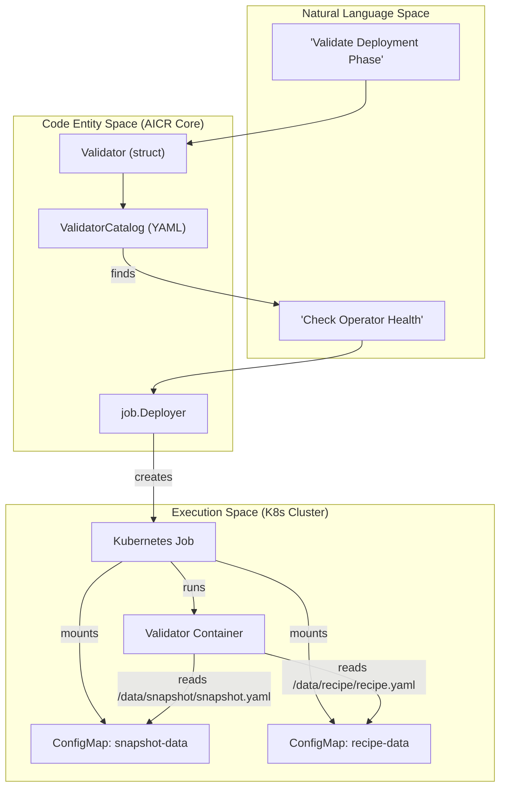
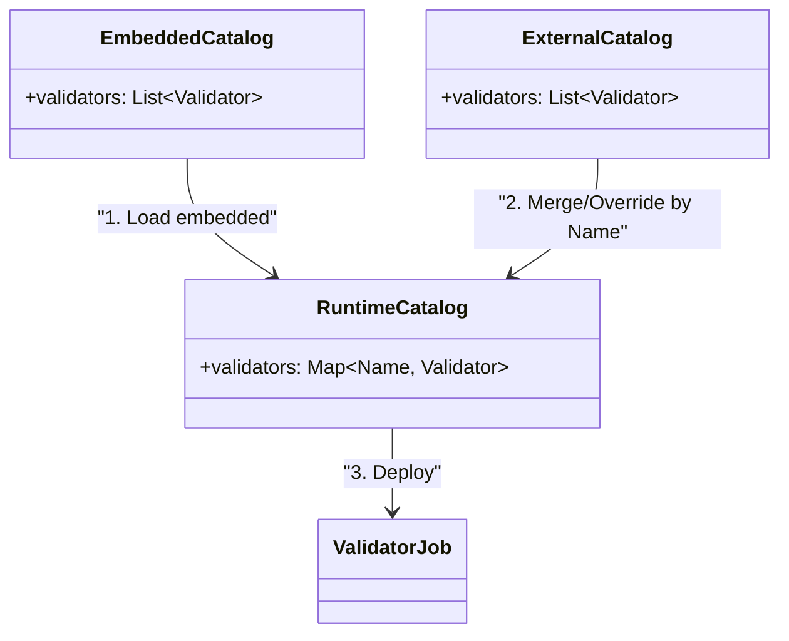

<!-- source: DeepWiki mcp.deepwiki.com · repo NVIDIA/aicr · page 11.2 Adding Validator Checks · fetched 2026-10-26 -->

# Adding Validator Checks

<details>
<summary>Relevant source files</summary>

The following files were used as context for generating this wiki page:

- [docs/contributor/validations.md](docs/contributor/validations.md)
- [docs/contributor/validator.md](docs/contributor/validator.md)
- [docs/integrator/validator-extension.md](docs/integrator/validator-extension.md)
- [recipes/checks/k8s-ephemeral-storage-metrics/health-check.yaml](recipes/checks/k8s-ephemeral-storage-metrics/health-check.yaml)
- [recipes/checks/kai-scheduler/health-check.yaml](recipes/checks/kai-scheduler/health-check.yaml)
- [recipes/checks/kube-prometheus-stack/health-check.yaml](recipes/checks/kube-prometheus-stack/health-check.yaml)
- [recipes/checks/kubeflow-trainer/health-check.yaml](recipes/checks/kubeflow-trainer/health-check.yaml)
- [recipes/checks/nvsentinel/health-check.yaml](recipes/checks/nvsentinel/health-check.yaml)
- [recipes/checks/skyhook-operator/health-check.yaml](recipes/checks/skyhook-operator/health-check.yaml)

</details>


This page describes how to develop and integrate new validation checks into the AICR framework. AICR employs a container-per-validator model where each check runs as an isolated Kubernetes Job with access to cluster state via a snapshot and the resolved recipe.

## Overview of the Validator Framework

Validators are organized into three distinct phases: `deployment`, `performance`, and `conformance`. Each validator is defined in a declarative catalog and must adhere to a specific execution contract.

### Validation Phases

| Phase | Purpose | Example |
|-------|---------|---------|
| `deployment` | Verify components are installed and healthy | GPU operator pods running, Helm values match recipe |
| `performance` | Verify system meets performance thresholds | NCCL bandwidth, GPU utilization |
| `conformance` | Verify workload-specific requirements | DRA support, gang scheduling, autoscaling |

Sources: [docs/contributor/validator.md:7-13]()

### The Container Contract

Validators are language-agnostic but must follow this process convention:

*   **Exit Codes**: `0` for pass, `1` for fail, and `2` for skip (not applicable) [docs/contributor/validator.md:106-113]().
*   **stdout**: Used for evidence output (human-readable results) captured in the CTRF report [docs/contributor/validator.md:118-118]().
*   **stderr**: Used for structured debug/progress logs streamed to the user [docs/contributor/validator.md:119-119]().
*   **Termination Log**: Write failure reasons to `/dev/termination-log` (max 4096 bytes) [docs/contributor/validator.md:120-120]().

### Data Flow and Entity Mapping

The following diagram illustrates how the Validator Runner maps the "Natural Language" validation request to the "Code Entity" execution environment within a Kubernetes cluster.

**Validator Execution Mapping**



Sources: [docs/contributor/validator.md:7-21](), [docs/contributor/validator.md:122-130](), [docs/integrator/validator-extension.md:32-38]()

---

## Implementing a New Check (Go)

Adding a check to an existing validator container involves implementing the logic, registering it in the runner, and updating the catalog.

### 1. Implement the Check Function
Create a function matching the `validators.CheckFunc` signature. Use the `validators.Context` to access Kubernetes clients and snapshot data.

```go
func checkMyComponent(ctx *validators.Context) error {
    slog.Info("checking my-component health")
    // Use ctx.Clientset or ctx.DynamicClient for K8s access
    // Use ctx.Snapshot for captured state
    // Use fmt.Printf to stdout for evidence
    return nil
}
```
Sources: [docs/contributor/validator.md:31-66]()

### 2. Register in the Runner
In the `main.go` of the target phase (e.g., `validators/deployment/main.go`), add the function to the dispatch map passed to `validators.Run`.

```go
func main() {
    validators.Run(map[string]validators.CheckFunc{
        "my-component": checkMyComponent,
    })
}
```
Sources: [docs/contributor/validator.md:68-81]()

### 3. Add Catalog Entry
Define the check in `recipes/validators/catalog.yaml`. The `args` must match the key used in the dispatch map.

```yaml
validators:
  - name: my-component
    phase: deployment
    description: "Verify my-component pods are running"
    image: ghcr.io/nvidia/aicr-validators/deployment:latest
    timeout: 2m
    args: ["my-component"]
```
Sources: [docs/contributor/validator.md:83-101]()

---

## The Context API

The `validators.Context` struct provides all dependencies required by a check. It is initialized by `LoadContext()` which reads mounted ConfigMaps and creates in-cluster clients.

| Field | Type | Description |
|-------|------|-------------|
| `Clientset` | `kubernetes.Interface` | Typed Kubernetes client [docs/contributor/validator.md:148-148]() |
| `DynamicClient` | `dynamic.Interface` | For CRD and unstructured access [docs/contributor/validator.md:150-150]() |
| `Snapshot` | `*snapshotter.Snapshot` | Captured cluster state [docs/contributor/validator.md:151-151]() |
| `Recipe` | `*recipe.RecipeResult` | Resolved recipe with constraints [docs/contributor/validator.md:152-152]() |
| `Namespace` | `string` | The validation namespace [docs/contributor/validator.md:153-153]() |

Sources: [docs/contributor/validator.md:142-158]()

---

## Component Health Checks (assertFiles)

AICR components can include `healthCheck` `assertFiles` in the `ComponentRegistry`. These are typically [Chainsaw](https://github.com/kyverno/chainsaw) tests that validate the healthy state of a component after deployment.

### Example Health Check Structure
Health checks often verify that a `Deployment` has available replicas and that no pods in the namespace are in an error state.

```yaml
# Example: recipes/checks/skyhook-operator/health-check.yaml
apiVersion: chainsaw.kyverno.io/v1alpha1
kind: Test
spec:
  steps:
    - name: validate-deployment-exists
      try:
        - assert:
            resource:
              apiVersion: apps/v1
              kind: Deployment
              metadata:
                name: skyhook-operator-controller-manager
              status:
                (availableReplicas > `0`): true
```
Sources: [recipes/checks/skyhook-operator/health-check.yaml:15-41](), [recipes/checks/nvsentinel/health-check.yaml:15-42]()

---

## External Validator Extensions

Users can add custom validators without modifying the AICR source code by using the `--data` flag.

### Custom Catalog Integration

1.  **Create a Data Directory**: Structure it with a `validators/catalog.yaml` [docs/integrator/validator-extension.md:9-16]().
2.  **Define Custom Entry**: Use a unique name for new checks, or an existing name to override embedded validators [docs/integrator/validator-extension.md:49-65]().
3.  **Execute**: Run `aicr validate --data ./my-data`. AICR merges the external catalog with the embedded one at runtime [docs/integrator/validator-extension.md:83-90]().

**Entity Relationship: Catalog Merging**



Sources: [docs/integrator/validator-extension.md:18-18](), [docs/integrator/validator-extension.md:92-113]()

---

## Testing Validator Checks

### Unit Testing
Go-based checks should be tested using standard Go testing. Since `validators.Context` uses interfaces (e.g., `kubernetes.Interface`), you can use `fake.NewSimpleClientset` to mock Kubernetes resources.

### E2E and Chainsaw Tests
Validator phases are tested end-to-end using Chainsaw. These tests simulate cluster states (often using KWOK) and verify that `aicr validate` returns the expected CTRF results and exit codes.

Sources: [docs/contributor/validator.md:21-21](), [docs/integrator/validator-extension.md:204-208]()

---

