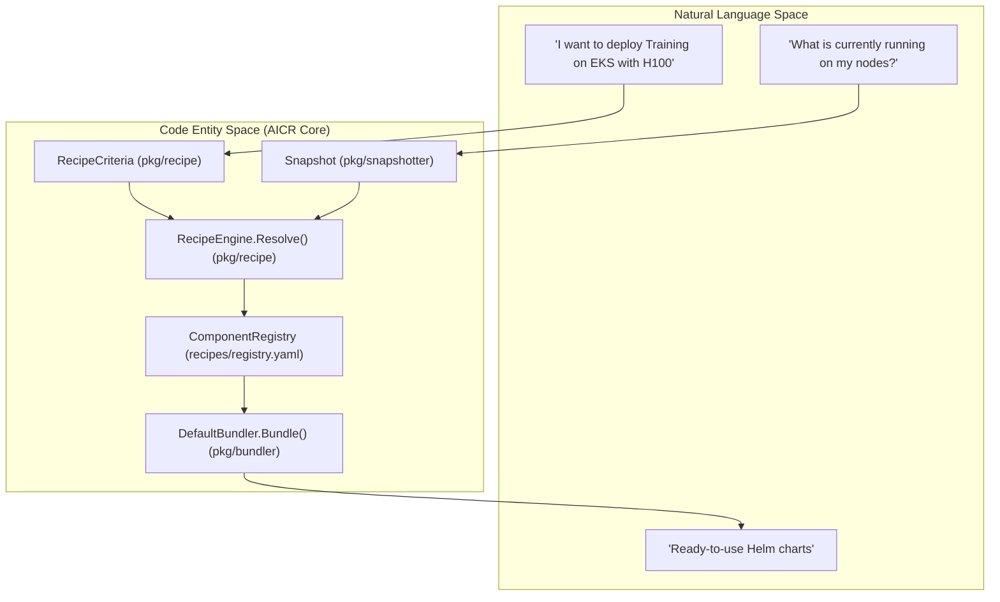
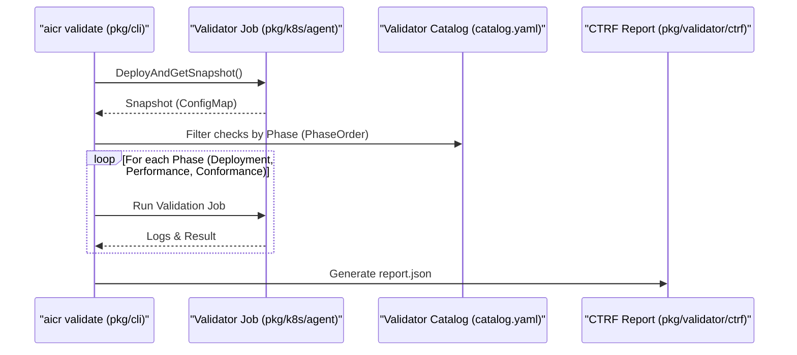

<!-- source: DeepWiki mcp.deepwiki.com · repo NVIDIA/aicr · page 12 Glossary · fetched 2026-10-26 -->

# Glossary

Relevant source files

The following files were used as context for generating this wiki page:

- [.claude/CLAUDE.md](.claude/CLAUDE.md)
- [.ctlptl-kwok.yaml](.ctlptl-kwok.yaml)
- [.github/PULL_REQUEST_TEMPLATE.md](.github/PULL_REQUEST_TEMPLATE.md)
- [.github/actions/README.md](.github/actions/README.md)
- [.github/actions/load-versions/action.yml](.github/actions/load-versions/action.yml)
- [.github/copilot-instructions.md](.github/copilot-instructions.md)
- [.goreleaser.yaml](.goreleaser.yaml)
- [.settings.yaml](.settings.yaml)
- [AGENTS.md](AGENTS.md)
- [CHANGELOG.md](CHANGELOG.md)
- [CONTRIBUTING.md](CONTRIBUTING.md)
- [DEVELOPMENT.md](DEVELOPMENT.md)
- [README.md](README.md)
- [RELEASING.md](RELEASING.md)
- [cliff.toml](cliff.toml)
- [docs/README.md](docs/README.md)
- [docs/conformance/cncf/evidence/accelerator-metrics.md](docs/conformance/cncf/evidence/accelerator-metrics.md)
- [docs/conformance/cncf/evidence/cluster-autoscaling.md](docs/conformance/cncf/evidence/cluster-autoscaling.md)
- [docs/conformance/cncf/evidence/dra-support.md](docs/conformance/cncf/evidence/dra-support.md)
- [docs/conformance/cncf/evidence/gang-scheduling.md](docs/conformance/cncf/evidence/gang-scheduling.md)
- [docs/conformance/cncf/evidence/index.md](docs/conformance/cncf/evidence/index.md)
- [docs/conformance/cncf/evidence/inference-gateway.md](docs/conformance/cncf/evidence/inference-gateway.md)
- [docs/conformance/cncf/evidence/pod-autoscaling.md](docs/conformance/cncf/evidence/pod-autoscaling.md)
- [docs/conformance/cncf/evidence/robust-operator.md](docs/conformance/cncf/evidence/robust-operator.md)
- [docs/conformance/cncf/evidence/secure-accelerator-access.md](docs/conformance/cncf/evidence/secure-accelerator-access.md)
- [docs/conformance/cncf/submission/PRODUCT.yaml](docs/conformance/cncf/submission/PRODUCT.yaml)
- [docs/conformance/cncf/submission/README.md](docs/conformance/cncf/submission/README.md)
- [docs/contributor/component.md](docs/contributor/component.md)
- [docs/integrator/data-flow.md](docs/integrator/data-flow.md)
- [docs/integrator/recipe-development.md](docs/integrator/recipe-development.md)
- [examples/recipes/eks-gb200-ubuntu-training-with-validation.yaml](examples/recipes/eks-gb200-ubuntu-training-with-validation.yaml)
- [examples/recipes/eks-training.yaml](examples/recipes/eks-training.yaml)
- [examples/recipes/kind.yaml](examples/recipes/kind.yaml)
- [pkg/cli/snapshot.go](pkg/cli/snapshot.go)
- [pkg/cli/validate.go](pkg/cli/validate.go)
- [pkg/cli/validate_test.go](pkg/cli/validate_test.go)
- [pkg/evidence/scripts/collect-evidence.sh](pkg/evidence/scripts/collect-evidence.sh)
- [pkg/k8s/agent/deployer.go](pkg/k8s/agent/deployer.go)
- [pkg/k8s/agent/deployer_test.go](pkg/k8s/agent/deployer_test.go)
- [pkg/k8s/agent/job.go](pkg/k8s/agent/job.go)
- [pkg/k8s/agent/permissions.go](pkg/k8s/agent/permissions.go)
- [pkg/k8s/agent/rbac.go](pkg/k8s/agent/rbac.go)
- [pkg/k8s/agent/types.go](pkg/k8s/agent/types.go)
- [pkg/snapshotter/agent.go](pkg/snapshotter/agent.go)
- [pkg/snapshotter/snapshot.go](pkg/snapshotter/snapshot.go)
- [pkg/validator/phases.go](pkg/validator/phases.go)
- [pkg/validator/validator.go](pkg/validator/validator.go)
- [pkg/validator/validator_test.go](pkg/validator/validator_test.go)
- [recipes/components/kai-scheduler/manifests/disable-runtime-class-injection.yaml](recipes/components/kai-scheduler/manifests/disable-runtime-class-injection.yaml)
- [recipes/overlays/base.yaml](recipes/overlays/base.yaml)
- [recipes/overlays/monitoring-hpa.yaml](recipes/overlays/monitoring-hpa.yaml)
- [recipes/registry.yaml](recipes/registry.yaml)
- [tests/chainsaw/ai-conformance/cluster/assert-skyhook.yaml](tests/chainsaw/ai-conformance/cluster/assert-skyhook.yaml)
- [tests/chainsaw/cli/cuj1-training/mock-snapshot.yaml](tests/chainsaw/cli/cuj1-training/mock-snapshot.yaml)
- [tests/e2e/run.sh](tests/e2e/run.sh)
- [tools/bump](tools/bump)
- [tools/check-agents-sync](tools/check-agents-sync)
- [tools/check-tools](tools/check-tools)
- [tools/common](tools/common)
- [tools/setup-tools](tools/setup-tools)
- [validators/conformance/pod_autoscaling_check.go](validators/conformance/pod_autoscaling_check.go)

This page provides a comprehensive reference for terminology, domain concepts, and architectural entities specific to the NVIDIA AI Cluster Runtime (AICR) codebase.

## 1. Core Concepts

The AICR lifecycle is defined by a four-stage pipeline: **Snapshot → Recipe → Validate → Bundle**.

| Term | Definition | Key Code Reference |
|:---|:---|:---|
| **Snapshot** | A point-in-time capture of cluster state, including GPU hardware, drivers, OS kernel, and Kubernetes versions. | `pkg/snapshotter/snapshot.go` |
| **Recipe** | A version-locked configuration artifact that maps infrastructure criteria to specific component versions and optimized settings. | `pkg/recipe/recipe.go` |
| **Overlay** | A layered configuration file used to resolve recipes based on matching criteria (e.g., Cloud provider, GPU model). | `pkg/recipe/overlay.go` |
| **Bundle** | The final deployment artifact containing Helm charts, values files, and shell scripts (`deploy.sh`/`undeploy.sh`). | `pkg/bundler/bundler.go` |
| **Criteria** | Key-value pairs (e.g., `service: eks`, `accelerator: h100`) used to select and merge overlays. | `pkg/recipe/criteria.go` |

**Sources:** [README.md:14-25](), [.claude/CLAUDE.md:14-25](), [pkg/snapshotter/snapshot.go:1-50]()

---

## 2. System Architecture and Data Flow

The following diagram illustrates how natural language concepts (like "My Cluster State") map to specific code entities and data structures within the AICR runtime.

### Natural Language to Code Entity Space

**Sources:** [pkg/recipe/recipe.go:1-100](), [pkg/bundler/bundler.go:1-50](), [recipes/registry.yaml:15-40]()

---

## 3. Subsystem Definitions

### 3.1. Collector System
Collectors are modular units responsible for gathering specific system telemetry.
*   **NodeSnapshotter**: The orchestrator that runs collectors in parallel using `errgroup`. [pkg/snapshotter/snapshot.go:1-100]()
*   **Measurement**: The structured data returned by a collector (e.g., `GPU.driver_version`). [pkg/snapshotter/snapshot.go:1-50]()
*   **Agent**: A Kubernetes Job deployed to nodes to run collectors in privileged mode. [pkg/snapshotter/agent.go:1-100]()

### 3.2. Recipe Engine
The engine handles the logic of "Base-plus-Overlay" inheritance.
*   **Overlay Resolution**: The process of merging `base.yaml` with specific overlays (e.g., `eks.yaml`, `h100.yaml`) using specificity scoring. [pkg/recipe/recipe.go:1-100]()
*   **Constraint**: A requirement defined in a recipe (e.g., `K8s.server.version >= 1.25`) that is checked against a Snapshot. [recipes/overlays/base.yaml:23-26]()

### 3.3. Validator Framework
The validator performs multi-phase checks on a cluster.
*   **Phases**: Execution stages defined in `PhaseOrder`: `deployment` → `performance` → `conformance`. [pkg/validator/phases.go:20-36]()
*   **CTRF**: Common Test Report Format, the standard JSON output for validation results. [pkg/cli/validate.go:38-39]()
*   **Evidence**: Behavioral test logs and outputs (e.g., HPA scaling events) used for CNCF AI Conformance. [pkg/evidence/scripts/collect-evidence.sh:1-30]()

### 3.4. Bundler and Deployer
*   **ComponentRegistry**: A declarative YAML file defining where Helm/Kustomize sources live for every supported component. [recipes/registry.yaml:1-40]()
*   **Node Scheduling Injection**: The logic that automatically adds `nodeSelector` and `tolerations` to component values based on registry paths. [recipes/registry.yaml:52-74]()
*   **Deployer**: Implementation of the deployment strategy, currently supporting `Helm` and `ArgoCD`. [pkg/bundler/bundler.go:1-100]()

---

## 4. Implementation Details

### Validation Phase Lifecycle
The following diagram shows the data flow between the CLI, the Validator Agent, and the Result generation.

**Sources:** [pkg/cli/validate.go:157-195](), [pkg/validator/phases.go:31-36](), [pkg/k8s/agent/job.go:1-50]()

---

## 5. Abbreviations and Technical Terms

| Abbreviation | Meaning | Context |
|:---|:---|:---|
| **AICR** | AI Cluster Runtime | The project name. |
| **aicrd** | AICR Daemon | The REST API server. [cmd/aicrd/main.go]() |
| **DRA** | Dynamic Resource Allocation | Kubernetes feature for specialized hardware like GPUs. [recipes/overlays/base.yaml:74-81]() |
| **KAI** | Kubernetes AI (Scheduler) | NVIDIA's batch scheduler for AI workloads. [recipes/overlays/base.yaml:82-95]() |
| **SLSA** | Supply-chain Levels for Software Artifacts | Security framework used for bundle attestation. [.goreleaser.yaml:38-47]() |
| **CTRF** | Common Test Report Format | Standardized validation output. [pkg/cli/validate.go:38]() |
| **KWOK** | Kubernetes Without Kubelet | Tool used for high-scale cluster simulation in tests. [.claude/CLAUDE.md:55-58]() |

**Sources:** [README.md:1-100](), [.goreleaser.yaml:1-100](), [pkg/validator/phases.go:1-37]()