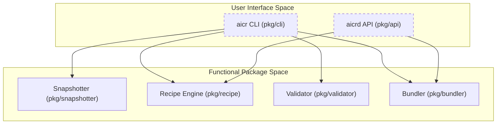
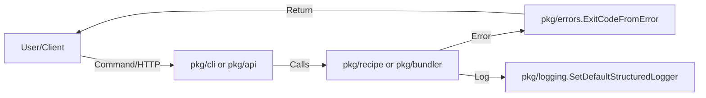

<!-- source: DeepWiki mcp.deepwiki.com · repo NVIDIA/aicr · page 2 CLI and API Server · fetched 2026-10-26 -->

# CLI and API Server

Relevant source files

The following files were used as context for generating this wiki page:

- [.claude/CLAUDE.md](.claude/CLAUDE.md)
- [.github/PULL_REQUEST_TEMPLATE.md](.github/PULL_REQUEST_TEMPLATE.md)
- [.github/actions/README.md](.github/actions/README.md)
- [.github/copilot-instructions.md](.github/copilot-instructions.md)
- [AGENTS.md](AGENTS.md)
- [CONTRIBUTING.md](CONTRIBUTING.md)
- [DEVELOPMENT.md](DEVELOPMENT.md)
- [RELEASING.md](RELEASING.md)
- [pkg/cli/root.go](pkg/cli/root.go)
- [pkg/cli/root_test.go](pkg/cli/root_test.go)
- [pkg/errors/exitcode.go](pkg/errors/exitcode.go)
- [pkg/recipe/provider_test.go](pkg/recipe/provider_test.go)
- [tools/check-agents-sync](tools/check-agents-sync)
- [tools/common](tools/common)

The NVIDIA AI Cluster Runtime (AICR) provides two primary interfaces for interacting with its core logic: the `aicr` command-line tool and the `aicrd` REST API server. Both interfaces act as thin wrappers around the project's functional packages, ensuring that business logic for snapshots, recipes, and bundling is consistent across all user touchpoints [DEVELOPMENT.md:117-120](), [.claude/CLAUDE.md:97-101]().

### Interface Overview

| Interface | Binary | Primary Use Case | Technology Stack |
| :--- | :--- | :--- | :--- |
| **CLI** | `aicr` | Local development, CI/CD pipelines, manual cluster audits. | [urfave/cli/v3](https://github.com/urfave/cli) [DEVELOPMENT.md:178]() |
| **API Server** | `aicrd` | Web-based integrations, centralized management services. | Standard Go `http` + `slog` [DEVELOPMENT.md:184-190]() |

The following diagram illustrates how both interfaces consume the same underlying functional packages to maintain architectural parity.

**Interface to Logic Mapping**

Sources: [DEVELOPMENT.md:176-192](), [.claude/CLAUDE.md:97-101](), [pkg/cli/root.go:149-156]()

---

## aicr CLI Commands

The `aicr` CLI is the primary tool for executing the four-stage AICR workflow: **Snapshot → Recipe → Validate → Bundle** [.claude/CLAUDE.md:14-25](). It is built using the `urfave/cli/v3` framework and supports multiple output formats including YAML, JSON, and human-readable tables [DEVELOPMENT.md:178-181]().

Key features of the CLI include:
*   **ConfigMap URI Support**: The `--output` flag supports a specialized `cm://` scheme, allowing results to be written directly to Kubernetes ConfigMaps [pkg/cli/root.go:60-65]().
*   **External Data Overlays**: Users can provide a `--data` directory to override or extend the embedded recipe registry and component values [pkg/cli/root.go:82-89]().
*   **Structured Logging**: Supports standard `slog` output with a `--log-json` flag for machine readability [pkg/cli/root.go:116-121]().

For a detailed reference on flags, command arguments, and usage examples, see **[aicr CLI Commands](#2.1)**.

Sources: [pkg/cli/root.go:60-156](), [DEVELOPMENT.md:176-182]()

---

## aicrd API Server

The `aicrd` daemon provides a RESTful interface to AICR's recipe and bundling capabilities. It is designed for deployment as a Kubernetes service or a standalone container (e.g., Google Cloud Run) [RELEASING.md:149-151]().

The server includes:
*   **Standard Endpoints**: `/v1/recipe` for generation and `/v1/bundle` for artifact creation [DEVELOPMENT.md:185-187]().
*   **Observability**: Built-in `/health`, `/ready`, and `/metrics` (Prometheus) endpoints [DEVELOPMENT.md:188-189]().
*   **Production Hardening**: Middleware for rate limiting and structured logging via `slog` [DEVELOPMENT.md:190]().

For details on API schemas, deployment configurations, and middleware internals, see **[aicrd API Server](#2.2)**.

Sources: [DEVELOPMENT.md:183-192](), [.claude/CLAUDE.md:101]()

---

## Common Infrastructure

Both interfaces share a common set of utilities for error handling and data serialization.

### Error Handling and Exit Codes
AICR uses a structured error system defined in `pkg/errors`. This system maps internal error codes (e.g., `ErrCodeNotFound`) to standard Unix exit codes to facilitate predictable scripting [pkg/errors/exitcode.go:26-60]().

**CLI Exit Code Mapping**
| Error Code | Exit Code | Description |
| :--- | :--- | :--- |
| `ErrCodeInvalidRequest` | 2 | Malformed input or validation failure. |
| `ErrCodeNotFound` | 3 | Resource not found. |
| `ErrCodeTimeout` | 5 | Operation exceeded time limit. |
| `ErrCodeInternal` | 8 | Unexpected internal failure. |

Sources: [pkg/errors/exitcode.go:26-60](), [pkg/errors/exitcode.go:80-99]()

### Component Interaction Diagram
The following diagram traces a user request from the CLI or API through the shared error and logging stack into the core logic.

**Request Flow and Code Entities**

Sources: [pkg/cli/root.go:122-148](), [pkg/errors/exitcode.go:65-77](), [pkg/cli/root.go:162-167]()

---

