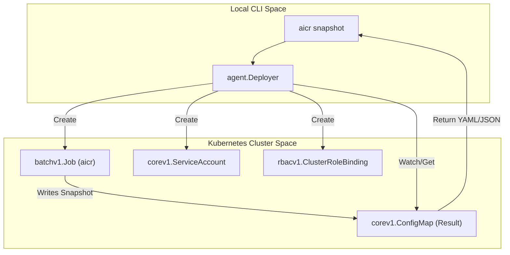
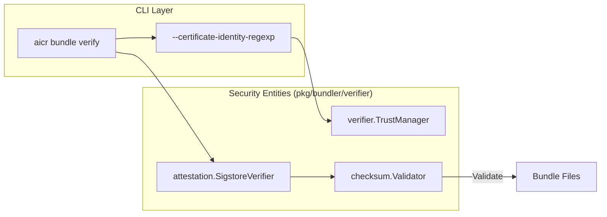

<!-- source: DeepWiki mcp.deepwiki.com · repo NVIDIA/aicr · page 2.1 aicr CLI Commands · fetched 2026-10-26 -->

# aicr CLI Commands

Relevant source files

The following files were used as context for generating this wiki page:

- [demos/attestation.md](demos/attestation.md)
- [docs/user/cli-reference.md](docs/user/cli-reference.md)
- [pkg/bundler/bundler.go](pkg/bundler/bundler.go)
- [pkg/bundler/bundler_test.go](pkg/bundler/bundler_test.go)
- [pkg/bundler/config/config.go](pkg/bundler/config/config.go)
- [pkg/bundler/config/config_test.go](pkg/bundler/config/config_test.go)
- [pkg/bundler/verifier/trust.go](pkg/bundler/verifier/trust.go)
- [pkg/bundler/verifier/trust_test.go](pkg/bundler/verifier/trust_test.go)
- [pkg/cli/bundle.go](pkg/cli/bundle.go)
- [pkg/cli/bundle_verify.go](pkg/cli/bundle_verify.go)
- [pkg/cli/bundle_verify_test.go](pkg/cli/bundle_verify_test.go)
- [pkg/cli/root.go](pkg/cli/root.go)
- [pkg/cli/root_test.go](pkg/cli/root_test.go)
- [pkg/cli/snapshot.go](pkg/cli/snapshot.go)
- [pkg/cli/validate.go](pkg/cli/validate.go)
- [pkg/cli/validate_test.go](pkg/cli/validate_test.go)
- [pkg/errors/exitcode.go](pkg/errors/exitcode.go)
- [pkg/k8s/agent/deployer.go](pkg/k8s/agent/deployer.go)
- [pkg/k8s/agent/deployer_test.go](pkg/k8s/agent/deployer_test.go)
- [pkg/k8s/agent/job.go](pkg/k8s/agent/job.go)
- [pkg/k8s/agent/permissions.go](pkg/k8s/agent/permissions.go)
- [pkg/k8s/agent/rbac.go](pkg/k8s/agent/rbac.go)
- [pkg/k8s/agent/types.go](pkg/k8s/agent/types.go)
- [pkg/recipe/components.go](pkg/recipe/components.go)
- [pkg/recipe/components_test.go](pkg/recipe/components_test.go)
- [pkg/recipe/provider_test.go](pkg/recipe/provider_test.go)
- [pkg/snapshotter/agent.go](pkg/snapshotter/agent.go)
- [pkg/snapshotter/snapshot.go](pkg/snapshotter/snapshot.go)
- [recipes/overlays/eks.yaml](recipes/overlays/eks.yaml)
- [tests/chainsaw/cli/bundle-attestation/chainsaw-test.yaml](tests/chainsaw/cli/bundle-attestation/chainsaw-test.yaml)
- [validators/conformance/pod_autoscaling_check.go](validators/conformance/pod_autoscaling_check.go)

The `aicr` CLI is the primary interface for the NVIDIA AI Cluster Runtime pipeline. It implements a four-stage workflow: capturing cluster state, generating optimization recipes, validating infrastructure against those recipes, and producing deployment-ready bundles.

### Global Flags

The CLI is built using `urfave/cli/v3` [pkg/cli/root.go:15-25]() and supports global flags for logging and output control.

| Flag | Short | Type | Default | Description |
| :--- | :--- | :--- | :--- | :--- |
| `--debug` | `-d` | bool | `false` | Enable debug logging (text mode with full metadata) |
| `--log-json` | | bool | `false` | Enable JSON logging for machine parsing |

**Logging Modes Implementation:**
The CLI supports three logging modes:
1.  **CLI Mode (Default):** Minimal output for human readability [docs/user/cli-reference.md:35-38]().
2.  **Text Mode (`--debug`):** Key=value format including timestamps and source locations [docs/user/cli-reference.md:40-42]().
3.  **JSON Mode (`--log-json`):** Structured JSON via `slog` for automation [docs/user/cli-reference.md:44-46]().

Sources: [docs/user/cli-reference.md:20-47](), [pkg/cli/root.go:15-30]()

---

### Command: snapshot

The `snapshot` command captures the current state of a Kubernetes cluster, including GPU hardware details, OS configurations, and SystemD service states.

#### Implementation and Data Flow
The snapshot process utilizes a **K8s Agent** pattern. The CLI does not collect data locally; instead, it deploys a privileged Job into the cluster to perform collection [pkg/cli/snapshot.go:171-180]().

1.  **RBAC Provisioning:** The `Deployer` creates a `ServiceAccount`, `Role` (for ConfigMap access), and `ClusterRole` (for node/pod discovery) [pkg/k8s/agent/rbac.go:45-165]().
2.  **Agent Deployment:** A `batchv1.Job` is created. If `privileged` is true (default), the pod uses `hostPID: true` and `hostNetwork: true` to access the node's underlying OS and GPU drivers [pkg/k8s/agent/job.go:140-160]().
3.  **Collection:** The agent runs the `aicr snapshot` command internally, executing collectors (GPU, OS, K8s, SystemD) in parallel [pkg/cli/snapshot.go:163-170]().
4.  **Retrieval:** The agent writes the result to a `ConfigMap`. The CLI watches the Job for completion, retrieves the `ConfigMap` data, and saves it to the specified `--output` [pkg/snapshotter/agent.go:166-183]().

#### Snapshot Logic Diagram
"This diagram maps the CLI execution to the internal K8s Agent deployment entities."

Sources: [pkg/cli/snapshot.go:157-188](), [pkg/snapshotter/agent.go:97-184](), [pkg/k8s/agent/job.go:68-103](), [pkg/k8s/agent/rbac.go:15-100]()

---

### Command: recipe

The `recipe` command resolves a set of infrastructure **Criteria** (e.g., Service=EKS, Accelerator=H100) into a concrete **RecipeResult** containing specific component versions and constraints.

#### ConfigMap URI Scheme
The CLI supports a `cm://` URI scheme for Kubernetes-native I/O, allowing snapshots and recipes to be stored directly in the cluster [docs/user/cli-reference.md:88-96]().
*   **Format:** `cm://<namespace>/<name>`
*   **Usage:** `aicr recipe --input cm://gpu-operator/snapshot-1`

#### Logic and Resolution
The command takes a snapshot as input and matches its measurements against the `ComponentRegistry` and `Overlays` [docs/user/cli-reference.md:210-220]().
*   **Asymmetric Matching:** The engine matches snapshot measurements against criteria defined in overlays like `recipes/overlays/eks.yaml` [recipes/overlays/eks.yaml:24-31]().
*   **Deep Merge:** It merges component references and constraints from the base recipe up through specific cloud and hardware overlays [recipes/overlays/eks.yaml:34-43]().

Sources: [docs/user/cli-reference.md:162-225](), [recipes/overlays/eks.yaml:15-43](), [pkg/cli/bundle.go:85-88]()

---

### Command: validate

The `validate` command executes a multi-phase validation suite (Deployment, Performance, Conformance) against the cluster.

#### Validation Phases
Users can filter which phases to run using the `--phase` flag [pkg/cli/validate.go:85-118]().

| Phase | Internal Entity | Description |
| :--- | :--- | :--- |
| `deployment` | `validator.PhaseDeployment` | Checks if operators/drivers are running [pkg/cli/validate.go:98](). |
| `performance` | `validator.PhasePerformance` | Runs NCCL benchmarks and stress tests [pkg/cli/validate.go:99](). |
| `conformance` | `validator.PhaseConformance` | Validates CNCF AI requirements (DRA, Gang Scheduling) [pkg/cli/validate.go:100](). |

#### CNCF Evidence Collection
The command includes specialized flags for the **CNCF AI Conformance** program:
*   `--cncf-submission`: Enables behavioral evidence gathering [pkg/cli/validate.go:348-355]().
*   `--evidence-dir`: Specifies where to save logs and CTRF (Common Test Report Format) results [pkg/cli/validate.go:219]().

Sources: [pkg/cli/validate.go:85-118](), [pkg/cli/validate.go:330-360](), [pkg/cli/validate_test.go:180-204]()

---

### Command: bundle

The `bundle` command transforms a `RecipeResult` into a deployable artifact, typically a collection of Helm charts with optimized `values.yaml` files.

#### Deployment Targets
The `--deployer` flag determines the output structure [pkg/cli/bundle.go:104-113]():
1.  **Helm (Default):** Generates a directory with `deploy.sh` and per-component `values.yaml` [pkg/bundler/bundler.go:42-50]().
2.  **ArgoCD:** Generates an App-of-Apps pattern with `application.yaml` manifests [pkg/bundler/bundler.go:149-160]().

#### Node Scheduling Injection
The bundler automatically injects `nodeSelector` and `tolerations` into components based on their tier:
*   **System Tier:** Components like `aws-ebs-csi-driver` [recipes/overlays/eks.yaml:38-42]().
*   **Accelerated Tier:** Components requiring GPUs (e.g., GPU Operator).
*   **Workload Gate:** Injects the `skyhook.io/runtime-required` taint to prevent pods from starting until validation passes [pkg/cli/bundle.go:168-172]().

#### Bundle Attestation
When the `--attest` flag is used, the CLI performs **SLSA Build Provenance** signing [pkg/bundler/bundler.go:120-135]().
*   **Implementation:** Uses Sigstore (Fulcio/Rekor) to bind the bundle's `checksums.txt` to an OIDC identity [pkg/cli/bundle.go:56-60]().
*   **Safety Check:** The `DefaultBundler` verifies that the `aicr` binary itself contains a valid NVIDIA attestation before signing a bundle [pkg/bundler/bundler.go:120-137]().

Sources: [pkg/bundler/bundler.go:42-65](), [pkg/bundler/bundler.go:147-190](), [pkg/cli/bundle.go:104-188](), [pkg/bundler/bundler_test.go:69-88]()

---

### Command: bundle verify

The `bundle verify` command validates the integrity and provenance of a generated bundle.

#### Verification Workflow
1.  **Binary Trust:** Verifies that the `aicr` binary used to perform verification is signed by NVIDIA [pkg/bundler/bundler.go:120-130]().
2.  **Signature Verification:** Checks the `bundle-attestation.sigstore.json` against the Rekor transparency log [pkg/cli/bundle_verify.go:15-30]().
3.  **Checksum Integrity:** Recalculates SHA256 hashes for all files in the bundle and compares them to the signed `checksums.txt` [pkg/bundler/bundler.go:159]().

#### Entity Mapping Diagram
"Mapping CLI verification flags to the internal security and verifier packages."

Sources: [pkg/cli/bundle_verify.go:10-40](), [pkg/bundler/bundler.go:120-140](), [pkg/bundler/verifier/trust.go:10-30]()

---

