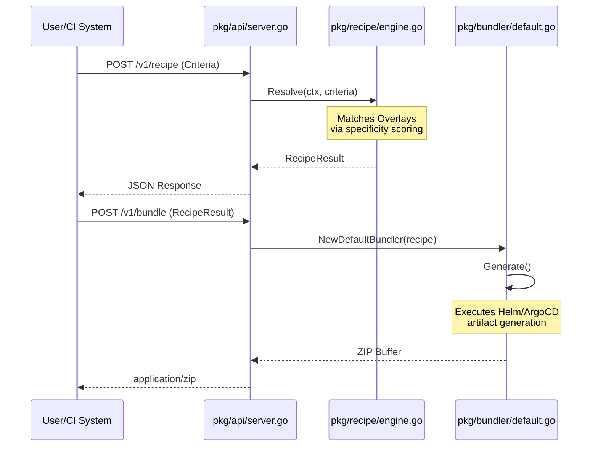
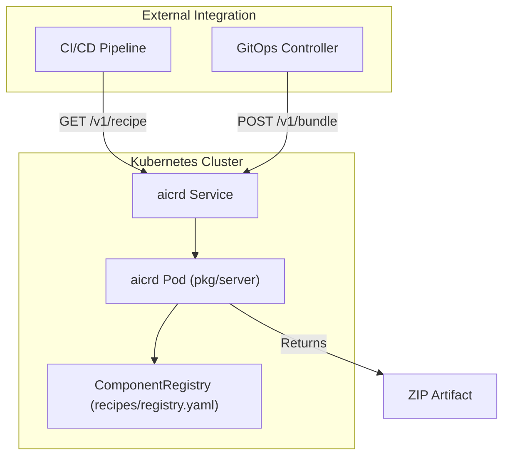

<!-- source: DeepWiki mcp.deepwiki.com · repo NVIDIA/aicr · page 2.2 aicrd API Server · fetched 2026-10-26 -->

# aicrd API Server

Relevant source files

The following files were used as context for generating this wiki page:

- [.claude/CLAUDE.md](.claude/CLAUDE.md)
- [.github/PULL_REQUEST_TEMPLATE.md](.github/PULL_REQUEST_TEMPLATE.md)
- [.github/actions/README.md](.github/actions/README.md)
- [.github/copilot-instructions.md](.github/copilot-instructions.md)
- [AGENTS.md](AGENTS.md)
- [CONTRIBUTING.md](CONTRIBUTING.md)
- [DEVELOPMENT.md](DEVELOPMENT.md)
- [RELEASING.md](RELEASING.md)
- [ROADMAP.md](ROADMAP.md)
- [docs/contributor/cli.md](docs/contributor/cli.md)
- [docs/contributor/data.md](docs/contributor/data.md)
- [docs/design/002-validatorv2-adr.md](docs/design/002-validatorv2-adr.md)
- [docs/images/aicr-end-to-end.png](docs/images/aicr-end-to-end.png)
- [docs/integrator/automation.md](docs/integrator/automation.md)
- [docs/integrator/kubernetes-deployment.md](docs/integrator/kubernetes-deployment.md)
- [docs/user/agent-deployment.md](docs/user/agent-deployment.md)
- [docs/user/api-reference.md](docs/user/api-reference.md)
- [pkg/validator/phases.go](pkg/validator/phases.go)
- [pkg/validator/validator.go](pkg/validator/validator.go)
- [pkg/validator/validator_test.go](pkg/validator/validator_test.go)
- [tests/e2e/run.sh](tests/e2e/run.sh)
- [tools/check-agents-sync](tools/check-agents-sync)
- [tools/common](tools/common)

The `aicrd` daemon is the RESTful interface for the NVIDIA AI Cluster Runtime (AICR). It provides programmatic access to the recipe generation and bundling engines, allowing external systems—such as CI/CD pipelines, GitOps controllers, or custom dashboards—to request validated GPU-accelerated Kubernetes configurations without requiring the `aicr` CLI.

## Purpose and Scope

The API server encapsulates the core business logic of AICR into a stateless HTTP service. While the `aicr` CLI is optimized for interactive use and local cluster operations (like snapshotting), `aicrd` is designed for remote integration. It handles:
*   **Recipe Resolution**: Translating environment parameters or `RecipeCriteria` into specialized `RecipeResult` objects.
*   **Bundle Generation**: Transforming recipes into downloadable ZIP archives containing Helm values and deployment scripts.
*   **Observability**: Providing Prometheus metrics, health probes, and structured logging for production deployments.

[DEVELOPMENT.md:183-192]()

## REST Endpoints

The `aicrd` server exposes a versioned API under `/v1/`.

### Recipe Generation
*   **`GET /v1/recipe`**: Generates a recipe based on query parameters (`service`, `accelerator`, `intent`, `os`, `platform`, `nodes`). [docs/user/api-reference.md:109-124]()
*   **`POST /v1/recipe`**: Accepts a `RecipeCriteria` YAML or JSON body to generate a recipe. This is the programmatic equivalent of `aicr recipe --criteria`. [docs/user/api-reference.md:146-170]()

### Bundle Creation
*   **`POST /v1/bundle`**: Accepts a `RecipeResult` JSON body and returns a `application/zip` stream containing the generated deployment artifacts. [docs/user/api-reference.md:269-272]()

### System Endpoints
*   **`GET /health`**: Liveness probe. [DEVELOPMENT.md:187]()
*   **`GET /ready`**: Readiness probe. [DEVELOPMENT.md:188]()
*   **`GET /metrics`**: Prometheus-formatted metrics. [DEVELOPMENT.md:189]()
*   **`GET /`**: Returns service information and a list of available routes. [docs/user/api-reference.md:90-105]()

**Sources:** [DEVELOPMENT.md:183-192](), [docs/user/api-reference.md:1-272]()

## Middleware Stack

The API server implements a robust middleware stack to ensure production-grade resiliency and observability.

| Middleware | Purpose | Implementation Detail |
| :--- | :--- | :--- |
| **Rate Limiting** | Prevents DoS and resource exhaustion. | Enforced per-IP or per-client. |
| **Structured Logging** | Provides machine-readable logs. | Uses `slog` with correlation IDs. |
| **Prometheus** | Exports performance data. | Tracks request latency and error rates. |
| **Context Timeouts** | Prevents hanging requests. | Handlers enforce a strict 30s timeout. |

**Sources:** [DEVELOPMENT.md:190](), [.claude/CLAUDE.md:149-155](), [.github/copilot-instructions.md:12-14]()

## Data Flow: Request to Artifact

The following diagram illustrates how a request for a bundle flows through the `aicrd` internal components, bridging the "Natural Language Space" of an API call to the "Code Entity Space".

### API Request Lifecycle

**Sources:** [docs/user/api-reference.md:9-18](), [.claude/CLAUDE.md:14-25](), [DEVELOPMENT.md:183-192]()

## Deployment as a Kubernetes Service

`aicrd` is typically deployed as a stateless Service within a Kubernetes cluster or as a serverless container (e.g., Google Cloud Run).

### Container Image
The server is packaged as a minimal, distroless image for security:
*   **Image**: `ghcr.io/nvidia/aicrd:latest`
*   **Base**: `gcr.io/distroless/static:nonroot`
*   **Port**: `8080`

[RELEASING.md:102]()

### Deployment Architecture
The API server acts as the central hub for automated workflows. While the **AICR Agent** (deployed as a `Job`) handles local node state, `aicrd` handles the logic of what *should* be installed.

**Sources:** [DEVELOPMENT.md:183-192](), [docs/user/api-reference.md:20-31](), [RELEASING.md:147-152]()

## Local Development and Testing

The project provides a `Tiltfile` and `make` targets to facilitate local development of the API server.

*   **`make server`**: Starts the `aicrd` server locally in debug mode. [.claude/CLAUDE.md:51]()
*   **`make dev-env`**: Spins up a Kind cluster and starts `Tilt`, which hot-reloads the `aicrd` container upon code changes. [.claude/CLAUDE.md:52]()
*   **E2E Testing**: The `tests/e2e/run.sh` script performs health checks against `localhost:8080/health` and validates the `/v1/recipe` endpoints using `curl`. [tests/e2e/run.sh:160-236]()

**Sources:** [.claude/CLAUDE.md:31-70](), [tests/e2e/run.sh:1-236]()

---

