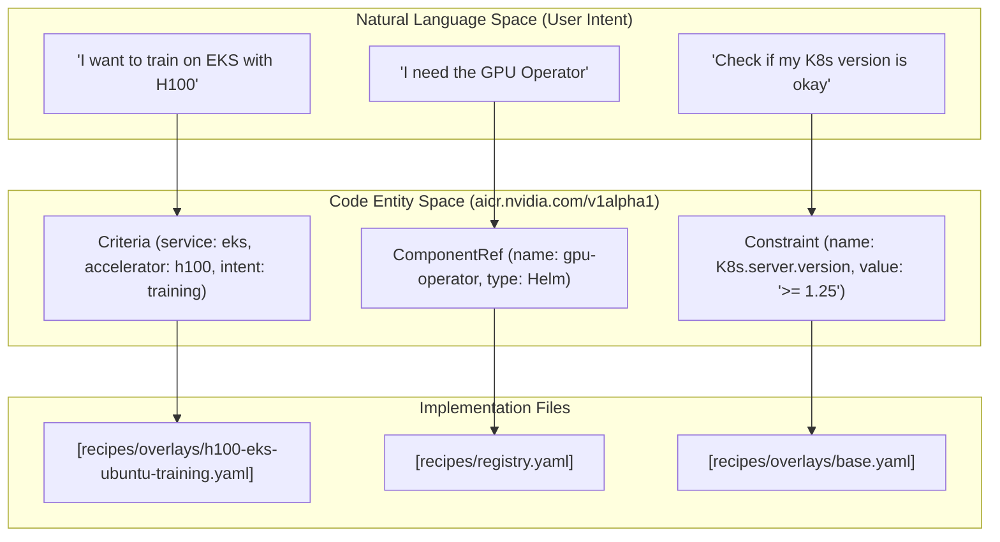
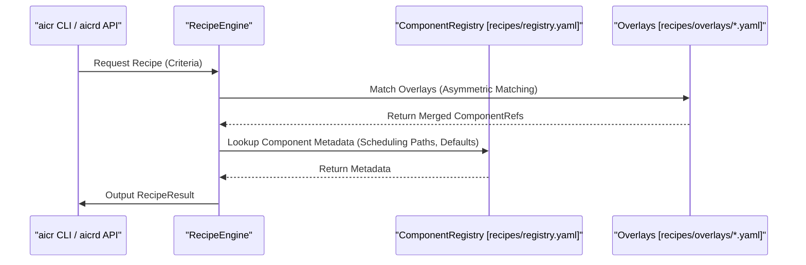

<!-- source: DeepWiki mcp.deepwiki.com · repo NVIDIA/aicr · page 3 Recipe Engine · fetched 2026-10-26 -->

# Recipe Engine

Relevant source files

The following files were used as context for generating this wiki page:

- [README.md](README.md)
- [docs/README.md](docs/README.md)
- [docs/contributor/component.md](docs/contributor/component.md)
- [docs/integrator/data-flow.md](docs/integrator/data-flow.md)
- [docs/integrator/recipe-development.md](docs/integrator/recipe-development.md)
- [examples/recipes/eks-gb200-ubuntu-training-with-validation.yaml](examples/recipes/eks-gb200-ubuntu-training-with-validation.yaml)
- [examples/recipes/eks-training.yaml](examples/recipes/eks-training.yaml)
- [examples/recipes/kind.yaml](examples/recipes/kind.yaml)
- [recipes/components/kai-scheduler/manifests/disable-runtime-class-injection.yaml](recipes/components/kai-scheduler/manifests/disable-runtime-class-injection.yaml)
- [recipes/overlays/base.yaml](recipes/overlays/base.yaml)
- [recipes/overlays/monitoring-hpa.yaml](recipes/overlays/monitoring-hpa.yaml)
- [recipes/registry.yaml](recipes/registry.yaml)
- [tests/chainsaw/ai-conformance/cluster/assert-skyhook.yaml](tests/chainsaw/ai-conformance/cluster/assert-skyhook.yaml)
- [tests/chainsaw/cli/cuj1-training/mock-snapshot.yaml](tests/chainsaw/cli/cuj1-training/mock-snapshot.yaml)

The **Recipe Engine** is the core intelligence of AICR. It transforms high-level environmental criteria (Cloud provider, GPU type, OS, and Workload Intent) into a deterministic, version-locked configuration called a **Recipe**. The engine uses a **base-plus-overlay inheritance model** to compose these configurations from a library of validated metadata.

The recipe system ensures that infrastructure deployments are not just "installable" but are optimized and validated for specific NVIDIA hardware and cloud environments [README.md:15-19]().

### Workflow Overview

The engine operates in two primary modes:
1.  **Query Mode**: Generates a recipe directly from CLI flags (e.g., `--accelerator h100 --service eks`) [docs/integrator/data-flow.md:147-150]().
2.  **Snapshot Mode**: Analyzes a `Snapshot` (captured cluster state) to automatically infer criteria like Kubernetes version, OS distribution, and GPU models, then matches them to the best available overlays [docs/integrator/data-flow.md:152-171]().

### Natural Language to Code Entity Mapping

The following diagram bridges the conceptual "Natural Language Space" of user requirements to the "Code Entity Space" of the AICR Recipe Engine.

**Diagram: Requirement Mapping to Code Entities**

**Sources:** [docs/README.md:7-26](), [recipes/registry.yaml:38-41](), [recipes/overlays/base.yaml:15-25]().

---

### The Overlay Inheritance Model

AICR uses a layered approach to configuration. Instead of monolithic files, recipes are composed by merging a chain of **Overlays**. This allows common settings (like `cert-manager` versions) to be defined once in a base layer and specialized only where necessary (e.g., specific driver versions for GB200).

**Resolution Chain:**
`base.yaml` (Universal Defaults) → `eks.yaml` (Provider Defaults) → `eks-training.yaml` (Workload Tuning) → `h100-eks-ubuntu-training.yaml` (Hardware Leaf)

**Merge Rules:**
*   **Constraints**: Overlays can add new constraints or override existing ones by name [docs/integrator/recipe-development.md:131]().
*   **ComponentRefs**: Merged field-by-field. For example, a leaf overlay can change the `version` of a component defined in the base without redefining its `source` [docs/integrator/recipe-development.md:132]().
*   **Values**: Deep-merged from `Base` → `ValuesFile` → `Overrides` → `CLI --set flags` [docs/integrator/recipe-development.md:192-200]().

For technical details on scoring and asymmetric matching, see **[Overlay System and Recipe Resolution](#3.2)**.

---

### Component Registry

The **ComponentRegistry** is a declarative catalog defined in `recipes/registry.yaml`. It serves as the "source of truth" for how the engine should handle individual software packages like the `gpu-operator` or `nvsentinel`.

**Key Features of the Registry:**
*   **Source Mapping**: Defines default Helm repositories or Kustomize sources [recipes/registry.yaml:24-31]().
*   **Node Scheduling**: Maps where the engine should inject `nodeSelector` and `toleration` values within a component's Helm values tree (e.g., `operator.nodeSelector` vs `daemonsets.nodeSelector`) [recipes/registry.yaml:52-73]().
*   **Health Checks**: Points to `assertFile` definitions used by the Validator to verify component health [recipes/registry.yaml:46-47]().

**Diagram: Component Resolution Flow**

**Sources:** [recipes/registry.yaml:15-37](), [docs/integrator/recipe-development.md:88-128]().

For a list of all supported components and how to add new ones, see **[Component Catalog and Registry](#3.3)**.

---

### Child Pages

*   **[Recipe Data Model](#3.1)**: Deep dive into the `v1alpha1` schema, including `RecipeMetadata`, `RecipeResult`, and `Constraints`.
*   **[Overlay System and Recipe Resolution](#3.2)**: Details on the matching algorithm, specificity scoring, and deep-merge logic.
*   **[Component Catalog and Registry](#3.3)**: How to extend AICR by adding components to `registry.yaml` and defining scheduling paths.
*   **[Cloud-Specific Overlays (EKS, GKE, AKS)](#3.4)**: Overview of provider-specific tuning and hardware profiles (H100/GB200).

---

