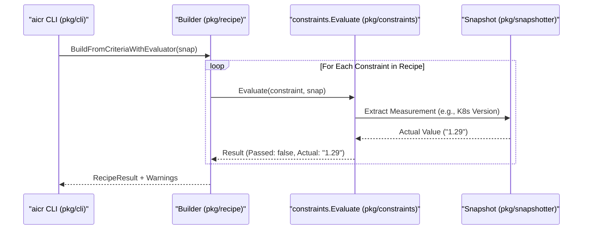

<!-- source: DeepWiki mcp.deepwiki.com · repo NVIDIA/aicr · page 3.1 Recipe Data Model · fetched 2026-10-26 -->

# Recipe Data Model

<details>
<summary>Relevant source files</summary>

The following files were used as context for generating this wiki page:

- [pkg/cli/recipe.go](pkg/cli/recipe.go)
- [pkg/component/base.go](pkg/component/base.go)
- [pkg/component/overrides.go](pkg/component/overrides.go)
- [pkg/measurement/types.go](pkg/measurement/types.go)
- [pkg/recipe/criteria.go](pkg/recipe/criteria.go)
- [pkg/recipe/criteria_test.go](pkg/recipe/criteria_test.go)
- [pkg/recipe/metadata.go](pkg/recipe/metadata.go)
- [pkg/recipe/metadata_store.go](pkg/recipe/metadata_store.go)
- [pkg/recipe/metadata_test.go](pkg/recipe/metadata_test.go)
- [pkg/recipe/provider.go](pkg/recipe/provider.go)
- [pkg/recipe/recipe.go](pkg/recipe/recipe.go)
- [pkg/version/version.go](pkg/version/version.go)

</details>


The Recipe Data Model defines the structural contract for cluster configuration and deployment orchestration within AICR. It leverages a base-plus-overlay inheritance system to transform environmental snapshots into actionable deployment plans. The model is versioned under the `aicr.nvidia.com/v1alpha1` API group.

## Core Entities and API Versioning

The system revolves around two primary resource kinds defined in [pkg/recipe/metadata.go:29-35]():
- `RecipeMetadata`: Defines the blueprint, including matching criteria, constraints, and component references.
- `RecipeResult`: The final, resolved output containing a sorted list of components and validated constraints.

### API Specification
| Field | Value | Source |
| :--- | :--- | :--- |
| **API Version** | `aicr.nvidia.com/v1alpha1` | [pkg/recipe/metadata.go:35]() |
| **Kind (Metadata)** | `RecipeMetadata` | [pkg/recipe/metadata.go:29]() |
| **Kind (Result)** | `RecipeResult` | [pkg/recipe/metadata.go:32]() |

---

## Recipe Metadata and Inheritance

The `RecipeMetadata` structure supports a hierarchical inheritance model where "Overlays" extend a "Base" recipe.

### Data Structure: RecipeMetadata
The metadata contains a `RecipeMetadataSpec` which includes:
- **Base**: A reference to a parent recipe name [pkg/recipe/metadata.go:193]().
- **Criteria**: Parameters used to match this recipe to a cluster (e.g., Service, Accelerator) [pkg/recipe/metadata.go:196]().
- **Constraints**: Requirements that must be satisfied by the cluster state [pkg/recipe/metadata.go:199]().
- **ComponentRefs**: A list of software components to deploy [pkg/recipe/metadata.go:202]().

### The Inheritance Chain
The `MetadataStore` resolves the inheritance by building a chain from the root `base.yaml` down to the most specific matching overlay [pkg/recipe/metadata_store.go:177-215]().

**Recipe Inheritance Logic**
```mermaid
graph TD
    subgraph "Code Entity Space: MetadataStore"
        [base.yaml] --> |"spec.base: nil"| Root["Base Recipe"]
        [eks.yaml] --> |"spec.base: base"| L1["EKS Overlay"]
        [eks-h100.yaml] --> |"spec.base: eks"| L2["EKS H100 Overlay"]
    end

    subgraph "Natural Language Space: Cluster Requirements"
        Req1["Generic K8s Setup"] -.-> Root
        Req2["AWS Specific Networking"] -.-> L1
        Req3["H100 Optimized Drivers"] -.-> L2
    end

    classDef code font-family:monospace;
    class Root,L1,L2 code;
```
Sources: [pkg/recipe/metadata_store.go:177-215](), [pkg/recipe/metadata.go:193-205]()

---

## Criteria and Matching

`Criteria` are the selectors used by the `Recipe Engine` to find applicable overlays.

### Supported Criteria Types
| Type | Constants | Source |
| :--- | :--- | :--- |
| **Service** | `eks`, `gke`, `aks`, `oke`, `kind` | [pkg/recipe/criteria.go:39-46]() |
| **Accelerator** | `h100`, `gb200`, `a100`, `l40` | [pkg/recipe/criteria.go:77-83]() |
| **Intent** | `training`, `inference` | [pkg/recipe/criteria.go:112-116]() |
| **OS** | `ubuntu`, `rhel`, `cos`, `amazonlinux` | [pkg/recipe/criteria.go:141-147]() |

### Matching Logic
Matching is asymmetric. A recipe with "any" (wildcard) criteria matches a specific query, but a specific recipe does not match a generic query [pkg/recipe/criteria_test.go:139-153]().

---

## Constraints and Snapshot Integration

`Constraints` represent assertions about the cluster environment that must be true for the recipe to be valid.

### Constraint Structure
Defined in [pkg/recipe/metadata.go:47-62](), a constraint includes:
- **Name**: Identifier (e.g., "k8s-version").
- **Value**: Expression (e.g., ">= 1.30").
- **Severity**: "error" or "warning".
- **Remediation**: Human-readable instructions for fixing a failure.

### Evaluation Flow
When a `Snapshot` is provided, the `Builder` uses a `ConstraintEvaluator` to compare the `Snapshot` measurements against the `Constraint` values [pkg/cli/recipe.go:173-180]().

**Constraint Evaluation Sequence**

Sources: [pkg/cli/recipe.go:171-183](), [pkg/recipe/metadata.go:47-62]()

---

## Components and Dependency Resolution

`ComponentRef` defines the deployment artifacts.

### Component Attributes
- **Type**: `Helm` or `Kustomize` [pkg/recipe/metadata.go:41-44]().
- **DependencyRefs**: List of other components that must be deployed first [pkg/recipe/metadata.go:97-98]().
- **Overrides**: Map of values to override the default `values.yaml` [pkg/recipe/metadata.go:90-92]().

### Topological Sort
To ensure correct deployment order, the `RecipeMetadataSpec` performs a topological sort based on `DependencyRefs` [pkg/recipe/metadata_test.go:144-185](). If a circular dependency is detected, the system returns an error [pkg/recipe/metadata_test.go:81-112]().

---

## Snapshot Schema and Measurements

The `Snapshot` is the source of truth for `Constraint` evaluation. It consists of `Measurements` collected from the cluster.

### Measurement Structure
Defined in [pkg/measurement/types.go:104-116](), measurements are categorized by `Type`:
- `TypeK8s`: Kubernetes version, nodes, namespaces.
- `TypeGPU`: Driver version, GPU models, count.
- `TypeOS`: Kernel version, OS name, architecture.
- `TypeSystemD`: Service states (Active/Enabled).

### Data Types (Readings)
Measurements use a `Reading` interface to support multiple scalar types (int, float, bool, string) while maintaining JSON/YAML compatibility [pkg/measurement/types.go:178-212]().

---

## Implementation Summary Table

| Component | Logic Location | Purpose |
| :--- | :--- | :--- |
| **MetadataStore** | [pkg/recipe/metadata_store.go]() | Loads YAMLs from `data/` and resolves inheritance. |
| **Builder** | [pkg/recipe/builder.go]() | Orchestrates criteria matching and constraint evaluation. |
| **Version** | [pkg/version/version.go]() | Handles semantic version comparison for constraints. |
| **Overrides** | [pkg/component/overrides.go]() | Applies dot-notation overrides to Helm/Kustomize values. |

Sources: [pkg/recipe/metadata.go](), [pkg/recipe/criteria.go](), [pkg/measurement/types.go](), [pkg/recipe/metadata_store.go](), [pkg/cli/recipe.go]()

---

