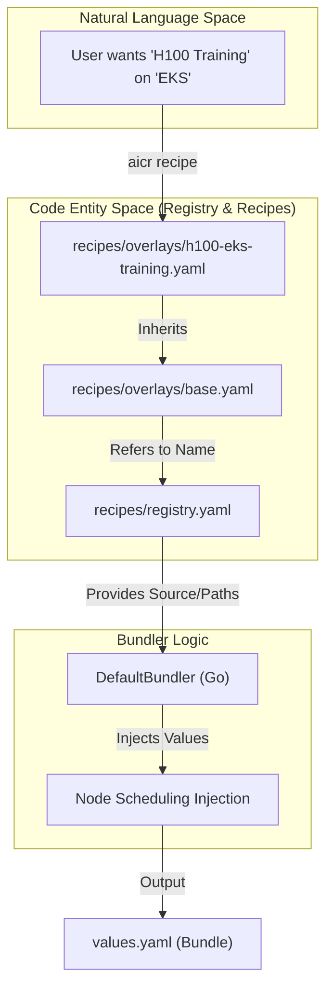
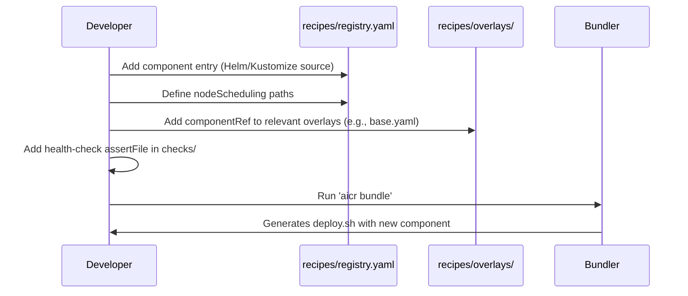

<!-- source: DeepWiki mcp.deepwiki.com · repo NVIDIA/aicr · page 3.3 Component Catalog and Registry · fetched 2026-10-26 -->

# Component Catalog and Registry

Relevant source files

The following files were used as context for generating this wiki page:

- [docs/integrator/aks-gpu-setup.md](docs/integrator/aks-gpu-setup.md)
- [docs/integrator/index.md](docs/integrator/index.md)
- [docs/user/component-catalog.md](docs/user/component-catalog.md)
- [examples/recipes/aks-training.yaml](examples/recipes/aks-training.yaml)
- [examples/recipes/eks-gb200-ubuntu-training-with-validation.yaml](examples/recipes/eks-gb200-ubuntu-training-with-validation.yaml)
- [examples/recipes/eks-training.yaml](examples/recipes/eks-training.yaml)
- [examples/recipes/kind.yaml](examples/recipes/kind.yaml)
- [h100-cluster.sh](h100-cluster.sh)
- [recipes/components/gpu-operator/values-aks-training.yaml](recipes/components/gpu-operator/values-aks-training.yaml)
- [recipes/components/gpu-operator/values-aks.yaml](recipes/components/gpu-operator/values-aks.yaml)
- [recipes/components/kai-scheduler/manifests/disable-runtime-class-injection.yaml](recipes/components/kai-scheduler/manifests/disable-runtime-class-injection.yaml)
- [recipes/components/nvsentinel/values.yaml](recipes/components/nvsentinel/values.yaml)
- [recipes/components/skyhook-customizations/manifests/no-op.yaml](recipes/components/skyhook-customizations/manifests/no-op.yaml)
- [recipes/components/skyhook-customizations/manifests/tuning.yaml](recipes/components/skyhook-customizations/manifests/tuning.yaml)
- [recipes/components/skyhook-operator/values.yaml](recipes/components/skyhook-operator/values.yaml)
- [recipes/overlays/aks-inference.yaml](recipes/overlays/aks-inference.yaml)
- [recipes/overlays/aks-training.yaml](recipes/overlays/aks-training.yaml)
- [recipes/overlays/aks.yaml](recipes/overlays/aks.yaml)
- [recipes/overlays/base.yaml](recipes/overlays/base.yaml)
- [recipes/overlays/h100-eks-inference.yaml](recipes/overlays/h100-eks-inference.yaml)
- [recipes/overlays/h100-eks-training.yaml](recipes/overlays/h100-eks-training.yaml)
- [recipes/overlays/monitoring-hpa.yaml](recipes/overlays/monitoring-hpa.yaml)
- [recipes/registry.yaml](recipes/registry.yaml)
- [tests/chainsaw/ai-conformance/cluster/assert-skyhook.yaml](tests/chainsaw/ai-conformance/cluster/assert-skyhook.yaml)
- [tests/chainsaw/ai-conformance/offline/assert-recipe.yaml](tests/chainsaw/ai-conformance/offline/assert-recipe.yaml)
- [tests/chainsaw/bundle-templates/README.md](tests/chainsaw/bundle-templates/README.md)
- [tests/chainsaw/bundle-templates/gpu-operator/assert-dcgm-defaults.yaml](tests/chainsaw/bundle-templates/gpu-operator/assert-dcgm-defaults.yaml)
- [tests/chainsaw/bundle-templates/gpu-operator/chainsaw-test.yaml](tests/chainsaw/bundle-templates/gpu-operator/chainsaw-test.yaml)
- [tests/chainsaw/bundle-templates/kgateway/chainsaw-test.yaml](tests/chainsaw/bundle-templates/kgateway/chainsaw-test.yaml)
- [tests/chainsaw/bundle-templates/nvsentinel/assert-netpol-defaults.yaml](tests/chainsaw/bundle-templates/nvsentinel/assert-netpol-defaults.yaml)
- [tests/chainsaw/bundle-templates/nvsentinel/chainsaw-test.yaml](tests/chainsaw/bundle-templates/nvsentinel/chainsaw-test.yaml)
- [tests/chainsaw/bundle-templates/skyhook-customizations/assert-tuning-defaults.yaml](tests/chainsaw/bundle-templates/skyhook-customizations/assert-tuning-defaults.yaml)
- [tests/chainsaw/bundle-templates/skyhook-customizations/assert-tuning-no-autotaint.yaml](tests/chainsaw/bundle-templates/skyhook-customizations/assert-tuning-no-autotaint.yaml)
- [tests/chainsaw/cli/cuj1-training/assert-recipe.yaml](tests/chainsaw/cli/cuj1-training/assert-recipe.yaml)
- [tests/chainsaw/cli/cuj1-training/mock-snapshot.yaml](tests/chainsaw/cli/cuj1-training/mock-snapshot.yaml)

The **Component Catalog and Registry** is the declarative heart of AICR's recipe and bundling system. It defines the universe of available software packages (components) that can be orchestrated into a GPU-accelerated Kubernetes runtime. By centralizing component metadata in a single registry, AICR allows for adding new software or updating deployment logic without modifying the Go source code [recipes/registry.yaml:15-18]().

## The ComponentRegistry Schema

The registry is defined in `recipes/registry.yaml` using the `aicr.nvidia.com/v1alpha1` API [recipes/registry.yaml:38-41](). Each entry in the `components` list provides the necessary metadata for the Recipe Engine to resolve versions and for the Bundler to generate deployment artifacts.

### Key Configuration Fields

| Field | Description |
| :--- | :--- |
| `name` | Unique identifier used in recipes (e.g., `gpu-operator`) [recipes/registry.yaml:21](). |
| `displayName` | Human-readable name for templates and UI output [recipes/registry.yaml:22](). |
| `valueOverrideKeys` | Alternative keys for the `--set` CLI flag to target specific components [recipes/registry.yaml:23](). |
| `helm` | Configuration for Helm-based components, including repository, chart name, and namespace [recipes/registry.yaml:24-27](). |
| `kustomize` | Configuration for Kustomize-based components (source, path, tag) [recipes/registry.yaml:28-31](). |
| `nodeScheduling` | Mapping of Helm value paths where AICR should inject node selectors and tolerations [recipes/registry.yaml:32](). |
| `healthCheck` | Reference to an `assertFile` used by the Validator to verify component health [recipes/registry.yaml:46-47](). |

**Sources:** [recipes/registry.yaml:20-34](), [recipes/registry.yaml:41-52]()

---

## Component Data Flow: From Registry to Bundle

The following diagram illustrates how a component definition in the registry is transformed into a deployable artifact through the AICR pipeline.

### Component Transformation Pipeline

**Sources:** [recipes/registry.yaml:15-36](), [recipes/overlays/base.yaml:34-44](), [recipes/overlays/h100-eks-training.yaml:35-48]()

---

## Node Scheduling Injection

A critical feature of the registry is the `nodeScheduling` block. This allows AICR to handle complex multi-tier scheduling (e.g., "System" nodes vs "Accelerated" GPU nodes) by knowing exactly where in a component's `values.yaml` to inject the selectors.

### Scheduling Tiers
1.  **System**: Services that should run on general-purpose CPU nodes (e.g., `cert-manager`, `operator` controllers) [recipes/registry.yaml:53-61]().
2.  **Accelerated**: Services that must run on GPU nodes (e.g., `nvidia-driver-daemonset`, `aws-efa` plugin) [recipes/registry.yaml:62-73]().

### Example: GPU Operator Scheduling
In `recipes/registry.yaml`, the `gpu-operator` defines multiple paths for scheduling injection to ensure both the manager and the drivers land on the correct nodes:
*   **System Paths**: `operator.nodeSelector`, `node-feature-discovery.master.nodeSelector` [recipes/registry.yaml:54-57]().
*   **Accelerated Paths**: `daemonsets.nodeSelector` [recipes/registry.yaml:63-64]().

**Sources:** [recipes/registry.yaml:52-74](), [docs/user/component-catalog.md:32-40]()

---

## Component Types and Sources

AICR supports multiple deployment formats, though a component must have exactly one primary source type (Helm or Kustomize) [recipes/registry.yaml:34]().

### 1. Helm Components
Most components (e.g., `nvsentinel`, `kai-scheduler`) are defined as Helm charts. The registry provides the `defaultRepository` and `defaultChart`, while the recipe provides the specific `version` [recipes/registry.yaml:48-51](), [recipes/overlays/base.yaml:45-49]().

### 2. Manifest-Only Components
Some components, like `skyhook-customizations`, act as "manifest-only" components. They may use an empty Helm repository and instead rely on `manifestFiles` defined in the recipe overlays to provide raw Kubernetes YAML or Go-templated manifests [recipes/registry.yaml:170-173](), [recipes/overlays/h100-eks-training.yaml:51-52]().

### 3. Native Kubernetes Objects
Components like `gke-nccl-tcpxo` may simply define a `defaultNamespace` and rely on environment-specific logic to provide the underlying manifests [recipes/registry.yaml:92-98]().

**Sources:** [recipes/registry.yaml:41-200](), [recipes/overlays/base.yaml:27-95]()

---

## Adding New Components

To add a component to the AICR ecosystem, a developer follows a declarative process without modifying Go code [recipes/registry.yaml:18]().

### Integration Workflow

### Checklist for New Components
1.  **Registry Entry**: Add the component to `recipes/registry.yaml` with appropriate `valueOverrideKeys` [recipes/registry.yaml:41-45]().
2.  **Health Check**: Create a health check YAML and reference it in `healthCheck.assertFile` [recipes/registry.yaml:46-47]().
3.  **Overlay Integration**: Add the component to `recipes/overlays/base.yaml` (for global components) or cloud-specific overlays (e.g., `eks.yaml`) [recipes/overlays/base.yaml:27-33]().
4.  **Templating**: If the component requires dynamic tuning (like `skyhook-customizations`), create templates in `recipes/components/{name}/manifests/` [recipes/components/skyhook-customizations/manifests/tuning.yaml:22-63]().

**Sources:** [docs/user/component-catalog.md:49-51](), [recipes/registry.yaml:15-36](), [recipes/components/skyhook-customizations/manifests/tuning.yaml:15-21]()

---

