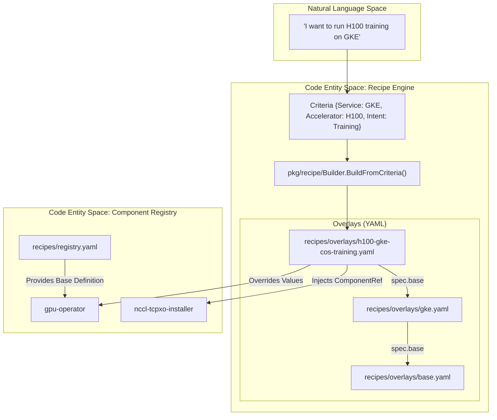
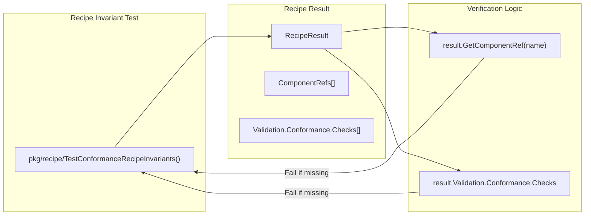

<!-- source: DeepWiki mcp.deepwiki.com · repo NVIDIA/aicr · page 3.4 Cloud-Specific Overlays (EKS, GKE, AKS) · fetched 2026-10-26 -->

# Cloud-Specific Overlays (EKS, GKE, AKS)

Relevant source files

The following files were used as context for generating this wiki page:

- [.trivyignore.yaml](.trivyignore.yaml)
- [demos/cuj1-gke.md](demos/cuj1-gke.md)
- [demos/cuj2-gke.md](demos/cuj2-gke.md)
- [demos/workloads/training/gke-nccl-test-tcpxo.yaml](demos/workloads/training/gke-nccl-test-tcpxo.yaml)
- [docs/integrator/aks-gpu-setup.md](docs/integrator/aks-gpu-setup.md)
- [docs/integrator/gke-tcpxo-networking.md](docs/integrator/gke-tcpxo-networking.md)
- [docs/integrator/index.md](docs/integrator/index.md)
- [docs/user/component-catalog.md](docs/user/component-catalog.md)
- [examples/recipes/aks-training.yaml](examples/recipes/aks-training.yaml)
- [h100-cluster.sh](h100-cluster.sh)
- [pkg/recipe/conformance_test.go](pkg/recipe/conformance_test.go)
- [recipes/components/dynamo-platform/values.yaml](recipes/components/dynamo-platform/values.yaml)
- [recipes/components/gke-nccl-tcpxo/manifests/nccl-tcpxo-installer.yaml](recipes/components/gke-nccl-tcpxo/manifests/nccl-tcpxo-installer.yaml)
- [recipes/components/gke-nccl-tcpxo/manifests/nri-device-injector.yaml](recipes/components/gke-nccl-tcpxo/manifests/nri-device-injector.yaml)
- [recipes/components/gpu-operator/manifests/gke-resource-quota.yaml](recipes/components/gpu-operator/manifests/gke-resource-quota.yaml)
- [recipes/components/gpu-operator/values-aks-training.yaml](recipes/components/gpu-operator/values-aks-training.yaml)
- [recipes/components/gpu-operator/values-aks.yaml](recipes/components/gpu-operator/values-aks.yaml)
- [recipes/components/gpu-operator/values-gke-cos-training.yaml](recipes/components/gpu-operator/values-gke-cos-training.yaml)
- [recipes/components/kgateway/manifests/inference-gateway.yaml](recipes/components/kgateway/manifests/inference-gateway.yaml)
- [recipes/components/kgateway/values.yaml](recipes/components/kgateway/values.yaml)
- [recipes/components/nvidia-dra-driver-gpu/values.yaml](recipes/components/nvidia-dra-driver-gpu/values.yaml)
- [recipes/overlays/aks-inference.yaml](recipes/overlays/aks-inference.yaml)
- [recipes/overlays/aks-training.yaml](recipes/overlays/aks-training.yaml)
- [recipes/overlays/aks.yaml](recipes/overlays/aks.yaml)
- [recipes/overlays/gke-cos-inference.yaml](recipes/overlays/gke-cos-inference.yaml)
- [recipes/overlays/h100-eks-ubuntu-inference-dynamo.yaml](recipes/overlays/h100-eks-ubuntu-inference-dynamo.yaml)
- [recipes/overlays/h100-gke-cos-inference-dynamo.yaml](recipes/overlays/h100-gke-cos-inference-dynamo.yaml)
- [recipes/overlays/h100-gke-cos-inference.yaml](recipes/overlays/h100-gke-cos-inference.yaml)
- [recipes/overlays/h100-kind-inference-dynamo.yaml](recipes/overlays/h100-kind-inference-dynamo.yaml)
- [recipes/overlays/kind.yaml](recipes/overlays/kind.yaml)

Cloud-specific overlays are specialized `RecipeMetadata` objects that extend base recipes to handle the unique infrastructure requirements of major cloud providers (AWS EKS, Google GKE, and Azure AKS). These overlays inject provider-specific components (e.g., AWS EFA drivers, GKE TCPXO networking), apply mandatory constraints (e.g., Kubernetes version requirements for DRA), and override Helm values to match cloud-specific storage classes or networking stacks.

## Implementation and Data Flow

Overlays use an inheritance model where a specific recipe (e.g., `h100-eks-ubuntu-inference-dynamo`) references a `base` recipe [recipes/overlays/h100-eks-ubuntu-inference-dynamo.yaml:23](). The `RecipeBuilder` resolves this chain, performing a deep merge of `componentRefs`, `constraints`, and `validation` checks.

### Overlay Resolution Logic
1.  **Criteria Matching**: The engine matches the cluster's `service` (eks, gke, aks), `accelerator` (h100, a100), and `intent` (training, inference) against the `criteria` block in the overlay [recipes/overlays/h100-eks-ubuntu-inference-dynamo.yaml:25-30]().
2.  **Constraint Injection**: Overlays enforce environment-specific requirements, such as requiring Kubernetes `>= 1.34` for Dynamic Resource Allocation (DRA) [recipes/overlays/h100-eks-ubuntu-inference-dynamo.yaml:33-35]().
3.  **Component Overrides**: Overlays modify generic components. For example, the `dynamo-platform` component on EKS is configured to use `gp2` storage classes for `etcd` and `nats` [recipes/overlays/h100-eks-ubuntu-inference-dynamo.yaml:64-74](), whereas the same component on `kind` overrides these to use the `standard` storage class [recipes/overlays/h100-kind-inference-dynamo.yaml:53-63]().

### Provider-Specific Component Mapping

| Provider | Key Components Injected | Purpose |
| :--- | :--- | :--- |
| **EKS** | `aws-efa`, `aws-ebs-csi-driver` | Low-latency networking and EBS storage integration [docs/user/component-catalog.md:15-23](). |
| **GKE** | `nccl-tcpxo-installer`, `nri-device-injector` | GPUDirect TCPXO for high-speed inter-node GPU communication [docs/integrator/gke-tcpxo-networking.md:11-12](). |
| **AKS** | `nvidia-dra-driver-gpu` | Native GPU management via Kubernetes ResourceSlices [docs/user/component-catalog.md:20](). |

**Sources:** [recipes/overlays/h100-eks-ubuntu-inference-dynamo.yaml:15-74](), [recipes/overlays/h100-kind-inference-dynamo.yaml:15-64](), [docs/user/component-catalog.md:1-51]()

---

## Amazon EKS Overlays

EKS overlays focus on integrating AWS-specific hardware features like EFA (Elastic Fabric Adapter) and storage via EBS.

### EKS Dynamo Inference (H100)
The `h100-eks-ubuntu-inference-dynamo` overlay prepares a cluster for high-performance inference using the NVIDIA Dynamo platform.

*   **Networking**: Requires specific Security Group rules (TCP 2379/4222) for control plane communication [recipes/overlays/h100-eks-ubuntu-inference-dynamo.yaml:37-39]().
*   **Storage**: Overrides `dynamo-platform` values to use the AWS EBS `gp2` storage class [recipes/overlays/h100-eks-ubuntu-inference-dynamo.yaml:67-73]().
*   **DRA Integration**: Enables the `nvidia-dra-driver-gpu` with `gpuResourcesEnabledOverride` set to `true` [recipes/overlays/h100-eks-ubuntu-inference-dynamo.yaml:41-45]().

**Sources:** [recipes/overlays/h100-eks-ubuntu-inference-dynamo.yaml:1-97](), [recipes/components/dynamo-platform/values.yaml:1-71]()

---

## Google GKE Overlays

GKE overlays are distinguished by their use of Container-Optimized OS (COS) and advanced networking for multi-node training.

### TCPXO Networking (H100 Training)
For H100 clusters on GKE (specifically `a3-megagpu-8g` instances), AICR injects the GPUDirect TCPXO stack. This is critical for performance, as inter-node bandwidth drops from ~340 GB/s to ~4 GB/s without it [docs/integrator/gke-tcpxo-networking.md:147-150]().

### GKE Overlay Implementation Detail
The `gke-nccl-test-tcpxo` logic demonstrates how AICR handles GKE's unique multi-NIC requirements:
*   **NRI Profile**: Uses the Node Resource Interface (NRI) to inject GPU devices and multi-NIC interfaces into pods without requiring `hostNetwork` [docs/integrator/gke-tcpxo-networking.md:19-23]().
*   **Sidecar Injection**: Workloads must include a `tcpxo-daemon` sidecar [demos/workloads/training/gke-nccl-test-tcpxo.yaml:129-151]().
*   **Privileged Constraints**: GKE TCPXO components require specific security exemptions (e.g., `hostPID`, `privileged: true`, hostPath mounts for `/sys`) which are managed via `.trivyignore.yaml` for security compliance tracking [.trivyignore.yaml:15-116]().

**Sources:** [docs/integrator/gke-tcpxo-networking.md:1-151](), [demos/workloads/training/gke-nccl-test-tcpxo.yaml:15-185](), [.trivyignore.yaml:15-116]()

---

## Azure AKS Overlays

AKS overlays focus on modernizing GPU allocation using Dynamic Resource Allocation (DRA).

*   **DRA Support**: AKS recipes prioritize the `nvidia-dra-driver-gpu` component [docs/user/component-catalog.md:20]().
*   **Dual-Mode Handling**: The `nvidia-dra-driver-gpu` values define how to transition from traditional `nvidia.com/gpu` limits to DRA `ResourceClaims` [recipes/components/nvidia-dra-driver-gpu/values.yaml:17-41]().
*   **Constraints**: Enforces Kubernetes `>= 1.34` for clusters utilizing DRA features [pkg/recipe/conformance_test.go:39-40]().

**Sources:** [recipes/components/nvidia-dra-driver-gpu/values.yaml:1-63](), [pkg/recipe/conformance_test.go:33-142]()

---

## Data Flow: Overlay Resolution to Component Values

This diagram illustrates how cloud-specific criteria trigger the selection of overlays and the subsequent injection of values into the `ComponentRegistry`.

### Overlay Resolution and Injection

**Sources:** [pkg/recipe/conformance_test.go:216-219](), [recipes/overlays/h100-eks-ubuntu-inference-dynamo.yaml:23-41](), [docs/user/component-catalog.md:32-40]()

---

## Conformance and Invariants

To ensure cloud overlays do not drift from CNCF AI Conformance requirements, AICR implements invariant testing. These tests verify that when a specific cloud criteria is requested, the resulting `RecipeResult` contains the mandatory components and validation checks.

### Conformance Invariant Matrix
| Recipe Name | Required Component | Required Validation Check |
| :--- | :--- | :--- |
| `h100-eks-ubuntu-inference-dynamo` | `nvidia-dra-driver-gpu` | `dra-support`, `inference-gateway` |
| `h100-gke-cos-inference-dynamo` | `kgateway` | `robust-controller`, `ai-service-metrics` |
| `h100-kind-training` | `kai-scheduler` | `gang-scheduling`, `pod-autoscaling` |

### Validation Data Flow

**Sources:** [pkg/recipe/conformance_test.go:33-252](), [recipes/overlays/h100-eks-ubuntu-inference-dynamo.yaml:75-97]()

---

