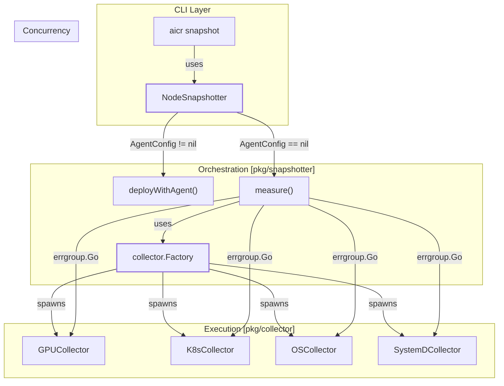
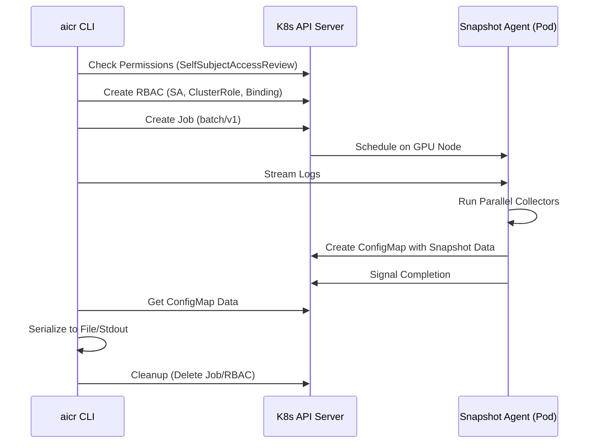

<!-- source: DeepWiki mcp.deepwiki.com · repo NVIDIA/aicr · page 4 Snapshot and Collector System · fetched 2026-10-26 -->

# Snapshot and Collector System

Relevant source files

The following files were used as context for generating this wiki page:

- [pkg/cli/snapshot.go](pkg/cli/snapshot.go)
- [pkg/cli/validate.go](pkg/cli/validate.go)
- [pkg/cli/validate_test.go](pkg/cli/validate_test.go)
- [pkg/collector/factory.go](pkg/collector/factory.go)
- [pkg/collector/factory_test.go](pkg/collector/factory_test.go)
- [pkg/collector/k8s/doc.go](pkg/collector/k8s/doc.go)
- [pkg/collector/k8s/image_test.go](pkg/collector/k8s/image_test.go)
- [pkg/collector/k8s/k8s.go](pkg/collector/k8s/k8s.go)
- [pkg/collector/k8s/server_test.go](pkg/collector/k8s/server_test.go)
- [pkg/k8s/agent/deployer.go](pkg/k8s/agent/deployer.go)
- [pkg/k8s/agent/deployer_test.go](pkg/k8s/agent/deployer_test.go)
- [pkg/k8s/agent/job.go](pkg/k8s/agent/job.go)
- [pkg/k8s/agent/permissions.go](pkg/k8s/agent/permissions.go)
- [pkg/k8s/agent/rbac.go](pkg/k8s/agent/rbac.go)
- [pkg/k8s/agent/types.go](pkg/k8s/agent/types.go)
- [pkg/snapshotter/agent.go](pkg/snapshotter/agent.go)
- [pkg/snapshotter/snapshot.go](pkg/snapshotter/snapshot.go)
- [validators/conformance/pod_autoscaling_check.go](validators/conformance/pod_autoscaling_check.go)

The Snapshot and Collector system is the data-acquisition layer of AICR. It is responsible for gathering a point-in-time representation of a Kubernetes cluster's state, including hardware details (GPUs), OS configuration, kernel parameters, and Kubernetes-native resources. This state is captured as a `Snapshot` object, which serves as the primary input for the Recipe Engine to determine the necessary cluster optimizations.

### System Overview

AICR utilizes a dual-execution model for snapshots:
1.  **Local Mode**: Collectors run directly within the process (typically used for unit testing or when the CLI has direct host access).
2.  **Agent Mode (Standard)**: The CLI deploys a privileged Kubernetes Job (the "Agent") onto a cluster node. This Agent executes the collectors and uploads the resulting `Snapshot` to a `ConfigMap` for the CLI to retrieve.

The system is designed for **parallelism** and **graceful degradation**. If a specific collector fails (e.g., `nvidia-smi` is missing), the system logs the warning and continues, ensuring the snapshot contains as much data as possible [pkg/snapshotter/snapshot.go:109-132]().

### Code Entity Mapping

The following diagram bridges the high-level system concepts to the specific Go types and files that implement them.

**Snapshot System Architecture**

Sources: [pkg/snapshotter/snapshot.go:39-54](), [pkg/snapshotter/snapshot.go:142-150](), [pkg/cli/snapshot.go:157-170]()

---

## NodeSnapshotter and Parallel Collection

The `NodeSnapshotter` is the central orchestrator [pkg/snapshotter/snapshot.go:39-54](). It uses a `collector.Factory` to instantiate various collectors and executes them concurrently using `golang.org/x/sync/errgroup` [pkg/snapshotter/snapshot.go:143-150]().

| Feature | Implementation Detail |
| :--- | :--- |
| **Concurrency** | Uses `errgroup` to run all collectors in parallel to minimize latency [pkg/snapshotter/snapshot.go:143-150](). |
| **Error Handling** | Individual collector failures are caught by `collectSafe`, logged, and skipped to prevent total snapshot failure [pkg/snapshotter/snapshot.go:112-132](). |
| **GPU Enforcement** | If `--require-gpu` is set, the snapshotter validates that `gpu-count > 0` before finishing [pkg/snapshotter/snapshot.go:179-194](). |
| **Metadata** | Automatically captures `source-node` and AICR version information [pkg/snapshotter/snapshot.go:134-140](). |

Sources: [pkg/snapshotter/snapshot.go:35-195]()

---

## Collector Factory Pattern

AICR uses a Factory pattern to decouple the snapshot orchestration from the specific implementation of data collection. This allows for easy dependency injection and testing.

The `collector.Factory` interface defines methods for creating the five primary collector types:
*   **Kubernetes**: Captures server version, node labels, taints, and installed Helm charts.
*   **GPU**: Captures hardware details via `nvidia-smi` and driver versions.
*   **OS**: Gathers kernel modules, sysctl parameters, and `/proc` filesystem data.
*   **SystemD**: Inspects the state of critical host services.
*   **NodeTopology**: Aggregates cluster-wide topology information.

For details on individual collector implementations and the factory interface, see **[Collectors](#4.1)**.

Sources: [pkg/snapshotter/snapshot.go:87-93](), [pkg/snapshotter/snapshot.go:144-148]()

---

## Agent-Based Deployment Model

Because many collectors require host-level access (e.g., `HostPID` for SystemD or device access for GPUs), AICR typically runs as an in-cluster Agent.

The `Deployer` manages the full lifecycle of this agent [pkg/k8s/agent/deployer.go:29-71]():
1.  **Permission Check**: Verifies the user has RBAC rights to create Jobs and ClusterRoles [pkg/k8s/agent/permissions.go:39-103]().
2.  **RBAC Provisioning**: Creates a `ServiceAccount`, `Role`, and `ClusterRole` (named `aicr-node-reader`) [pkg/k8s/agent/rbac.go:45-200]().
3.  **Job Execution**: Deploys a `batch/v1.Job` using the AICR image [pkg/k8s/agent/job.go:68-103]().
4.  **Log Streaming**: Streams the agent's `stdout/stderr` back to the CLI user [pkg/snapshotter/agent.go:155-164]().
5.  **Data Retrieval**: Pulls the final YAML snapshot from a `ConfigMap` populated by the agent [pkg/snapshotter/agent.go:177-183]().

### Security Modes
The Agent supports two security profiles [pkg/k8s/agent/job.go:108-147]():
*   **Privileged (Default)**: Enables `hostPID`, `hostNetwork`, and `privileged: true`. Required for GPU and SystemD collectors.
*   **Restricted**: Runs as a non-root, PSS-compliant pod. Limited to Kubernetes-native collection only.

For details on the Agent lifecycle and RBAC requirements, see **[Snapshot Agent](#4.2)**.

**Agent Lifecycle Flow**

Sources: [pkg/k8s/agent/deployer.go:29-147](), [pkg/snapshotter/agent.go:97-184](), [pkg/k8s/agent/permissions.go:106-123]()

Sources: [pkg/snapshotter/agent.go:43-95](), [pkg/k8s/agent/job.go:108-220]()

---

