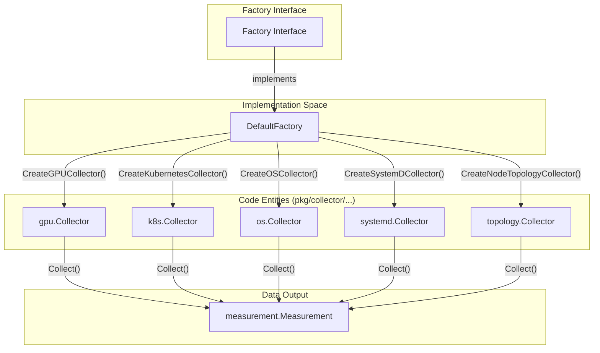
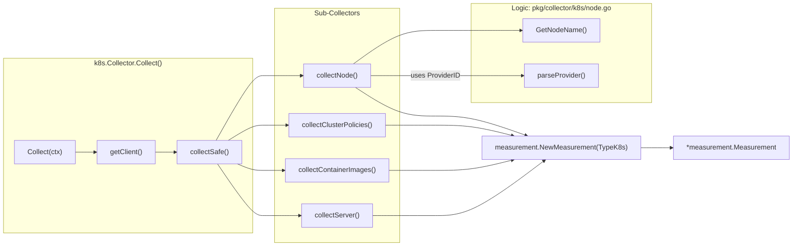

<!-- source: DeepWiki mcp.deepwiki.com · repo NVIDIA/aicr · page 4.1 Collectors · fetched 2026-10-26 -->

# Collectors

Relevant source files

The following files were used as context for generating this wiki page:

- [pkg/bundler/handler_test.go](pkg/bundler/handler_test.go)
- [pkg/collector/factory.go](pkg/collector/factory.go)
- [pkg/collector/factory_test.go](pkg/collector/factory_test.go)
- [pkg/collector/file/file.go](pkg/collector/file/file.go)
- [pkg/collector/k8s/doc.go](pkg/collector/k8s/doc.go)
- [pkg/collector/k8s/image.go](pkg/collector/k8s/image.go)
- [pkg/collector/k8s/image_test.go](pkg/collector/k8s/image_test.go)
- [pkg/collector/k8s/k8s.go](pkg/collector/k8s/k8s.go)
- [pkg/collector/k8s/node.go](pkg/collector/k8s/node.go)
- [pkg/collector/k8s/node_test.go](pkg/collector/k8s/node_test.go)
- [pkg/collector/k8s/server.go](pkg/collector/k8s/server.go)
- [pkg/collector/k8s/server_test.go](pkg/collector/k8s/server_test.go)
- [pkg/collector/os/grub.go](pkg/collector/os/grub.go)
- [pkg/collector/os/grub_test.go](pkg/collector/os/grub_test.go)
- [pkg/collector/os/kmod.go](pkg/collector/os/kmod.go)
- [pkg/collector/os/kmod_test.go](pkg/collector/os/kmod_test.go)
- [pkg/collector/os/release.go](pkg/collector/os/release.go)
- [pkg/collector/os/release_test.go](pkg/collector/os/release_test.go)
- [pkg/collector/topology/topology.go](pkg/collector/topology/topology.go)
- [pkg/collector/topology/topology_test.go](pkg/collector/topology/topology_test.go)
- [pkg/errors/network.go](pkg/errors/network.go)
- [pkg/k8s/agent/wait_test.go](pkg/k8s/agent/wait_test.go)
- [pkg/k8s/pod/job.go](pkg/k8s/pod/job.go)
- [pkg/k8s/pod/job_test.go](pkg/k8s/pod/job_test.go)
- [pkg/k8s/pod/logs_test.go](pkg/k8s/pod/logs_test.go)
- [pkg/k8s/pod/wait_test.go](pkg/k8s/pod/wait_test.go)
- [pkg/serializer/http_test.go](pkg/serializer/http_test.go)

The Collector system is the observation layer of AICR. It is responsible for gathering raw system state from the underlying host and the Kubernetes cluster. These data points, known as `Measurements`, are later used by the Recipe Engine to match criteria and identify missing components.

AICR utilizes a **Factory pattern** and **Dependency Injection** to manage five specialized collector types. This design allows the `aicr` CLI and the in-cluster `aicr-agent` to share the same collection logic while supporting mock implementations for testing.

## Collector Factory and Interface

All collectors implement a common `Collector` interface (which requires a `Collect(context.Context)` method). The `Factory` interface defines the contract for instantiating these collectors with their required dependencies.

### Implementation: DefaultFactory
The `DefaultFactory` is the production implementation that configures collectors with standard dependencies, such as specific SystemD services to monitor (e.g., `containerd`, `docker`, `kubelet`) [pkg/collector/factory.go:56-79]().

| Method | Created Collector | Purpose |
| :--- | :--- | :--- |
| `CreateGPUCollector()` | `gpu.Collector` | Hardware, driver, and CUDA versions. |
| `CreateOSCollector()` | `os.Collector` | Kernel modules, sysctl, and OS release info. |
| `CreateKubernetesCollector()` | `k8s.Collector` | Server version, images, and ClusterPolicies. |
| `CreateSystemDCollector()` | `systemd.Collector` | Service states (Active/Inactive). |
| `CreateNodeTopologyCollector()` | `topology.Collector` | Cluster-wide taints and labels. |

**Sources:** [pkg/collector/factory.go:28-34](), [pkg/collector/factory.go:81-109]()

## The Five Collector Types

### 1. GPU Collector (`nvidia-smi`)
The GPU collector identifies the hardware profile of the node. It typically parses output from NVIDIA utilities to determine:
* GPU Model (e.g., H100, A100).
* Driver Version.
* CUDA Capability.

**Sources:** [pkg/collector/factory.go:81-84]()

### 2. OS Collector (Kernel & System)
The OS collector aggregates data from several sub-collectors to build a `measurement.TypeOS` object [pkg/collector/os/release_test.go:112-120]().
* **Release:** Parses `/etc/os-release` for fields like `ID`, `VERSION_ID`, and `PRETTY_NAME` [pkg/collector/os/release_test.go:150-155]().
* **Kernel Modules (kmod):** Checks for loaded modules (e.g., `nvidia`, `nvidia_uvm`).
* **Sysctl:** Gathers kernel runtime parameters.
* **Grub:** Inspects boot configurations (e.g., IOMMU settings).

**Sources:** [pkg/collector/os/release_test.go:121-134](), [pkg/collector/os/release.go:1-50]()

### 3. Kubernetes Collector
The `k8s.Collector` interacts with the Kubernetes API server. It is designed to **degrade gracefully**; if a specific sub-collection fails (e.g., due to RBAC restrictions), it logs a warning and returns empty data for that subtype rather than failing the entire snapshot [pkg/collector/k8s/k8s.go:38-52]().

* **Server:** Gathers K8s version, platform, and Go version [pkg/collector/k8s/k8s.go:55-57]().
* **Node:** Detects the cloud provider (EKS, GKE, AKS) by parsing the `ProviderID` (e.g., `aws:///...` maps to `eks`) [pkg/collector/k8s/node.go:52-58](), [pkg/collector/k8s/node.go:98-122](). It also collects the container runtime version and kernel version from the node status [pkg/collector/k8s/node.go:60-87]().
* **Image:** Lists container images present on the node.
* **Policy:** Inspects `ClusterPolicy` resources (often used for GPU Operator state).

**Sources:** [pkg/collector/k8s/k8s.go:71-80](), [pkg/collector/k8s/node.go:29-45]()

### 4. SystemD Collector
This collector monitors the state of critical host services. By default, it tracks `containerd.service`, `docker.service`, and `kubelet.service` [pkg/collector/factory.go:65-71](). It reports whether these services are active, which is crucial for identifying nodes with broken runtimes.

**Sources:** [pkg/collector/factory.go:87-91]()

### 5. Node Topology Collector
Unlike the other collectors that usually run locally on a node, the Topology collector looks across the cluster to gather taints and labels [pkg/collector/factory.go:103-108](). This helps AICR understand the distribution of specialized hardware (like InfiniBand or specific GPU SKUs) across the fleet.

**Sources:** [pkg/collector/topology/topology.go:1-40]()

## Data Flow and Error Handling

Collectors utilize `context` for timeout management. For instance, the Kubernetes collector defaults to a specific timeout defined in `defaults.CollectorK8sTimeout` [pkg/collector/k8s/k8s.go:41]().

### Collector Entity Relationship
This diagram shows how the `DefaultFactory` orchestrates the creation of various `Collector` implementations.

Title: Collector Implementation and Factory Mapping

**Sources:** [pkg/collector/factory.go:28-34](), [pkg/collector/factory.go:56-59](), [pkg/collector/k8s/k8s.go:38-40]()

### Kubernetes Sub-Collector Flow
The Kubernetes collector demonstrates the pattern of safe, concurrent sub-collection.

Title: Kubernetes Sub-Collector Data Flow

**Sources:** [pkg/collector/k8s/k8s.go:54-80](), [pkg/collector/k8s/node.go:36-58](), [pkg/collector/k8s/node.go:127-144]()

## Dependency Injection and Testing
The use of the `Factory` interface allows the testing suite to inject fake clients. For example, `pkg/k8s/pod/job_test.go` uses `fake.NewSimpleClientset` to simulate Job completion and failure scenarios without requiring a real cluster [pkg/k8s/pod/job_test.go:103-118]().

**Sources:** [pkg/k8s/pod/job_test.go:31-70](), [pkg/collector/factory_test.go:24-42]()

---

