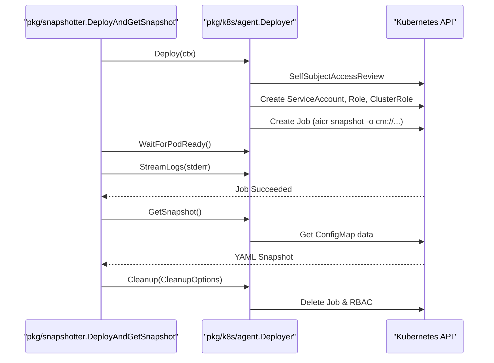
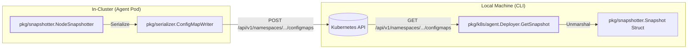

<!-- source: DeepWiki mcp.deepwiki.com · repo NVIDIA/aicr · page 4.2 Snapshot Agent · fetched 2026-10-26 -->

# Snapshot Agent

Relevant source files

The following files were used as context for generating this wiki page:

- [pkg/cli/doc.go](pkg/cli/doc.go)
- [pkg/cli/snapshot.go](pkg/cli/snapshot.go)
- [pkg/cli/validate.go](pkg/cli/validate.go)
- [pkg/cli/validate_test.go](pkg/cli/validate_test.go)
- [pkg/k8s/agent/deployer.go](pkg/k8s/agent/deployer.go)
- [pkg/k8s/agent/deployer_test.go](pkg/k8s/agent/deployer_test.go)
- [pkg/k8s/agent/job.go](pkg/k8s/agent/job.go)
- [pkg/k8s/agent/permissions.go](pkg/k8s/agent/permissions.go)
- [pkg/k8s/agent/rbac.go](pkg/k8s/agent/rbac.go)
- [pkg/k8s/agent/types.go](pkg/k8s/agent/types.go)
- [pkg/snapshotter/agent.go](pkg/snapshotter/agent.go)
- [pkg/snapshotter/agent_test.go](pkg/snapshotter/agent_test.go)
- [pkg/snapshotter/snapshot.go](pkg/snapshotter/snapshot.go)
- [tests/chainsaw/README.md](tests/chainsaw/README.md)
- [tests/chainsaw/snapshot/deploy-agent/assert-configmap.yaml](tests/chainsaw/snapshot/deploy-agent/assert-configmap.yaml)
- [tests/chainsaw/snapshot/deploy-agent/assert-job-complete.yaml](tests/chainsaw/snapshot/deploy-agent/assert-job-complete.yaml)
- [tests/chainsaw/snapshot/deploy-agent/chainsaw-test.yaml](tests/chainsaw/snapshot/deploy-agent/chainsaw-test.yaml)
- [tests/chainsaw/snapshot/deploy-agent/rbac.yaml](tests/chainsaw/snapshot/deploy-agent/rbac.yaml)
- [tests/chainsaw/snapshot/deploy-agent/snapshot-job.yaml](tests/chainsaw/snapshot/deploy-agent/snapshot-job.yaml)
- [validators/conformance/pod_autoscaling_check.go](validators/conformance/pod_autoscaling_check.go)

The Snapshot Agent is an in-cluster component deployed as a Kubernetes `Job` to capture the state of a node and the surrounding cluster. It is the primary mechanism for gathering hardware-level data (GPUs, kernel modules, sysctl) and cluster-wide configuration (Helm charts, ClusterPolicies) without requiring the user to have local tools like `nvidia-smi` or `helm` installed on their workstation.

The agent follows a **deploy-wait-retrieve** lifecycle, where the `aicr` CLI orchestrates the deployment of RBAC and the Job, streams real-time logs to the user, and finally extracts the resulting snapshot from a `ConfigMap`.

## Agent Deployment Lifecycle

The deployment process is managed by the `Deployer` struct in `pkg/k8s/agent/deployer.go`. It ensures that all necessary prerequisites are met before launching the collection task.

### 1. Permission Validation
Before any resources are created, the `Deployer` performs a `SelfSubjectAccessReview` to verify the user has sufficient privileges to create the required RBAC and Job resources [pkg/k8s/agent/permissions.go:39-103]().

### 2. RBAC Provisioning
The agent requires specific permissions to read cluster state and write its results. The following resources are created:
*   **Namespace**: Created if it doesn't exist (defaults to `default`) [pkg/k8s/agent/rbac.go:30-41]().
*   **ServiceAccount**: The identity used by the agent Pod [pkg/k8s/agent/rbac.go:45-55]().
*   **Role & RoleBinding**: Grants permission to `create` and `patch` `ConfigMaps` (to store results) and `list` `Pods` within its namespace [pkg/k8s/agent/rbac.go:58-125]().
*   **ClusterRole & ClusterRoleBinding**: Named `aicr-node-reader`. It grants cluster-wide `get/list` access to `nodes`, `pods`, and `nvidia.com/clusterpolicies` [pkg/k8s/agent/rbac.go:128-200]().

### 3. Job Execution
The `Deployer` creates a Kubernetes `Job` with `backoffLimit: 0` to ensure it does not retry on failure, providing immediate feedback to the user [pkg/k8s/agent/job.go:86-92]().

### 4. Log Streaming and Result Retrieval
While the Job runs, the CLI uses `StreamLogs` to pipe the agent's `stderr` to the user's terminal [pkg/snapshotter/agent.go:149-164](). Once the Job reaches a `Succeeded` state, the CLI retrieves the snapshot data from the `ConfigMap` and performs cleanup [pkg/snapshotter/agent.go:166-184]().

### Code Entity Mapping: Deployment Lifecycle
The following diagram maps the logical deployment steps to the internal Go functions and Kubernetes entities.

**Agent Deployment Flow**

**Sources:** [pkg/snapshotter/agent.go:97-184](), [pkg/k8s/agent/deployer.go:27-72](), [pkg/k8s/agent/job.go:34-65]()

## Pod Security Modes

The agent supports two security profiles depending on the required collectors and the cluster's Pod Security Standards (PSS).

### Privileged Mode (Default)
Required for the **GPU**, **SystemD**, and **OS** collectors. It allows the agent to inspect host-level details by mounting host paths and using host namespaces [pkg/k8s/agent/job.go:149-220]().
*   **Host Namespaces**: `hostPID: true`, `hostNetwork: true`, `hostIPC: true`.
*   **Security Context**: `privileged: true`, `runAsUser: 0`.
*   **Volumes**: Mounts `/run/systemd` and `/etc/os-release` from the host.
*   **Capabilities**: Adds `SYS_ADMIN` and `SYS_CHROOT`.

### Restricted Mode
Triggered by setting `--privileged=false`. This mode is PSS-compliant but limits collection to the **Kubernetes** collector only, as it cannot access host-level hardware or service information [pkg/k8s/agent/job.go:223-255]().
*   **Security Context**: `allowPrivilegeEscalation: false`, `runAsNonRoot: true`, `seccompProfile: RuntimeDefault`.

### GPU Requirements
If `--require-gpu` is specified, the Pod spec is modified to include a resource limit for `nvidia.com/gpu: 1` [pkg/k8s/agent/job.go:167-169](). This is essential in environments using **CDI (Container Device Interface)** where GPU devices are only injected into the container if explicitly requested in the resource requirements [pkg/snapshotter/agent.go:84-87]().

**Sources:** [pkg/k8s/agent/job.go:108-147](), [pkg/k8s/agent/job.go:149-220](), [pkg/snapshotter/agent.go:80-87]()

## Data Flow: Result Retrieval via ConfigMap

The agent does not egress data over the network. Instead, it uses the AICR ConfigMap URI scheme (`cm://<namespace>/<name>`) to write the snapshot to a Kubernetes `ConfigMap` [pkg/k8s/agent/job.go:70]().

### Result Retrieval Process
1.  The Agent Job executes `aicr snapshot -o cm://<ns>/<job-name>`.
2.  The internal `snapshotter` writes the serialized YAML into the `data["snapshot.yaml"]` field of the target ConfigMap.
3.  The `Deployer` on the client-side calls `getSnapshotFromConfigMap` [pkg/k8s/agent/deployer.go:82-84]().
4.  The client-side `aicr` binary reads the ConfigMap, parses the YAML, and returns a `*snapshotter.Snapshot` object for further processing (e.g., by the Recipe engine) [pkg/snapshotter/agent.go:205-230]().

### Code Entity Mapping: Data Retrieval
The following diagram illustrates how the `Deployer` and `Snapshotter` interact with the Kubernetes API to move data from the cluster to the CLI.

**ConfigMap Data Pipeline**

**Sources:** [pkg/snapshotter/agent.go:176-184](), [pkg/k8s/agent/job.go:68-73](), [pkg/snapshotter/snapshot.go:165-172]()

## Configuration Parameters

The agent behavior is controlled via the `AgentConfig` struct, which is populated from CLI flags [pkg/snapshotter/agent.go:43-95]().

| Parameter | CLI Flag | Description |
| :--- | :--- | :--- |
| `Namespace` | `--namespace` | K8s namespace for deployment. |
| `Image` | `--image` | The `aicr` container image to run. |
| `Privileged` | `--privileged` | Enables host-level collectors (default: true). |
| `RequireGPU` | `--require-gpu` | Requests `nvidia.com/gpu` resource for the Pod. |
| `NodeSelector` | `--node-selector` | Targets specific nodes (e.g., `nvidia.com/gpu.present=true`). |
| `Cleanup` | `--no-cleanup` | If false, keeps Job and RBAC for debugging. |
| `Timeout` | `--timeout` | Max time to wait for Job completion. |

**Sources:** [pkg/cli/snapshot.go:73-155](), [pkg/snapshotter/agent.go:43-95]()

---

