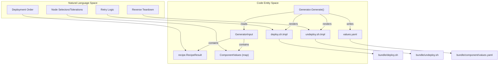
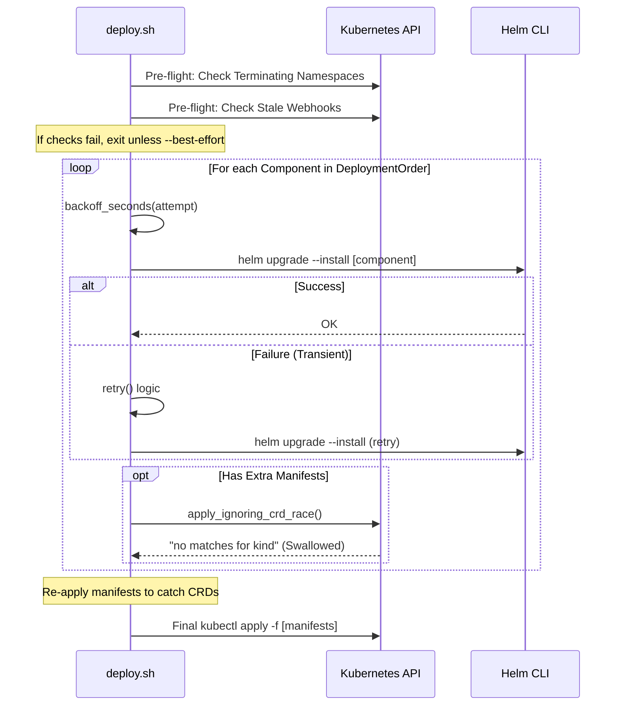

<!-- source: DeepWiki mcp.deepwiki.com · repo NVIDIA/aicr · page 5.1 Helm Deployer · fetched 2026-10-26 -->

# Helm Deployer

<details>
<summary>Relevant source files</summary>

The following files were used as context for generating this wiki page:

- [demos/README.md](demos/README.md)
- [demos/cuj2.md](demos/cuj2.md)
- [demos/examples/CUJ2-Test-Report.md](demos/examples/CUJ2-Test-Report.md)
- [install](install)
- [pkg/bundler/deployer/argocd/argocd.go](pkg/bundler/deployer/argocd/argocd.go)
- [pkg/bundler/deployer/argocd/templates/README.md.tmpl](pkg/bundler/deployer/argocd/templates/README.md.tmpl)
- [pkg/bundler/deployer/helm/helm.go](pkg/bundler/deployer/helm/helm.go)
- [pkg/bundler/deployer/helm/helm_test.go](pkg/bundler/deployer/helm/helm_test.go)
- [pkg/bundler/deployer/helm/templates/README.md.tmpl](pkg/bundler/deployer/helm/templates/README.md.tmpl)
- [pkg/bundler/deployer/helm/templates/component-README.md.tmpl](pkg/bundler/deployer/helm/templates/component-README.md.tmpl)
- [pkg/bundler/deployer/helm/templates/deploy.sh.tmpl](pkg/bundler/deployer/helm/templates/deploy.sh.tmpl)
- [pkg/bundler/deployer/helm/templates/undeploy.sh.tmpl](pkg/bundler/deployer/helm/templates/undeploy.sh.tmpl)
- [recipes/components/cert-manager/values.yaml](recipes/components/cert-manager/values.yaml)

</details>


The Helm deployer is the default deployment mechanism for AICR bundles. It transforms a `RecipeResult` into a structured directory containing Helm `values.yaml` overrides, Kustomize sources, and robust shell scripts (`deploy.sh` and `undeploy.sh`) designed to handle the complexities of deploying AI infrastructure, such as Custom Resource Definition (CRD) races and orphaned webhooks.

## Overview and Directory Structure

The `Generator` in `pkg/bundler/deployer/helm/helm.go` creates a per-component directory structure. Instead of a single monolithic Helm chart, AICR generates a bundle where each component is managed independently, allowing for granular versioning and easier troubleshooting [pkg/bundler/deployer/helm/helm.go:105-111]().

**Generated Structure Example:**
```text
bundle/
├── README.md           # Root instructions and component metadata
├── deploy.sh           # Main deployment orchestrator
├── undeploy.sh         # Teardown script (reverse order)
├── checksums.txt       # SHA256 hashes for all files (optional)
├── gpu-operator/
│   ├── README.md       # Component-specific manual commands
│   ├── values.yaml     # Resolved Helm values for this component
│   └── manifests/      # (Optional) Extra K8s manifests
└── cert-manager/
    ├── README.md
    └── values.yaml
```

### Data Flow: Recipe to Bundle
The `Generator` takes a `GeneratorInput` containing the `RecipeResult` and a map of `ComponentValues` (derived from overlays and node scheduling logic) to produce the output [pkg/bundler/deployer/helm/helm.go:67-88]().

| Entity | Role |
| :--- | :--- |
| `Generator` | Orchestrates the creation of all files and directories [pkg/bundler/deployer/helm/helm.go:114](). |
| `ComponentData` | Intermediate struct used to render templates for each component [pkg/bundler/deployer/helm/helm.go:51-64](). |
| `buildComponentDataList` | Validates component names and sorts them by `DeploymentOrder` [pkg/bundler/deployer/helm/helm.go:213-238](). |

**Sources:** [pkg/bundler/deployer/helm/helm.go:15-111](), [pkg/bundler/deployer/helm/helm_test.go:35-79]()

---

## Deployment Orchestration (`deploy.sh`)

The generated `deploy.sh` script is a robust wrapper around `helm upgrade --install` and `kubectl apply`. It implements several critical patterns for reliable AI cluster setup.

### Retry and Backoff Logic
To handle transient API server errors or network issues during large-scale deployments, the script includes a `retry` function with exponential backoff [pkg/bundler/deployer/helm/templates/deploy.sh.tmpl:61-78]().
* **Default Retries:** 5 attempts [pkg/bundler/deployer/helm/templates/deploy.sh.tmpl:29]().
* **Backoff Calculation:** `attempt * attempt * 5` seconds, capped at 120s [pkg/bundler/deployer/helm/templates/deploy.sh.tmpl:54-59]().

### CRD Race Handling
A common failure mode in Kubernetes is applying a Custom Resource (CR) before its definition (CRD) is fully registered and "Established." The `apply_ignoring_crd_race` function handles this by [pkg/bundler/deployer/helm/templates/deploy.sh.tmpl:102-127]():
1. Attempting `kubectl apply`.
2. Parsing errors for "no matches for kind" or "ensure CRDs are installed first" [pkg/bundler/deployer/helm/templates/deploy.sh.tmpl:85-88]().
3. Swallowing these specific errors during the first pass, knowing that post-install hooks or subsequent components will re-apply them once the CRDs are ready.

### Pre-flight Checks
Before installation, `deploy.sh` verifies cluster health to prevent "deadlock" scenarios [pkg/bundler/deployer/helm/templates/deploy.sh.tmpl:141-184]():
* **Terminating Namespaces:** Checks if namespaces from a previous install are stuck in `Terminating`, which would block new resource creation [pkg/bundler/deployer/helm/templates/deploy.sh.tmpl:149-157]().
* **Stale Webhooks:** Uses `jq` to find Validating/Mutating webhooks pointing to non-existent services. These "fail-closed" webhooks often block the very pods intended to fix them [pkg/bundler/deployer/helm/templates/deploy.sh.tmpl:159-181]().

**Sources:** [pkg/bundler/deployer/helm/templates/deploy.sh.tmpl:1-184]()

---

## Teardown Logic (`undeploy.sh`)

The `undeploy.sh` script performs a clean removal of the stack, focusing on resource ordering and cleaning up cluster-scoped artifacts that Helm often leaves behind.

### Reverse-Order Teardown
Components are uninstalled in the exact reverse order of their deployment to satisfy dependency requirements (e.g., removing workloads before the operators that manage them) [pkg/bundler/deployer/helm/templates/undeploy.sh.tmpl:140-155]().

### Cleanup of Orphaned Resources
Helm's `uninstall` command often leaves behind cluster-scoped resources if they have specific annotations or were created by operators. The script explicitly cleans these:
* **Webhook Cleanup:** `delete_orphaned_webhooks_for_ns` removes webhooks whose backing service namespace is gone or terminating [pkg/bundler/deployer/helm/templates/undeploy.sh.tmpl:90-121]().
* **Finalizer Clearing:** If a namespace is stuck in `Terminating`, `force_clear_namespace_finalizers` patches resources to remove finalizers, allowing the namespace to delete [pkg/bundler/deployer/helm/templates/undeploy.sh.tmpl:124-137]().
* **Cluster Resources:** `delete_release_cluster_resources` identifies CRDs or Webhooks specifically managed by the Helm release and deletes them [pkg/bundler/deployer/helm/templates/undeploy.sh.tmpl:67-84]().

**Sources:** [pkg/bundler/deployer/helm/templates/undeploy.sh.tmpl:1-155]()

---

## Technical Architecture Diagrams

### Deployment Data Flow
This diagram illustrates how the `Generator` consumes `RecipeResult` data and renders the shell scripts and directory structure.


**Sources:** [pkg/bundler/deployer/helm/helm.go:67-111](), [pkg/bundler/deployer/helm/templates/deploy.sh.tmpl:7-15]()

### deploy.sh Execution Lifecycle
This diagram details the runtime behavior of the generated `deploy.sh` script during a cluster installation.


**Sources:** [pkg/bundler/deployer/helm/templates/deploy.sh.tmpl:141-184](), [pkg/bundler/deployer/helm/templates/deploy.sh.tmpl:61-78](), [pkg/bundler/deployer/helm/templates/deploy.sh.tmpl:102-127]()

---

