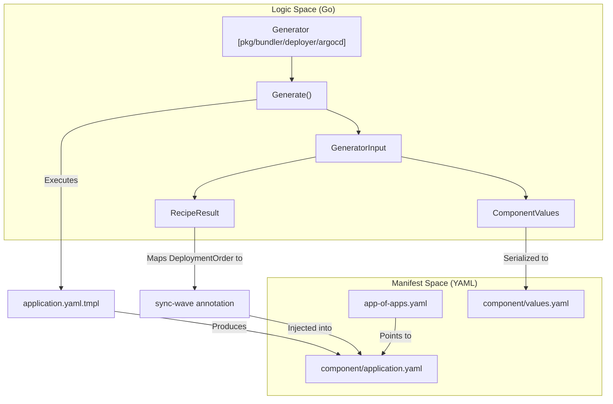
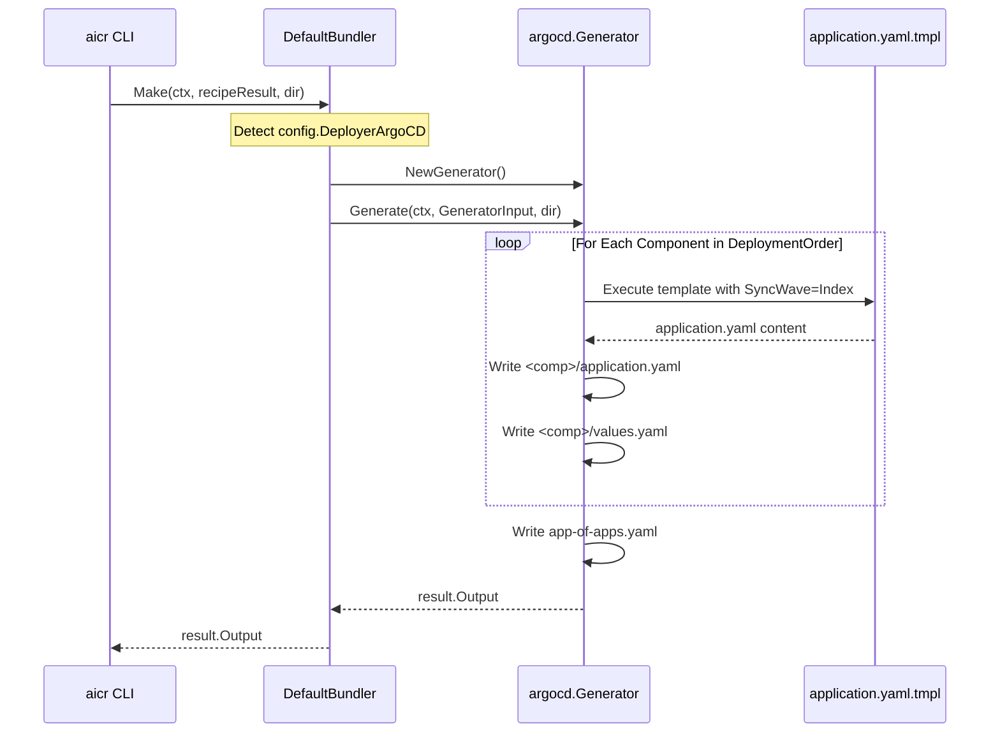

<!-- source: DeepWiki mcp.deepwiki.com · repo NVIDIA/aicr · page 5.2 ArgoCD Deployer · fetched 2026-10-26 -->

# ArgoCD Deployer

<details>
<summary>Relevant source files</summary>

The following files were used as context for generating this wiki page:

- [.yamllint.yaml](.yamllint.yaml)
- [Makefile](Makefile)
- [docs/user/cli-reference.md](docs/user/cli-reference.md)
- [pkg/bundler/bundler.go](pkg/bundler/bundler.go)
- [pkg/bundler/bundler_test.go](pkg/bundler/bundler_test.go)
- [pkg/bundler/config/config.go](pkg/bundler/config/config.go)
- [pkg/bundler/config/config_test.go](pkg/bundler/config/config_test.go)
- [pkg/bundler/deployer/argocd/argocd_test.go](pkg/bundler/deployer/argocd/argocd_test.go)
- [pkg/bundler/deployer/argocd/templates/application.yaml.tmpl](pkg/bundler/deployer/argocd/templates/application.yaml.tmpl)
- [pkg/cli/bundle.go](pkg/cli/bundle.go)
- [pkg/recipe/components.go](pkg/recipe/components.go)
- [pkg/recipe/components_test.go](pkg/recipe/components_test.go)
- [recipes/overlays/eks.yaml](recipes/overlays/eks.yaml)
- [site/.vitepress/config.ts](site/.vitepress/config.ts)
- [site/.vitepress/theme/Landing.vue](site/.vitepress/theme/Landing.vue)
- [site/.vitepress/theme/custom.css](site/.vitepress/theme/custom.css)
- [site/.vitepress/theme/index.ts](site/.vitepress/theme/index.ts)
- [tests/chainsaw/cli/bundle-variants/chainsaw-test.yaml](tests/chainsaw/cli/bundle-variants/chainsaw-test.yaml)

</details>


The ArgoCD deployer is a specialized backend for the AICR bundler that transforms a `RecipeResult` into a GitOps-ready directory structure. It utilizes the **App-of-Apps** pattern to manage multiple components as a single unit, leveraging ArgoCD's native `sync-wave` mechanism to enforce the installation sequence defined in the recipe.

## Overview

While the default Helm deployer generates a `deploy.sh` script for manual or imperative execution, the ArgoCD deployer produces declarative Kubernetes manifests. These manifests allow an ArgoCD controller to reconcile the entire AI stack, including Helm charts and Kustomize components, with proper dependency ordering.

### Key Features
- **App-of-Apps Pattern**: Generates a root `app-of-apps.yaml` that tracks all individual component `Application` manifests [pkg/bundler/deployer/argocd/argocd_test.go:104-111]().
- **Sync-Wave Mapping**: Automatically maps the `DeploymentOrder` from the recipe to `argocd.argoproj.io/sync-wave` annotations [pkg/bundler/deployer/argocd/argocd_test.go:124-143]().
- **Multi-Source Support**: Handles both Helm-based components (using `sources` with a separate values repository) and Kustomize components [pkg/bundler/deployer/argocd/templates/application.yaml.tmpl:10-26]().
- **Value Decoupling**: Separates the component's Helm chart source from the environment-specific `values.yaml` generated by AICR [pkg/bundler/deployer/argocd/templates/application.yaml.tmpl:21-25]().

## Data Flow and Implementation

The deployment generation is triggered when the `DefaultBundler` is configured with `DeployerArgoCD` [pkg/bundler/bundler.go:149-150]().

### Component Association Diagram

This diagram shows how code entities in the `argocd` package map to the generated ArgoCD resources.

Title: ArgoCD Deployer Entity Mapping

Sources: [pkg/bundler/deployer/argocd/argocd_test.go:39-85](), [pkg/bundler/deployer/argocd/templates/application.yaml.tmpl:1-36]()

### Implementation Details

1.  **Sync-Wave Assignment**: The generator iterates through the `RecipeResult.DeploymentOrder`. The index of a component in this list is assigned as its `sync-wave`. For example, the first component receives `sync-wave: "0"`, and the second receives `sync-wave: "1"` [pkg/bundler/deployer/argocd/argocd_test.go:124-143]().
2.  **Multi-Source Application**: For Helm components, the generator uses the ArgoCD "Multiple Sources" feature.
    -   **Source 1**: The upstream Helm repository and chart version defined in the `ComponentRef` [pkg/bundler/deployer/argocd/templates/application.yaml.tmpl:16-20]().
    -   **Source 2**: The Git repository containing the generated `values.yaml`. This is referenced via the `$values` variable in the Helm `valueFiles` section [pkg/bundler/deployer/argocd/templates/application.yaml.tmpl:21-25]().
3.  **Kustomize Support**: If a component is marked as `IsKustomize`, the template switches to a single-source block targeting the specific path and revision [pkg/bundler/deployer/argocd/templates/application.yaml.tmpl:10-15]().

## Directory Structure

When running `aicr bundle --deployer argocd`, the following structure is generated in the output directory:

| File / Directory | Description |
| :--- | :--- |
| `app-of-apps.yaml` | The parent ArgoCD Application that manages all other components. |
| `<component>/` | A directory for each component in the recipe. |
| `<component>/application.yaml` | The ArgoCD Application manifest for the specific component. |
| `<component>/values.yaml` | The computed Helm values (including node scheduling and overrides). |
| `README.md` | Deployment instructions for the ArgoCD bundle. |

Sources: [pkg/bundler/bundler.go:161-166](), [pkg/bundler/deployer/argocd/argocd_test.go:104-111]()

## Execution Logic

The following sequence diagram illustrates how the `DefaultBundler` delegates work to the `argocd.Generator`.

Title: ArgoCD Bundle Generation Sequence

Sources: [pkg/bundler/bundler.go:148-168](), [pkg/bundler/deployer/argocd/argocd_test.go:39-85]()

## Usage

To generate an ArgoCD bundle, use the `--deployer` flag with the `bundle` command:

```bash
aicr bundle \
  --recipe recipe.yaml \
  --deployer argocd \
  --repo https://github.com/org/aicr-bundles.git \
  --output ./my-bundle
```

The `--repo` flag is critical for ArgoCD deployments as it populates the `repoURL` in the `Application` manifests, allowing ArgoCD to find the generated `values.yaml` files once they are pushed to Git [pkg/cli/bundle.go:74](), [pkg/bundler/deployer/argocd/templates/application.yaml.tmpl:23]().

Sources: [docs/user/cli-reference.md:104-113](), [pkg/cli/bundle.go:104-113]()

---

