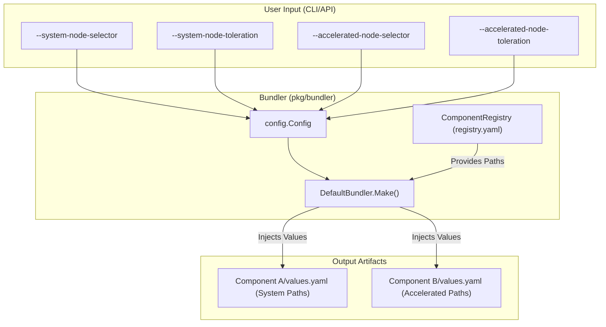
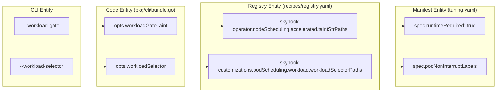

<!-- source: DeepWiki mcp.deepwiki.com · repo NVIDIA/aicr · page 5.3 Node Scheduling Injection · fetched 2026-10-26 -->

# Node Scheduling Injection

<details>
<summary>Relevant source files</summary>

The following files were used as context for generating this wiki page:

- [docs/user/cli-reference.md](docs/user/cli-reference.md)
- [examples/recipes/eks-gb200-ubuntu-training-with-validation.yaml](examples/recipes/eks-gb200-ubuntu-training-with-validation.yaml)
- [examples/recipes/eks-training.yaml](examples/recipes/eks-training.yaml)
- [examples/recipes/kind.yaml](examples/recipes/kind.yaml)
- [pkg/bundler/bundler.go](pkg/bundler/bundler.go)
- [pkg/bundler/bundler_test.go](pkg/bundler/bundler_test.go)
- [pkg/bundler/config/config.go](pkg/bundler/config/config.go)
- [pkg/bundler/config/config_test.go](pkg/bundler/config/config_test.go)
- [pkg/cli/bundle.go](pkg/cli/bundle.go)
- [pkg/recipe/components.go](pkg/recipe/components.go)
- [pkg/recipe/components_test.go](pkg/recipe/components_test.go)
- [recipes/components/kai-scheduler/manifests/disable-runtime-class-injection.yaml](recipes/components/kai-scheduler/manifests/disable-runtime-class-injection.yaml)
- [recipes/components/skyhook-customizations/manifests/no-op.yaml](recipes/components/skyhook-customizations/manifests/no-op.yaml)
- [recipes/components/skyhook-customizations/manifests/tuning.yaml](recipes/components/skyhook-customizations/manifests/tuning.yaml)
- [recipes/overlays/base.yaml](recipes/overlays/base.yaml)
- [recipes/overlays/eks.yaml](recipes/overlays/eks.yaml)
- [recipes/overlays/h100-eks-inference.yaml](recipes/overlays/h100-eks-inference.yaml)
- [recipes/overlays/h100-eks-training.yaml](recipes/overlays/h100-eks-training.yaml)
- [recipes/overlays/monitoring-hpa.yaml](recipes/overlays/monitoring-hpa.yaml)
- [recipes/registry.yaml](recipes/registry.yaml)
- [tests/chainsaw/ai-conformance/cluster/assert-skyhook.yaml](tests/chainsaw/ai-conformance/cluster/assert-skyhook.yaml)
- [tests/chainsaw/ai-conformance/offline/assert-recipe.yaml](tests/chainsaw/ai-conformance/offline/assert-recipe.yaml)
- [tests/chainsaw/bundle-templates/README.md](tests/chainsaw/bundle-templates/README.md)
- [tests/chainsaw/bundle-templates/skyhook-customizations/assert-tuning-defaults.yaml](tests/chainsaw/bundle-templates/skyhook-customizations/assert-tuning-defaults.yaml)
- [tests/chainsaw/bundle-templates/skyhook-customizations/assert-tuning-no-autotaint.yaml](tests/chainsaw/bundle-templates/skyhook-customizations/assert-tuning-no-autotaint.yaml)
- [tests/chainsaw/cli/cuj1-training/assert-recipe.yaml](tests/chainsaw/cli/cuj1-training/assert-recipe.yaml)
- [tests/chainsaw/cli/cuj1-training/mock-snapshot.yaml](tests/chainsaw/cli/cuj1-training/mock-snapshot.yaml)

</details>


The Node Scheduling Injection system in AICR automates the placement of GPU infrastructure components by injecting `nodeSelector` and `toleration` values into Helm charts during the bundle generation phase. This ensures that system controllers run on management nodes while GPU-intensive daemonsets are restricted to accelerated hardware.

## Overview

AICR categorizes scheduling into two primary tiers: **System** and **Accelerated**. The mapping between CLI flags and Helm value paths is governed by a declarative `ComponentRegistry`.

| Tier | CLI Flags | Target Components |
| :--- | :--- | :--- |
| **System** | `--system-node-selector`, `--system-node-toleration` | Operators, controllers, and management webhooks (e.g., `gpu-operator` manager, `cert-manager`). |
| **Accelerated** | `--accelerated-node-selector`, `--accelerated-node-toleration` | GPU-specific daemonsets, drivers, and runtime customizations (e.g., `nvidia-driver-daemonset`, `skyhook` tuning). |

Sources: [pkg/cli/bundle.go:48-51](), [recipes/registry.yaml:32-36]()

## Architecture and Data Flow

The following diagram illustrates how scheduling requirements flow from the user interface through the bundler into the final Helm `values.yaml` files.

### Scheduling Injection Flow

Sources: [pkg/bundler/bundler.go:52-54](), [pkg/cli/bundle.go:148-165](), [recipes/registry.yaml:52-74]()

## Component Registry Configuration

The `recipes/registry.yaml` file defines the specific YAML paths within each component's Helm values where scheduling configuration should be injected. This allows AICR to support diverse Helm chart structures without hardcoded logic.

### Example: GPU Operator Mapping
The GPU Operator requires complex scheduling because it contains both a system controller and multiple accelerated daemonsets.

```yaml
components:
  - name: gpu-operator
    nodeScheduling:
      system:
        nodeSelectorPaths:
          - operator.nodeSelector
          - node-feature-discovery.gc.nodeSelector
        tolerationPaths:
          - operator.tolerations
          - node-feature-discovery.gc.tolerations
      accelerated:
        nodeSelectorPaths:
          - daemonsets.nodeSelector
        tolerationPaths:
          - daemonsets.tolerations
          - node-feature-discovery.worker.tolerations
```
Sources: [recipes/registry.yaml:42-74]()

### The NFD Worker Exception
As noted in [recipes/registry.yaml:65-70](), the `node-feature-discovery.worker` nodeSelector is intentionally **excluded** from accelerated scheduling. NFD workers must run on all nodes (including CPU-only system nodes) to perform hardware discovery. However, they **do** inherit accelerated tolerations to ensure they can deploy onto tainted GPU nodes.

## Workload Gating (Skyhook)

AICR integrates with **Skyhook** to provide a "Workload Gate" mechanism. This prevents workloads from running on nodes until they have been fully initialized and tuned.

### Implementation Details
1.  **Taint Injection**: The `--workload-gate` flag allows users to specify a taint (default: `skyhook.io/runtime-required:NoSchedule`) that is injected into the Skyhook operator configuration.
2.  **Runtime Required**: In the `skyhook-customizations` component, the `tuning.yaml` manifest sets `spec.runtimeRequired: true`.
3.  **Workload Selector**: The `--workload-selector` flag defines which pods are subject to gating, preventing Skyhook from evicting critical system pods during tuning.

### Code-to-Entity Mapping: Workload Gate

Sources: [pkg/cli/bundle.go:168-180](), [recipes/registry.yaml:142-163](), [recipes/components/skyhook-customizations/manifests/tuning.yaml:40-63]()

## Key Functions and Classes

### `pkg/bundler/config`
The `Config` struct holds the parsed node selectors and tolerations.
- `WithSystemNodeSelector(map[string]string)`: Sets the selectors for system components.
- `WithAcceleratedNodeTolerations([]corev1.Toleration)`: Sets the tolerations for hardware-specific components.

### `pkg/bundler/DefaultBundler`
The `Make` method orchestrates the injection process:
1.  Loads the `ComponentRegistry` from `recipes/registry.yaml`.
2.  Iterates through `ComponentRefs` in the `RecipeResult`.
3.  For each component, it lookups the paths defined in the registry.
4.  Deep-merges the CLI-provided values into the component's `values.yaml`.

Sources: [pkg/bundler/bundler.go:52-54](), [pkg/bundler/bundler.go:168-190](), [pkg/cli/bundle.go:40-67]()

---

