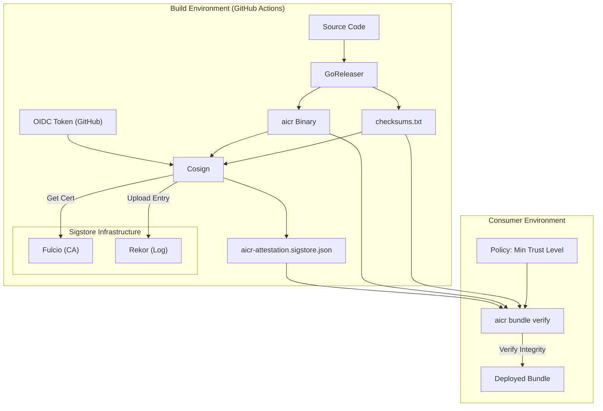

<!-- source: DeepWiki mcp.deepwiki.com · repo NVIDIA/aicr · page 5.4 Bundle Attestation and Supply Chain Security · fetched 2026-10-26 -->

# Bundle Attestation and Supply Chain Security

<details>
<summary>Relevant source files</summary>

The following files were used as context for generating this wiki page:

- [.github/actions/load-versions/action.yml](.github/actions/load-versions/action.yml)
- [.goreleaser.yaml](.goreleaser.yaml)
- [.settings.yaml](.settings.yaml)
- [demos/attestation.md](demos/attestation.md)
- [pkg/bundler/checksum/checksum.go](pkg/bundler/checksum/checksum.go)
- [pkg/bundler/handler.go](pkg/bundler/handler.go)
- [pkg/bundler/verifier/trust.go](pkg/bundler/verifier/trust.go)
- [pkg/bundler/verifier/trust_test.go](pkg/bundler/verifier/trust_test.go)
- [pkg/cli/bundle_verify.go](pkg/cli/bundle_verify.go)
- [pkg/cli/bundle_verify_test.go](pkg/cli/bundle_verify_test.go)
- [pkg/evidence/collector.go](pkg/evidence/collector.go)
- [pkg/evidence/collector_test.go](pkg/evidence/collector_test.go)
- [pkg/logging/cli.go](pkg/logging/cli.go)
- [pkg/manifest/render.go](pkg/manifest/render.go)
- [pkg/oci/push.go](pkg/oci/push.go)
- [tests/chainsaw/cli/bundle-attestation/chainsaw-test.yaml](tests/chainsaw/cli/bundle-attestation/chainsaw-test.yaml)
- [tests/uat/aws/config.yaml](tests/uat/aws/config.yaml)
- [tools/check-tools](tools/check-tools)
- [tools/setup-tools](tools/setup-tools)
- [validators/context.go](validators/context.go)

</details>


AICR implements a robust supply chain security model for its generated bundles, ensuring that deployment artifacts are tamper-proof and traceable to a verified build identity. This is achieved through SLSA Build Provenance, keyless Sigstore signing via Fulcio and Rekor, and automated checksum generation.

## Overview of Supply Chain Security

The security of an AICR bundle relies on three layers of verification:
1.  **Content Integrity**: SHA256 digests of every file in the bundle, stored in `checksums.txt` [[pkg/bundler/checksum/checksum.go:32-35]]().
2.  **Provenance**: A SLSA (Supply Chain Levels for Software Artifacts) predicate that describes how the bundle was built.
3.  **Attestation**: A Sigstore-signed bundle attestation (`aicr-attestation.sigstore.json`) that binds the `checksums.txt` file to a specific OIDC identity (e.g., a GitHub Actions workflow) [[.goreleaser.yaml:42-46]]().

### Data Flow and Artifact Generation

The following diagram illustrates how the `aicr` binary and its associated attestation artifacts are generated and verified.

**Supply Chain Data Flow**

Sources: [[.goreleaser.yaml:19-47]](), [[pkg/bundler/checksum/checksum.go:34-44]](), [[pkg/cli/bundle_verify_test.go:33-35]]()

---

## Checksum Generation

Every AICR bundle includes a `checksums.txt` file. This file contains SHA256 digests for all generated artifacts, including `deploy.sh`, `recipe.yaml`, and component-specific `values.yaml` files [[pkg/bundler/handler.go:55-61]]().

The `GenerateChecksums` function in `pkg/bundler/checksum/checksum.go` iterates through the generated files, computes their raw SHA256 digests using streaming I/O to minimize memory footprint, and writes the results in a format compatible with `sha256sum` [[pkg/bundler/checksum/checksum.go:44-79]]().

### Verification Logic
The `VerifyChecksumsFromData` function performs the following security checks:
- **Digest Comparison**: Re-computes the SHA256 of local files and compares them against the `checksums.txt` entries [[pkg/bundler/checksum/checksum.go:137-146]]().
- **Path Traversal Protection**: Ensures that the relative paths specified in the checksum file do not resolve to locations outside the bundle directory [[pkg/bundler/checksum/checksum.go:121-135]]().

Sources: [[pkg/bundler/checksum/checksum.go:15-185]](), [[pkg/bundler/handler.go:61-61]]()

---

## Keyless Signing and SLSA Provenance

AICR utilizes **Sigstore** for keyless signing, eliminating the need for manual PGP key management. During the release process, `cosign` interacts with **Fulcio** to obtain a short-lived certificate based on the GitHub Actions OIDC identity [[.goreleaser.yaml:42-46]]().

### Release Configuration
The `.goreleaser.yaml` file defines the post-build hook that generates the attestation:
- **Predicate Type**: `https://slsa.dev/provenance/v1` [[.goreleaser.yaml:44-44]]().
- **Artifact**: The resulting signature is stored in `aicr-attestation.sigstore.json` [[.goreleaser.yaml:45-45]]().

### Identity Binding
The attestation binds the build to a specific identity. For official NVIDIA releases, the expected OIDC issuer is `https://token.actions.githubusercontent.com` and the identity matches the release workflow path [[.goreleaser.yaml:190-195]]().

Sources: [[.goreleaser.yaml:37-47]](), [[.goreleaser.yaml:188-196]]()

---

## The `aicr bundle verify` Command

The `aicr bundle verify` command is the primary interface for users to validate the security of a bundle before deployment. It evaluates the bundle against a set of trust policies.

### Verification Phases
1.  **Checksum Verification**: Validates that all files in the bundle match the signed `checksums.txt`.
2.  **Attestation Verification**: Uses `cosign` logic to verify the signature in `aicr-attestation.sigstore.json`.
3.  **Policy Enforcement**: Compares the resulting `TrustLevel` against the user-specified `--min-trust-level` [[pkg/cli/bundle_verify_test.go:33-35]]().

### Code Entity Mapping
The following diagram maps the CLI command components to the internal verification logic.

**Verification Logic Mapping**
```mermaid
classDiagram
    class "bundleVerifyCmd" {
        +String min-trust-level
        +String certificate-identity-regexp
        +Run()
    }
    class "verifier.VerifyResult" {
        +bool ChecksumsPassed
        +bool BundleAttested
        +TrustLevel TrustLevel
        +[]string Errors
    }
    class "checksum.VerifyChecksums" {
        +VerifyChecksums(bundleDir)
    }
    class "verifier.TrustLevel" {
        <<enumeration>>
        TrustUnknown
        TrustUnverified
        TrustVerified
    }

    "bundleVerifyCmd" ..> "checksum.VerifyChecksums" : Invokes
    "bundleVerifyCmd" ..> "verifier.VerifyResult" : Populates
    "verifier.VerifyResult" --> "verifier.TrustLevel" : Contains
```
Sources: [[pkg/cli/bundle_verify_test.go:27-35]](), [[pkg/cli/bundle_verify_test.go:67-127]](), [[pkg/bundler/checksum/checksum.go:90-97]]()

### Trust Levels
The verifier supports multiple trust levels, defaulting to `max` (highest security) [[pkg/cli/bundle_verify_test.go:58-60]]():
- `TrustUnknown`: Verification failed or artifacts are missing.
- `TrustUnverified`: Checksums match, but no valid attestation was found.
- `TrustVerified`: Checksums match and the Sigstore attestation is valid and matches the pinned identity.

Sources: [[pkg/cli/bundle_verify_test.go:15-142]](), [[pkg/bundler/checksum/checksum.go:90-110]]()

---

