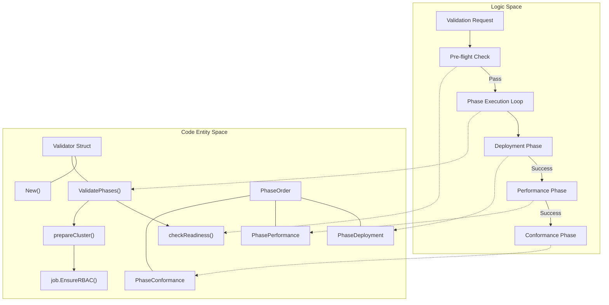
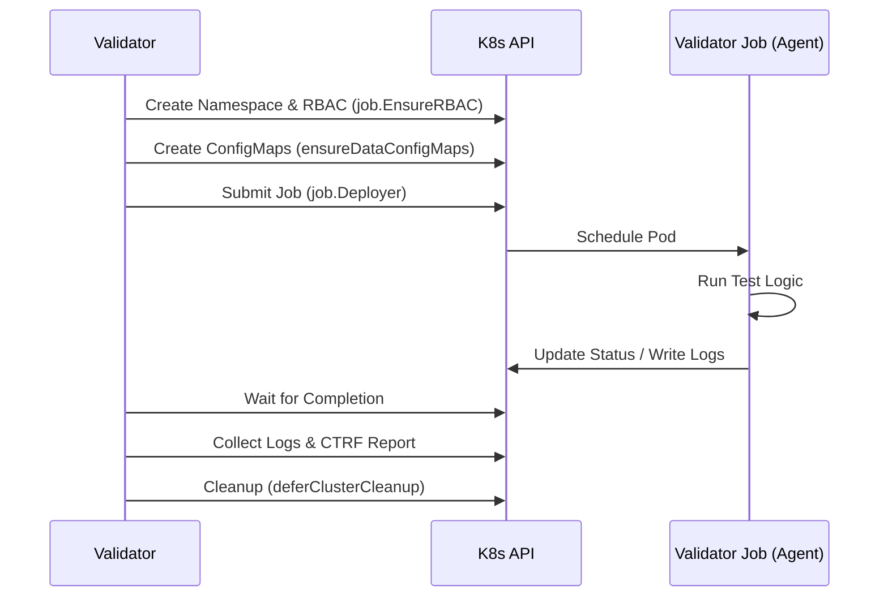

<!-- source: DeepWiki mcp.deepwiki.com · repo NVIDIA/aicr · page 6 Validator · fetched 2026-10-26 -->

# Validator

Relevant source files

The following files were used as context for generating this wiki page:

- [pkg/validator/phases.go](pkg/validator/phases.go)
- [pkg/validator/validator.go](pkg/validator/validator.go)
- [pkg/validator/validator_test.go](pkg/validator/validator_test.go)
- [tests/e2e/run.sh](tests/e2e/run.sh)

The `Validator` is a multi-phase framework designed to verify that a Kubernetes cluster is correctly configured, performing optimally, and compliant with AI infrastructure standards. It operates by executing a series of specialized checks, often as ephemeral Kubernetes Jobs, and aggregating the results into a standardized report format.

The validation process is driven by the `Validator` struct [pkg/validator/validator.go:70-81](), which orchestrates cluster preparation, phase execution, and cleanup.

### Multi-Phase Framework

Validation is organized into distinct phases that follow a mandatory execution order. This sequential approach ensures that foundational issues (like deployment failures) are identified before attempting more complex tests (like performance benchmarks).

| Phase | Description | Code Entity |
| :--- | :--- | :--- |
| **Deployment** | Validates that all recipe components are deployed and healthy. | `PhaseDeployment` |
| **Performance** | Runs GPU performance benchmarks (e.g., NCCL bandwidth). | `PhasePerformance` |
| **Conformance** | Verifies Kubernetes API and AI-specific conformance requirements. | `PhaseConformance` |

The execution order is defined by the `PhaseOrder` slice [pkg/validator/phases.go:36-36](). If a phase fails, the framework short-circuits and skips all subsequent phases [pkg/validator/validator.go:194-200]().

For details, see [Validation Phases and Lifecycle](#6.1).

### Readiness Pre-flight Check

Before deploying any in-cluster resources or containers, the `Validator` performs a **Readiness Check**. This is an "inline" evaluation that compares the top-level constraints defined in a `RecipeResult` against the captured `Snapshot` [pkg/validator/validator.go:46-67]().

If a readiness constraint fails (e.g., the cluster has the wrong GPU type for the selected recipe), the validation process terminates immediately without incurring the overhead of Kubernetes Job creation.

### CTRF Output Format

All validation results are consolidated into the **Common Test Report Format (CTRF)**. This JSON-based schema provides a uniform way to represent test success, failure, and skipping across different types of validators.

*   **Status**: Each phase and individual test is marked as `passed`, `failed`, or `skipped` [pkg/validator/ctrf/ctrf.go]().
*   **Artifacts**: The framework can extract logs and artifacts from validator jobs to include in the final report.

### System Architecture and Code Entities

The following diagram illustrates how the high-level validation concepts map to the internal Go structures and execution logic.

**Validator Logic to Code Entity Mapping**

Sources: [pkg/validator/validator.go:70-81](), [pkg/validator/validator.go:148-166](), [pkg/validator/phases.go:20-36](), [pkg/validator/validator.go:108-110]()

### Deployment and Performance Checks

The built-in validators handle a variety of environment-specific checks:
*   **Deployment**: Discovers Helm values and checks for expected resources like the GPU Operator or `nvidia-smi` availability.
*   **Performance**: Utilizes tools like the Kubeflow Trainer to run NCCL all-reduce tests, ensuring inter-node bandwidth meets the required thresholds for distributed training.

For details, see [Deployment and Performance Checks](#6.2).

### Conformance and Evidence Collection

The Conformance phase is critical for the **CNCF AI Conformance** program. It verifies advanced cluster behaviors such as:
*   **Pod Autoscaling**: Validating HPA functionality using DCGM GPU metrics.
*   **Gang Scheduling**: Ensuring workloads are scheduled together to avoid deadlocks.
*   **Secure Access**: Testing that webhooks correctly reject non-secure accelerator configurations.

For details, see [Conformance Checks](#6.3).

### Job Lifecycle Management

Most validators run as Kubernetes Jobs using the `validator-agent` image. The `job.Deployer` handles the lifecycle of these jobs, including:
1.  **RBAC Provisioning**: Creating the necessary ServiceAccounts and Roles [pkg/validator/validator.go:108-110]().
2.  **Data Mounting**: Injecting the `Snapshot` and `RecipeResult` into the Job via ConfigMaps [pkg/validator/validator.go:112-114]().
3.  **Log Extraction**: Streaming logs from the validator container back to the CLI or API server.
4.  **Cleanup**: Removing ephemeral resources after execution [pkg/validator/validator.go:129-143]().

**Validator Job Execution Flow**

Sources: [pkg/validator/validator.go:93-127](), [pkg/validator/validator.go:129-143](), [pkg/validator/validator.go:202-211]()

For details, see [Validator Agent and Job Management](#6.4).

---

