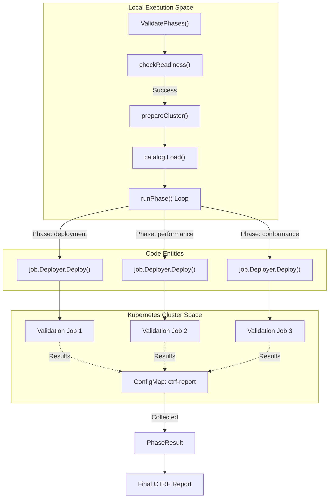
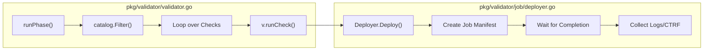

<!-- source: DeepWiki mcp.deepwiki.com · repo NVIDIA/aicr · page 6.1 Validation Phases and Lifecycle · fetched 2026-10-26 -->

# Validation Phases and Lifecycle

Relevant source files

The following files were used as context for generating this wiki page:

- [pkg/component/helpers.go](pkg/component/helpers.go)
- [pkg/manifest/render_test.go](pkg/manifest/render_test.go)
- [pkg/validator/phases.go](pkg/validator/phases.go)
- [pkg/validator/validator.go](pkg/validator/validator.go)
- [pkg/validator/validator_test.go](pkg/validator/validator_test.go)
- [tests/chainsaw/cli/validate-agent-flags/chainsaw-test.yaml](tests/chainsaw/cli/validate-agent-flags/chainsaw-test.yaml)
- [tests/e2e/run.sh](tests/e2e/run.sh)

The `ValidatePhases` orchestration is the core engine of the AICR validation subsystem. It manages the end-to-end lifecycle of cluster validation, ranging from pre-flight readiness checks to the sequential execution of containerized validation jobs across multiple phases.

## Orchestration Overview

The validation lifecycle is managed by the `Validator` struct defined in `pkg/validator/validator.go`. The primary entry point for multi-phase validation is the `ValidatePhases` function [pkg/validator/validator.go:148-153]().

The orchestration follows a strict sequential flow:
1.  **Pre-flight Readiness**: Immediate evaluation of recipe constraints against the cluster snapshot without deploying resources.
2.  **Cluster Preparation**: Provisioning of the validation namespace, RBAC, and data mounting.
3.  **Phase Execution**: Sequential execution of `deployment`, `performance`, and `conformance` phases.
4.  **Short-Circuit Logic**: If a phase fails (returns a `ctrf.StatusFailed`), subsequent phases are skipped to prevent invalid performance or conformance testing on an unstable cluster [pkg/validator/validator.go:194-211]().
5.  **Cleanup**: Automated teardown of all ephemeral Kubernetes resources.

### Validation Lifecycle Flow

The following diagram illustrates the data flow and entity transitions during the `ValidatePhases` execution.

**Validation Lifecycle Orchestration**

Sources: [pkg/validator/validator.go:148-215](), [pkg/validator/phases.go:20-36]()

---

## Pre-flight Readiness Check

Before any Kubernetes `Job` is created, the `Validator` performs a "readiness" check using `checkReadiness` [pkg/validator/validator.go:46-67](). 

This check evaluates the top-level `Constraints` defined in the `RecipeResult` against the provided `Snapshot`. Unlike subsequent phases, this is an **inline evaluation** that does not require container execution [pkg/validator/phases.go:34-35](). If a mandatory constraint (e.g., a minimum GPU count or specific kernel version) is not met, the validator fails fast and returns an `ErrCodeInvalidRequest` [pkg/validator/validator.go:60-62]().

Sources: [pkg/validator/validator.go:46-67](), [pkg/validator/phases.go:34-35]()

---

## Cluster Preparation and RBAC

The `prepareCluster` function [pkg/validator/validator.go:93-97]() initializes the environment required for validation jobs.

| Action | Implementation | Description |
| :--- | :--- | :--- |
| **Namespace Creation** | `ensureNamespace` | Creates the `aicr-validation` namespace (default) [pkg/validator/validator.go:72](). |
| **RBAC Provisioning** | `job.EnsureRBAC` | Configures the `ServiceAccount`, `ClusterRole`, and `ClusterRoleBinding` required for validators to inspect cluster resources [pkg/validator/validator.go:108](). |
| **Data Mounting** | `ensureDataConfigMaps` | Serializes the `Snapshot` and `RecipeResult` into ConfigMaps, which are later mounted as volumes into validation pods [pkg/validator/validator.go:112](). |
| **Informer Startup** | `informers.NewSharedInformerFactory` | Starts a scoped informer factory to monitor the lifecycle of validation Jobs [pkg/validator/validator.go:116-120](). |

Sources: [pkg/validator/validator.go:93-127](), [pkg/validator/validator.go:71-81]()

---

## Phase Filtering and Execution

AICR defines three distinct phases in `pkg/validator/phases.go`:

1.  **`PhaseDeployment`**: Validates that components are deployed and healthy [pkg/validator/phases.go:22]().
2.  **`PhasePerformance`**: Runs GPU performance benchmarks like NCCL all-reduce [pkg/validator/phases.go:25]().
3.  **`PhaseConformance`**: Verifies Kubernetes API conformance (e.g., HPA, DRA, Gang Scheduling) [pkg/validator/phases.go:28]().

The execution order is strictly enforced by `PhaseOrder` [pkg/validator/phases.go:36]().

### Implementation of `runPhase`

The `runPhase` function [pkg/validator/validator.go:245-248]() iterates through the `ValidatorCatalog`. It filters validators based on the current phase and the components present in the `RecipeResult`. For each matching validator, it invokes the `job.Deployer` to execute the check as a Kubernetes Job.

**Validator Execution Logic**

Sources: [pkg/validator/validator.go:245-300](), [pkg/validator/phases.go:20-36]()

---

## Short-Circuit and Cleanup

### Failure Handling
If any validator within a phase results in a `ctrf.StatusFailed`, the `overallFailed` flag is set to true [pkg/validator/validator.go:208-210](). While the remaining checks in the *current* phase may continue (depending on configuration), all *subsequent* phases are immediately marked as `ctrf.StatusSkipped` [pkg/validator/validator.go:194-200]().

### Cleanup Lifecycle
Cleanup is managed by `deferClusterCleanup` [pkg/validator/validator.go:130-132](). Unless disabled via `WithCleanup(false)` [pkg/validator/validator_test.go:59](), the validator performs the following on completion or interrupt:
1.  **RBAC Teardown**: Deletes the validation `ClusterRoleBinding` and `ServiceAccount` via `job.CleanupRBAC` [pkg/validator/validator.go:135]().
2.  **ConfigMap Teardown**: Removes the snapshot and recipe data ConfigMaps [pkg/validator/validator.go:141]().
3.  **Timeout Protection**: Cleanup operations use a dedicated context with `defaults.K8sCleanupTimeout` to ensure they do not hang the CLI [pkg/validator/validator.go:133-140]().

Sources: [pkg/validator/validator.go:130-143](), [pkg/validator/validator.go:194-211](), [pkg/validator/validator_test.go:34-52]()

---

