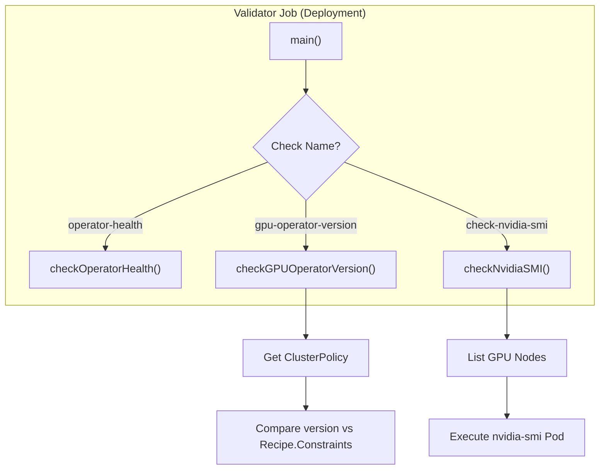
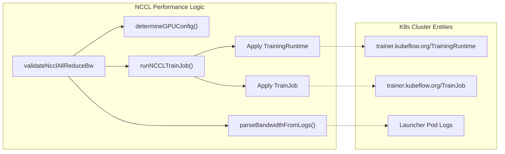

<!-- source: DeepWiki mcp.deepwiki.com · repo NVIDIA/aicr · page 6.2 Deployment and Performance Checks · fetched 2026-10-26 -->

# Deployment and Performance Checks

Relevant source files

The following files were used as context for generating this wiki page:

- [kwok/scripts/validate-scheduling.sh](kwok/scripts/validate-scheduling.sh)
- [recipes/components/gpu-operator/values.yaml](recipes/components/gpu-operator/values.yaml)
- [recipes/components/prometheus-adapter/values.yaml](recipes/components/prometheus-adapter/values.yaml)
- [recipes/overlays/h100-eks-ubuntu-training.yaml](recipes/overlays/h100-eks-ubuntu-training.yaml)
- [recipes/validators/README.md](recipes/validators/README.md)
- [recipes/validators/catalog.yaml](recipes/validators/catalog.yaml)
- [tests/chainsaw/cli/cuj1-training/assert-validate-multiphase.yaml](tests/chainsaw/cli/cuj1-training/assert-validate-multiphase.yaml)
- [tests/chainsaw/cli/snapshot-template/chainsaw-test.yaml](tests/chainsaw/cli/snapshot-template/chainsaw-test.yaml)
- [validators/conformance/inference_gateway_check.go](validators/conformance/inference_gateway_check.go)
- [validators/conformance/robust_controller_check.go](validators/conformance/robust_controller_check.go)
- [validators/conformance/robust_controller_check_test.go](validators/conformance/robust_controller_check_test.go)
- [validators/deployment/main.go](validators/deployment/main.go)
- [validators/performance/nccl_all_reduce_bw_constraint.go](validators/performance/nccl_all_reduce_bw_constraint.go)
- [validators/performance/nccl_test.go](validators/performance/nccl_test.go)
- [validators/performance/testdata/h100/gke/runtime.yaml](validators/performance/testdata/h100/gke/runtime.yaml)

This page details the built-in validation logic used by AICR to verify that a Kubernetes cluster is correctly provisioned for AI workloads (Deployment Phase) and that the underlying hardware and software stack meets performance expectations (Performance Phase). These checks are orchestrated by the `Validator` and executed as sequential Kubernetes Jobs.

## Deployment Phase Validators

The Deployment phase focuses on the "readiness" of the AI stack components defined in the recipe. It ensures that the NVIDIA GPU Operator is functional, drivers are loaded, and the expected hardware resources are visible to the Kubernetes scheduler.

### Key Deployment Checks

| Check Name | Implementation Function | Purpose |
| :--- | :--- | :--- |
| `operator-health` | `checkOperatorHealth` | Verifies that GPU Operator pods (validator, feature-discovery, etc.) are in `Running` state. |
| `expected-resources` | `checkExpectedResources` | Discovers if required CRDs and services (e.g., `clusterpolicies.nvidia.com`) exist. |
| `gpu-operator-version` | `checkGPUOperatorVersion` | Compares the installed GPU Operator version against the recipe's `constraints`. |
| `check-nvidia-smi` | `checkNvidiaSMI` | Executes `nvidia-smi` across all nodes to verify driver-to-GPU communication. |

### Data Flow: Deployment Validation
The deployment validator container is invoked with a specific command-line argument to select the check logic [validators/deployment/main.go:30-37]().

Sources: [validators/deployment/main.go:30-37](), [recipes/validators/catalog.yaml:30-57]()

## Performance Phase Validators

The Performance phase executes synthetic benchmarks to validate the high-speed interconnects (NVLink and InfiniBand/EFA/TCPXo) required for distributed training. Currently, this primarily centers on the **NCCL All-Reduce Bandwidth** check.

### NCCL All-Reduce Bandwidth Check
This check utilizes the [Kubeflow Trainer](https://github.com/kubeflow/trainer) (v1alpha1) to orchestrate an MPI-based NCCL benchmark across multiple nodes [validators/performance/nccl_all_reduce_bw_constraint.go:93-96]().

#### Implementation Details
1.  **Configuration Discovery**: The validator determines the `WorkerCount` and `GPUCountPerNode` from the cluster state [validators/performance/nccl_all_reduce_bw_constraint.go:132-136](). It requires at least 2 nodes to test East-West (EW) fabric [validators/performance/nccl_all_reduce_bw_constraint.go:140-144]().
2.  **Template Selection**: It selects a platform-specific `TrainingRuntime` (e.g., GKE TCPXO vs. EKS EFA) based on the `Recipe.Criteria` [validators/performance/nccl_all_reduce_bw_constraint.go:78-82]().
3.  **Job Execution**: It applies a `TrainJob` resource and waits for the launcher pod to complete [validators/performance/nccl_all_reduce_bw_constraint.go:149-152]().
4.  **Log Parsing**: It uses a regex `ncclBandwidthRe` to extract the bus bandwidth (GB/s) from the `out-of-place` NCCL results [validators/performance/nccl_all_reduce_bw_constraint.go:76-76]().
5.  **Constraint Validation**: The measured bandwidth is compared against the threshold defined in the recipe (e.g., `300 GB/s` for H100 EKS) [recipes/overlays/h100-eks-ubuntu-training.yaml:58-60](). A 10% tolerance is applied [validators/performance/nccl_all_reduce_bw_constraint.go:162-163]().

### Platform-Specific Performance Runtimes
Different cloud providers require specific sidecars and environment variables to achieve peak NCCL performance. For example, GKE requires the `tcpxo-daemon` sidecar and specific NRI device annotations [validators/performance/testdata/h100/gke/runtime.yaml:163-168]().

Sources: [validators/performance/nccl_all_reduce_bw_constraint.go:149-158](), [validators/performance/testdata/h100/gke/runtime.yaml:29-32]()

## Validator Catalog and Configuration

The `catalog.yaml` defines the registry of available checks, their associated OCI images, and execution timeouts [recipes/validators/catalog.yaml:28-65]().

### Image Resolution
To ensure consistency, AICR performs image tag resolution:
*   `:latest` tags in the catalog are replaced with the specific CLI version (e.g., `v0.9.5`) during release builds [recipes/validators/catalog.yaml:21-23]().
*   The `AICR_VALIDATOR_IMAGE_REGISTRY` environment variable can override the registry for air-gapped or local development [recipes/validators/catalog.yaml:26-27]().

### Performance Check Metadata
| Name | Phase | Image | Default Timeout |
| :--- | :--- | :--- | :--- |
| `nccl-all-reduce-bw` | `performance` | `aicr-validators/performance` | 30m |

Sources: [recipes/validators/catalog.yaml:59-65](), [recipes/validators/README.md:26-32]()

## Testing and Validation
AICR uses KWOK (Kubernetes WithOut Kubelet) to simulate GPU nodes and validate that the deployment logic (node selectors, tolerations) correctly targets accelerated hardware [kwok/scripts/validate-scheduling.sh:16-27](). 

The validation output is standardized using the **Common Test Report Format (CTRF)** JSON, which is verified during E2E testing to ensure structured reporting of all check results [tests/chainsaw/cli/cuj1-training/assert-validate-multiphase.yaml:15-24]().

Sources: [kwok/scripts/validate-scheduling.sh:16-27](), [tests/chainsaw/cli/cuj1-training/assert-validate-multiphase.yaml:15-24]()

---

