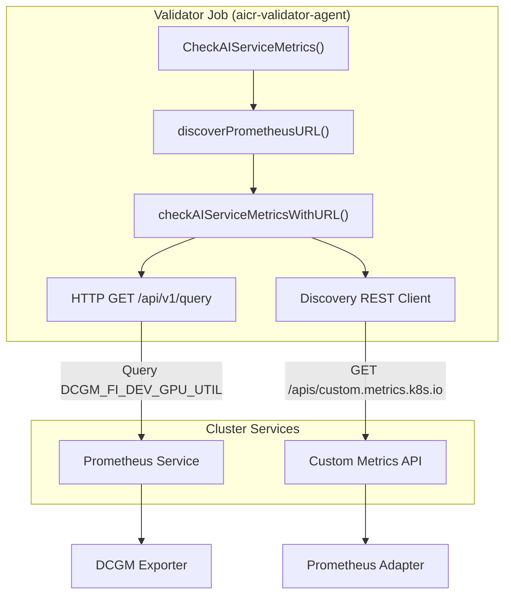
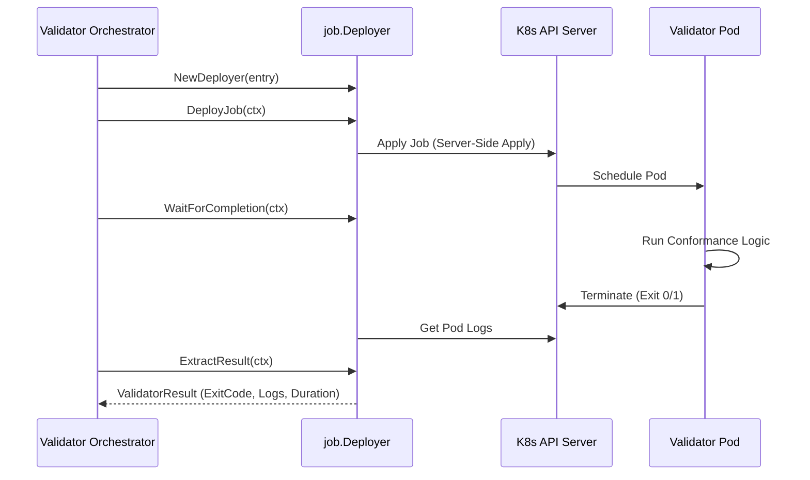

<!-- source: DeepWiki mcp.deepwiki.com · repo NVIDIA/aicr · page 6.3 Conformance Checks · fetched 2026-10-26 -->

# Conformance Checks

Relevant source files

The following files were used as context for generating this wiki page:

- [pkg/defaults/timeouts.go](pkg/defaults/timeouts.go)
- [pkg/defaults/timeouts_test.go](pkg/defaults/timeouts_test.go)
- [pkg/validator/job/deployer.go](pkg/validator/job/deployer.go)
- [pkg/validator/job/deployer_test.go](pkg/validator/job/deployer_test.go)
- [pkg/validator/job/result.go](pkg/validator/job/result.go)
- [pkg/validator/job/result_test.go](pkg/validator/job/result_test.go)
- [recipes/checks/skyhook-customizations/health-check.yaml](recipes/checks/skyhook-customizations/health-check.yaml)
- [validators/conformance/ai_service_metrics_check.go](validators/conformance/ai_service_metrics_check.go)
- [validators/conformance/ai_service_metrics_check_test.go](validators/conformance/ai_service_metrics_check_test.go)
- [validators/conformance/cluster_autoscaling_check.go](validators/conformance/cluster_autoscaling_check.go)
- [validators/conformance/cluster_autoscaling_check_test.go](validators/conformance/cluster_autoscaling_check_test.go)

The Conformance phase of the AICR Validator verifies the functional and operational readiness of an AI cluster against the CNCF AI Conformance requirements. Unlike deployment checks that verify resource existence, conformance checks execute behavioral tests—such as triggering autoscaling events or querying Prometheus for GPU-specific metrics—to ensure the stack is correctly integrated and performing as expected.

## Conformance Validation Areas

The conformance suite covers seven key technical areas, implemented as specialized validator jobs that run within the cluster.

| Area | Requirement | Implementation Detail |
| :--- | :--- | :--- |
| **AI Service Metrics** | CNCF #5 | Verifies DCGM GPU metrics in Prometheus and Custom Metrics API availability. |
| **Cluster Autoscaling** | CNCF #8a | Validates Karpenter NodePools or platform-specific (EKS/GKE) autoscalers. |
| **Pod Autoscaling** | CNCF #8b | Tests HPA functionality using GPU utilization metrics via DCGM. |
| **Secure Access** | CNCF #4 | Ensures non-privileged pods cannot access accelerator resources without authorization. |
| **Robust Controller** | CNCF #12 | Validates that the GPU Operator/Controller correctly rejects invalid configurations. |
| **Inference Gateway** | CNCF #10 | Checks for the presence and health of AI-optimized ingress/gateway controllers. |
| **Gang Scheduling** | CNCF #7 | Verifies co-scheduling of distributed training pods using Volcano or Kueue. |

Sources: [validators/conformance/ai_service_metrics_check.go:36-40](), [validators/conformance/cluster_autoscaling_check.go:61-68]()

## Implementation Architecture

Conformance checks are orchestrated by the `Validator` and executed as Kubernetes `Jobs` via the `Deployer`. Each check runs in a dedicated container with a specific timeout and RBAC profile.

### Conformance Data Flow
The following diagram illustrates how a conformance check (e.g., AI Service Metrics) interacts with cluster components.

**Conformance Logic: AI Service Metrics**

Sources: [validators/conformance/ai_service_metrics_check.go:40-46](), [validators/conformance/ai_service_metrics_check.go:97-106](), [validators/conformance/ai_service_metrics_check.go:157-162]()

## Key Conformance Components

### 1. AI Service Metrics
This check ensures that GPU telemetry is flowing and available for autoscaling.
- **Discovery**: It identifies the Prometheus service by searching for the `kube-prometheus-stack` component in the `RecipeResult` [validators/conformance/ai_service_metrics_check.go:51-66]().
- **Verification**: It queries for `DCGM_FI_DEV_GPU_UTIL` and retries until metrics appear, respecting `defaults.AIServiceMetricsWaitTimeout` [validators/conformance/ai_service_metrics_check.go:104-116]().
- **Custom Metrics**: It validates the `custom.metrics.k8s.io/v1beta1` endpoint to ensure `prometheus-adapter` is functional [validators/conformance/ai_service_metrics_check.go:157-169]().

### 2. Cluster Autoscaling
The validator supports multiple autoscaling providers:
- **Karpenter**: Performs a behavioral test by creating a temporary HPA and Deployment to trigger a NodePool scale-up [validators/conformance/cluster_autoscaling_check.go:73-86]().
- **Platform Fallbacks**: If Karpenter is not found, it detects the platform (EKS/GKE) and verifies the status of Auto Scaling Groups (ASG) or the `cluster-autoscaler-status` ConfigMap [validators/conformance/cluster_autoscaling_check.go:82-85]().

### 3. Job Management and Lifecycle
Each conformance check is managed by the `Deployer` struct, which handles the Kubernetes Job lifecycle.

**Validator Job Lifecycle**

Sources: [pkg/validator/job/deployer.go:43-52](), [pkg/validator/job/deployer.go:84-95](), [pkg/validator/job/result.go:37-50]()

## Timeout and Retry Configuration

Conformance checks often involve asynchronous cluster operations (like pulling large CUDA images or waiting for nodes to join). The system uses a tiered timeout strategy defined in `pkg/defaults/timeouts.go`.

| Constant | Value | Purpose |
| :--- | :--- | :--- |
| `CheckExecutionTimeout` | 10m | Max duration for a single check within a Job [pkg/defaults/timeouts.go:174](). |
| `DRATestPodTimeout` | 5m | Timeout for Dynamic Resource Allocation tests [pkg/defaults/timeouts.go:178](). |
| `GangTestPodTimeout` | 5m | Timeout for co-scheduling verification [pkg/defaults/timeouts.go:182](). |
| `K8sJobCompletionTimeout` | 5m | Orchestrator-side wait for Job termination [pkg/defaults/timeouts.go:85](). |

Sources: [pkg/defaults/timeouts.go:169-182](), [pkg/defaults/timeouts.go:84-85]()

## Result Extraction
The `ExtractResult` function in `pkg/validator/job/result.go` is responsible for collecting the outcome of a conformance check. It retrieves:
1. **Exit Code**: Maps to CTRF status (0=Pass, 1=Fail, 2=Skip) [pkg/validator/job/result.go:61-70]().
2. **Termination Message**: Captured from the pod's `status.containerStatuses[0].state.terminated.message` [pkg/validator/job/result.go:63]().
3. **Logs**: Captures stdout for debugging, truncated to `defaults.ValidatorMaxStdoutLines` [pkg/validator/job/result.go:84-93]().

Sources: [pkg/validator/job/result.go:37-96](), [pkg/validator/job/result_test.go:70-103]()

---

