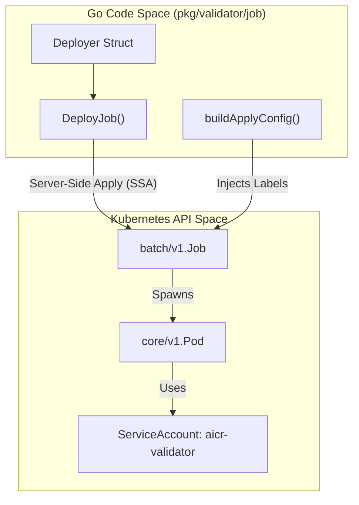
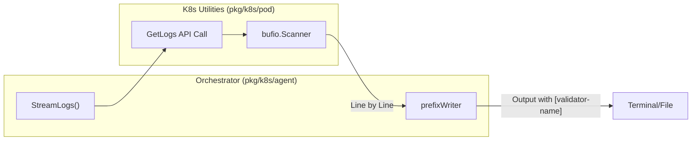

<!-- source: DeepWiki mcp.deepwiki.com · repo NVIDIA/aicr · page 6.4 Validator Agent and Job Management · fetched 2026-10-26 -->

# Validator Agent and Job Management

Relevant source files

The following files were used as context for generating this wiki page:

- [.dockerignore](.dockerignore)
- [pkg/bundler/attestation/oidc.go](pkg/bundler/attestation/oidc.go)
- [pkg/defaults/http.go](pkg/defaults/http.go)
- [pkg/defaults/http_test.go](pkg/defaults/http_test.go)
- [pkg/k8s/agent/wait.go](pkg/k8s/agent/wait.go)
- [pkg/k8s/pod/doc.go](pkg/k8s/pod/doc.go)
- [pkg/k8s/pod/logs.go](pkg/k8s/pod/logs.go)
- [pkg/k8s/pod/wait.go](pkg/k8s/pod/wait.go)
- [pkg/validator/job/deployer.go](pkg/validator/job/deployer.go)
- [pkg/validator/job/deployer_test.go](pkg/validator/job/deployer_test.go)
- [validators/conformance/cluster_autoscaling_check.go](validators/conformance/cluster_autoscaling_check.go)
- [validators/conformance/cluster_autoscaling_check_test.go](validators/conformance/cluster_autoscaling_check_test.go)

The Validator subsystem manages the execution of validation checks within a Kubernetes cluster. It leverages a specialized container image and a dedicated job lifecycle manager to execute checks across three distinct phases: deployment, performance, and conformance.

## Validator Agent Container

The validator agent is a containerized environment designed to execute individual validation checks. It is built using `Dockerfile.validator` and contains the necessary binaries and libraries to interact with the Kubernetes API and hardware-specific tools (like `nvidia-smi`).

### Container Environment
When a validator Job is deployed, the agent container is configured with specific environment variables and volume mounts to facilitate its execution:

*   **Input Data**: The agent receives the cluster `Snapshot` and the resolved `Recipe` via ConfigMap mounts at `/data/snapshot` and `/data/recipe` respectively [pkg/validator/job/deployer.go:177-187]().
*   **Environment Variables**: The `Deployer` injects standard paths such as `AICR_SNAPSHOT_PATH` and `AICR_RECIPE_PATH` so the internal logic knows where to find the input artifacts [pkg/validator/job/deployer.go:197-199]().
*   **Termination Logs**: The container uses `/dev/termination-log` to communicate failure reasons back to the orchestrator [pkg/validator/job/deployer.go:175-176]().

**Sources:** [pkg/validator/job/deployer.go:175-199]()

---

## Job Deployer Lifecycle

The `job.Deployer` struct is responsible for the lifecycle of a single validator Job. It handles name generation, resource provisioning via Server-Side Apply (SSA), and cleanup.

### Implementation Flow
The `Deployer` uses `applyconfigurations` to define the Job manifest, ensuring that fields are managed by the `aicr` manager [pkg/validator/job/deployer.go:88-90]().

#### 1. Name Generation
To avoid collisions between multiple runs or parallel validators, the `Deployer` generates a unique name using a random 4-byte suffix [pkg/validator/job/deployer.go:107-111]().

#### 2. Resource Provisioning
The Job is configured with strict execution constraints:
*   **Timeouts**: Uses `ActiveDeadlineSeconds` based on the `catalog.yaml` entry or a default value [pkg/validator/job/deployer.go:143-144]().
*   **Retries**: `BackoffLimit` is set to `0` to ensure validators do not retry on failure, as validation state should be deterministic [pkg/validator/job/deployer.go:144]().
*   **TTL**: `TTLSecondsAfterFinished` is applied to ensure the Job object is automatically garbage collected by Kubernetes after completion [pkg/validator/job/deployer.go:145]().

### Code Entity Mapping: Job Deployment
The following diagram maps the `Deployer` logic to the resulting Kubernetes entities.

**Sources:** [pkg/validator/job/deployer.go:43-111](), [pkg/validator/job/deployer.go:126-191]()

---

## RBAC and Security

Validators require specific permissions to inspect cluster state or run behavioral tests (e.g., creating a temporary HPA or Deployment for autoscaling checks).

*   **Service Account**: All validator Jobs run under a dedicated `ServiceAccount` defined by the `ServiceAccountName` constant [pkg/validator/job/deployer.go:153]().
*   **Labels**: Jobs and Pods are tagged with `aicr.nvidia.com/validator` and `aicr.nvidia.com/phase` labels to allow for granular RBAC filtering and monitoring [pkg/validator/job/deployer.go:133-151]().
*   **Scheduling**: The `Deployer` applies `preferCPUNodeAffinity` to avoid consuming expensive GPU resources for simple inspection tasks, while allowing `tolerations` for specific hardware constraints [pkg/validator/job/deployer.go:157-158]().

**Sources:** [pkg/validator/job/deployer.go:133-158]()

---

## Wait Logic and Log Extraction

The orchestrator must monitor the Job execution and retrieve logs for debugging or evidence collection. This is handled by the `pkg/k8s/pod` and `pkg/k8s/agent` packages.

### Wait Mechanism
The `Deployer` utilizes a polling and watch-based mechanism to track Job progress:
1.  **WaitForPodReady**: Polls the API server until the Pod enters the `Running` state [pkg/k8s/agent/wait.go:90-125]().
2.  **WaitForJobCompletion**: Monitors the Job status until it reaches a terminal state (`Succeeded` or `Failed`) [pkg/k8s/agent/wait.go:31-33]().

### Log Streaming
Logs can be retrieved in two modes:
*   **Streaming**: Real-time line-by-line transfer using `StreamLogs`, often used for CLI output [pkg/k8s/pod/logs.go:32-63]().
*   **Bulk Retrieval**: Fetching the entire log history after completion via `GetPodLogs` [pkg/k8s/pod/logs.go:68-99]().

### Data Flow: Log Retrieval

**Sources:** [pkg/k8s/agent/wait.go:61-86](), [pkg/k8s/pod/logs.go:1-99]()

---

## Validator Catalog

The `catalog.yaml` (represented by `catalog.ValidatorEntry`) serves as the registry for all available validation checks.

| Field | Description |
| :--- | :--- |
| `Name` | Unique identifier for the validator (e.g., `gpu-operator-health`) |
| `Phase` | The execution phase: `deployment`, `performance`, or `conformance` |
| `Image` | The specific container image to run |
| `Timeout` | Maximum allowed duration before the Job is killed |
| `Args` | Command-line arguments passed to the agent container |
| `Env` | Custom environment variables for the specific check |

### Behavioral Checks example: Cluster Autoscaling
The `CheckClusterAutoscaling` function illustrates a complex validator that interacts with the Kubernetes API to detect and test platform-specific autoscalers (Karpenter, EKS ASG, or GKE CA) [validators/conformance/cluster_autoscaling_check.go:68-110](). It performs discovery, verifies controller health, and can optionally run behavioral tests to verify that new nodes are provisioned in response to GPU demand [validators/conformance/cluster_autoscaling_check.go:171-180]().

**Sources:** [pkg/validator/catalog/catalog.go](), [validators/conformance/cluster_autoscaling_check.go:61-180]()

---

