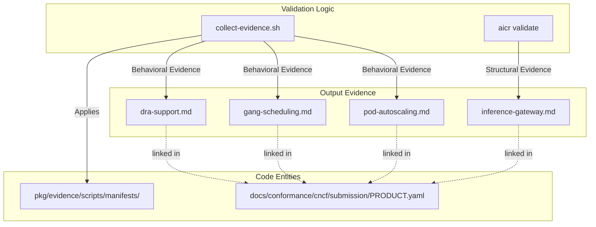
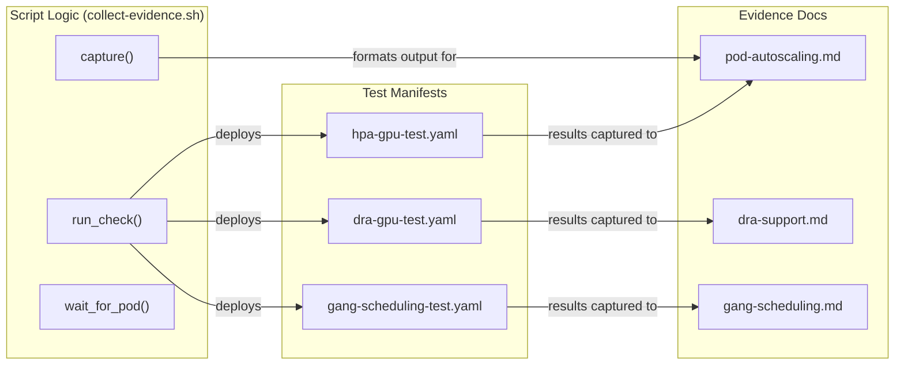

<!-- source: DeepWiki mcp.deepwiki.com · repo NVIDIA/aicr · page 7 CNCF AI Conformance · fetched 2026-10-26 -->

# CNCF AI Conformance

Relevant source files

The following files were used as context for generating this wiki page:

- [docs/conformance/cncf/evidence/accelerator-metrics.md](docs/conformance/cncf/evidence/accelerator-metrics.md)
- [docs/conformance/cncf/evidence/cluster-autoscaling.md](docs/conformance/cncf/evidence/cluster-autoscaling.md)
- [docs/conformance/cncf/evidence/dra-support.md](docs/conformance/cncf/evidence/dra-support.md)
- [docs/conformance/cncf/evidence/gang-scheduling.md](docs/conformance/cncf/evidence/gang-scheduling.md)
- [docs/conformance/cncf/evidence/index.md](docs/conformance/cncf/evidence/index.md)
- [docs/conformance/cncf/evidence/inference-gateway.md](docs/conformance/cncf/evidence/inference-gateway.md)
- [docs/conformance/cncf/evidence/pod-autoscaling.md](docs/conformance/cncf/evidence/pod-autoscaling.md)
- [docs/conformance/cncf/evidence/robust-operator.md](docs/conformance/cncf/evidence/robust-operator.md)
- [docs/conformance/cncf/evidence/secure-accelerator-access.md](docs/conformance/cncf/evidence/secure-accelerator-access.md)
- [docs/conformance/cncf/index.md](docs/conformance/cncf/index.md)
- [docs/conformance/cncf/submission/PRODUCT.yaml](docs/conformance/cncf/submission/PRODUCT.yaml)
- [docs/conformance/cncf/submission/README.md](docs/conformance/cncf/submission/README.md)
- [pkg/evidence/scripts/collect-evidence.sh](pkg/evidence/scripts/collect-evidence.sh)

The NVIDIA AI Cluster Runtime (AICR) provides a standardized framework for achieving and verifying **CNCF AI Conformance**. AICR automates the deployment of the necessary runtime components—such as the GPU Operator, KAI Scheduler, and kgateway—and includes an evidence collection system to prove that a cluster satisfies the specific requirements defined by the CNCF AI Working Group.

## Overview of Conformance Submission

A complete CNCF AI Conformance submission consists of two primary parts: the metadata describing the product and the behavioral evidence demonstrating the features in action. AICR uses the `PRODUCT.yaml` file to map specific conformance IDs (e.g., `dra_support`, `gang_scheduling`) to the evidence generated during cluster validation.

### Evidence Collection Framework
AICR collects evidence through a combination of structural checks and behavioral tests. Structural evidence (e.g., verifying CRDs exist) is generated by the `aicr validate` command. Behavioral evidence (e.g., verifying a GPU workload scales via HPA) is gathered by executing test workloads that stress specific cluster capabilities.

For details on the collection process, see [Evidence Collection](#7.1).

### Submission Metadata
The `PRODUCT.yaml` file serves as the manifest for the submission. It includes metadata about the platform (e.g., Kubernetes version, vendor) and a specification section where each CNCF requirement ID is linked to its corresponding evidence file and implementation notes.

For details on the requirements and formatting, see [Conformance Requirements and Submission](#7.2).

### Relationship between Conformance Entities

The following diagram illustrates how the AICR validation process generates the artifacts required for a CNCF submission.

**Conformance Artifact Generation**

Sources: [pkg/evidence/scripts/collect-evidence.sh:18-25](), [docs/conformance/cncf/submission/PRODUCT.yaml:15-50](), [docs/conformance/cncf/evidence/index.md:14-23]()

---

## Conformance Requirement Areas

AICR addresses eight key requirement areas defined for AI Conformance. Each area is validated by deploying specific components and running verified test manifests.

| Area | Requirement ID(s) | Key Component(s) |
| :--- | :--- | :--- |
| **Accelerators** | `dra_support`, `gpu_sharing` | NVIDIA GPU Operator, DRA Driver |
| **Networking** | `ai_inference` | kgateway (Gateway API) |
| **Scheduling** | `gang_scheduling` | KAI Scheduler (PodGroups) |
| **Observability** | `accelerator_metrics`, `ai_service_metrics` | DCGM Exporter, Prometheus |
| **Autoscaling** | `pod_autoscaling`, `cluster_autoscaling` | Prometheus Adapter, HPA, Cluster Autoscaler |
| **Security** | `secure_accelerator_access` | GPU Operator (mediated access) |
| **Robustness** | `robust_controller` | Dynamo Platform, Kubeflow Trainer |

### Behavioral Evidence Workflow
The behavioral evidence is produced by the `collect_evidence.sh` script, which orchestrates the deployment of test manifests located in `pkg/evidence/scripts/manifests/`. For example, the `pod_autoscaling` requirement is satisfied by deploying a CUDA N-Body simulation and observing the HPA scale the deployment based on `gpu_utilization` metrics.

**Evidence Collection Code Mapping**

Sources: [pkg/evidence/scripts/collect-evidence.sh:50-70](), [pkg/evidence/scripts/collect-evidence.sh:119-134](), [docs/conformance/cncf/evidence/pod-autoscaling.md:58-156](), [docs/conformance/cncf/evidence/dra-support.md:66-129]()

For a deep dive into how these tests are executed and how the Markdown evidence files are structured, see [Evidence Collection](#7.1).

For the full list of requirement IDs and the mapping to the `PRODUCT.yaml` submission format, see [Conformance Requirements and Submission](#7.2).

---

