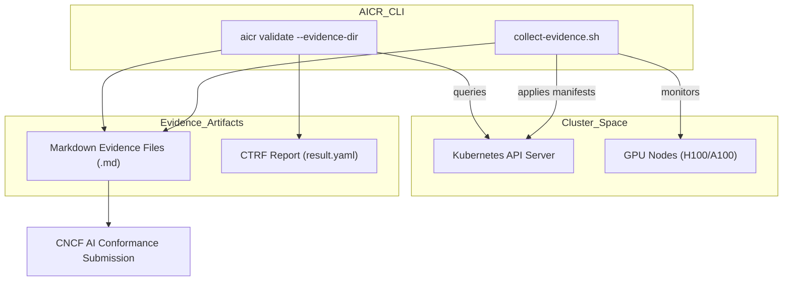
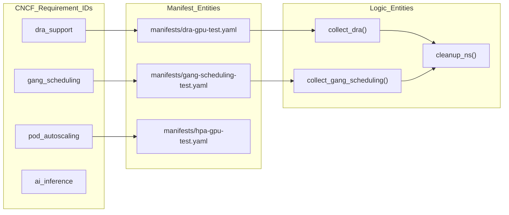

<!-- source: DeepWiki mcp.deepwiki.com · repo NVIDIA/aicr · page 7.1 Evidence Collection · fetched 2026-10-26 -->

# Evidence Collection

Relevant source files

The following files were used as context for generating this wiki page:

- [docs/conformance/cncf/evidence/accelerator-metrics.md](docs/conformance/cncf/evidence/accelerator-metrics.md)
- [docs/conformance/cncf/evidence/cluster-autoscaling.md](docs/conformance/cncf/evidence/cluster-autoscaling.md)
- [docs/conformance/cncf/evidence/dra-support.md](docs/conformance/cncf/evidence/dra-support.md)
- [docs/conformance/cncf/evidence/gang-scheduling.md](docs/conformance/cncf/evidence/gang-scheduling.md)
- [docs/conformance/cncf/evidence/index.md](docs/conformance/cncf/evidence/index.md)
- [docs/conformance/cncf/evidence/inference-gateway.md](docs/conformance/cncf/evidence/inference-gateway.md)
- [docs/conformance/cncf/evidence/pod-autoscaling.md](docs/conformance/cncf/evidence/pod-autoscaling.md)
- [docs/conformance/cncf/evidence/robust-operator.md](docs/conformance/cncf/evidence/robust-operator.md)
- [docs/conformance/cncf/evidence/secure-accelerator-access.md](docs/conformance/cncf/evidence/secure-accelerator-access.md)
- [docs/conformance/cncf/submission/PRODUCT.yaml](docs/conformance/cncf/submission/PRODUCT.yaml)
- [docs/conformance/cncf/submission/README.md](docs/conformance/cncf/submission/README.md)
- [pkg/bundler/checksum/checksum.go](pkg/bundler/checksum/checksum.go)
- [pkg/bundler/handler.go](pkg/bundler/handler.go)
- [pkg/evidence/collector.go](pkg/evidence/collector.go)
- [pkg/evidence/collector_test.go](pkg/evidence/collector_test.go)
- [pkg/evidence/renderer.go](pkg/evidence/renderer.go)
- [pkg/evidence/renderer_test.go](pkg/evidence/renderer_test.go)
- [pkg/evidence/scripts/collect-evidence.sh](pkg/evidence/scripts/collect-evidence.sh)
- [pkg/evidence/templates.go](pkg/evidence/templates.go)
- [pkg/evidence/types.go](pkg/evidence/types.go)
- [pkg/logging/cli.go](pkg/logging/cli.go)
- [pkg/manifest/render.go](pkg/manifest/render.go)
- [pkg/oci/push.go](pkg/oci/push.go)
- [tests/uat/aws/config.yaml](tests/uat/aws/config.yaml)
- [validators/context.go](validators/context.go)

Evidence collection in AICR is a multi-phase process that captures both the structural state of a cluster (via the `aicr validate` command) and the behavioral characteristics of AI workloads (via the `collect-evidence.sh` script). This combined data is used to satisfy the requirements of the CNCF AI Conformance program.

## Overview and Workflow

The evidence collection lifecycle ensures that a cluster not only has the correct components installed but that those components behave as expected under load (e.g., GPUs are allocated, pods scale, and metrics are exported).

1.  **Structural Evidence**: Generated by `aicr validate --evidence-dir`. This captures the presence of CRDs, Pod statuses, and Service configurations [pkg/evidence/scripts/collect-evidence.sh:18-22]().
2.  **Behavioral Evidence**: Generated by `collect-evidence.sh`. This script deploys test workloads (e.g., CUDA N-Body simulations) to trigger and record cluster behaviors like HPA scaling and DRA allocation [pkg/evidence/scripts/collect-evidence.sh:23-24]().

### Data Flow Diagram

The following diagram illustrates how raw cluster data is transformed into Markdown evidence files for conformance submission.

"Evidence Generation Data Flow"

Sources: [pkg/evidence/scripts/collect-evidence.sh:16-30](), [docs/conformance/cncf/evidence/index.md:1-12]()

## The collect-evidence.sh Script

The `collect-evidence.sh` script is the primary engine for behavioral validation. It manages the lifecycle of test workloads, monitors their progress, and captures command outputs into formatted Markdown blocks.

### Key Functions and Logic

| Function | Purpose | Implementation Detail |
| :--- | :--- | :--- |
| `capture` | Formats output | Wraps command output in fenced code blocks and strips local file paths to prevent leaking build environment info [pkg/evidence/scripts/collect-evidence.sh:50-70](). |
| `wait_for_pod` | Sync logic | Polls pod status until `Succeeded` or `Failed`. It includes early exit for unrecoverable errors like `ImagePullBackOff` [pkg/evidence/scripts/collect-evidence.sh:74-97](). |
| `cleanup_ns` | Resource Teardown | Deletes resources in a specific order (Pods → ResourceClaims → Namespace) to prevent stale DRA checkpoints [pkg/evidence/scripts/collect-evidence.sh:139-156](). |
| `run_check` | Orchestration | Executes a collector function and records a `PASS/FAIL/SKIP` status in the runtime results tracker [pkg/evidence/scripts/collect-evidence.sh:119-134](). |

### Behavioral Test Areas

The script executes specific collectors for various conformance requirements:

*   **DRA Support**: Deploys a `ResourceClaim` and a pod requesting a GPU via `deviceClassName: gpu.nvidia.com`. It verifies that `/dev/nvidia*` devices are visible inside the container [docs/conformance/cncf/evidence/dra-support.md:66-129]().
*   **Gang Scheduling**: Uses the **KAI Scheduler** to deploy a `PodGroup` with `minMember: 2`. It ensures both pods are scheduled atomically [docs/conformance/cncf/evidence/gang-scheduling.md:55-143]().
*   **Pod Autoscaling (HPA)**: Deploys a CUDA stress test that forces `gpu_utilization` above 50%, then verifies the HPA scales the deployment replicas [docs/conformance/cncf/evidence/pod-autoscaling.md:58-156]().
*   **Robust Operator**: Validates the **Dynamo Platform** and **Kubeflow Trainer**. It submits invalid manifests to verify that admission webhooks correctly reject malformed resources [docs/conformance/cncf/evidence/robust-operator.md:97-107]().

Sources: [pkg/evidence/scripts/collect-evidence.sh:1-160](), [docs/conformance/cncf/evidence/dra-support.md:1-166](), [docs/conformance/cncf/evidence/gang-scheduling.md:1-170]()

## Code Entity Association

This diagram maps the natural language conformance requirements to the specific manifests and logic used by the evidence collection system.

"Conformance Requirement to Code Mapping"

Sources: [pkg/evidence/scripts/collect-evidence.sh:119-156](), [docs/conformance/cncf/submission/PRODUCT.yaml:38-134]()

## Evidence Artifacts

The collection process produces a set of Markdown files, typically stored in `docs/conformance/cncf/evidence/`. Each file contains:
1.  **Metadata**: Kubernetes version, platform, and timestamp [docs/conformance/cncf/evidence/pod-autoscaling.md:3-6]().
2.  **Summary**: A high-level list of validated features and the final result (PASS/FAIL) [docs/conformance/cncf/evidence/pod-autoscaling.md:13-20]().
3.  **Command Logs**: Actual `kubectl` outputs showing the state of the cluster during the test [docs/conformance/cncf/evidence/accelerator-metrics.md:28-33]().
4.  **Manifests**: The YAML used to trigger the behavior [docs/conformance/cncf/evidence/dra-support.md:67-129]().

### Conformance Summary Table

| Requirement ID | Feature | Evidence File |
| :--- | :--- | :--- |
| `dra_support` | Dynamic Resource Allocation | `dra-support.md` |
| `gang_scheduling` | All-or-nothing scheduling | `gang-scheduling.md` |
| `pod_autoscaling` | HPA with GPU Metrics | `pod-autoscaling.md` |
| `ai_inference` | Gateway API / kgateway | `inference-gateway.md` |
| `robust_controller` | Webhook validation & reconciliation | `robust-operator.md` |

Sources: [docs/conformance/cncf/evidence/index.md:14-24](), [docs/conformance/cncf/submission/PRODUCT.yaml:36-136]()

---

