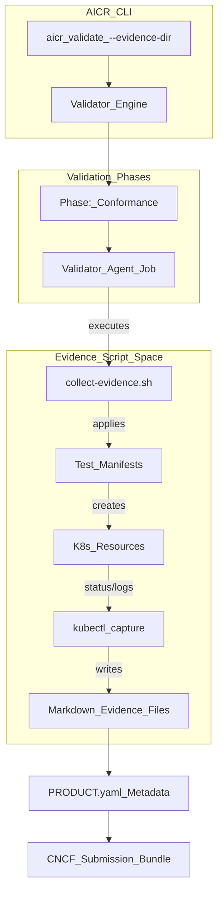
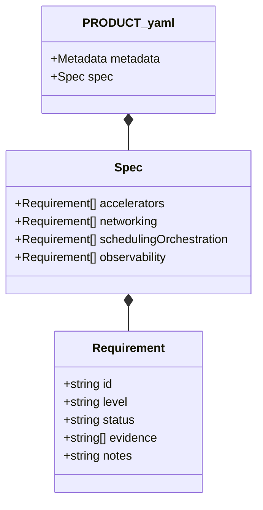

<!-- source: DeepWiki mcp.deepwiki.com · repo NVIDIA/aicr · page 7.2 Conformance Requirements and Submission · fetched 2026-10-26 -->

# Conformance Requirements and Submission

<details>
<summary>Relevant source files</summary>

The following files were used as context for generating this wiki page:

- [docs/conformance/cncf/evidence/accelerator-metrics.md](docs/conformance/cncf/evidence/accelerator-metrics.md)
- [docs/conformance/cncf/evidence/cluster-autoscaling.md](docs/conformance/cncf/evidence/cluster-autoscaling.md)
- [docs/conformance/cncf/evidence/dra-support.md](docs/conformance/cncf/evidence/dra-support.md)
- [docs/conformance/cncf/evidence/gang-scheduling.md](docs/conformance/cncf/evidence/gang-scheduling.md)
- [docs/conformance/cncf/evidence/index.md](docs/conformance/cncf/evidence/index.md)
- [docs/conformance/cncf/evidence/inference-gateway.md](docs/conformance/cncf/evidence/inference-gateway.md)
- [docs/conformance/cncf/evidence/pod-autoscaling.md](docs/conformance/cncf/evidence/pod-autoscaling.md)
- [docs/conformance/cncf/evidence/robust-operator.md](docs/conformance/cncf/evidence/robust-operator.md)
- [docs/conformance/cncf/evidence/secure-accelerator-access.md](docs/conformance/cncf/evidence/secure-accelerator-access.md)
- [docs/conformance/cncf/submission/PRODUCT.yaml](docs/conformance/cncf/submission/PRODUCT.yaml)
- [docs/conformance/cncf/submission/README.md](docs/conformance/cncf/submission/README.md)
- [pkg/evidence/scripts/collect-evidence.sh](pkg/evidence/scripts/collect-evidence.sh)
- [tests/chainsaw/ai-conformance/cluster/assert-cert-manager.yaml](tests/chainsaw/ai-conformance/cluster/assert-cert-manager.yaml)
- [tests/chainsaw/ai-conformance/cluster/assert-crds.yaml](tests/chainsaw/ai-conformance/cluster/assert-crds.yaml)
- [tests/chainsaw/ai-conformance/cluster/assert-dra-driver.yaml](tests/chainsaw/ai-conformance/cluster/assert-dra-driver.yaml)
- [tests/chainsaw/ai-conformance/cluster/assert-dynamo.yaml](tests/chainsaw/ai-conformance/cluster/assert-dynamo.yaml)
- [tests/chainsaw/ai-conformance/cluster/assert-gpu-operator.yaml](tests/chainsaw/ai-conformance/cluster/assert-gpu-operator.yaml)
- [tests/chainsaw/ai-conformance/cluster/assert-kai-scheduler.yaml](tests/chainsaw/ai-conformance/cluster/assert-kai-scheduler.yaml)
- [tests/chainsaw/ai-conformance/cluster/assert-kgateway.yaml](tests/chainsaw/ai-conformance/cluster/assert-kgateway.yaml)
- [tests/chainsaw/ai-conformance/cluster/assert-monitoring.yaml](tests/chainsaw/ai-conformance/cluster/assert-monitoring.yaml)
- [tests/chainsaw/ai-conformance/cluster/assert-namespaces.yaml](tests/chainsaw/ai-conformance/cluster/assert-namespaces.yaml)
- [tests/chainsaw/ai-conformance/cluster/assert-nvsentinel.yaml](tests/chainsaw/ai-conformance/cluster/assert-nvsentinel.yaml)
- [tests/chainsaw/ai-conformance/main.go](tests/chainsaw/ai-conformance/main.go)
- [tests/manifests/dynamo-vllm-smoke-test.yaml](tests/manifests/dynamo-vllm-smoke-test.yaml)

</details>


This page details the technical implementation of the CNCF AI Conformance requirements within the NVIDIA AI Cluster Runtime (AICR). It covers the twelve requirement IDs, the structural metadata required for submission via `PRODUCT.yaml`, and the automated process for generating behavioral and structural evidence.

## CNCF AI Conformance Requirements

AICR implements and validates the following CNCF AI Conformance requirements to ensure a standardized, interoperable environment for AI workloads.

### Requirement IDs and Implementation

| ID | Level | AICR Implementation | Evidence File |
|:---|:---|:---|:---|
| `dra_support` | **MUST** | Enabled via `resource.k8s.io/v1` APIs. Uses NVIDIA DRA driver (controller and kubelet-plugin) to advertise GPUs via `ResourceSlices`. | [dra-support.md]() |
| `gang_scheduling` | **MUST** | Implemented via the KAI Scheduler and `PodGroup` CRDs to ensure all-or-nothing scheduling for distributed training. | [gang-scheduling.md]() |
| `ai_inference` | **MUST** | Supported through the Kubernetes Gateway API using `kgateway` with inference extensions (`InferencePool`, `InferenceModelRewrite`). | [inference-gateway.md]() |
| `robust_controller` | **MUST** | Validated using Dynamo Platform (Inference) and Kubeflow Trainer (Training) with functional admission webhooks. | [robust-operator.md]() |
| `pod_autoscaling` | **MUST** | HPA scaling using custom GPU metrics (e.g., `gpu_utilization`) provided by the Prometheus Adapter and DCGM Exporter. | [pod-autoscaling.md]() |
| `accelerator_metrics` | **SHOULD** | Fine-grained GPU metrics (temp, power, util) exposed by DCGM Exporter in Prometheus format. | [accelerator-metrics.md]() |
| `ai_service_metrics` | **SHOULD** | Monitoring stack (Prometheus/Grafana) configured for automated workload metric discovery. | [accelerator-metrics.md]() |
| `secure_accelerator_access` | **SHOULD** | GPU access mediated through DRA/Device Plugins; no direct `hostPath` mounts to `/dev/nvidia*`. | [secure-accelerator-access.md]() |
| `cluster_autoscaling` | **SHOULD** | Integration with platform-native autoscalers (AWS ASG, GKE Autoscaler) with GPU-aware scaling. | [cluster-autoscaling.md]() |
| `driver_runtime_management` | **SHOULD** | GPU Operator manages the full lifecycle of drivers and runtimes, verified by `nvidia-operator-validator`. | [PRODUCT.yaml:51-67]() |
| `gpu_sharing` | **SHOULD** | Support for MIG (Multi-Instance GPU) hardware partitioning and software time-slicing. | [PRODUCT.yaml:68-90]() |
| `virtualized_accelerator` | **SHOULD** | Support for vGPU deployments managed through the same DRA/Device Plugin framework. | [PRODUCT.yaml:91-107]() |

**Sources:** [docs/conformance/cncf/submission/PRODUCT.yaml:36-136](), [docs/conformance/cncf/evidence/index.md:14-23]()

## Evidence Generation Process

The evidence collection process is split into two categories: **Structural Evidence** (verifying CRDs, Deployments, and API versions) and **Behavioral Evidence** (verifying functional scaling, allocation, and scheduling).

### Behavioral Evidence Collection
The `collect-evidence.sh` script orchestrates the deployment of test workloads to generate markdown-formatted evidence files.

**Behavioral Test Flow**
1. **Namespace Setup**: Creates isolated namespaces (e.g., `dra-test`, `hpa-test`) [pkg/evidence/scripts/collect-evidence.sh:139-156]().
2. **Workload Deployment**: Applies specialized manifests like `hpa-gpu-test.yaml` or `dra-gpu-test.yaml` [docs/conformance/cncf/evidence/pod-autoscaling.md:58-156]().
3. **Wait & Verify**: Uses `wait_for_pod` to monitor terminal phases and `capture` to record command output into `.md` files [pkg/evidence/scripts/collect-evidence.sh:50-97]().
4. **Result Recording**: The `run_check` function parses the output to determine `PASS`/`FAIL` status [pkg/evidence/scripts/collect-evidence.sh:119-134]().

### Evidence Data Flow

The following diagram illustrates how the `aicr` CLI coordinates with the validator and the collection script to produce the final submission artifacts.

**Evidence Collection Architecture**

**Sources:** [pkg/evidence/scripts/collect-evidence.sh:16-25](), [docs/conformance/cncf/evidence/pod-autoscaling.md:58-76](), [docs/conformance/cncf/evidence/dra-support.md:66-83]()

## Submission Format: PRODUCT.yaml

The `PRODUCT.yaml` file serves as the metadata manifest for the CNCF AI Conformance submission. It maps specific requirement IDs to implementation notes and URLs for the evidence generated in the previous step.

### Metadata Schema
The metadata section identifies the product, version, and the underlying conformant Kubernetes platform used for validation.

```yaml
metadata:
  kubernetesVersion: v1.35
  platformName: "NVIDIA AI Cluster Runtime"
  vendorName: "NVIDIA"
  k8sConformanceUrl: "https://github.com/cncf/k8s-conformance/tree/master/v1.35/eks"
```
**Sources:** [docs/conformance/cncf/submission/PRODUCT.yaml:15-34]()

### Requirement Mapping
Each entry in the `spec` section corresponds to a CNCF Requirement ID.

**Code Entity Association**

**Sources:** [docs/conformance/cncf/submission/PRODUCT.yaml:36-136]()

## Verification Examples

### Pod Autoscaling (HPA)
Evidence for `pod_autoscaling` is generated by deploying a CUDA N-Body simulation. The HPA targets `gpu_utilization` with a threshold of 50. The evidence captures the HPA status transition from 1 to 2 replicas when utilization reaches 100%.
**Sources:** [docs/conformance/cncf/evidence/pod-autoscaling.md:133-180]()

### Gang Scheduling (KAI)
Evidence for `gang_scheduling` verifies that the `kai-scheduler` and `PodGroup` CRDs are present. It deploys a group with `minMember: 2`, ensuring that both `gang-worker-0` and `gang-worker-1` are scheduled atomically.
**Sources:** [docs/conformance/cncf/evidence/gang-scheduling.md:71-169]()

### Robust Operator (Dynamo)
Evidence for `robust_controller` includes a "Webhook Rejection Test". The script attempts to submit an invalid `DynamoGraphDeployment` (e.g., missing services) and captures the `Forbidden` error from the admission webhook `vdynamographdeployment.kb.io`.
**Sources:** [docs/conformance/cncf/evidence/robust-operator.md:97-107]()

## Summary of Evidence Artifacts

The final submission consists of:
1.  **PRODUCT.yaml**: The master manifest linking IDs to evidence.
2.  **Evidence Markdown Files**: Individual files for each requirement (e.g., `dra-support.md`, `inference-gateway.md`) containing `kubectl` output, logs, and `PASS` results.
3.  **Cluster State**: Snapshots of CRDs and component health (e.g., `assert-dynamo.yaml`).

**Sources:** [docs/conformance/cncf/evidence/index.md:14-23](), [tests/chainsaw/ai-conformance/cluster/assert-dynamo.yaml:23-41]()

---

